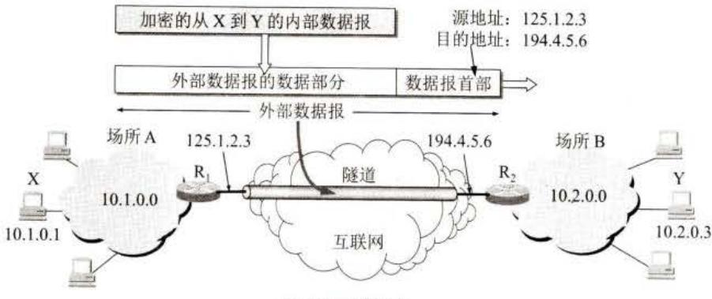
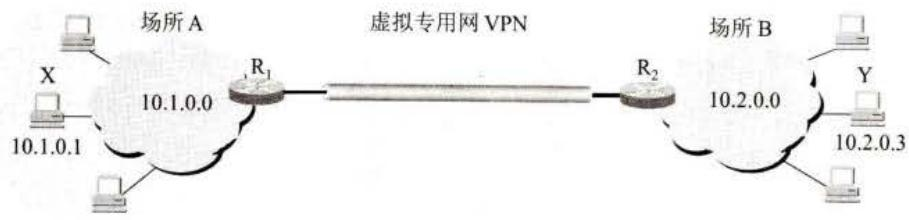

# 4.8.1 虚拟专用网VPN

## 4.8 虚拟专用网 VPN 和网络地址转换 NAT

由于 IP 地址的紧缺，一个机构能够申请到的 IP 地址数往往远小于本机构所拥有的主机数。考虑到互联网并不很安全，一个机构内也并不需要把所有的主机接入到外部的互联网。实际上，在许多情况下，很多主机主要还是和本机构内的其他主机进行通信（例如，在大型商场或宾馆中，有很多用于营业和管理的计算机。显然这些计算机并不都需要和互联网相连）。假定在一个机构内部的计算机通信也是采用 TCP/IP 协议，那么从原则上讲，对于这些仅在机构内部使用的计算机就可以由本机构自行分配其 IP 地址。这就是说，让这些计算机使用仅在本机构有效的 IP 地址（这种地址称为本地地址），而不需要向互联网的管理机构申请全球唯一的 IP 地址（这种地址称为全球地址）。这样就可以大大节约宝贵的全球 IP 地址资源。

但是，如果任意选择一些 IP 地址作为本机构内部使用的本地地址，那么在某种情况下可能会引起一些麻烦。例如，有时机构内部的某台主机需要和互联网连接，那么这种仅在内部使用的本地地址就有可能和互联网中某个 IP 地址重合，这样就会出现地址的二义性问题。

为了解决这一问题，RFC 1918 指明了一些专用地址(private address)。这些地址只能用于一个机构的内部通信，而不能用于和互联网上的主机通信。换言之，专用地址只能用作本地地址而不能用作全球地址。在互联网中的所有路由器，对目的地址是专用地址的数据报一律不进行转发。2013 年 4 月，RFC 6890 全面地给出了所有特殊用途的 IPv4 和 IPv6 地址，但三个 IPv4 专用地址块的指派并无变化，即

(1) 10.0.0.0/8，即从 10.0.0.0 到 10.255.255.255。

(2) 172.16.0.0/12，即从 172.16.0.0 到 172.31.255.255。

(3) 192.168.0.0/16，即从 192.168.0.0 到 192.168.255.255。

上面的三个地址块分别相当于原来的一个 A 类网络、16 个连续的 B 类网络和 256 个连续的 C 类网络。A 类地址本来早已用完了，而上面的地址 10.0.0.0 本来是分配给 ARPANET 的。由于 ARPANET 已经关闭停止运行了，因此这个地址就用作专用地址。

采用这样的专用 IP 地址的互连网络称为专用互联网或本地互联网，或更简单些，就叫作专用网。显然，全世界可能有很多的专用互连网络具有相同的 IP 地址，但这并不会引起麻烦，因为这些专用地址仅在本机构内部使用。专用 IP 地址也叫作可重用地址(reusable address)。

有时一个很大的机构的许多部门分布的范围很广（例如，在世界各地），这些部门经常要互相交换信息。这可以有两种方法。(1) 租用电信公司的通信线路为本机构专用。这种方法虽然简单方便，但线路的租金太高，一般难于承受。(2) 利用公用的互联网作为本机构各专用网之间的通信载体，这样的专用网又称为虚拟专用网 VPN (Virtual Private Network)。

这里之所以称为“专用网”是因为这种网络是为本机构的主机用于机构内部的通信，而不是用于和网络外非本机构的主机通信。如果专用网不同网点之间的通信必须经过公用的互联网，但又有保密的要求，那么所有通过互联网传送的数据都必须加密。加密需要采用的协议将在7.6.1节讨论。“虚拟”表示“好像是”，但实际上并不是，因为现在并没有真正使用通信专线，而VPN只是在效果上和真正的专用网一样。一个机构要构建自己的VPN就必须为它的每一个场所购买专门的硬件和软件，并进行配置，使每一个场所的VPN系统都知道其他场所的地址。

图 4-64 以两个场所为例说明如何使用 IP 隧道技术实现虚拟专用网。

假定某个机构在两个相隔较远的场所建立了专用网 A 和 B，其网络地址分别为专用地址 10.1.0.0 和 10.2.0.0。现在这两个场所需要通过公用的互联网构成一个 VPN。

显然，每一个场所至少要有一个路由器具有合法的全球 IP 地址，如图 4-64(a) 中的路由器 $R_{1}$ 和 $R_{2}$ 。这两个路由器和互联网的接口地址必须是合法的全球 IP 地址。路由器 $R_{1}$ 和 $R_{2}$ 在专用网内部网络的接口地址则是专用网的本地地址。

> (a) 使用隧道技术（教材第 187 页）

> (b) 构成虚拟专用网 图 4-64 用隧道技术实现虚拟专用网（教材第 187 页）

在每一个场所 A 或 B 内部的通信量都不经过互联网。但如果场所 A 的主机 X 要和另一个场所 B 的主机 Y 通信，那么就必须经过路由器 $R_{1}$ 和 $R_{2}$ 。主机 X 向主机 Y 发送的 IP 数据报的源地址是 10.1.0.1，而目的地址是 10.2.0.3。这个数据报先作为本机构的内部数据报从 X 发送到与互联网连接的路由器 $R_{1}$ 。路由器 $R_{1}$ 收到内部数据报后，发现其目的网络必须通过互联网才能到达，就把整个的内部数据报进行加密（这样就保证了内部数据报的安全），然后重新加上数据报的首部，封装成为在互联网上发送的外部数据报，其源地址是路由器 $R_{1}$ 的全球地址 125.1.2.3，而目的地址是路由器 $R_{2}$ 的全球地址 194.4.5.6。路由器 $R_{2}$ 收到数据报后将其数据部分取出进行解密，恢复出原来的内部数据报（目的地址是 10.2.0.3），交付主机 Y。可见，虽然 X 向 Y 发送的数据报通过了公用的互联网，但在效果上就好像是在本部门的专用网上传送一样。如果主机 Y 要向 X 发送数据报，那么所进行的步骤也是类似的。

请注意，数据报从 $R_{1}$ 传送到 $R_{2}$ 可能要经过互联网中的很多个网络和路由器。但从逻辑上看，在 $R_{1}$ 到 $R_{2}$ 之间好像是一条直通的点对点链路，图 4-64(a) 中的“隧道”就是这个意思。

如图 4-64(b) 所示的、由场所 A 和 B 的内部网络所构成的虚拟专用网 VPN 又称为内联网（intranet 或 intranet VPN，即内联网 VPN），表示场所 A 和 B 都属于同一个机构。

有时一个机构的 VPN 需要有某些外部机构（通常就是合作伙伴）参加进来。这样的 VPN 就称为外联网（extranet 或 extranet VPN，即外联网 VPN）。

请注意，内联网和外联网都采用了互联网技术，即都是基于 TCP/IP 协议的。

还有一种类型的 VPN，就是远程接入 VPN (remote access VPN)。我们知道，有的公司可能并没有分布在不同场所的部门，但却有很多流动员工在外地工作。公司需要和他们保持联系，有时还可能一起开电话会议或视频会议。远程接入 VPN 可以满足这种需求。在外地工作的员工通过拨号接入互联网，而驻留在员工个人电脑中的 VPN 软件可以在员工的个人电脑和公司的主机之间建立 VPN 隧道，因而外地员工与公司通信的内容也是保密的，员工

们感到好像就是使用公司内部的本地网络。

关于 VPN 隧道的保密问题，在后面的 7.5.1 节还有进一步的论述。
