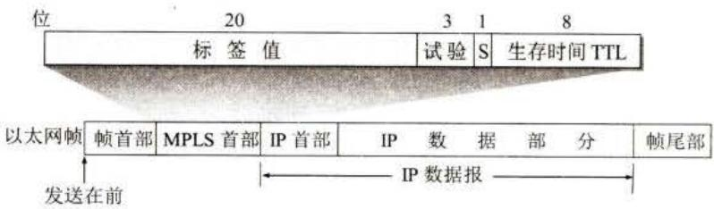

# 4.9.2 MPLS首部的位置与格式

MPLS 并不要求下层的网络都使用面向连接的技术。因此一对 MPLS 路由器之间的物理连接，既可以由一个专用电路组成，如 OC-48 线路，也可以使用像以太网这样的网络。但是这些网络并不提供打标签的手段，而 IPv4 数据报首部也没有多余的位置存放 MPLS 标签。这就需要使用一种封装技术：在把 IP 数据报封装成以太网帧之前，先要插入一个 MPLS 首部。从层次的角度看，MPLS 首部就处在第二层和第三层之间（如图 4-68 所示）。在把加上 MPLS 首部的 IP 数据报封装成以太网帧时，以太网的类型字段在单播的情况下设置为 $8847_{16}$ （下标 16 表示这是十六进制的数字），而在多播的情况下为 $8848_{16}$ 。这样，接收方可以用帧的类型来判决这个帧是携带了 MPLS 标签还是一个常规的 IP 数据报。

> 图 4-68 MPLS 首部的位置（教材第 193 页）

图 4-69 给出了 MPLS 首部的格式。可见 “给 IP 数据报打上标签” 其实就是在以太网的帧首部和 IP 数据报的首部之间插入一个 4 字节的 MPLS 首部。具体的标签就在 “标签值” 这个字段中。

> 图 4-69 MPLS 首部的格式（教材第 193 页）

MPLS 首部共包括以下四个字段：

(1) 标签值 占 20 位。由于一个 MPLS 标签占 20 位，因此从理论上讲，在设置 MPLS 时可以使用标签的所有 20 位，因而可以同时容纳高达 $2^{20}$ 个流（即 1048576 个流）。但是，实际上几乎没有哪个 MPLS 实例会使用很大数目的流，因为通常需要管理员人工管理和设置每条交换路径。

(2) 试验 占 3 位，目前保留用于试验。

(3) S 占 1 位，S(Stack)表示栈，在有“标签栈”时使用。

(4) 生存时间 TTL 占 8 位，用来防止 MPLS 分组在 MPLS 域中兜圈子。
