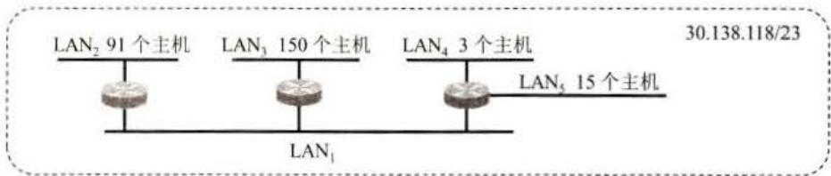
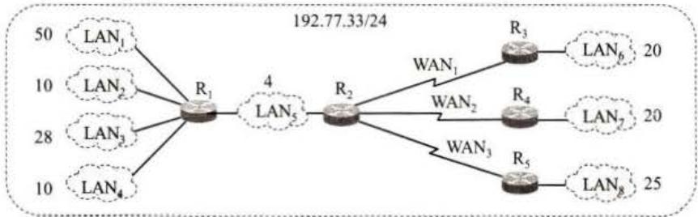
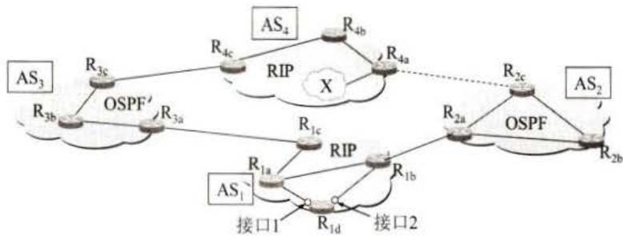
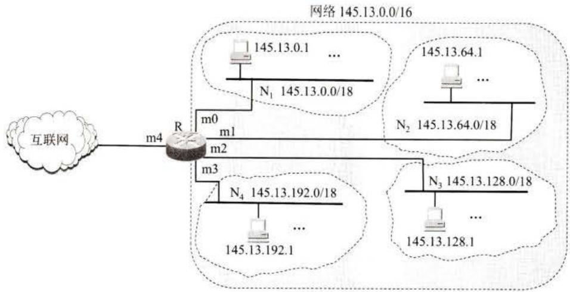
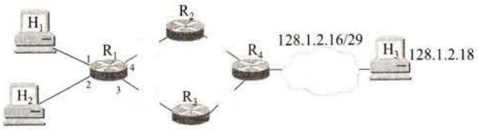
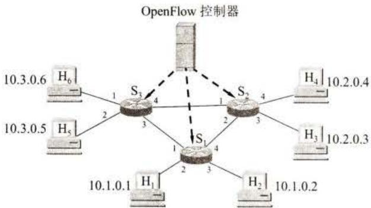

# 第4章 习题

4-01 网络层向上提供的服务有哪两种？试比较其优缺点。

4-02 网络互连有何实际意义？进行网络互连时，有哪些共同的问题需要解决？

4-03 作为中间设备，转发器、网桥、路由器和网关有何区别？

4-04 试简单说明下列协议的作用：

IP, ARP 和 ICMP。

4-05 IP地址如何表示？

4-06 IP 地址的主要特点是什么？

4-07 试说明 IP 地址与 MAC 地址的区别。为什么要使用这两种不同的地址？

4-08 IP 地址方案与我国的电话号码体制的主要不同点是什么？

4-09 IP 数据报中的首部检验和并不检验数据报中的数据。这样做的最大好处是什么？坏处是什么？

4-10 当某个路由器发现一 IP 数据报的检验和有差错时，为什么采取丢弃的办法而不是要求源站重传此数据报？计算首部检验和为什么不采用 CRC 检验码？

4-11 设 IP 数据报使用固定首部，其各字段的具体数值如图 4-76 所示（除 IP 地址外，均为十进制形式表示）。试用二进制运算方法计算应当写入到首部检验和字段中的数值（用二进制形式表示）。

> 图4-76 习题4-11的图 4-12 重新计算上题，但使用十六进制运算方法（每16位二进制数字转换为4个十六进制数字，再按十六进制加法规则计算）。比较这两种方法。 4-13 什么是最大传送单元 MTU？它和 IP 数据报首部中的哪个字段有关系？ 4-14 在互联网中将 IP 数据报分片传送的数据报在最后的目的主机进行组装。还可以有另一种做法，即数据报分片通过一个网络就进行一次组装。试比较这两种方法的优劣。（教材第 203 页）

| 4 | 5 | 0 | 28 |
| --- | --- | --- | --- |
| 1 | 0 | 0 |  |
| 4 | 17 | 首部检验和(待计算后写入) |  |
| 10.12.14.5 |  |  |  |
| 12.6.7.9 |  |  |  |

> 4-15 一个3200位长的TCP报文传到IP层，加上160位的首部后成为数据报。下面的互联网由两个局域网通过路由器连接起来，但第二个局域网所能传送的最长数据帧中的数据部分只有1200位，因此数据报在路由器必须进行分片。试问第二个局域网向其上层要传送多少比特的数据（这里的“数据”当然指的是局域网看见的数据）？ 4-16 (1) 试解释为什么 ARP 高速缓存每存入一个项目就要设置 10～20 分钟的超时计时器。这个时间设置得太大或太小会出现什么问题？ (2) 举出至少两种不需要发送 ARP 请求分组的情况（即不需要请求将某个目的 IP 地址解析为相应的 MAC 地址）。 4-17 主机 A 发送 IP 数据报给主机 B，途中经过了 5 个路由器。试问在 IP 数据报的发送过程中总共使用了几次 ARP? 4-18 设某路由器建立了如下转发表：（教材第 203 页）

| 前缀匹配 | 下一跳 |
| --- | --- |
| 192.4.153.0/26 | $R_{3}$ |
| 128.96.39.0/25 | 接口 m0 |
| 128.96.39.128/25 | 接口 m1 |
| 128.96.40.0 /25 | $R_{2}$ |
| 192.4.153.0/26 | $R_{3}$ |
| *(默认) | $R_{4}$ |

现共收到 5 个分组，其目的地址分别为：

(1) 128.96.39.10(2) 128.96.40.12 (3) 128.96.40.151 (4) 192.4.153.17 (5) 192.4.153.90 试分别计算其下一跳。

4-19 某单位分配到一个地址块 129.250/16。该单位有 4000 台机器，平均分布在 16 个不同的地点。试给每一个地点分配一个地址块，并算出每个地址块中 IP 地址的最小值和最大值。

4-20 一个数据报长度为 4000 字节（固定首部长度）。现在经过一个网络传送，但此网络能够传送的最大数据长度为 1500 字节。试问应当划分为几个短些的数据报片？各数据报片的数据字段长度、片偏移字段和 MF 标志应为何数值？

4-21 写出互联网的 IP 层查找路由的算法。

4-22 有如下的4个/24地址块，试进行最大可能的聚合。212.56.132.0/24 212.56.133.0/24 212.56.134.0/24 212.56.135.0/24

4-23 有两个 CIDR 地址块 208.128/11 和 208.130.28/22。是否有哪一个地址块包含了另一个的地址？如果有，请指出，并说明理由。

4-24 已知路由器 $\mathbb{R}_1$ 的转发表如表4-10所示。

> 表 4-10 习题 4-24 中路由器 ${\mathrm{R}}_{1}$ 的转发表（教材第 204 页）

| 前缀匹配 | 下一跳地址 | 路由器接口 |
| --- | --- | --- |
| 140.5.12.64/26 | 180.15.2.5 | m2 |
| 130.5.8/24 | 190.16.6.2 | m1 |
| 110.71/16 | ... | m0 |
| 180.15/16 | ... | m2 |
| 190.16/16 | ... | m1 |
| 默认 | 110.71.4.5 | m0 |

试画出各网络和必要的路由器的连接拓扑，标注出必要的 IP 地址和接口。对不能确定的情况应当指明。

4-25 一个自治系统分配到的 IP 地址块为 30.138.118/23，并包含有 5 个局域网，其连接图如图 4-77 所示，每个局域网上的主机数分别标注在图 4-77 上。试给出每一个局域网的地址块（包括前缀）。

> 图4-77 习题4-25的图（教材第 204 页）

4-26 一个大公司有一个总部和三个下属部门。公司分配到的网络前缀是 192.77.33/24。公司的网络布局如图 4-78 所示。总部共有 5 个局域网，其中的 LAN $_{1}$ \~ LAN $_{4}$ 都连接到路由器 R $_{1}$ 上，R $_{1}$ 再通过 LAN $_{5}$ 与路由器 R $_{2}$ 相连。R $_{2}$ 和远地的三个部门的局域网 LAN $_{6}$ \~ LAN $_{8}$ 通过广域网相连。每一个局域网旁边标明的数字是局域网上的主机数。试给每一个局域网分配一个合适的网络前缀。

> 图4-78 习题4-26的图（教材第 205 页）

4-27 以下地址中的哪一个和86.32/12匹配？请说明理由。(1) 86.33.224.123; (2) 86.79.65.216; (3) 86.58.119.74; (4) 86.68.206.154。

4-28 以下的地址前缀中的哪一个地址与 2.52.90.140 匹配？请说明理由。

4-29 下面的前缀中的哪一个和地址 152.7.77.159 及 152.31.47.252 都匹配？请说明理由。(1) 152.40/13; (2) 153.40/9; (3) 152.64/12; (4) 152.0/11。

4-30 与下列掩码相对应的网络前缀各有多少位？(1) 192.0.0.0; (2) 240.0.0.0; (3) 255.224.0.0; (4) 255.255.255.252。

4-31 已知地址块中的一个地址是 140.120.84.24/20。试求这个地址块中的最小地址和最大地址。地址掩码是什么？地址块中共有多少个地址？相当于多少个 C 类地址？

4-32 已知地址块中的一个地址是 190.87.140.202/29。重新计算上题。

4-33 某单位分配到一个地址块 136.23.12.64/26。现在需要进一步划分为 4 个一样大的子网。试问：

(1) 每个子网的网络前缀有多长？

(2) 每一个子网中有多少个地址？

(3) 每一个子网的地址块是什么？

(4) 每一个子网可分配给主机使用的最小地址和最大地址是什么？

4-34 IGP和EGP这两类协议的主要区别是什么？

4-35 试简述 RIP, OSPF 和 BGP 路由选择协议的主要特点。

4-36 RIP 使用 UDP, OSPF 使用 IP, 而 BGP 使用 TCP。这样做有何优点？为什么 RIP 周期性地和邻站交换路由信息而 BGP 却不这样做？

4-37 假定网络中的路由器 B 的路由表有如下的项目（这三列分别表示“目的网络”“距离”和“下一跳路由器”）：

$$ \begin{array}{c c c} \mathrm{N} _ {1} & 7 & \mathrm{A} \\ \mathrm{N} _ {2} & 2 & \mathrm{C} \\ \mathrm{N} _ {6} & 8 & \mathrm{F} \\ \mathrm{N} _ {8} & 4 & \mathrm{E} \\ \mathrm{N} _ {9} & 4 & \mathrm{F} \end{array} $$

现在 B 收到从 C 发来的路由信息（这两列分别表示“目的网络”和“距离”）：

$$ \begin{array}{l l} \mathrm{N} _ {2} & 4 \\ \mathrm{N} _ {3} & 8 \\ \mathrm{N} _ {6} & 4 \\ \mathrm{N} _ {8} & 3 \\ \mathrm{N} _ {9} & 5 \end{array} $$

试求出路由器 B 更新后的路由表（详细说明每一个步骤）。

网络如图 4-79 所示。假定 $AS_{1}$ 和 $AS_{4}$ 运行程序 RIP， $AS_{2}$ 和 $AS_{3}$ 运行程序 OSPF。AS 之间运行程序 eBGP 和 iBGP。目前先假定在 $AS_{2}$ 和 $AS_{4}$ 之间没有物理连接（图中的虚线表示这个假定）。

> 图4-79 习题4-38的图（教材第 206 页）

(1) 路由器 $R_{3c}$ 使用哪一个协议知道前缀 X（X 在 $AS_{4}$ 中）？

(2) 路由器 $R_{3a}$ 使用哪一个协议知道前缀 X?

(3) 路由器 $R_{1c}$ 使用哪一个协议知道前缀 X?

(4) 路由器 $R_{1d}$ 使用哪一个协议知道前缀 X?

4-39 网络同上题。路由器 $R_{1d}$ 知道前缀 X，并将前缀 X 写入转发表。

(1) 试问路由器 $R_{1d}$ 应当从接口 1 还是接口 2 转发分组呢？请简述理由。

(2) 现假定 $AS_{2}$ 和 $AS_{4}$ 之间有物理连接，即图中的虚线变成了实线。假定路由器 $R_{1d}$ 知道到达前缀 X 可以经过 $AS_{2}$ ，但也可以经过 $AS_{3}$ 。试问路由器 $R_{1d}$ 应当从接口 1 还是接口 2 转发分组呢？请简述理由。

(3) 现假定有另一个 $\mathrm{AS}_5$ 处在 $\mathrm{AS}_2$ 和 $\mathrm{AS}_4$ 之间（图中的虚线之间未画出 $\mathrm{AS}_5$ ）。假定路由器 $\mathbf{R}_{1d}$ 知道到达前缀 X 可以经过路由 $[\mathrm{AS}_2, \mathrm{AS}_5, \mathrm{AS}_4]$ ，但也可以经过路由 $[\mathrm{AS}_3, \mathrm{AS}_4]$ 。试问路由器 $\mathbf{R}_{1d}$ 应当从接口 1 还是接口 2 转发分组呢？请简述理由。

4-40 IGMP 协议的要点是什么？隧道技术在多播中是怎样使用的？

4-41 什么是VPN？VPN有什么特点和优缺点？VPN有几种类别？

4-42 什么是 NAT? NAPT 有哪些特点? NAT 的优点和缺点有哪些?

4-43 试把下列 IPv4 地址从二进制记法转换为点分十进制记法。

(1) 10000001 00001011 00001011 11101111

(2) 11000001 10000011 00011011 11111111

(3) 11100111 11011011 10001011 01101111

(4) 11111001 10011011 11111011 00001111

4-44 假设一段地址的首地址为 146.102.29.0，末地址为 146.102.32.255，求这个地址段的

地址数。

4-45 已知一/27 网络中有一个地址是 167.199.170.82，问这个网络的网络掩码、网络前缀长度和网络后缀长度是多少？

4-46 已知条件同上题，试求这个地址块的地址数、首地址以及末地址各是多少？

4-47 某单位分配到一个地址块 14.24.74.0/24。该单位需要用到三个子网，对这三个子地址块的具体要求是：子网 $\mathrm{N}_{1}$ 需要 120 个地址，子网 $\mathrm{N}_{2}$ 需要 60 个地址，子网 $\mathrm{N}_{3}$ 需要 10 个地址。请给出地址块的分配方案。

4-48 如图 4-80 所示，网络 145.13.0.0/16 划分为四个子网 $N_{1}$ ， $N_{2}$ ， $N_{3}$ 和 $N_{4}$ 。这四个子网与路由器 R 连接的接口分别是 m0, m1, m2 和 m3。路由器 R 的第五个接口 m4 连接到互联网。

> 图4-80 习题4-48的图（教材第 207 页）

(1) 试给出路由器 R 的路由表。

(2) 路由器 R 收到一个分组，其目的地址是 145.13.160.78。试给出这个分组是怎样被转发的。

4-49 收到一个分组，其目的地址 D = 11.1.2.5。要查找的转发表中有这样三项：

路由1 到达网络 $11.0.0.0 / 8$

路由 2 到达网络 11.1.0.0/16

路由 3 到达网络 11.1.2.0/24

试问在转发这个分组时应当选择哪一个路由？

4-50 同上题。假定路由 1 的目的网络 11.0.0.0/8 中有一台主机 H，其 IP 地址是 11.1.2.3。当我们发送一个分组给主机 H 时，根据最长前缀匹配准则，上面的这个转发表却把这个分组转发到路由 3 的目的网络 11.1.2.0/24。是最长前缀匹配准则有时会出错吗？

4-51 已知一 CIDR 地址块为 200.56.168.0/21。

(1) 试用二进制形式表示这个地址块。

(2) 这个 CIDR 地址块包括有多少个 C 类地址块?

4-52 建议的 IPv6 协议没有首部检验和。这样做的优缺点是什么？

4-53 在 IPv4 首部中有一个 “协议” 字段，但在 IPv6 的固定首部中却没有。这是为什么？

4-54 当使用 IPv6 时，协议 ARP 是否需要改变？如果需要改变，那么应当进行概念性的改变还是技术性的改变？

4-55 IPv6 只允许在源点进行分片。这样做有什么好处？

4-56 设每隔 1 微微秒就分配出 100 万个 IPv6 地址。试计算大约要用多少年才能将 IPv6 地址空间全部用光。可以和宇宙的年龄（大约有 100 亿年）进行比较。

4-57 试把以下的 IPv6 地址用零压缩方法写成简洁形式:

(1) 0000:0000:0F53:6382:AB00:67DB:BB27:7332

(2) 0000:0000:0000:0000:0000:0000:004D:ABCD

(3) 0000:0000:0000:AF36:7328:0000:87AA:0398

(4) 2819:00AF:0000:0000:0000:0035:0CB2:B271

4-58 试把以下的零压缩的 IPv6 地址写成原来的形式:

(1) 0::0

(2) 0:AA::0

(3) 0:1234::3

(4) 123::1:2

4-59 从 IPv4 过渡到 IPv6 的方法有哪些？

4-60 多协议标签交换 MPLS 的工作原理是怎样的？它有哪些主要的功能？

4-61 SDN 的广义转发与传统的基于终点的转发有何区别？

4-62 试举出 IP 数据报首部中能够在 OpenFlow 1.0 中匹配的三个字段。试举出在 OpenFlow 中不能匹配的三个 IP 数据报首部。

4-63 网络如图 4-81 所示。

(1) 假定路由器 $R_{1}$ 把所有发往网络前缀 123.1.2.16/29 的分组都从接口 4 转发出去。

(2) 假定路由器 $R_{1}$ 要把 $H_{1}$ 发往 123.1.2.16/29 的分组从接口 4 转发出去，而把 $H_{2}$ 发往 123.1.2.16/29 的分组从接口 3 转发出去。

试问，在上述两种情况下，你都能够给出路由器 $\mathbb{R}_1$ 的转发表吗？转发表只需要给出发往123.1.2.16/29的分组应当从哪一个接口转发出去。

> 图4-81 习题4-63的网络（教材第 208 页）

4-64 已知一具有 4 个接口的路由器 $R_{1}$ 的转发表如表 4-11 所示，转发表的每一行给出了目的地址的范围，以及对应的转发接口。

> 表 4-11 习题 4-64 中路由器 ${\mathrm{R}}_{1}$ 的转发表（教材第 208 页）

| 目的地址范围 | 转发接口 |
| --- | --- |
| 最小地址 11100000 00000001 00000000 00000000最大地址 11100000 00000001 11111111 11111111 | 0 |

续表

| 目的地址范围 | 转发接口 |
| --- | --- |
| 最小地址 11100000 00000000 00000000 00000000最大地址 11100000 00000000 11111111 11111111 | 1 |
| 最小地址 11100000 00000010 00000000 00000000最大地址 11100001 11111111 11111111 11111111 | 2 |
| 其他 | 3 |

(1) 试把以上转发表改换为另一形式，其中的目的地址范围改为前缀匹配，而转发表由4行增加为5行。

(2) 若路由器收到一个分组，其目的地址是：

(a) 11100000 10000001 01010001 01010101

(b) 11100000 00000000 11010111 01111100

(c) 11100001 10010000 00010001 01110111

试给出每一种情况下分组应当通过的转发接口。

一路由器连接到三个子网，这三个子网共同的前缀是 225.2.17/24。假定子网 $N_{1}$ 要有 62 台主机，子网 $N_{2}$ 要有 105 台主机，而子网 $N_{3}$ 要有 12 台主机。试分配这三个子网的前缀。

4-66 图 4-82 是一个 SDN OpenFlow 网络。假定：

> 图4-82 一个SDNOpenFlow网络（教材第 209 页）

\- 任何来自 $\mathrm{H}_{5}$ 或 $\mathrm{H}_{6}$ 并到达输入端口1的且发往 $\mathrm{H}_{1}$ 或 $\mathrm{H}_{2}$ 的分组，应通过端口2转发出去。

\- 任何来自 $\mathrm{H}_{1}$ 或 $\mathrm{H}_{2}$ 并到达输入端口2的且发往 $\mathrm{H}_{5}$ 或 $\mathrm{H}_{6}$ 的分组，应通过端口1转发出去。

\- 任何从端口1或2进入的且发往 $\mathrm{H}_{3}$ 或 $\mathrm{H}_{4}$ 的分组，应交付指明的主机；

\- $\mathrm{H}_{3}$ 或 $\mathrm{H}_{4}$ 彼此可以互相发送分组。

试给出交换机 $S_{2}$ 的流表项（即每一行的“匹配 + 动作”）。

4-67 SDN OpenFlow 网络同上题。从主机 $H_{3}$ 或 $H_{4}$ 发出并到达 $S_{2}$ 交换机的分组，应遵循以下规则：

\- 任何来自 $\mathrm{H}_{3}$ 并到达输入端口2的且发往 $\mathrm{H}_{1}, \mathrm{H}_{2}, \mathrm{H}_{5}$ 或 $\mathrm{H}_{6}$ 的分组，应顺时针转发出去。

\- 任何来自 $\mathrm{H}_{4}$ 并到达输入端口2的且发往 $\mathrm{H}_{1}, \mathrm{H}_{2}, \mathrm{H}_{5}$ 或 $\mathrm{H}_{6}$ 的分组，应逆时针转发出去。

试给出交换机 $S_{2}$ 的流表项（即每一行的“匹配 + 动作”）。

SDN OpenFlow 网络同上题。在交换机 $S_{1}$ 和 $S_{3}$ 有这样的规定：从源地址 $H_{3}$ 或 $H_{4}$ 到来的分组，将按照分组首部中的目的地址进行转发。试给出交换机 $S_{1}$ 和 $S_{3}$ 的流表。

SDN OpenFlow 网络同上题。假定我们把交换机 $S_{2}$ 作为防火墙。防火墙的行为有以下两种：

(1) 对于目的地址为 $H_{3}$ 和 $H_{4}$ 的分组，仅可转发从 $H_{1}$ 和 $H_{6}$ 发出的分组，也就是说，从 $H_{1}$ 和 $H_{5}$ 发出的分组应当被阻挡。

(2) 仅对于目的地址为 $\mathrm{H}_{3}$ 的分组才交付, 也就是说, 所有发往 $\mathrm{H}_{4}$ 的分组均被阻挡。试分别对上述的每一种情况给出交换机 $\mathrm{S}_{2}$ 的流表。对于发往其他路由器的分组可不用管。
