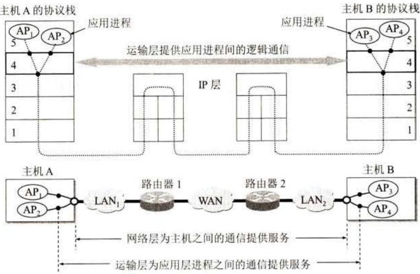
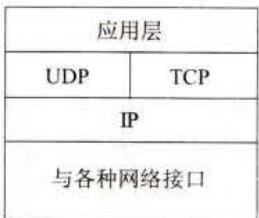

# 5.1 运输层协议概述

## 第 5 章 运输层

本章先概括介绍运输层协议的特点、进程之间的通信和端口等重要概念，然后讲述比较简单的 UDP 协议。其余的篇幅都是讨论较为复杂但非常重要的 TCP 协议 $^{①}$ 和可靠传输的工作原理，包括停止等待协议和 ARQ 协议。在详细讲述 TCP 报文段的首部格式之后，讨论 TCP 的三个重要问题：滑动窗口、流量控制和拥塞控制机制。最后，介绍 TCP 的连接管理。

运输层是整个网络体系结构中的关键层次之一。一定要弄清以下一些重要概念：

(1) 运输层为相互通信的应用进程提供逻辑通信。

(2) 端口和套接字的意义。

(3) 无连接的 UDP 的特点。

(4) 面向连接的 TCP 的特点。

(5) 在不可靠的网络上实现可靠传输的工作原理，停止等待协议和 ARQ 协议。

(6) TCP 的滑动窗口、流量控制、拥塞控制和连接管理。

## 5.1.1 进程之间的通信

从通信和信息处理的角度看，运输层向它上面的应用层提供通信服务，它属于面向通信部分的最高层，同时也是用户功能中的最低层。当网络边缘部分的两台主机使用网络核心部分的功能进行端到端的通信时，都要使用协议栈中的运输层，而网络核心部分中的路由器在转发分组时只用到下三层的功能。

下面通过图 5-1 的示意图来说明运输层的作用。设局域网 $LAN_{1}$ 上的主机 A 和局域网 $LAN_{2}$ 上的主机 B 通过互连的广域网 WAN 进行通信。我们知道，IP 协议能够把源主机 A 发送出的分组，按照首部中的目的地址，送交到目的主机 B，那么，为什么还需要运输层呢？

从 IP 层来说，通信的两端是两台主机。IP 数据报的首部明确地标志了这两台主机的 IP 地址。但“两台主机之间的通信”这种说法还不够明确。真正进行通信的实体是在主机中的哪个构件呢？是主机中的应用进程，是一台主机中的应用进程和另一台主机中的应用进程在交换数据（即通信）。因此严格地讲，两台主机进行通信就是两台主机中的应用进程互相通信。IP 协议虽然能把分组送到目的主机，但是这个分组还停留在主机的网络层而没有交付主机中的应用进程。通信的两端应当是两个主机中的应用进程。也就是说，端到端的通信是应用进程之间的通信。在一台主机中经常有多个应用进程同时分别和另一台主机中的多个应用进程通信。例如，某用户在使用浏览器查找某网站的信息时，其主机的应用层运行浏览器客户进程。如果在浏览网页的同时，还要用电子邮件给网站发送反馈意见，那么主机的应用层就还要运行电子邮件的客户进程。在图 5-1 中，主机 A 的应用进程 AP₁ 和主机 B 的应用进程 AP₃ 通信，而与此同时，应用进程 AP₂ 也和对方的应用进程 AP₄ 通信。这表明运输层有一个很重要的功能——复用(multiplexing)和分用(demultiplexing)。这里的“复用”是指在发送方不同的应用进程都可以使用同一个运输层协议传送数据（当然需要加上适当的首部），而“分用”是指接收方的运输层在剥去报文的首部后能够把这些数据正确交付目的应用进程 $^{①}$ 。

> ① 注：运输层最近又增加了第三种协议，即流控制传输协议 SCTP (Stream Control Transmission Protocol) [RFC 4960，建议标准]，它具有 TCP 和 UDP 协议的共同优点，可支持一些新的应用，如 IP 电话。限于篇幅，这里不再介绍。

图 5-1 中两个运输层之间有一个深色双向粗箭头，写明 “运输层提供应用进程间的逻辑通信”。“逻辑通信”的意思是：从应用层来看，只要把应用层报文交给下面的运输层，运输层就可以把这报文传送到对方的运输层（哪怕双方相距很远，例如几千公里），好像这种通信就是沿水平方向直接传送数据。但事实上这两个运输层之间并没有一条水平方向的物理连接。数据的传送是沿着图中的虚线方向（经过多个层次）传送的。“逻辑通信”的意思是“好像是这样通信，但事实上并非真的这样通信”。

> 图 5-1 运输层为相互通信的应用进程提供了逻辑通信（教材第 212 页）

从这里可以看出网络层和运输层有明显的区别。网络层为主机之间的通信提供服务，而运输层则在网络层的基础上，为应用进程之间的通信提供服务。然而正如后面还要讨论的，运输层还具有网络层无法代替的许多其他重要功能。

运输层还要对收到的报文进行差错检测。大家应当还记得，在网络层，IP 数据报首部中的检验和字段，只检验首部是否出现差错而不检查数据部分。

根据应用程序的不同需求，运输层需要有两种不同的运输协议，即面向连接的 TCP 和无连接的 UDP，这两种协议就是本章要讨论的主要内容。

我们还应指出，运输层向高层用户屏蔽了下面网络核心的细节（如网络拓扑、所采用的路由选择协议等），它使应用进程看见的就是好像在两个运输层实体之间有一条端到端的逻辑通信信道，但这条逻辑通信信道对上层的表现却因运输层使用的不同协议而有很大的差别。当运输层采用面向连接的 TCP 协议时，尽管下面的网络是不可靠的（只提供尽最大努力服务），但这种逻辑通信信道就相当于一条全双工的可靠信道。但当运输层采用无连接的UDP协议时，这种逻辑通信信道仍然是一条不可靠信道。

> ① 注：IP 层也有复用和分用的功能。即在发送方使用不同协议的数据都可以封装成 IP 数据报发送出去，而在接收方的 IP 层根据 IP 首部中的协议字段进行分用，把剥去首部后的数据交付应当接收这些数据的协议。

## 5.1.2 运输层的两个主要协议

TCP/IP 运输层的两个主要协议都是互联网的正式标准，即：

(1) 用户数据报协议 UDP (User Datagram Protocol) [RFC 768, STD6]

(2) 传输控制协议 TCP (Transmission Control Protocol) [RFC 793, STD7]

图 5-2 给出了这两种协议在协议栈中的位置。

> 图 5-2 TCP/IP 体系中的运输层协议（教材第 213 页）

按照 OSI 的术语，两个对等运输实体在通信时传送的数据单位叫作运输协议数据单元 TPDU (Transport Protocol Data Unit)。但在 TCP/IP 体系中，则根据所使用的协议是 TCP 或 UDP，分别称之为 TCP 报文段(segment) 或 UDP 用户数据报。

UDP 在传送数据之前不需要先建立连接。远地主机的运输层在收到 UDP 报文后，不需要给出任何确认。虽然 UDP 不提供可靠交付，但由于 UDP 非常简单，在某些情况下 UDP 是一种最有效的工作方式。

TCP 则提供面向连接的服务。在传送数据之前必须先建立连接，数据传送结束后要释放连接。TCP 不提供广播或多播服务。由于 TCP 要提供可靠的、面向连接的运输服务，因此不可避免地增加了许多的开销，如确认、流量控制、计时器以及连接管理等。这不仅使协议数据单元的首部增大很多，还要占用许多的处理机资源。

表 5-1 给出了一些应用和应用层协议主要使用的运输层协议（UDP 或 TCP）。

> 表 5-1 使用 UDP 或 TCP 协议的各种应用和应用层协议（教材第 213 页）

| 应用 | 应用层协议 | 运输层协议 |
| --- | --- | --- |
| 名字转换 | DNS(域名系统) | UDP |
| 文件传送 | TFTP(简单文件传送协议) | UDP |
| 路由选择协议 | RIP(路由信息协议) | UDP |
| IP地址配置 | DHCP(动态主机配置协议) | UDP |
| 网络管理 | SNMP(简单网络管理协议) | UDP |
| 远程文件服务器 | NFS(网络文件系统) | UDP |
| IP电话 | 专用协议 | UDP |
| 流式多媒体通信 | 专用协议 | UDP |
| 多播 | IGMP(网际组管理协议) | UDP |
| 电子邮件 | SMTP(简单邮件传送协议) | TCP |
| 远程终端接入 | TELNET(远程终端协议) | TCP |
| 万维网 | HTTP(超文本传送协议) | TCP |
| 文件传送 | FTP(文件传送协议) | TCP |

## 5.1.3 运输层的端口

前面已经提到过运输层的复用和分用功能。其实在日常生活中也有很多复用和分用的例子。假定一个机构的所有部门向外单位发出的公文都由收发室负责寄出，这相当于各部门都“复用”这个收发室。当收发室收到从外单位寄来的公文时，则要完成“分用”功能，即按照信封上写明的本机构的部门地址把公文正确进行交付。

运输层的复用和分用功能也是类似的。应用层所有的应用进程都可以通过运输层再传送到 IP 层（网络层），这就是复用。运输层从 IP 层收到发送给各应用进程的数据后，必须分别交付指明的各应用进程，这就是分用。显然，给应用层的每个应用进程赋予一个非常明确的标志是至关重要的。

我们知道，在单个计算机中的进程是用进程标识符（一个不大的整数）来标志的。但是在互联网环境下，用计算机操作系统所指派的这种进程标识符来标志运行在应用层的各种应用进程则是不行的。这是因为在互联网上使用的计算机的操作系统种类很多，而不同的操作系统又使用不同格式的进程标识符。为了使运行不同操作系统的计算机的应用进程能够互相通信，就必须用统一的方法（而这种方法必须与特定操作系统无关）对 TCP/IP 体系的应用进程进行标志。

但是，把一个特定机器上运行的特定进程，指明为互联网上通信的最后终点是不可行的。这是因为进程的创建和撤销都是动态的，通信的一方几乎无法知道和识别对方机器上的进程。另外，我们往往需要利用目的主机提供的功能来识别终点，而不需要知道具体实现这个功能的进程是哪一个（例如，要和互联网上的某个邮件服务器联系，但并不一定要知道这个服务器功能是由目的主机上的哪个进程实现的）。

解决这个问题的方法很巧妙，就是在应用层和运输层之间的界面上，设置一个特殊的抽象的“门”。应用层中的应用进程要通过运输层发送到互联网，必须要通过这个门。而别的主机上的应用进程要寻找本主机中的某个应用进程，也必须通过这个门。这样，我们就可以把应用层和运输层的界面上这些“门”，设为通信的抽象终点。这些抽象终点的正式名称就是协议端口(protocol port)，一般就简称为端口(port)。每一个端口用一个称为端口号(port number)的正整数来标志。主机的操作系统提供了接口机制，使得进程能够通过这种机制找到所要找的端口。

请注意，这种在协议栈层间的抽象的协议端口是软件端口，和路由器或交换机上的硬件端口是完全不同的概念。硬件端口是不同硬件设备进行交互的接口，而软件端口是应用层的各种协议进程与运输实体进行层间交互的地点。不同的系统具体实现端口的方法可以是不同的（取决于系统使用的操作系统）。

当应用层要发送数据时，应用进程就把数据发送到适当的端口，然后运输层从该端口读取数据，进行后续的处理（把数据发送到目的主机）。当运输层收到对方主机发来的数据时，就把数据发送到适当的端口，然后应用进程就从该端口读取这些数据。显然，端口必须有一定容量的缓存来暂时存放数据。

在后面将讲到的 UDP 和 TCP 的首部格式中（图 5-5 和图 5-14），都有源端口和目的端口这两个重要字段。这两个端口就是运输层和应用层进行交互的地点。

TCP/IP 的运输层用一个 16 位端口号来标志一个端口。但请注意，端口号只具有本地意义，它只是为了标志本计算机应用层中的各个进程在和运输层交互时的层间接口。在互联网不同计算机中，相同的端口号是没有关联的。16 位的端口号可允许有 65535 个不同的端口

号，这个数目对一个计算机来说是足够用的。

由此可见，两个计算机中的进程要互相通信，不仅必须知道对方的 IP 地址（为了找到对方的计算机），而且要知道对方的端口号（为了找到对方计算机中的应用进程）。这和我们寄信的过程类似。当我们要给某人写信时，就必须在信封上写明他的通信地址（这是为了找到他的住所，相当于 IP 地址），并且还要写上收件人的姓名（这是因为在同一住所中可能有好几个人，这相当于端口号）。在信封上还应写明自己的地址和姓名。当收信人回信时，很容易在信封上找到发信人的地址和姓名。互联网上的计算机通信是采用客户-服务器方式。客户在发起通信请求时，必须先知道对方服务器的 IP 地址（用来找到目的主机）和端口号（用来找到目的进程）。因此运输层的端口号分为下面的两大类。

(1) 服务器端使用的端口号 这里又分为两类，最重要的一类叫作熟知端口号(well-known port number)或全球通用端口号，数值为0\~1023。这些熟知端口号最初公布在文档中[RFC 1700, STD2]，但后来因为互联网发展太快，这种标准文档无法随时更新，因此在RFC 3232中就把RFC 1700列为陈旧的，而当前最新的熟知端口号可在网址www.iana.org上查到。IANA把这些熟知端口号指派给了TCP/IP最重要的一些应用程序，让所有的用户都知道。当一种新的应用程序出现后，IANA必须为它指派一个熟知端口，否则互联网上的其他应用进程就无法和它进行通信。和电话通信对比，熟知端口号相当于所有人都应知晓的重要电话号码，如报警电话110，急救电话120等。表5-2给出了一些常用的熟知端口号。

> 表 5-2 常用的熟知端口号（教材第 215 页）

| 应用程序 | FTP | TELNET | SMTP | DNS | TFTP | HTTP | SNMP | SNMP (trap) | HTTPS |
| --- | --- | --- | --- | --- | --- | --- | --- | --- | --- |
| 熟知端口号 | 21 | 23 | 25 | 53 | 69 | 80 | 161 | 162 | 443 |

另一类叫作登记端口号，数值为 1024\~49151。这类端口号是为没有熟知端口号的应用程序使用的。要使用这类端口号必须在 IANA 按照规定的手续登记，以防止重复。

(2) 客户端使用的端口号 数值为 49152\~65535。由于这类端口号仅在客户进程运行时才动态选择，因此又叫作短暂端口号 $^{①}$ 。这类端口号就是临时端口号，留给客户进程选择临时使用。当服务器进程收到客户进程的报文时，就知道了客户进程所使用的端口号，因而可以把数据发送给客户进程。通信结束后，刚才已使用过的客户端口号就被系统收回，以便给其他客户进程使用。

下面将分别讨论 UDP 和 TCP。UDP 比较简单，本章主要讨论 TCP。
