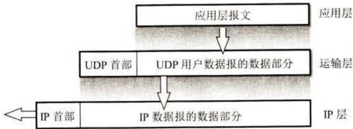
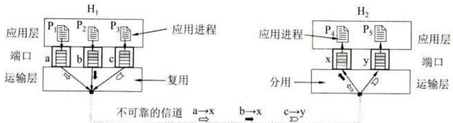
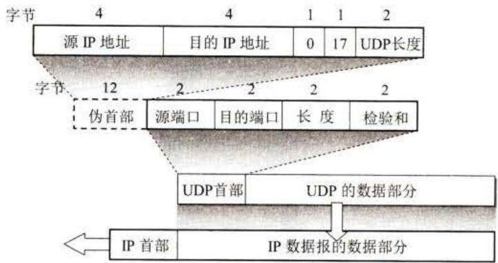
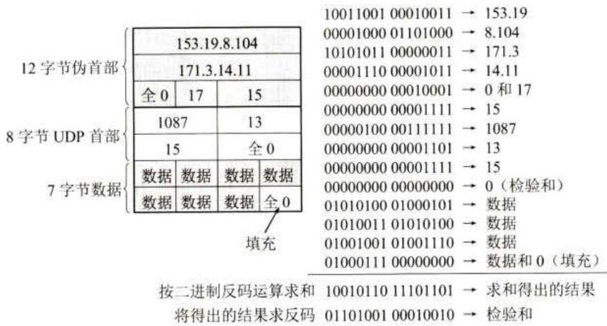

# 5.2 用户数据报协议UDP

## 5.2.1 UDP 概述

用户数据报协议 UDP 只在 IP 的数据报服务之上增加了很少一点的功能，这就是复用和分用的功能以及差错检测的功能。UDP 的主要特点是：

> ① 注：短暂端口(ephemeral port)[STEV94, p.13]表示这种端口的存在时间是短期的。客户进程并不在意操作系统给它分配的是哪一个端口号，因为客户进程之所以必须有一个端口号（在本地主机中必须是唯一的），是为了让运输层的实体能够找到自己。这和熟知端口不同。服务器机器一接通电源，服务器程序就运行起来。为了让互联网上所有的客户程序都能找到服务器程序，服务器程序所使用的端口（即熟知端口）就必须是固定的，并且是众所周知的。

(1) UDP 是无连接的，即发送数据之前不需要建立连接（当然，发送数据结束时也没有连接可释放），因此减少了开销和发送数据之前的时延。

(2) UDP 使用尽最大努力交付，即不保证可靠交付，因此主机不需要维持复杂的连接状态表（这里面有许多参数）。

(3) UDP 是面向报文的。发送方的 UDP 对应用程序交下来的报文，在添加首部后就向下交付 IP 层。UDP 对应用层交下来的报文，既不合并，也不拆分，而是保留这些报文的边界。这就是说，应用层交给 UDP 多长的报文，UDP 就照样发送，即一次发送一个报文，如图 5-3 所示。在接收方的 UDP，对 IP 层交上来的 UDP 用户数据报，在去除首部后就原封不动地交付上层的应用进程。也就是说，UDP 一次交付一个完整的报文。因此，应用程序必须选择合适大小的报文。若报文太长，UDP 把它交给 IP 层后，IP 层在传送时可能要进行分片，这会降低 IP 层的效率。反之，若报文太短，UDP 把它交给 IP 层后，会使 IP 数据报的首部的相对长度太大，这也降低了 IP 层的效率。

> 图 5-3 UDP 是面向报文的（教材第 216 页）

(4) UDP 没有拥塞控制，因此网络出现的拥塞不会使源主机的发送速率降低。这对某些实时应用是很重要的。很多的实时应用（如 IP 电话、实时视频会议等）要求源主机以恒定的速率发送数据，并且允许在网络发生拥塞时丢失一些数据，但却不允许数据有太大的时延。UDP 正好适合这种要求。

(5) UDP 支持一对一、一对多、多对一和多对多的交互通信。

(6) UDP 的首部开销小，只有 8 个字节，比 TCP 的 20 个字节的首部要短。

下面举例说明 UDP 的通信和端口号的关系（如图 5-4 所示）。主机 $H_{1}$ 中有三个应用进程分别要和主机 $H_{2}$ 中的两个应用进程进行通信。通信双方的关系是： $P_{1} \rightarrow P_{4}, P_{2} \rightarrow P_{4}, P_{3} \rightarrow P_{5}$ 。主机 $H_{1}$ 的操作系统为这三个进程分别指派了端口，其端口号分别为 a, b 和 c。图中位于应用层和运输层之间的小方框代表端口。在端口小方框中间还画有队列，表示端口具有缓存的功能，可以把收到的数据暂时存储一下。有时也可以把队列画成双向的，即分别表示存放来自应用层或运输层的数据。现在假定主机 $H_{1}$ 中的进程已经知道了对方进程 $P_{4}$ 和 $P_{5}$ 的端口号分别为 x 和 y，于是在主机 $H_{1}$ 的运输层就可以组装成需要发送的 UDP 用户数据报，其中最重要的地址信息(源端口，目的端口)分别是(a, x)，(b, x)和(c, y)。在图 5-4 中把运输层以下的都省略了。因此，进程之间的通信现在可以看成是两个端口之间的通信。

图中在两个运输层之间有一条虚线，表示在两个运输层之间可以进行通信，而不是一条连接。但这种通信是不可靠的通信，即所发送的报文在传输过程中有可能丢失，同时也不保证报文都能按照发送的先后顺序到达终点。这正是 UDP 通信的特点：简单方便，但不可靠。如果想要得到可靠的运输层通信，那就要使用后面要介绍的 TCP 进行通信。请注意，在两个运输层的 UDP 之间并没有建立连接。

> 请注意：运输层之间的这条虚线不是一条连接 图 5-4 UDP 的通信和端口号的关系（教材第 217 页）

图 5-4 的例子画出了多对一的通信（ $a \rightarrow x, b \rightarrow x$ ）。如果改成 $a \rightarrow x, a \rightarrow y$ ，则是一对多的情况了。

主机 $H_{1}$ 中的 3 个应用进程，把用户数据通过各自的端口传送到了运输层后，就共用一个网络层协议，把收到的 UDP 用户数据报组装成不同的 IP 数据报，发送到互联网。这就是 UDP 的复用功能。主机 $H_{2}$ 的网络层收到 3 个 IP 数据报后，提取出数据部分（即 UDP 用户数据报），然后根据其首部中的目的端口号，分别传送到相应的端口，以便上层的应用进程到端口读取数据。这就是 UDP 的分用功能。

虽然某些实时应用需要使用没有拥塞控制的 UDP，但当很多的源主机同时都向网络发送高速率的实时视频流时，网络就有可能发生拥塞，结果大家都无法正常接收。因此，不使用拥塞控制功能的 UDP 有可能会引起网络产生严重的拥塞问题。

还有一些使用 UDP 的实时应用，需要对 UDP 的不可靠的传输进行适当的改进，以减少数据的丢失。在这种情况下，应用进程本身可以在不影响应用的实时性的前提下，增加一些提高可靠性的措施，如采用前向纠错或重传已丢失的报文。

## 5.2.2 UDP的首部格式

用户数据报 UDP 有两个字段：数据字段和首部字段。首部字段很简单，只有 8 个字节（如图 5-5 所示），由 4 个字段组成，每个字段的长度都是 2 字节。各字段意义如下：

(1) 源端口源端口号。在需要对方回信时选用。不需要时可用全0。

(2) 目的端口 目的端口号。这在终点交付报文时必须使用。

(3) 长度 UDP 用户数据报的长度，其最小值是 8（仅有首部）。

(4) 检验和 检测 UDP 用户数据报在传输中是否有错。有错就丢弃。

> 图 5-5 UDP 用户数据报的首部和伪首部（教材第 217 页）

如果接收方 UDP 发现收到的报文中的目的端口号不正确（即不存在对应于该端口号的应用进程），就丢弃该报文，并由网际控制报文协议 ICMP 发送“端口不可达”差错报文给发送方。我们在上一章 4.4.2 节 “ICMP 的应用举例” 讨论 traceroute 时，就是让发送的 UDP 用户数据报故意使用一个非法的 UDP 端口，结果 ICMP 就返回“端口不可达”差错报文，因而达到了测试的目的。

UDP 用户数据报首部中检验和的计算方法有些特殊。在计算检验和时，要在 UDP 用户数据报之前增加 12 个字节的伪首部。所谓 “伪首部” 是因为这种伪首部并不是 UDP 用户数据报真正的首部。只是在计算检验和时，临时添加在 UDP 用户数据报前面，得到一个临时的 UDP 用户数据报。检验和就是按照这个临时的 UDP 用户数据报来计算的。伪首部既不向下传送也不向上递交，而仅仅是为了计算检验和。图 5-5 的最上面给出了伪首部各字段的内容。

UDP 计算检验和的方法和计算 IP 数据报首部检验和的方法相似。但不同的是：IP 数据报的检验和只检验 IP 数据报的首部，但 UDP 的检验和是把首部和数据部分一起都检验。在发送方，首先是先把全零放入检验和字段。再把伪首部以及 UDP 用户数据报看成是由许多 16 位的字串接起来的。若 UDP 用户数据报的数据部分不是偶数个字节，则要填入一个全零字节（但此字节不发送）。然后按二进制反码计算出这些 16 位字的和。将此和的二进制反码写入检验和字段后，就发送这样的 UDP 用户数据报。在接收方，把收到的 UDP 用户数据报连同伪首部（以及可能的填充全零字节）一起，按二进制反码求这些 16 位字的和。当无差错时其结果应为全 1。否则就表明有差错出现，接收方就应丢弃这个 UDP 用户数据报（也可以上交给应用层，但附上出现了差错的警告）。图 5-6 给出了一个计算 UDP 检验和的例子。这里假定用户数据报的长度是 15 字节，因此要添加一个全 0 的字节。读者可以自己检验一下在接收端是怎样对检验和进行检验的。不难看出，这种简单的差错检验方法的检错能力并不强，但它的好处是简单，处理起来较快。

> 图 5-6 计算 UDP 检验和的例子（教材第 218 页）

如图 5-6 所示，伪首部的第 3 字段是全零；第 4 字段是 IP 首部中的协议字段的值。以前曾讲过，对于 UDP，此协议字段值为 17；第 5 字段是 UDP 用户数据报的长度。因此，这样的检验和，既检查了 UDP 用户数据报的源端口号和目的端口号以及 UDP 用户数据报的数据部分，又检查了 IP 数据报的源 IP 地址和目的地址。
