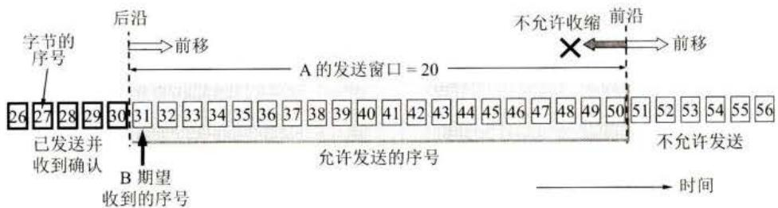
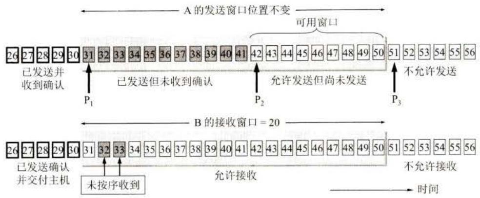
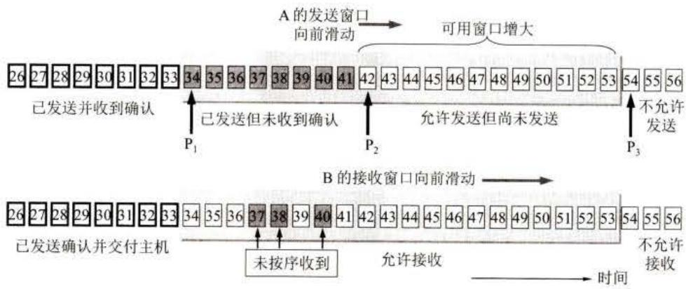
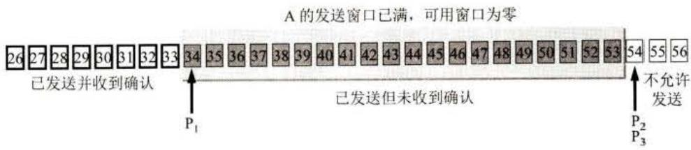
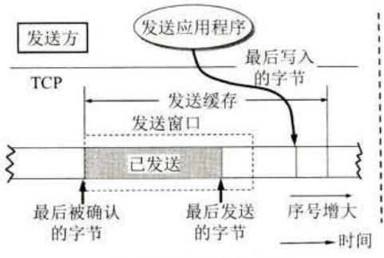
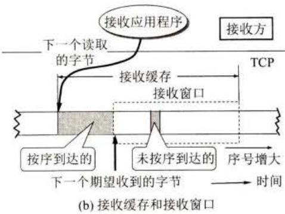

# 5.6.1 以字节为单位的滑动窗口

## 5.6 TCP 可靠传输的实现

本节讨论 TCP 可靠传输的实现。

我们首先介绍以字节为单位的滑动窗口。为了讲述可靠传输原理的方便，我们假定数据传输只在一个方向进行，即 A 发送数据，B 给出确认。这样的好处是使讨论限于两个窗口，即发送方 A 的发送窗口和接收方 B 的接收窗口。如果再考虑 B 也向 A 发送数据，那么还要增加 A 的接收窗口和 B 的发送窗口，这样总共有 4 个都不断在变化大小的窗口。这对讲述可靠传输的原理并没有多少帮助，反而会使问题变得更加烦琐。

TCP 的滑动窗口是以字节为单位的。为了便于说明滑动窗口的工作原理，我们故意把后面图 5-14 至图 5-17 中的字节编号都取得很小（实际的窗口大小多为数千字节）。现假定 A 收到了 B 发来的确认报文段，其中窗口是

20 字节，而确认号是 31（这表明 B 期望收到的下一个字节序号是 31（请注意，这里不是分组的序号），而到序号 30 为止的数据已经收到了）。根据这两个数据，A 就构造出自己的发送窗口，如图 5-14 所示。

> ① 注：这种信道常称为长粗管道(long fat pipe)。

> 图 5-14 根据 B 给出的窗口值，A 构造出自己的发送窗口（教材第 230 页）

我们先讨论发送方 A 的发送窗口。发送窗口表示：在没有收到 B 的确认的情况下，A 可以连续把窗口内的数据都发送出去。凡是已经发送过的数据，在未收到确认之前都必须暂时保留，以便在超时重传时使用。

发送窗口里面的序号表示允许发送的序号。显然，窗口越大，发送方就可以在收到对方确认之前连续发送更多的数据，因而可能获得更高的传输效率。在上面的 5.5 节我们已经讲过，接收方会把自己的接收窗口数值放在窗口字段中发送给对方。因此，A 的发送窗口一定不能超过 B 的接收窗口数值。在后面的 5.8 节我们将要讨论，发送方的发送窗口大小还要受到当时网络拥塞程度的制约。但在目前，我们暂不考虑网络拥塞的影响。

发送窗口后沿的后面部分表示已发送且已收到了确认。这些数据显然不需要再保留了。而发送窗口前沿的前面部分表示不允许发送，因为接收方没有为这部分数据保留临时存放的缓存空间。

发送窗口的位置由窗口前沿和后沿的位置共同确定。发送窗口后沿的变化情况有两种可能，即不动（没有收到新的确认）和前移（收到了新的确认）。发送窗口后沿不可能向后移动，因为不能撤销掉已收到的确认。发送窗口前沿通常是不断向前移动的，但也有可能不动。这对应两种情况：一是没有收到新的确认，对方通知的窗口大小也不变；二是收到了新的确认但对方通知的窗口缩小了，使得发送窗口前沿正好不动。

发送窗口前沿也有可能向后收缩。这发生在对方通知的窗口缩小了。但 TCP 的标准强烈不赞成这样做。因为很可能发送方在收到这个通知以前已经发送了窗口中的许多数据，现在又要收缩窗口，不让发送这些数据，这样就会产生一些错误。

现在假定 A 发送了序号为 31～41 的数据。这时，发送窗口位置并未改变（如图 5-15 所示），但发送窗口内靠后面有 11 个字节（灰色方框表示）表示已发送但未收到确认。而发送窗口内靠前面的 9 个字节（序号 42～50）是允许发送但尚未发送的。

> 图 5-15 A 发送了 11 个字节的数据（教材第 230 页）

从以上所述可以看出，要描述一个发送窗口的状态需要三个指针： $P_{1}$ ， $P_{2}$ 和 $P_{3}$ （如图 5-15 所示）。指针都指向字节的序号。A 的发送窗口中三个指针指向的几个部分的意义如下：

$P_{1}$ 之前的数据（序号<31）是已发送并已收到确认的部分。

$P_{3}$ 之后的数据（序号>50）是不允许发送的部分。

$P_{3}-P_{1}=A$ 的发送窗口 =20（序号 31\~50）。

$P_{2}-P_{1}=$ 已发送但尚未收到确认的字节数（序号 31\~41）。

$P_{3}-P_{2}=$ 允许发送但当前尚未发送的字节数（序号 42～50）（又称为可用窗口或有效窗口）。

再看一下 B 的接收窗口。设 B 的接收窗口大小是 20。在接收窗口外面，到序号为 30 的数据是已经发送过确认，并且已经交付主机了。因此在 B 可以不再保留这些数据。接收窗口内的数据（序号 31～50）是允许接收的。在图 5-15 中，B 收到了序号为 32 和 33 的数据，但序号为 31 的数据没有收到（也许丢失了，也许滞留在网络中的某处）。请注意，B 只能对按序收到的数据中的最高序号给出确认，因此 B 发送的确认报文段中的确认号仍然是 31（即期望收到的序号）。

现在假定 B 收到了序号为 31 的数据，把序号为 31～33 的数据交付主机，删除这些数据。接着把接收窗口向前移动 3 个序号（如图 5-16 所示），同时给 A 发送确认，其中窗口值仍为 20，但确认号是 34。这表明 B 已经收到了到序号 33 为止的数据。我们注意到，B 还收到了序号为 37, 38 和 40 的数据，但这些数据都没有按序到达，只能先暂存在接收窗口中。A 收到 B 的确认后，就可以把发送窗口向前滑动 3 个序号，但指针 P₂ 不动。可以看出，现在 A 的可用窗口增大了些，可发送的序号范围是 42～53。

> 图 5-16 A 收到新的确认号，发送窗口向前滑动（教材第 231 页）

A 在继续发送完序号 42 \~ 53 的数据后，指针 $P_{2}$ 向前移动和 $P_{3}$ 重合。发送窗口内的序号都已用完，但还没有再收到确认（如图 5-17 所示）。由于 A 的发送窗口已满，可用窗口已减小到零，因此必须停止发送。请注意，存在下面这种可能性，就是发送窗口内所有的数据都已正确到达 B，B 也早已发出了确认。但不幸的是，所有这些确认都滞留在网络中。在没有收到 B 的确认时，为了保证可靠传输，A 只能认为 B 还没有收到这些数据。于是，A 在经过一段时间后（由超时计时器控制）就重传这部分数据，重新设置超时计时器，直到收到 B 的确认为止。如果 A 按序收到落在发送窗口内的确认号，那么 A 就可以使发送窗口继续向前滑动，并发送新的数据。

> 图 5-17 A 的发送窗口内的序号都属于已发送但未被确认（教材第 232 页）

我们在前面的图 5-7 中曾给出了这样的概念：发送方的应用进程把字节流写入 TCP 的发送缓存，接收方的应用进程从 TCP 的接收缓存中读取字节流。下面我们就进一步讨论前面讲的窗口和缓存的关系。图 5-18 画出了发送方维持的发送缓存和发送窗口，以及接收方维持的接收缓存和接收窗口。这里首先要明确两点：

> (a) 发送缓存和发送窗口（教材第 232 页）

> 图 5-18 TCP 的缓存和窗口的关系（教材第 232 页）

第一，缓存空间和序号空间都是有限的，并且都是循环使用的。最好是把它们画成圆环状的。但这里为了画图的方便，我们还是把它们画成了长条状的。

第二，由于缓存或窗口中实际的字节数可能很大，因此图 5-18 仅仅是个示意图，没有标出具体的数值。但用这样的图来说明缓存和发送窗口以及接收窗口的关系是很清楚的。

我们先看一下图 5-18(a) 所示的发送方的情况。

发送缓存用来暂时存放：

(1) 发送应用程序传送给发送方 TCP 准备发送的数据；

(2) TCP 已发送出但尚未收到确认的数据。

发送窗口通常只是发送缓存的一部分。已被确认的数据应当从发送缓存中删除，因此发送缓存和发送窗口的后沿是重合的。发送应用程序最后写入发送缓存的字节减去最后被确认的字节，就是还保留在发送缓存中的被写入的字节数。发送应用程序必须控制写入缓存的速率，不能太快，否则发送缓存就会没有存放数据的空间。

再看一下图 5-18(b) 所示的接收方的情况。

接收缓存用来暂时存放：

(1) 按序到达的、但尚未被接收应用程序读取的数据；

(2) 未按序到达的数据。

如果收到的分组被检测出有差错，则要丢弃。如果接收应用程序来不及读取收到的数据，接收缓存最终就会被填满，使接收窗口减小到零。反之，如果接收应用程序能够及时从接收缓存中读取收到的数据，接收窗口就可以增大，但最大不能超过接收缓存的大小。

图 5-18(b) 中还指出了下一个期望收到的字节号。这个字节号也就是接收方给发送方的报文段的首部中的确认号。

根据以上所讨论的，我们还要再强调以下三点。

第一，虽然 A 的发送窗口是根据 B 的接收窗口设置的，但在同一时刻，A 的发送窗口并不总是和 B 的接收窗口一样大。这是因为通过网络传送窗口值需要经历一定的时间滞后（这个时间是不确定的）。另外，正如后面 5.7 节将要讲到的，发送方 A 还可能根据网络当时的拥塞情况适当减小自己的发送窗口数值。

第二，对于不按序到达的数据应如何处理，TCP 标准并无明确规定。如果接收方把不按序到达的数据一律丢弃，那么接收窗口的管理将会比较简单，但这样做对网络资源的利用不利（因为发送方会重复传送较多的数据）。因此 TCP 通常是把不按序到达的数据先临时存放在接收窗口中，等到字节流中所缺少的字节收到后，再按序交付上层的应用进程。

第三，TCP 要求接收方必须有累积确认的功能，这样可以减小传输开销。接收方可以在合适的时候发送确认，也可以在自己有数据要发送时把确认信息顺便捎带上。但请注意两点。一是接收方不应过分推迟发送确认，否则会导致发送方不必要的重传，这反而浪费了网络的资源。TCP 标准规定，确认推迟的时间不应超过 0.5 秒。若收到一连串具有最大长度的报文段，则必须每隔一个报文段就发送一个确认[RFC 1122, STD3]。二是捎带确认实际上并不经常发生，因为大多数应用程序很少同时在两个方向上发送数据。

最后再强调一下，TCP 的通信是全双工通信。通信中的每一方都在发送和接收报文段。因此，每一方都有自己的发送窗口和接收窗口。在谈到这些窗口时，一定要弄清是哪一方的窗口。
