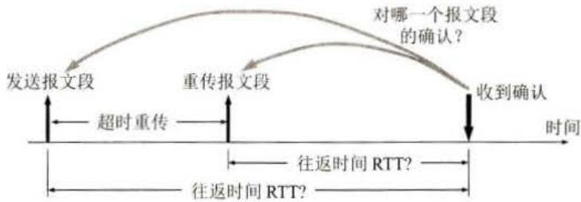

# 5.6.2 超时重传时间的选择

上面已经讲到，TCP 的发送方在规定的时间内没有收到确认就要重传已发送的报文段。这种重传的概念是很简单的，但重传时间的选择却是 TCP 最复杂的问题之一。

由于 TCP 的下层是互联网环境，发送的报文段可能只经过一个高速率的局域网，也可能经过多个低速率的网络，并且每个 IP 数据报所选择的路由还可能不同。如果把超时重传时间设置得太短，就会引起很多报文段的不必要的重传，使网络负荷增大。但若把超时重传时间设置得过长，则又使网络的空闲时间增大，降低了传输效率。

那么，运输层的超时计时器的超时重传时间究竟应设置为多大呢？

TCP 采用了一种自适应算法，它记录一个报文段发出的时间，以及收到相应的确认的时间。这两个时间之差就是报文段的往返时间 RTT。TCP 保留了 RTT 的一个加权平均往返时间 RTTs（这又称为平滑的往返时间，S 表示 Smoothed。因为进行的是加权平均，因此得出的结果更加平滑）。每当第一次测量到 RTT 样本时，RTTs 值就取为所测量到的 RTT 样本值。但以后每测量到一个新的 RTT 样本，就按下式重新计算一次 RTTs:

$$ \mathrm{RTT} _ {\mathrm{S}} = (1 - \alpha) \times (\text {旧的RTT} _ {\mathrm{S}}) + \alpha \times (\text {新的RTT样本})\tag{5-4} $$

在上式中， $0 \leqslant \alpha < 1$ 。若 $\alpha$ 很接近于零，表示新的 $RTT_{S}$ 值和旧的 $RTT_{S}$ 值相比变化不大，而对新的 RTT 样本影响不大（RTT 值更新较慢）。若选择 $\alpha$ 接近于 1，则表示新的 $RTT_{S}$ 值受新的 RTT 样本的影响较大（RTT 值更新较快）。已成为建议标准的 RFC 6298 推荐的 $\alpha$ 值为 1/8，即 0.125。用这种方法得出的加权平均往返时间 $RTT_{S}$ 就比测量出的 RTT 值

更加平滑。

显然，超时计时器设置的超时重传时间 RTO (RetransmissionTime-Out)应略大于上面得出的加权平均往返时间 RTT $_{S}$ 。RFC 6298 建议使用下式计算 RTO:

$$ \mathrm{RTO} = \mathrm{RTT} _ {\mathrm{S}} + 4 \times \mathrm{RTT} _ {\mathrm{D}}\tag{5-5} $$

而 $\mathrm{RTT}_{\mathrm{D}}$ 是RTT的偏差的加权平均值，它与 $\mathrm{RTT}_{\mathrm{S}}$ 和新的RTT样本之差有关。RFC6298建议这样计算 $\mathrm{RTT}_{\mathrm{D}}$ 。当第一次测量时， $\mathrm{RTT}_{\mathrm{D}}$ 值取为测量到的RTT样本值的一半。在以后的测量中，则使用下式计算加权平均的 $\mathrm{RTT}_{\mathrm{D}}$ ：

$$ \text { 新 的 } \mathrm{RTT} _ {\mathrm{D}} = (1 - \beta) \times (\text { 旧 的 } \mathrm{RTT} _ {\mathrm{D}}) + \beta \times | \mathrm{RTT} _ {\mathrm{S}} - \text { 新 的 } \mathrm{RTT} \text { 样 本 } |\tag{5-6} $$

这里 $\beta$ 是个小于1的系数，它的推荐值是1/4，即0.25。

上面所说的往返时间的测量，实现起来相当复杂。试看下面的例子。

如图 5-19 所示，发送出一个报文段，设定的重传时间到了，还没有收到确认，于是重传报文段。经过了一段时间后，收到了确认报文段。现在的问题是：如何判定此确认报文段是对先发送的报文段的确认，还是对后来重传的报文段的确认？由于重传的报文段和原来的报文段完全一样，因此源主机在收到确认后，就无法做出正确的判断，而正确的判断对确定加权平均 RTT $_{s}$ 的值关系很大。

若收到的确认是对重传报文段的确认，但却被源主机当成是对原来的报文段的确认，则这样计算出的 $\mathrm{RTT}_{\mathrm{S}}$ 和超时重传时间RTO就会偏大。若后面再发送的报文段又是经过重传后才收到确认报文段，则按此方法得出的超时重传时间RTO就越来越长。

> 图 5-19 收到的确认是对哪一个报文段的确认？（教材第 234 页）

同样，若收到的确认是对原来的报文段的确认，但被当成是对重传报文段的确认，则由此计算出的 $\mathrm{RTT}_{\mathrm{S}}$ 和RTO都会偏小。这就必然导致报文段过多地重传。这样就有可能使RTO越来越短。

根据以上所述，Karn 提出了一个算法：在计算加权平均 $\mathrm{RTT}_{\mathrm{s}}$ 时，只要报文段重传了，就不采用其往返时间样本。这样得出的加权平均 $\mathrm{RTT}_{\mathrm{s}}$ 和 RTO 就较准确。

但是，这又引起新的问题。设想出现这样的情况：报文段的时延突然增大了很多。因此在原来得出的重传时间内不会收到确认报文段，于是就重传报文段。但根据 Karn 算法，不考虑重传的报文段的往返时间样本。这样，超时重传时间就无法更新。

因此要对 Karn 算法进行修正。方法是：报文段每重传一次，就把超时重传时间 RTO 增大一些。典型的做法是取新的重传时间为旧的重传时间的 2 倍。当不再发生报文段的重传时，才根据上面给出的式(5-5)计算超时重传时间。实践证明，这种策略较为合理。

总之，Karn 算法能够使运输层区分开有效的和无效的往返时间样本，从而改进了往返时间的估测，使计算结果更加合理。
