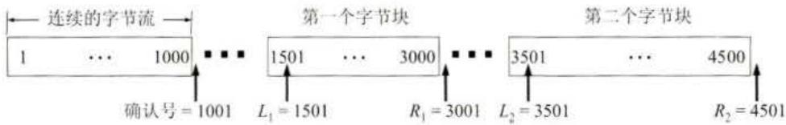

# 5.6.3 选择确认SACK

现在还有一个问题没有讨论。这就是若收到的报文段无差错，只是未按序号，中间还缺少一些序号的数据，那么能否设法只传送缺少的数据而不重传已经正确到达接收方的数据？答案是可以的。选择确认(Selective ACK)[RFC 2018，建议标准]就是一种可行的处理方法。

我们用一个例子来说明选择确认的工作原理。TCP 的接收方在接收对方发送过来的数据字节流的序号不连续，结果就形成了一些不连续的字节块（如图 5-20 所示）。可以看出，序号 1～1000 收到了，但序号 1001～1500 没有收到。接下来的字节流又收到了，可是又缺少了 3001～3500。再后面从序号 4501 起又没有收到。也就是说，接收方收到了和前面的字节流不连续的两个字节块。如果这些字节的序号都在接收窗口之内，那么接收方就先收下这些数据，但要把这些信息准确地告诉发送方，使发送方不要再重复发送这些已收到的数据。

> 图 5-20 接收到的字节流序号不连续（教材第 235 页）

从图 5-20 可看出，和前后字节不连续的每一个字节块都有两个边界：左边界和右边界，因此在图中用四个指针标记这些边界。请注意，第一个字节块的左边界 $L_{1} = 1501$ ，但右边界 $R_{1} = 3001$ 而不是 3000。这就是说，左边界指出字节块的第一个字节的序号，但右边界减 1 才是字节块的最后一个序号。同理，第二个字节块的左边界 $L_{2} = 3501$ ，而右边界 $R_{2} = 4501$ 。

我们知道，TCP 的首部没有哪个字段能够提供上述这些字节块的边界信息。RFC 2018 规定，如果要使用选择确认 SACK，那么在建立 TCP 连接时，就要在 TCP 首部的选项中加上 “允许 SACK” 的选项，而双方必须都事先商定好。如果使用选择确认，那么原来首部中的 “确认号字段” 的用法仍然不变。只是以后在 TCP 报文段的首部中都增加了 SACK 选项，以便报告收到的不连续的字节块的边界。由于首部选项的长度最多只有 40 字节，而指明一个边界就要用掉 4 字节（因为序号有 32 位，需要使用 4 个字节表示），因此在选项中最多只能指明 4 个字节块的边界信息。这是因为 4 个字节块共有 8 个边界，因而需要用 32 个字节来描述。另外还需要两个字节，一个字节用来指明是 SACK 选项，另一个字节指明这个选项要占用多少字节。如果要报告 5 个字节块的边界信息，那么至少需要 42 个字节。这就超过了选项长度 40 字节的上限。互联网建议标准 RFC 2018 还对报告这些边界信息的格式都做出了非常明确的规定，这里从略。

然而，SACK 文档并没有指明发送方应当怎样响应 SACK。因此大多数的实现还是重传所有未被确认的数据块。
