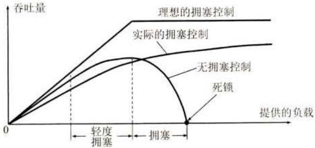

# 5.8.1 拥塞控制的一般原理

## 5.8 TCP 的拥塞控制

在计算机网络中的链路容量（即带宽）、交换节点中的缓存和处理机等，都是网络的资源。在某段时间，若对网络中某一资源的需求超过了该资源所能

提供的可用部分，网络的性能就要变坏。这种情况就叫作拥塞(congestion)。可以把出现网络拥塞的条件写成如下的关系式：

$$ \sum \text { 对资源的需求 } > \text { 可用资源 }\tag{5-7} $$

若网络中有许多资源同时呈现供应不足，网络的性能就要明显变坏，整个网络的吞吐量将随输入负荷的增大而下降。

有人可能会说：“只要任意增加一些资源，例如，把节点缓存的存储空间扩大，或把链路更换为更高速率的链路，或把节点处理机的运算速度提高，就可以解决网络拥塞的问题。”其实不然。这是因为网络拥塞是一个非常复杂的问题。简单地采用上述做法，在许多情况下，不但不能解决拥塞问题，而且还可能使网络的性能更坏。

网络拥塞往往是由很多因素引起的。例如，当某个节点缓存的容量太小时，到达该节点的分组因无存储空间暂存而不得不被丢弃。现在设想将该节点缓存的容量扩展到非常大，于是凡到达该节点的分组均可在节点的缓存队列中排队，不受任何限制。由于输出链路的容量和处理机的处理速度并未提高，因此在这队列中的绝大多数分组的排队等待时间将会大大增加，结果上层软件只好把它们进行重传（因为早就超时了）。由此可见，简单地扩大缓存的存储空间同样会造成网络资源的严重浪费，因而解决不了网络拥塞的问题。

又如，处理机处理的速率太低可能引起网络的拥塞。简单地将处理机的速率提高，可能会使上述情况缓解一些，但往往又会将瓶颈转移到其他地方。问题的实质往往是整个系统的各个部分不匹配。只有所有的部分都平衡了，问题才会得到解决。

拥塞常常趋于恶化。如果一个路由器没有足够的缓存空间，它就会丢弃一些新到的分组。但当分组被丢弃时，发送这一分组的源点就会重传这一分组，甚至可能还要重传多次。这样会引起更多的分组流入网络和被网络中的路由器丢弃。可见拥塞引起的重传并不会缓解网络的拥塞，反而会加剧网络的拥塞。

拥塞控制与流量控制的关系密切，它们之间也存在着一些差别。所谓拥塞控制就是防止过多的数据注入到网络中，这样可以使网络中的路由器或链路不至于过载。拥塞控制所要做的都有一个前提，就是网络能够承受现有的网络负荷。拥塞控制是一个全局性的过程，涉及所有的主机、所有的路由器，以及与降低网络传输性能有关的所有因素。但 TCP 连接的端点只要迟迟不能收到对方的确认信息，就猜想在当前网络中的某处很可能发生了拥塞，但这时却无法知道拥塞到底发生在网络的何处，也无法知道发生拥塞的具体原因。（是访问某个服务器的通信量过大？还是在某个地区出现自然灾害？）

相反，流量控制往往是指点对点通信量的控制，是个端到端的问题（接收端控制发送

端）。流量控制所要做的就是抑制发送端发送数据的速率，以便接收端来得及接收。

可以用一个简单例子说明这种区别。设某个光纤网络的链路传输速率为 1000 Gbit/s，有一台巨型计算机向一台个人电脑以 1 Gbit/s 的速率传送文件。显然，网络本身的带宽是足够大的，因而不存在产生拥塞的问题。但流量控制却是必需的，因为巨型计算机必须经常停下来，以便个人电脑来得及接收。

但如果有另一个网络，其链路传输速率为 1 Mbit/s，而有 1000 台大型计算机连接在这个网络上。假定其中的 500 台计算机分别向其余的 500 台计算机以 100 kbit/s 的速率发送文件。那么现在的问题已不是接收端的大型计算机是否来得及接收，而是整个网络的输入负载是否超过网络所能承受的。

拥塞控制和流量控制之所以常常被弄混，是因为某些拥塞控制算法是向发送端发送控制报文，并告诉发送端，网络已出现麻烦，必须放慢发送速率。这点又和流量控制是很相似的。

流量控制和拥塞控制的区别可以用图 5-22 的简单比喻来说明。图中表示一水龙头通过管道向一个水桶放水。图 5-22(a) 表示水桶太小，来不及接收注入水桶的水。这时只好请求管水龙头的人把水龙头拧小些，以减缓放水的速率。这就相当于流量控制。图 5-22(b) 表示虽然水桶足够大，但管道中有很狭窄的地方，使得管道不通畅，水流被堵塞。这种情况被反馈到管水龙头的人，请求把水龙头拧小些，以减缓放水的速率，为的是减缓水管的堵塞状态。这就相当于拥塞控制。请注意，同样是把水龙头拧小些，但目的是很不一样的。

![图 5-22 流量控制和拥塞控制的比喻（本图取自\[TANE11\]图 6-22，特此致谢）](../../figures/05-运输层/fig-5-22.jpg)

> 图 5-22 流量控制和拥塞控制的比喻（本图取自[TANE11]图 6-22，特此致谢）（教材第 239 页）

进行拥塞控制需要付出代价。这首先需要获得网络内部流量分布的信息。在实施拥塞控制时，还需要在节点之间交换信息和各种命令，以便选择控制的策略和实施控制。这样就产生了额外开销。拥塞控制有时需要将一些资源（如缓存、带宽等）分配给个别用户（或一些类别的用户）单独使用，这样就使得网络资源不能更好地实现共享。十分明显，在设计拥塞控制策略时，必须全面衡量得失。

在图 5-23 中的横坐标是提供的负载(offered load)，代表单位时间内输入给网络的分组数目。因此提供的负载也称为输入负载或网络负载。纵坐标是吞吐量(throughput)，代表单位时间内从网络输出的分组数目。具有理想拥塞控制的网络，在吞吐量饱和之前，网络吞吐量应等于提供的负载，故吞吐量曲线是 $45^{\circ}$ 的斜线。但当提供的负载超过某一限度时，由于网络资源受限，吞吐量不再增长而保持为水平线，即吞吐量达到饱和。这就表明提供的负载中有一部分损失掉了（例如，输入到网络的某些分组被某个节点丢弃了）。虽然如此，在这种理想的拥塞控制作用下，网络的吞吐量仍然维持在其所能达到的最大值。

> 图 5-23 拥塞控制所起的作用（教材第 240 页）

但是，实际网络的情况就很不相同了。从图 5-23 可看出，随着提供的负载的增大，网络吞吐量的增长速率逐渐减小。也就是说，在网络吞吐量还未达到饱和时，就已经有一部分的输入分组被丢弃了。当网络的吞吐量明显地小于理想的吞吐量时，网络就进入了轻度拥塞的状态。更值得注意的是，当提供的负载达到某一数值时，网络的吞吐量反而随提供的负载的增大而下降，这时网络就进入了拥塞状态。当提供的负载继续增大到某一数值时，网络的吞吐量就下降到零，网络已无法工作，这就是所谓的死锁(deadlock)。

从原理上讲，寻找拥塞控制的方案无非是寻找使不等式(5-7)不再成立的条件。这或者是增大网络的某些可用资源（如业务繁忙时增加一些链路，增大链路的带宽，或使额外的通信量从另外的通路分流），或减少一些用户对某些资源的需求（如拒绝接受新的建立连接的请求，或要求用户减轻其负荷，这属于降低服务质量）。但正如上面所讲过的，在采用某种措施时，还必须考虑到该措施所带来的其他影响。

实践证明，拥塞控制是很难设计的，因为它是一个动态的（而不是静态的）问题。当前网络正朝着高速化的方向发展，这很容易出现缓存不够大而导致分组的丢失。但分组的丢失是网络发生拥塞的征兆而不是原因。在许多情况下，甚至正是拥塞控制机制本身成为引起网络性能恶化甚至发生死锁的原因。这点应特别引起重视。

由于计算机网络是一个很复杂的系统，因此可以从控制理论的角度来看拥塞控制这个问题。这样，从大的方面看，可以分为开环控制和闭环控制两种方法。开环控制就是在设计网络时事先将发生拥塞的有关因素考虑周到，力求网络在工作时不产生拥塞。但一旦整个系统运行起来，就不再中途进行改正了。

闭环控制是基于反馈环路的概念，主要有以下几种措施：

(1) 监测网络系统以便检测到拥塞在何时、何处发生。

(2) 把拥塞发生的信息传送到可采取行动的地方。

(3) 调整网络系统的运行以解决出现的问题。

有很多的方法可用来监测网络的拥塞。主要的一些指标是：由于缺少缓存空间而被丢弃的分组的百分数、平均队列长度、超时重传的分组数、平均分组时延、分组时延的标准差，等等。上述这些指标的上升都标志着拥塞发生的可能性增加。

一般在监测到拥塞发生时，要将拥塞发生的信息传送到产生分组的源站。当然，通知拥塞发生的分组同样会使网络更加拥塞。

另一种方法是在路由器转发的分组中保留一个比特或字段，用该比特或字段的值表示网络没有拥塞或产生了拥塞。也可以由一些主机或路由器周期性地发出探测分组，以询问拥塞是否发生。

此外，过于频繁地采取行动以缓和网络的拥塞，会使系统产生不稳定的振荡。但过于迟缓地采取行动又不具有任何实用价值。因此，要采用某种折中的方法，但选择正确的时间常数是相当困难的。

下面就来介绍更加具体的防止网络拥塞的方法。
