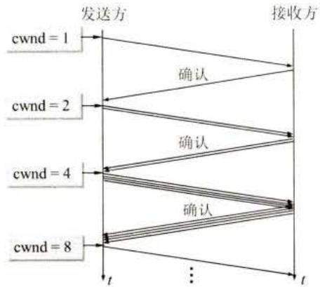
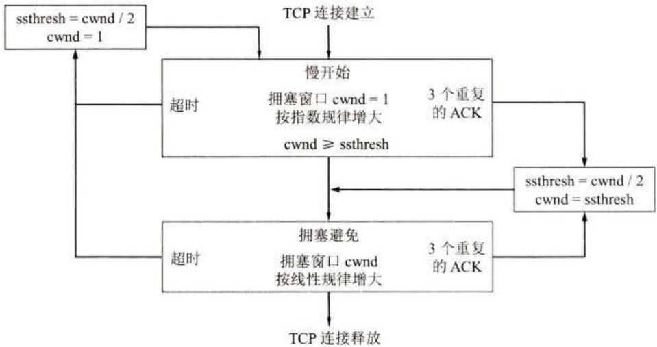

# 5.8.2 TCP的拥塞控制方法

TCP 进行拥塞控制的算法有四种，即慢开始(slow-start)、拥塞避免(congestion avoidance)、快重传(fast retransmit)和快恢复(fast recovery)（见草案标准 RFC 5681）。下面就介绍这些算法的原理。为了集中精力讨论拥塞控制，我们假定：

(1) 数据是单方向传送的，对方只传送确认报文。

(2) 接收方总是有足够大的缓存空间，因而发送窗口的大小由网络的拥塞程度来决定。

## 1. 慢开始和拥塞避免

下面讨论的拥塞控制也叫作基于窗口的拥塞控制。为此，发送方维持一个叫作拥塞窗口 cwnd (congestion window)的状态变量。拥塞窗口的大小取决于网络的拥塞程度，并且是动态变化着的。发送方让自己的发送窗口等于拥塞窗口。根据假定，对方的接收窗口足够大，发送方在发送数据时，只需考虑发送方的拥塞窗口。

发送方控制拥塞窗口的原则是：只要网络没有出现拥塞，拥塞窗口就可以再增大一些，以便把更多的分组发送出去，这样就可以提高网络的利用率。但只要网络出现拥塞或有可能出现拥塞，就必须把拥塞窗口减小一些，以减少注入到网络中的分组数，以便缓解网络出现的拥塞。

发送方又如何知道网络发生了拥塞呢？我们知道，当网络发生拥塞时，路由器就要把来不及处理而排不上队的分组丢弃。因此只要发送方没有按时收到对方的确认报文，也就是说，只要出现了超时，就可以估计可能在网络某处出现了拥塞。现在通信线路的传输质量一般都很好，因传输出差错而丢弃分组的概率是很小的（远小于1%）。因此，发送方在超时重传计时器启动时，就判断网络出现了拥塞。

下面将讨论拥塞窗口 cwnd 的大小是怎样变化的。我们从 “慢开始算法” 讲起。

慢开始算法的思路是这样的：当主机在已建立的 TCP 连接上开始发送数据时，并不清楚网络当前的负荷情况。如果立即把大量数据字节注入到网络，那么就有可能引起网络发生拥塞。经验证明，较好的方法是先探测一下，即由小到大逐渐增大注入到网络中的数据字节，也就是说，由小到大逐渐增大拥塞窗口数值。

旧的规定是这样的：在刚刚开始发送报文段时，先把初始拥塞窗口 cwnd 设置为 1 至 2 个发送方的最大报文段 SMSS (Sender Maximum Segment Size) 的数值，但新的 RFC 5681（草案标准）把初始拥塞窗口 cwnd 设置为不超过 2 至 4 个 SMSS 的数值。具体的规定如下：

若 SMSS > 2190 字节，

则设置初始拥塞窗口 cwnd = 2 × SMSS 字节，且不得超过 2 个报文段。

$$ \text { 若 } (\mathrm{SMSS} > 1 0 9 5 \text { 字节 }) \text { 且 } (\mathrm{SMSS} \leqslant 2 1 9 0 \text { 字节 }), $$

则设置初始拥塞窗口 cwnd = 3 × SMSS 字节，且不得超过 3 个报文段。若 SMSS ≤ 1095 字节，

则设置初始拥塞窗口 cwnd = 4 × SMSS 字节，且不得超过 4 个报文段。

可见这个规定就是限制初始拥塞窗口的字节数。

慢开始规定，在每收到一个对新的报文段的确认后，可以把拥塞窗口增加最多一个SMSS的数值。更具体些，就是

$$ \text { 拥塞窗口 cwnd 每次的增加量 } = \min (N, \mathrm{SMSS})\tag{5-8} $$

其中 N 是原先未被确认的、但现在被刚收到的确认报文段所确认的字节数。不难看出，当 N < SMSS 时，拥塞窗口每次的增加量要小于 SMSS。

用这样的方法逐步增大发送方的拥塞窗口 cwnd，可以使分组注入到网络的速率更加合理。

下面用例子说明慢开始算法的原理。请注意，虽然实际上 TCP 用字节数作为窗口大小的单位。但为叙述方便起见，我们用报文段的个数作为窗口大小的单位，这样可以使用较小的数字来阐明拥塞控制的原理。

在一开始发送方先设置 cwnd = 1，发送第一个报文段，接收方收到后就发送确认。慢开始算法定规定，发送方每收到一个对新报文段的确认（对重传的确认不算在内），就把发送方的拥塞窗口加 1。因此，经过一个往返时延 RTT 后，发送方就增大拥塞窗口，使 cwnd = 2，即发送方现在可连续发送两个报文段。接收方收到这两个报文段后，先后发回两个确认。现在发送方收到两个确认，根据慢开始算法，拥塞窗口就应当加 2，使拥塞窗口从 cwnd = 2 增加到 cwnd = 4，即可连续发送 4 个报文段。发送方收到这 4 个确认后，就可以把拥塞窗口再加 4，使 cwnd = 8（如图 5-24 所示）。显然，发送方并不是要在所有的确认都收齐了之后才调整其拥塞窗口，而是收到一个确认就调整一下拥塞窗口，抓紧时间发送报文段。但这样的细节不是我们现在所要研究的，我们想知道的只是拥塞窗口的大致增长趋势。

> 图 5-24 发送方每收到 1 个确认就把拥塞窗口加 1（教材第 242 页）

由此可见，慢开始的“慢”并不是指 cwnd 的增长速率慢，而是指在 TCP 开始发送报文段时，只发送一个报文段，即设置 cwnd = 1，目的是试探一下网络的拥塞情况，然后视情况再逐渐增大 cwnd。这当然比一开始设置大的 cwnd 值，一下子把许多报文段迅速注入到网络要“慢得多”。这对防止出现网络拥塞是一个非常好的方法。

为了防止拥塞窗口 cwnd 增长过大引起网络拥塞，还需要设置一个慢开始门限 ssthresh 状态变量（可以把门限 ssthresh 的数值设置大些，例如达到发送窗口的最大容许值）。慢开

始门限 ssthresh 的用法如下:

当 cwnd < ssthresh 时，使用上述的慢开始算法。

当 cwnd > ssthresh 时，停止使用慢开始算法而改用拥塞避免算法。

当 cwnd = ssthresh 时，既可使用慢开始算法，也可使用拥塞避免算法。

拥塞避免算法的目的是让拥塞窗口 cwnd 缓慢地增大（具体算法见[RFC 5681]）。执行算法后的结果大约是这样的：每经过一个往返时间 RTT，发送方的拥塞窗口 cwnd 的大小就加 1，而不是像慢开始阶段那样加倍增长。因此在拥塞避免阶段就称为“加法增大”AI (Additive Increase)，表明在拥塞避免阶段，拥塞窗口 cwnd 按线性规律缓慢增长，比慢开始算法的拥塞窗口增长速率缓慢得多。

可以用曲线来说明 TCP 的拥塞窗口 cwnd 是怎样随时间变化的（如图 5-25 所示）。但这里请特别注意横坐标采用的单位是往返时延 RTT。在实际的互联网中，TCP 发送的每一个报文段的往返时延 RTT 都是不一样的（不会像图 5-24 中所画出的那样很理想的情况）。但在这里我们是讲解拥塞控制的原理，因此应当把图中的 RTT 理解为一个大致的时间，在这样的时间之内，发送方发出了一批报文段，并且都收到了接收方的确认。图 5-25 中的数字①至⑤是特别要注意的几个点。现假定 TCP 的发送窗口等于拥塞窗口。

当 TCP 连接已建立后，把拥塞窗口 cwnd 置为 1。在本例中，慢开始门限的初始值设置为 16 个报文段，即 ssthresh = 16。在执行慢开始算法阶段，每经过一个往返时间 RTT，拥塞窗口 cwnd 就加倍。当拥塞窗口 cwnd 增长到慢开始门限值 ssthresh 时（图中的点①，此时拥塞窗口 cwnd = 16），就改为执行拥塞避免算法，拥塞窗口按线性规律增长。但请注意，“拥塞避免”并非完全避免拥塞，而是让拥塞窗口增长得缓慢些，使网络不容易出现拥塞。

当拥塞窗口 cwnd = 24 时，网络出现了超时（图中的点②），这就是网络发生拥塞的标志。于是调整门限值 ssthresh = cwnd / 2 = 12，同时设置拥塞窗口 cwnd = 1，执行慢开始算法。

按照慢开始算法，发送方每收到一个对新报文段的确认 ACK，就把拥塞窗口值加 1。当拥塞窗口 cwnd = ssthresh = 12 时（图中的点③，这是 ssthresh 第 1 次调整后的数值），改为执行拥塞避免算法，拥塞窗口按线性规律增大。

当拥塞窗口 cwnd = 16 时（图中的点④），出现了一个新的情况，就是发送方一连收到 3 个对同一个报文段的重复确认（图中记为 3-ACK）。关于这个问题要解释如下。

有时，个别报文段会在网络中意外丢失，但实际上网络并未发生拥塞。如果发送方迟迟收不到确认，就会产生超时，并误认为网络发生了拥塞。这就导致发送方错误地启动慢开始，把拥塞窗口 cwnd 又设置为 1，因而不必要地降低了传输效率。

采用快重传算法可以让发送方尽早知道发生了个别报文段的丢失。快重传算法首先要求接收方不要等待自己发送数据时才进行捎带确认，而是要立即发送确认，即使收到了失序的报文段也要立即发出对已收到的报文段的重复确认。如图5-26所示，接收方收到了 $M_{1}$ 和 $M_{2}$ 后都分别及时发出了确认。现假定接收方没有收到 $M_{3}$ 但却收到了 $M_{4}$ 。本来接收方可以什么都不做。但按照快重传算法，接收方必须立即发送对 $M_{2}$ 的重复确认，以便让发送方及早知道接收方没有收到报文段 $M_{3}$ 。发送方接着发送 $M_{5}$ 和 $M_{6}$ 。接收方收到后也仍要再次分别发出对 $M_{2}$ 的重复确认。这样，发送方共收到了接收方的4个对 $M_{2}$ 的确认，其中后3个都是重复确认。快重传算法规定，发送方只要一连收到3个重复确认，就可知道现在并未出现网络拥塞，而只是接收方少收到一个报文段 $M_{3}$ ，因而立即进行重传 $M_{3}$ （即“快重传”）。使用快重传可以使整个网络的吞吐量提高约20%。

因此，在图 5-25 中的点④，发送方知道现在只是丢失了个别的报文段。于是不启动慢开始，而是执行快恢复算法。这时，发送方第 2 次调整门限值，使 ssthresh = cwnd / 2 = 8，同时设置拥塞窗口 cwnd = ssthresh = 8（见图 5-25 中的点⑤），并开始执行拥塞避免算法。

在图 5-25 中还标注有 “TCP Reno 版本”，表示区别于老的 TCP Tahao 版本。

请注意，也有的快恢复实现是把快恢复开始时的拥塞窗口 cwnd 值再增大一些（增大 3 个报文段的长度），即等于新的 ssthresh + 3 × MSS。这样做的理由是：既然发送方收到 3 个重复的确认，就表明有 3 个分组已经离开了网络。这 3 个分组不再消耗网络的资源而是停留在接收方的缓存中（接收方发送出 3 个重复的确认就证明了这个事实）。可见现在网络中并不是堆积了分组而是减少了 3 个分组。因此可以适当把拥塞窗口扩大些。

从图 5-25 可以看出，在拥塞避免阶段，拥塞窗口是按照线性规律增大的，这就是前面提到过的加法增大 AI。而一旦出现超时或 3 个重复的确认，就要把门限值设置为当前拥塞窗口值的一半，并大大减小拥塞窗口的数值。这常称为“乘法减小”MD (Multiplicative Decrease)。二者合在一起就是所谓的 AIMD 算法。

采用这样的拥塞控制方法使得 TCP 的性能有明显的改进[STEV94][RFC 5681]。

根据以上所述，TCP 的拥塞控制可以归纳为图 5-27 的流程图。这个流程图就比图 5-25 所示的特例要更加全面些。例如，图 5-25 没有说明在慢开始阶段如果出现了超时（即出现了网络拥塞）或出现 3-ACK，发送方应采取什么措施。但从图 5-27 的流程图就可以很明确地知道发送方应采取的措施。

> 图 5-27 TCP 的拥塞控制的流程图（教材第 245 页）

在这一节的开始我们就假定了接收方总是有足够大的缓存空间，因而发送窗口的大小由网络的拥塞程度来决定。但实际上接收方的缓存空间总是有限的。接收方根据自己的接收能力设定了接收方窗口 rwnd，并把这个窗口值写入 TCP 首部中的窗口字段，传送给发送方。因此，接收方窗口又称为通知窗口(advertised window)。因此，从接收方对发送方的流量控制的角度考虑，发送方的发送窗口一定不能超过对方给出的接收方窗口值 rwnd。

如果把本节所讨论的拥塞控制和接收方对发送方的流量控制一起考虑，那么很显然，发送方的窗口的上限值应当取为接收方窗口 rwnd 和拥塞窗口 cwnd 这两个变量中较小的一个，也就是说：

$$ \text { 发送方窗口的上限值 } = \mathrm{Min} [ \mathrm{rwnd}, \mathrm{cwnd} ]\tag{5-9} $$

式(5-9)指出：

当 rwnd < cwnd 时，是接收方的接收能力限制发送方窗口的最大值。

反之，当 cwnd < rwnd 时，则是网络的拥塞程度限制发送方窗口的最大值。

也就是说，rwnd 和 cwnd 中数值较小的一个，控制了发送方发送数据的速率。
