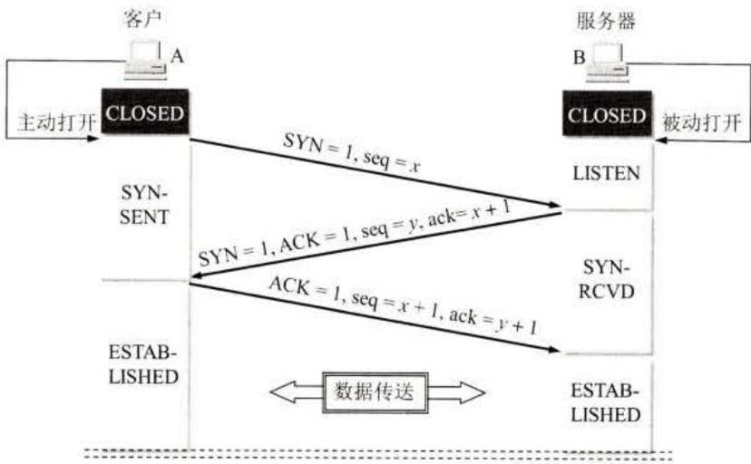

# 5.9.1 TCP的连接建立

## 5.9 TCP 的运输连接管理

TCP 是面向连接的协议。运输连接是用来传送 TCP 报文的。TCP 运输连接的建立和释放是每一次面向连接的通信中必不可少的过程。因此，运输连接就有三个阶段，即：连接建立、数据传送和连接释放。运输连接的管理就是使运输连接的建立和释放都能正常地进行。

在 TCP 连接建立过程中要解决以下三个问题:

(1) 要使每一方能够确知对方的存在。

(2) 要允许双方协商一些参数（如最大窗口值、是否使用窗口扩大选项和时间戳选项以及服务质量等）。

(3) 能够对运输实体资源（如缓存大小、连接表中的项目等）进行分配。

TCP 连接的建立采用客户服务器方式。主动发起连接建立的应用进程叫作客户(client)，而被动等待连接建立的应用进程叫作服务器(server)。

TCP 建立连接的过程叫作握手，握手需要在客户和服务器之间交换三个 TCP 报文段。图 5-28 画出了三报文握手 $^{①}$ 建立 TCP 连接的过程。

> 图 5-28 用三报文握手建立 TCP 连接（教材第 247 页）

假定主机 A 运行的是 TCP 客户程序，而 B 运行 TCP 服务器程序。最初两端的 TCP 进程都处于 CLOSED（关闭）状态。图中在主机下面的方框分别是 TCP 进程所处的状态。请注意，在本例中，A 主动打开连接，而 B 被动打开连接。

一开始，B 的 TCP 服务器进程先创建传输控制块 TCB $^{2}$ ，准备接受客户进程的连接请求。然后服务器进程就处于 LISTEN（收听）状态，等待客户的连接请求。如有，即做出响应。

> ① 注：三报文握手是本教材首次采用的译名。在 RFC 793（TCP 标准的文档）中使用的名称是 three way handshake，但这个名称很难译为准确的中文。例如，以前本教材曾采用“三次握手”这个广为流行的译名。其实这是在一次握手过程中交换了三个报文，而并不是进行了三次握手（这有点像两个人见面进行一次握手时，他们的手上下摇晃了三次，但这并非进行了三次握手）。最近再次重新阅读了 RFC 793 文档，发现有这样的表述：“three way (three message) handshake”。可见采用“三报文握手”这样的译名，在意思的表达上应当是比较准确的。请注意，handshake 使用的是单数而不是复数，表明只是一次握手。

> ② 注：传输控制块 TCB (Transmission Control Block) 存储了每一个连接中的一些重要信息，如：TCP 连接表、指向发送和接收缓存的指针、指向重传队列的指针、当前的发送和接收序号，等等。

A 的 TCP 客户进程也是首先创建传输控制块 TCB。然后，在打算建立 TCP 连接时，向 B 发出连接请求报文段，这时首部中的同步位 SYN = 1，同时选择一个初始序号 seq = x。TCP 规定，SYN 报文段（即 SYN = 1 的报文段）不能携带数据，但要消耗掉一个序号。这时，TCP 客户进程进入 SYN-SENT（同步已发送）状态。

B 收到连接请求报文段后，如同意建立连接，则向 A 发送确认。在确认报文段中应把 SYN 位和 ACK 位都置 1，确认号是 ack = x + 1，同时也为自己选择一个初始序号 seq = y。请注意，这个报文段也不能携带数据，但同样要消耗掉一个序号。这时 TCP 服务器进程进入 SYN-RCVD（同步收到）状态。

TCP 客户进程收到 B 的确认后，还要向 B 给出确认。确认报文段的 ACK 置 1，确认号 ack = y + 1，而自己的序号 seq = x + 1。TCP 的标准规定，ACK 报文段可以携带数据。但如果不携带数据则不消耗序号，在这种情况下，下一个数据报文段的序号仍是 seq = x + 1。这时，TCP 连接已经建立，A 进入 ESTABLISHED（已建立连接）状态。

当 B 收到 A 的确认后，也进入 ESTABLISHED 状态。

上面给出的连接建立过程叫作三报文握手。请注意，在图 5-28 中 B 发送给 A 的报文段，也可拆成两个报文段。可以先发送一个确认报文段（ACK = 1, ack = x + 1），然后再发送一个同步报文段（SYN = 1, seq = y）。这样的过程就变成了四报文握手，但效果是一样的。

为什么 A 最后还要发送一次确认呢？这主要是为了防止已失效的连接请求报文段突然又传送到了 B，因而产生错误。

所谓 “已失效的连接请求报文段” 是这样产生的。考虑一种正常情况，A 发出连接请求，但因连接请求报文丢失而未收到确认。于是 A 再重传一次连接请求。后来收到了确认，建立了连接。数据传输完毕后，就释放了连接。A 共发送了两个连接请求报文段，其中第一个丢失，第二个到达了 B，没有 “已失效的连接请求报文段”。

现假定出现一种异常情况，即 A 发出的第一个连接请求报文段并没有丢失，而是在某些网络节点长时间滞留了，以致延误到连接释放以后的某个时间才到达 B。本来这是一个早已失效的报文段。但 B 收到此失效的连接请求报文段后，就误认为是 A 又发出一次新的连接请求。于是就向 A 发出确认报文段，同意建立连接。假定不采用报文握手，那么只要 B 发出确认，新的连接就建立了。

由于现在 A 并没有发出建立连接的请求，因此不会理睬 B 的确认，也不会向 B 发送数据。但 B 却以为新的运输连接已经建立了，并一直等待 A 发来数据。B 的许多资源就这样白白浪费了。

采用三报文握手的办法，可以防止上述现象的发生。例如在刚才的异常情况下，A 不会向 B 的确认发出确认。B 由于收不到确认，就知道 A 并没有要求建立连接。
