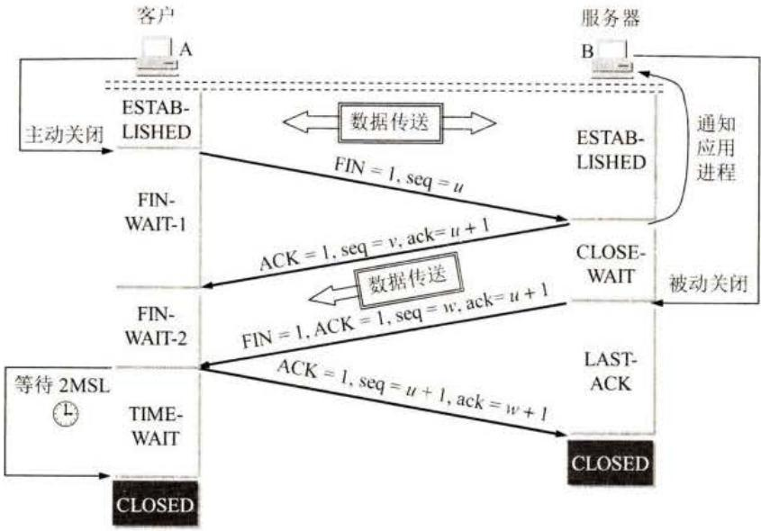

# 5.9.2 TCP的连接释放

TCP 连接释放过程比较复杂，我们仍结合双方状态的改变来阐明连接释放的过程。

数据传输结束后，通信的双方都可释放连接。现在 A 和 B 都处于 ESTABLISHED 状态（如图 5-29 所示）。A 的应用进程先向其 TCP 发出连

接释放报文段，并停止再发送数据，主动关闭 TCP 连接。A 把连接释放报文段首部的终止控制位 FIN 置 1，其序号 seq = u，它等于前面已传送过的数据的最后一个字节的序号加 1。这时 A 进入 FIN-WAIT-1（终止等待 1）状态，等待 B 的确认。请注意，TCP 规定，FIN 报文段即使不携带数据，它也消耗掉一个序号。

> 图 5-29 TCP 连接释放的过程（教材第 249 页）

B 收到连接释放报文段后即发出确认，确认号是 ack = u + 1，而这个报文段自己的序号是 v，等于 B 前面已传送过的数据的最后一个字节的序号加 1。然后 B 就进入 CLOSE-WAIT（关闭等待）状态。TCP 服务器进程这时应通知高层应用进程，因而从 A 到 B 这个方向的连接就释放了，这时的 TCP 连接处于半关闭(half-close)状态，即 A 已经没有数据要发送了，但 B 若发送数据，A 仍要接收。也就是说，从 B 到 A 这个方向的连接并未关闭，这个状态可能会持续一段时间。

A 收到来自 B 的确认后，就进入 FIN-WAIT-2（终止等待 2）状态，等待 B 发出的连接释放报文段。

若 B 已经没有要向 A 发送的数据，其应用进程就通知 TCP 释放连接。这时 B 发出的连接释放报文段必须使 FIN = 1。现假定 B 的序号为 w（在半关闭状态 B 可能又发送了一些数据）。B 还必须重复上次已发送过的确认号 ack = u + 1。这时 B 就进入 LAST-ACK（最后确认）状态，等待 A 的确认。

A 在收到 B 的连接释放报文段后，必须对此发出确认。在确认报文段中把 ACK 置 1，确认号 ack = w + 1，而自己的序号是 seq = u + 1（根据 TCP 标准，前面发送过的 FIN 报文段要消耗一个序号）。然后进入到 TIME-WAIT（时间等待）状态。请注意，现在 TCP 连接还没有释放掉。必须经过时间等待计时器(TIME-WAIT timer)设置的时间 2MSL 后，A 才进入到 CLOSED 状态。时间 MSL 叫作最长报文段寿命(Maximum Segment Lifetime)，RFC 793 建议设为 2 分钟。但这完全是从工程上来考虑的，对于现在的网络，MSL = 2 分钟可能太长了一些。因此 TCP 允许不同的实现可根据具体情况使用更小的 MSL 值。因此，从 A 进入到 TIME-WAIT 状态后，要经过 4 分钟才能进入到 CLOSED 状态，才能开始建立下一个新的连接。当 A 撤销相应的传输控制块 TCB 后，就结束了这次的 TCP 连接。

为什么 A 在 TIME-WAIT 状态必须等待 2MSL 的时间呢？这有两个理由。

第一，为了保证 A 发送的最后一个 ACK 报文段能够到达 B。这个 ACK 报文段有可能丢失，因而使处在 LAST-ACK 状态的 B 收不到对已发送的 FIN + ACK 报文段的确认。B 会超时重传这个 FIN + ACK 报文段，而 A 就能在 2MSL 时间内收到这个重传的 FIN + ACK 报文段。接着 A 重传一次确认，重新启动 2MSL 计时器。最后，A 和 B 都正常进入到 CLOSED 状态。如果 A 在 TIME-WAIT 状态不等待一段时间，而是在发送完 ACK 报文段后立即释放连接，那么就无法收到 B 重传的 FIN + ACK 报文段，因而也不会再发送一次确认报文段。这样，B 就无法按照正常步骤进入 CLOSED 状态。

第二，防止上一节提到的“已失效的连接请求报文段”出现在本连接中。A在发送完最后一个ACK报文段后，再经过时间2MSL，就可以使本连接持续的时间内所产生的所有报文段都从网络中消失。这样就可以使下一个新的连接中不会出现这种旧的连接请求报文段。

B 只要收到了 A 发出的确认，就进入 CLOSED 状态。同样，B 在撤销相应的传输控制块 TCB 后，就结束了这次的 TCP 连接。我们注意到，B 结束 TCP 连接的时间要比 A 早一些。

上述的 TCP 连接释放过程是四报文握手。

除时间等待计时器外，TCP 还设有一个保活计时器(keepalive timer)。设想有这样的情况：客户已主动与服务器建立了 TCP 连接。但后来客户端的主机突然出故障。显然，服务器以后就不能再收到客户发来的数据。因此，应当有措施使服务器不要再白白等待下去。这就是使用保活计时器。服务器每收到一次客户的数据，就重新设置保活计时器，时间的设置通常是两小时。若两小时没有收到客户的数据，服务器就发送一个探测报文段，以后则每隔 75 秒钟发送一次。若一连发送 10 个探测报文段后仍无客户的响应，服务器就认为客户端出了故障，接着就关闭这个连接。
