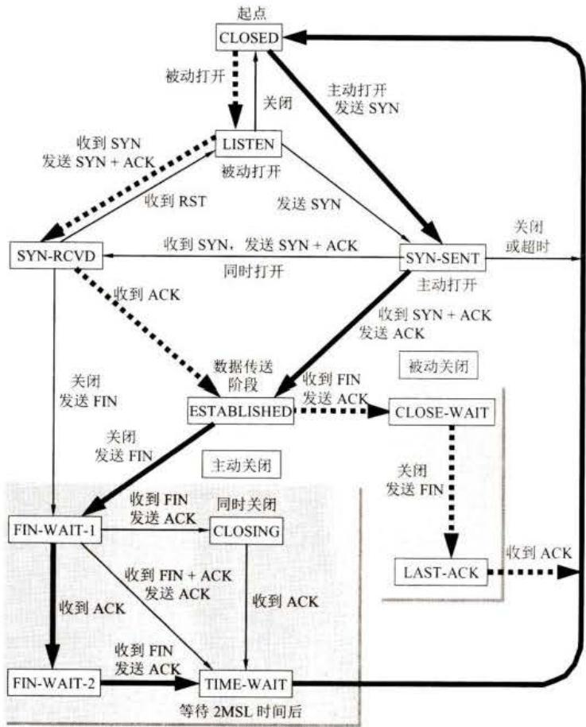

# 5.9.3 TCP的有限状态机

为了更清晰地看出 TCP 连接的各种状态之间的关系，图 5-30 给出了 TCP 的有限状态机。图中每一个方框是 TCP 可能具有的状态。每个方框中的大写英文字符串是 TCP 标准所使用的 TCP 连接状态名。状态之间的箭头

表示可能发生的状态变迁。箭头旁边的字，表明引起这种变迁的原因，或表明发生状态变迁后又出现什么动作。请注意图中有三种不同的箭头。粗实线箭头表示对客户进程的正常变迁。粗虚线箭头表示对服务器进程的正常变迁。另一种细线箭头表示异常变迁。

我们可以把图 5-30 和前面的图 5-28、图 5-29 对照起来看。在图 5-28 和图 5-29 中左边客户进程从上到下的状态变迁，就是图 5-30 中粗实线箭头所指的状态变迁。而在图 5-28 和 5-29 右边服务器进程从上到下的状态变迁，就是图 5-30 中粗虚线箭头所指的状态变迁。

还有一些状态变迁，例如连接建立过程中的从 LISTEN 到 SYN-SENT 和从 SYN-SENT 到 SYN-RCVD。读者可分析在什么情况下会出现这样的变迁（见习题 5-43）。

> 图 5-30 TCP 的有限状态机（教材第 251 页）
