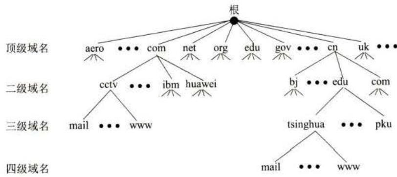

# 6.1.2 互联网的域名结构

早期的互联网使用了非等级的名字空间，其优点是名字简短。但当互联网上的用户数急剧增加时，用非等级的名字空间来管理一个很大的而且是经常变化的名字集合是非常困难的。因此，互联网后来就采用了层次树状结构的命名方法，就像全球邮政系统和电话系统那样。采用这种命名方法，任何一个连接在互联网上的主机或路由器，都有一个唯一的层次结构的名字，即域名(domain name)。这里，“域”(domain)是名字空间中一个可被管理的划分。域还可以划分为子域，而子域还可继续划分为子域的子域，这样就形成了顶级域、二级域、三级域，等等。

从语法上讲，每一个域名都由标号(label)序列组成，而各标号之间用点隔开（请注意，这里所说的“点”是英语中的句号“.”，不是中文的句号“。”）。例如下面的域名

就是中央电视台用于收发电子邮件的计算机（即邮件服务器）的域名，它由三个标号组成，其中标号 com 是顶级域名，标号 cctv 是二级域名，标号 mail 是三级域名。

DNS 规定，域名中的标号都由英文字母和数字组成，每一个标号不超过 63 个字符（但为了记忆方便，最好不要超过 12 个字符），也不区分大小写字母（例如，CCTV 或 cctv 在域名中是等效的）。标号中除连字符(-)外不能使用其他的标点符号。级别最低的域名写在最左边，而级别最高的顶级域名则写在最右边。由多个标号组成的完整域名总共不超过 255 个字符。DNS 既不规定一个域名需要包含多少个下级域名，也不规定每一级的域名代表什么意思。各级域名由其上一级的域名管理机构管理，而最高的顶级域名则由 ICANN 进行管理。用这种方法可使每一个域名在整个互联网范围内是唯一的，并且也容易设计出一种查找域名的机制。

需要注意的是，域名只是个逻辑概念，并不代表计算机所在的物理地点。变长的域名和使用有助记忆的字符串，是为了便于人使用。而 IP 地址是定长的 32 位二进制数字则非常便于机器进行处理。这里需要注意，域名中的“点”和点分十进制 IP 地址中的“点”并无一一对应的关系。点分十进制 IP 地址中一定是包含三个“点”，但每一个域名中“点”的数

目则不一定正好是三个。

截至 2020 年 6 月的统计[W-Wiki]，现在全球顶级域名 TLD (Top Level Domain) 在 IANA 登记的已有 1584 个（其中有不到 80 个未使用）。原先的顶级域名共分为三大类：

(1) 国家顶级域名 nTLD：采用 ISO 3166 的规定。如: cn 表示中国, us 表示美国, uk 表示英国, 等等 $^{①}$ 。国家顶级域名又常记为 ccTLD（cc 表示国家代码 country-code）。截至 2020 年 6 月为止，国家顶级域名总数已达 316 个。

(2) 通用顶级域名 gTLD: 到 2006 年 12 月为止, 通用顶级域名的总数已经达到 20 个。最先确定的通用顶级域名有 7 个, 即:

com（公司企业），net（网络服务机构），org（非营利性组织），int（国际组织），edu（美国专用的教育机构），gov（美国的政府部门），mil表示（美国的军事部门）。

以后又陆续增加了13个通用顶级域名：

aero（航空运输企业），asia（亚太地区），biz（公司和企业），cat（使用加泰隆人的语言和文化团体），coop（合作团体），info（各种情况），jobs（人力资源管理者），mobi（移动产品与服务的用户和提供者），museum（博物馆），name（个人），pro（有证书的专业人员），tel（Telnic股份有限公司），travel（旅游业）。

(3) 基础结构域名(infrastructure domain): 这种顶级域名只有一个，即 arpa，用于反向域名解析，因此又称为反向域名。

值得注意的是，ICANN 于 2011 年 6 月 20 日在新加坡会议上正式批准新顶级域名（New gTLD），因此任何公司、机构都有权向 ICANN 申请新的顶级域名。新顶级域名的后缀特点，使企业域名具有了显著的、强烈的标志特征。因此，新顶级域名被认为是真正的企业网络商标。新顶级域名是企业品牌战略发展的重要内容，其申请费很高（18 万美元），并且在 2013 年开始启用。目前已有一些由两个汉字组成的中文的顶级域名出现了，例如，商城、公司、新闻等。然而中文顶级域名并未获得广泛的使用（可能是使用不太方便吧）。

在国家顶级域名下注册的二级域名均由该国家自行确定。例如，顶级域名为 jp 的日本，将其教育和企业机构的二级域名定为 ac 和 co，而不用 edu 和 com。

我国把二级域名划分为“类别域名”和“行政区域名”两大类。

“类别域名”共7个，分别为：ac（科研机构），com（工、商、金融等企业），edu（中国的教育机构），gov（中国的政府机构），mil（中国的国防机构），net（提供互联网络服务的机构），org（非营利性的组织）。

“行政区域名”共34个，适用于我国的各省、自治区、直辖市。例如：bj（北京市），js（江苏省），等等。

关于我国的互联网络发展现状以及各种规定（如申请域名的手续），均可在中国互联网网络信息中心 CNNIC 的网址上找到[W-CNNIC]。

用域名树来表示互联网的域名系统是最清楚的。图 6-1 是互联网域名空间的结构，它实际上是一个倒过来的树，在最上面的是根，但没有对应的名字。根下面一级的节点 $^{①}$ 就是最高一级的顶级域名（由于根没有名字，所以在根下面一级的域名就叫作顶级域名）。顶级域名可往下划分子域，即二级域名。再往下划分就是三级域名、四级域名，等等。图6-1列举了一些域名作为例子。凡是在顶级域名com下注册的单位都获得了一个二级域名。图中给出的例子有：中央电视台cctv，以及IBM和华为等公司。在顶级域名cn（中国）下面举出了几个二级域名，如：bj,edu以及com。在某个二级域名下注册的单位就可以获得一个三级域名。图中给出的在edu下面的三级域名有：tsinghua（清华大学）和pku（北京大学）。一旦某个单位拥有了一个域名，它就可以自己决定是否要进一步划分其下属的子域，并且不必由其上级机构批准。图中cctv（中央电视台）和tsinghua（清华大学）都分别划分了自己的下一级的域名mail和www（分别是三级域名和四级域名） $^{②}$ 。域名树的树叶就是单台计算机的名字，它不能再继续往下划分子域了。

> ① 注：实际上，国家顶级域名也包括某些地区的域名，如我国的香港特区（hk）和台湾省（tw）也都是 ccTLD 里面的顶级域名。此外，国家顶级域名可以使用一个国家自己的文字。例如，中国可以有“.cn”、“.中国”和繁体字的“.中國”这三种不同形式的域名。

> 图 6-1 互联网的域名空间（教材第 264 页）

应当注意，虽然中央电视台和清华大学都各有一台计算机取名为 mail，但它们的域名并不一样，因为前者是 mail.cctv.com，而后者是 mail.tsinghua.edu.cn。因此，即使在世界上还有很多单位的计算机取名为 mail，但是它们在互联网中的域名都必须是唯一的。

这里还要强调指出，互联网的名字空间是按照机构的组织来划分的，与物理的网络无关，与 IP 地址中的 “子网” 也没有关系。
