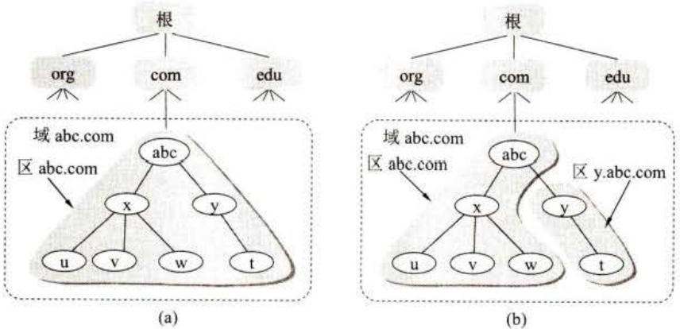
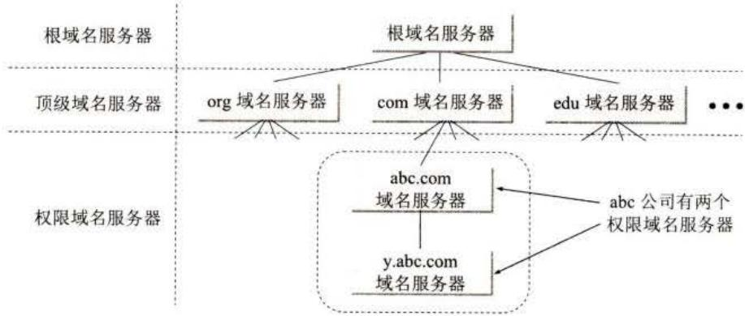
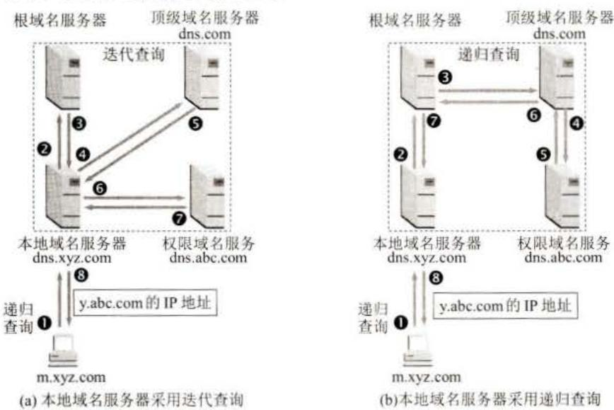

# 6.1.3 域名服务器

上面讲述的域名体系是抽象的。但具体实现域名系统则是使用分布在各地的域名服务器。从理论上讲，可以让每一级的域名都有一个相对应的域名服务器，使所有的域名服务器构成和图 6-1 相对应的“域名服务器树”的结构。但这样做会使域名服务器的数量太多，使域名系统的运行效率降低。因此 DNS 就采用划分区的办法来解决这个问题。

一个服务器所负责管辖的（或有权限的）范围叫作区(zone)。各单位根据具体情况来划分自己管辖范围的区。但在一个区中的所有节点必须是能够连通的。每一个区设置相应的权限域名服务器(authoritative name server)，用来保存该区中的所有主机的域名到 IP 地址的映射。总之，DNS 服务器的管辖范围不是以“域”为单位，而是以“区”为单位的。区是 DNS服务器实际管辖的范围。区可能等于或小于域，但一定不能大于域。

> ① 注：根据[MINGCI94]，对于树这样的数据结构，它的 node 应当译为“节点”（不是结点）。

> ② 注：为了便于记忆，人们愿意把用作邮件服务器的计算机取名为 mail，而把用作网站服务器的计算机取名为 www。

图 6-2 是区的不同划分方法的举例。假定 abc 公司有下属部门 x 和 y，部门 x 下面又分三个分部门 u, v 和 w，而 y 下面还有其下属部门 t。图 6-2(a) 表示 abc 公司只设一个区 abc.com。这时，区 abc.com 和域 abc.com 指的是同一件事。但图 6-2(b) 表示 abc 公司划分了两个区（大的公司可能要划分多个区）：abc.com 和 y.abc.com。这两个区都隶属于域 abc.com，都各设置了相应的权限域名服务器。不难看出，区是“域”的子集。

> 图 6-2 DNS 划分区的举例（教材第 265 页）

图 6-3 以图 6-2(b) 中公司 abc 划分的两个区为例，给出了 DNS 域名服务器树状结构图。这种 DNS 域名服务器树状结构图可以更准确地反映出 DNS 的分布式结构。在图 6-3 中的每一个域名服务器都能够进行部分域名到 IP 地址的解析。当某个 DNS 服务器不能进行域名到 IP 地址的转换时，它就设法找互联网上别的域名服务器进行解析。

> 图 6-3 树状结构的 DNS 域名服务器（教材第 265 页）

从图 6-3 可看出，互联网上的 DNS 域名服务器也是按照层次安排的。每一个域名服务器都只对域名体系中的一部分进行管辖。根据域名服务器所起的作用，可以把域名服务器划分为以下四种不同的类型：

(1) 根域名服务器(root name server): 根域名服务器是最高层次的域名服务器, 也是最重要的域名服务器。所有的根域名服务器都知道所有的顶级域名服务器的域名和 IP 地址。根域名服务器是最重要的域名服务器, 因为不管是哪一个本地域名服务器, 若要对互联网上任何一个域名进行解析 (即转换为 IP 地址), 只要自己无法解析, 就首先要求助于根域名服务器。假定所有的根域名服务器都瘫痪了，那么整个互联网中的 DNS 系统就无法工作。全世界的根域名服务器只使用 13 个不同 IP 地址的域名，即 a.rootservers.net, b.rootservers.net, …, m.rootservers.net。每个域名下的根域名服务器由专门的公司或美国政府的某个部门负责运营。但请注意，虽然互联网的根域名服务器总共只有 13 个域名，但根域名服务器并非仅由 13 台机器所组成（如果仅仅依靠这 13 台机器，根本不可能为全世界的互联网用户提供令人满意的服务）。实际上，在互联网中是由 13 套装置（13 installations，也就是 13 套系统）构成这 13 组根域名服务器的[W-ROOT]。每一套装置在很多地点安装根域名服务器（也可称为镜像根服务器），但都使用同一个域名。负责运营根域名服务器的公司大多在美国，但所有的根域名服务器却分布在全世界。为了提供更可靠的服务，在每一个地点的根域名服务器往往由多台机器组成（为了安全起见，这些根域名服务器的具体位置是严格保密的，不对外开放参观）。现在世界上大部分 DNS 域名服务器，都能就近找到一个根域名服务器查询 IP 地址（现在这些根域名服务器都已增加了 IPv6 地址）。为了方便，人们常用从 A 到 M 的前 13 个英文字母中的一个，来表示某组根域名服务器。截至 2021 年 3 月 24 日，全球共有 1375 个根域名服务器在运行，其中在我国的共有 37 个（分布在北京(8 个)、上海、杭州(2 个)、武汉(2 个)、贵阳、重庆、广州、西宁(3 个)、郑州(2 个)、香港(7 个)、澳门(2)、台北(7 个)）。

由于根域名服务器采用了任播(anycast)技术 $^{①}$ ，因此当DNS客户向某个根域名服务器的IP地址发出查询报文时，互联网上的路由器就能找到离这个DNS客户最近的一个根域名服务器。这样做不仅加快了DNS的查询过程，也更加合理地利用了互联网的资源。

必须指出，目前根域名服务器在全球的分布仍然是很不均衡的。在某些地区根域名服务器还较少，这就影响了上网的速率。

需要注意的是，在许多情况下，根域名服务器并不直接把待查询的域名直接转换成 IP 地址（根域名服务器也没有存放这种信息），而是告诉本地域名服务器下一步应当找哪一个顶级域名服务器进行查询。

由于根域名服务器在DNS中的地位特殊，因此对根域名服务器有许多具体的要求，如必须能够运行某些程序等[RFC7720]。

(2) 顶级域名服务器（即 TLD 服务器）：这些域名服务器负责管理在该顶级域名服务器注册的所有二级域名。当收到 DNS 查询请求时，就给出相应的回答（可能是最后的结果，也可能是下一步应当找的域名服务器的 IP 地址）。

(3) 权限域名服务器：这就是前面已经讲过的负责一个区的域名服务器。当一个权限域名服务器还不能给出最后的查询回答时，就会告诉发出查询请求的 DNS 客户，下一步应当找哪一个权限域名服务器。例如在图 6-2(b) 中，区 abc.com 和区 y.abc.com 各设有一个权限域名服务器。

(4) 本地域名服务器(local name server): 本地域名服务器并不属于图 6-3 所示的域名服务器层次结构，但它对域名系统非常重要。当一台主机发出 DNS 查询请求时，这个查询请求报文就发送给本地域名服务器。由此可看出本地域名服务器的重要性。每一个互联网服务提供者 ISP，或一个大学，甚至一个大学里的系，都拥有一个本地域名服务器，本地域名服务器离用户较近，一般不超过几个路由器的距离。当所要查询的主机也属于同一个本地 ISP时，该本地域名服务器立即就能将所查询的主机名转换为它的 IP 地址，而不需要再去询问其他的域名服务器。

> ① 注：任播的 IP 数据报的终点是一组在不同地点的主机，但具有相同的 IP 地址。IP 数据报交付离源点最近的一台主机。

为了提高域名服务器的可靠性，DNS 域名服务器都把数据复制到几个域名服务器来保存，其中的一个是主域名服务器(master name server)，其他的是辅助域名服务器(secondary name server)。当主域名服务器出故障时，辅助域名服务器可以保证 DNS 的查询工作不会中断。主域名服务器定期把数据复制到辅助域名服务器中，而更改数据只能在主域名服务器中进行。这样就保证了数据的一致性。

下面简单讨论一下域名的解析过程。这里要注意两点。

第一，主机向本地域名服务器的查询一般都采用递归查询(recursive query)。所谓递归查询就是：如果主机所询问的本地域名服务器不知道被查询域名的 IP 地址，那么本地域名服务器就以 DNS 客户的身份，向其他根域名服务器继续发出查询请求报文（即替该主机继续查询），而不是让该主机自己进行下一步的查询。因此，递归查询返回的查询结果或者是所要查询的 IP 地址，或者是报错，表示无法查询到所需的 IP 地址。

第二，本地域名服务器向根域名服务器的查询通常采用迭代查询(iterative query)。迭代查询的特点是这样的：当根域名服务器收到本地域名服务器发出的迭代查询请求报文时，要么给出所要查询的IP地址，要么告诉本地域名服务器：“你下一步应当向哪一个域名服务器进行查询”。然后让本地域名服务器进行后续的查询（而不是替本地域名服务器进行后续的查询）。根域名服务器通常是把自己知道的顶级域名服务器的IP地址告诉本地域名服务器，让本地域名服务器再向顶级域名服务器查询。顶级域名服务器在收到本地域名服务器的查询请求后，要么给出所要查询的IP地址，要么告诉本地域名服务器下一步应当向哪一个权限域名服务器进行查询，本地域名服务器就这样进行迭代查询。最后，知道了所要解析的域名的IP地址，然后把这个结果返回给发起查询的主机。当然，本地域名服务器也可以采用递归查询，这取决于最初的查询请求报文的设置要求使用哪一种查询方式。

图 6-4 用例子说明了这两种查询的区别。

> 图 6-4 DNS 查询举例（教材第 267 页）

假定域名为 m.xyz.com 的主机想知道另一台主机（域名为 y.abc.com）的 IP 地址。例如，主机 m.xyz.com 打算发送邮件给主机 y.abc.com。这时就必须知道主机 y.abc.com 的 IP 地址。下面是图 6-4(a) 的几个查询步骤：

① 主机 m.xyz.com 先向其本地域名服务器 dns.xyz.com 进行递归查询。

② 本地域名服务器采用迭代查询。它先向一个根域名服务器查询。

③ 根域名服务器告诉本地域名服务器，下一次应查询的顶级域名服务器 dns.com 的 IP 地址。

④ 本地域名服务器向顶级域名服务器 dns.com 进行查询。

⑤ 顶级域名服务器 dns.com 告诉本地域名服务器，下一次应查询的权限域名服务器 dns.abc.com 的 IP 地址。

⑥ 本地域名服务器向权限域名服务器 dns.abc.com 进行查询。

⑦ 权限域名服务器 dns.abc.com 告诉本地域名服务器，所查询的主机的 IP 地址。

⑧ 本地域名服务器最后把查询结果告诉主机 m.xyz.com。

我们注意到，这 8 个步骤总共要使用 8 个 UDP 用户数据报的报文。本地域名服务器经过三次迭代查询后，从权限域名服务器 dns.abc.com 得到了主机 y.abc.com 的 IP 地址，最后把结果返回给发起查询的主机 m.xyz.com。

图 6-4(b) 是本地域名服务器采用递归查询的情况。在这种情况下，本地域名服务器只需向根域名服务器查询一次，后面的几次查询都是在其他几个域名服务器之间进行的（步骤③至⑥）。只是在步骤⑦，本地域名服务器从根域名服务器得到了所需的 IP 地址。最后在步骤⑧，本地域名服务器把查询结果告诉主机 m.xyz.com。整个的查询也是使用 8 个 UDP 报文。

为了提高 DNS 查询效率，并减轻根域名服务器的负荷和减少互联网上的 DNS 查询报文数量，在域名服务器中广泛地使用了高速缓存（有时也称为高速缓存域名服务器）。高速缓存用来存放最近查询过的域名以及从何处获得域名映射 $^{①}$ 信息的记录。

例如，在图 6-4(a) 的查询过程中，如果在不久前已经有用户查询过域名为 y.abc.com 的 IP 地址，那么本地域名服务器就不必向根域名服务器重新查询 y.abc.com 的 IP 地址，而是直接把高速缓存中存放的上次查询结果（即 y.abc.com 的 IP 地址）告诉用户。

假定本地域名服务器的缓存中并没有 y.abc.com 的 IP 地址，而是存放着顶级域名服务器 dns.com 的 IP 地址，那么本地域名服务器也可以不向根域名服务器进行查询，而是直接向 com 顶级域名服务器发送查询请求报文。这样不仅可以大大减轻根域名服务器的负荷，而且也能够使互联网上的 DNS 查询请求和回答报文的数量大为减少。

由于名字到地址的绑定 $^{②}$ 并不经常改变，为保持高速缓存中的内容正确，域名服务器应为每项内容设置计时器并处理超过合理时间的项目（例如，每个项目只存放两天）。当域名服务器已从缓存中删去某项信息后又被请求查询该项信息，就必须重新到授权管理该项的域名服务器中获取绑定信息。当权限域名服务器回答一个查询请求时，在响应中都指明绑定有效存在的时间值。增加此时间值可减少网络开销，而减少此时间值可提高域名转换的准确性。

不但在本地域名服务器中需要高速缓存，在主机中也很需要。许多主机在启动时从本

> ① 注：映射(mapping)指两个集合元素之间的一种对应规则。

> ② 注：绑定(binding)指一个对象（或事务）与其某种属性建立某种联系的过程。

地域名服务器下载名字和地址的全部数据库，维护存放自己最近使用的域名的高速缓存，并且只在从缓存中找不到名字时才使用域名服务器。维护本地域名服务器数据库的主机自然应该定期地检查域名服务器以获取新的映射信息，而且主机必须从缓存中删掉无效的项。由于域名改动并不频繁，大多数网点不需花太多精力就能维护数据库的一致性。
