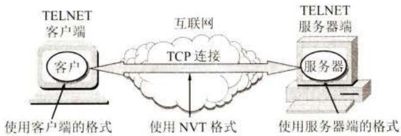

# 6.3 远程终端协议TELNET

TELNET 是一个简单的远程终端协议[RFC 854, STD8]。用户用

TELNET 就可在其所在地通过 TCP 连接注册（即登录）到远地的另一台主机上（使用主机名或 IP 地址）。TELNET 能将用户的击键传到远地主机，同时也能将远地主机的输出通过 TCP 连接返回到用户屏幕。这种服务是透明的，因为用户感觉到好像键盘和显示器是直接连在远地主机上的。因此，TELNET 又称为终端仿真协议。

TELNET 并不复杂，以前应用得很多。现在由于计算机的功能越来越强，用户已较少使用 TELNET 了，可作为历史资料了解一下即可。

TELNET 也使用客户服务器方式。在本地系统运行 TELNET 客户进程，而在远地主机则运行 TELNET 服务器进程。和 FTP 的情况相似，服务器中的主进程等待新的请求，并产生从属进程来处理每一个连接。

TELNET 能够适应许多计算机和操作系统的差异。例如，对于文本中一行的结束，有的系统使用 ASCII 码的回车(CR)，有的系统使用换行(LF)，还有的系统使用两个字符，回车-换行(CR-LF)。又如，在中断一个程序时，许多系统使用 Control-C (^C)，但也有系统使用 ESC 按键。为了适应这种差异，TELNET 定义了数据和命令应怎样通过互联网。这些定义就是所谓的网络虚拟终端 NVT (Network Virtual Terminal)。图 6-6 说明了 NVT 的意义。客户软件把用户的击键和命令转换成 NVT 格式，并送交服务器。服务器软件把收到的数据和命令从 NVT 格式转换成远地系统所需的格式。向用户返回数据时，服务器把远地系统的格式转换为 NVT 格式，本地客户再从 NVT 格式转换到本地系统所需的格式。

> 图 6-6 TELNET 使用网络虚拟终端 NVT 格式（教材第 272 页）

NVT 的格式定义很简单。所有的通信都使用 8 位一个字节。在运转时，NVT 使用 7 位 ASCII 码传送数据，而当高位置 1 时用作控制命令。ASCII 码共有 95 个可打印字符（如字母、数字、标点符号）和 33 个控制字符。所有可打印字符在 NVT 中的意义和在 ASCII 码中一样。但 NVT 只使用了 ASCII 码的控制字符中的几个。此外，NVT 还定义了两字符的 CR-LF 为标准的行结束控制符。当用户键入回车按键时，TELNET 的客户就把它转换为 CR-LF 再进行传输，而 TELNET 服务器要把 CR-LF 转换为远地机器的行结束字符。

TELNET 的选项协商(Option Negotiation)使 TELNET 客户和 TELNET 服务器可商定使用更多的终端功能，协商的双方是平等的。
