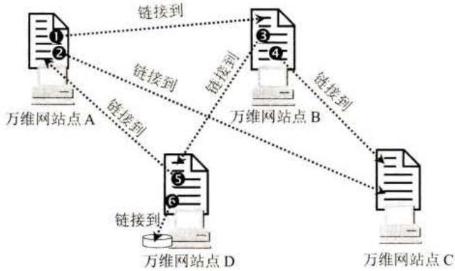

# 6.4.1 万维网概述

## 6.4 万维网 WWW

万维网 WWW (World Wide Web) 是一个大规模的、联机式的信息储藏所，英文简称为 Web，而不是什么特殊的计算机网络。万维网用链接的方法能非常方便地从互联网上的一个站点访问另一个站点（也就是所谓的“链接到另一个站点”），从而主动地按需获取丰富的信息。图 6-7 说明了万维网提供分布式服务的特点。

> 图 6-7 万维网提供分布式服务（教材第 273 页）

图 6-7 画出了四个万维网上的站点，它们可以相隔数千公里，但都必须连接在互联网上。每个万维网站点都存放了许多文档。在这些文档中有一些地方的文字是用特殊方式显示的（例如用不同的颜色，或添加了下划线），而当我们将鼠标移动到这些地方时，鼠标的箭头就变成了一只手的形状。这就表明这些地方有一个链接(link)（这种链接有时也称为超链 hyperlink），如果我们在这些地方点击鼠标左键，就可从这个文档链接到可能相隔很远的另一个文档。经过一定的时延（几秒钟、几分钟甚至更长，取决于所链接的文档的大小和网络的拥塞情况），在我们的屏幕上就能将远方传送过来的文档显示出来。例如，站点 A 的某个文档中有两个地方有链接。点击链接①可链接到站点 B 的某个文档，点击②可链接到站点 C。站点 B 的文档也有两个链接。点击链接③可链接到站点 D，点击链接④可链接到站点 C，但站点 C 的这个文档已无其他的链接了。站点 D 的文档中有两个链接。点击⑤可链接到站点 A，点击⑥可以链接到存储在本站点硬盘中的文档。

正是由于万维网的出现，使计算机的操作发生了革命性的变化。不必在键盘上输入复杂而难以记忆的命令，而改用鼠标点击一下屏幕上的链接，这就使互联网从仅由少数计算机专家使用变为普通百姓也能利用的信息资源。万维网的出现使网站数按指数规律增长，因而成为互联网发展中的一个非常重要的里程碑。

万维网是欧洲粒子物理实验室的 Tim Berners-Lee 最初于 1989 年 3 月提出的。1993 年 2 月，第一个图形界面的浏览器 (browser) 开发成功，名字叫作 Mosaic。1995 年著名的 Netscape Navigator 浏览器上市。目前流行的浏览器很多，如微软公司的 Internet Explorer （简称 IE），谷歌公司的 Chrome 浏览器，腾讯公司的 QQ 浏览器，苹果公司的 Safari 浏览器，等等。

万维网是一个分布式的超媒体(hypermedia)系统，它是超文本(hypertext)系统的扩充。所谓超文本是指包含指向其他文档的链接的文本(text)。也就是说，一个超文本由多个信息源链接成，而这些信息源可以分布在世界各地，并且数目也是不受限制的。利用一个链接可使用户找到远在异地的另一个文档，而这又可链接到其他的文档（依此类推）。这些文档可以位于世界上任何一个接在互联网上的超文本系统中。超文本是万维网的基础。

超媒体与超文本的区别是文档内容不同。超文本文档仅包含文本信息，而超媒体文档还包含其他表示方式的信息，如图形、图像、声音、动画以及视频图像等。

分布式的和非分布式的超媒体系统有很大区别。在非分布式系统中，各种信息都驻留在单个计算机的磁盘中。由于各种文档都可从本地获得，因此这些文档之间的链接可进行一致性检查。所以，一个非分布式超媒体系统能够保证所有的链接都是有效的和一致的。

万维网把大量信息分布在整个互联网上。每台主机上的文档都独立进行管理。对这些文档的增加、修改、删除或重新命名都不需要（实际上也不可能）通知到互联网上成千上万的节点。这样，万维网文档之间的链接就经常会不一致。例如，主机 A 上的文档 X 本来包含了一个指向主机 B 上的文档 Y 的链接。若主机 B 的管理员在某日删除了文档 Y，那么主机 A 的上述链接显然就失效了（但是 B 并没有责任必须通知 A）。

万维网以客户服务器方式工作。上面所说的浏览器就是在用户主机上的万维网客户程序。万维网文档所驻留的主机则运行服务器程序，因此这台主机也称为万维网服务器。客户程序向服务器程序发出请求，服务器程序向客户程序送回客户所要的万维网文档。在一个客户程序主窗口上显示出的万维网文档称为页面(page)。

从以上所述可以看出，万维网必须解决以下几个问题：

(1) 怎样标志分布在整个互联网上的万维网文档？

(2) 用什么样的协议来实现万维网上的各种链接？

(3) 怎样使不同作者创作的不同风格的万维网文档，都能在互联网上的各种主机上显示出来，同时使用户清楚地知道在什么地方存在着链接？

(4) 怎样使用户能够很方便地找到所需的信息？

为了解决第一个问题，万维网使用统一资源定位符 URL (Uniform Resource Locator) 来标志万维网上的各种文档，并使每一个文档在整个互联网的范围内具有唯一的标识符 URL。为了解决上述的第二个问题，就要使万维网客户程序与万维网服务器程序之间的交互遵守严格的协议，这就是超文本传送协议 HTTP (HyperText Transfer Protocol)。HTTP 是一个应用层协议，它使用 TCP 连接进行可靠的传送。为了解决上述的第三个问题，万维网使用超文本标记语言 HTML (HyperText Markup Language)，使得万维网页面的设计者可以很方便地用链接从本页面的某处链接到互联网上的任何一个万维网页面，并且能够在自己的主机屏幕上将这些页面显示出来。最后，用户可使用搜索工具在万维网上方便地查找所需的信息。

下面我们将进一步讨论上述重要概念。
