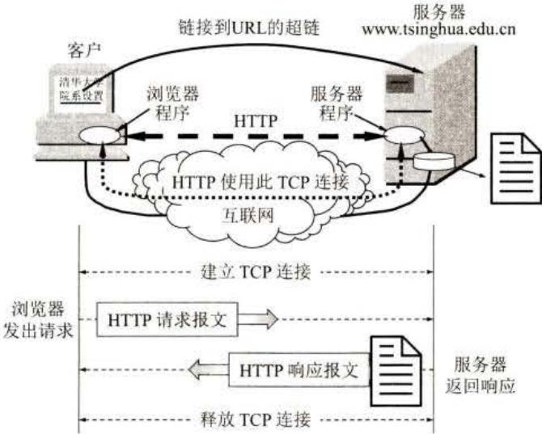
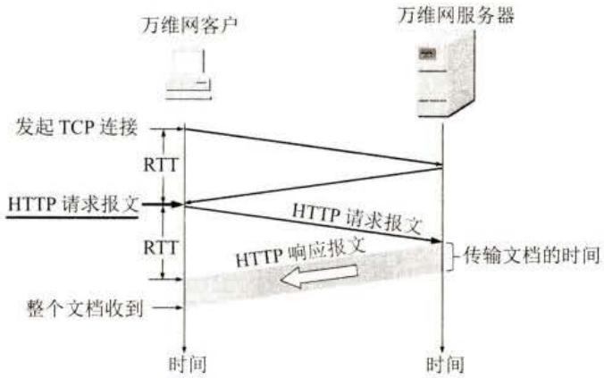
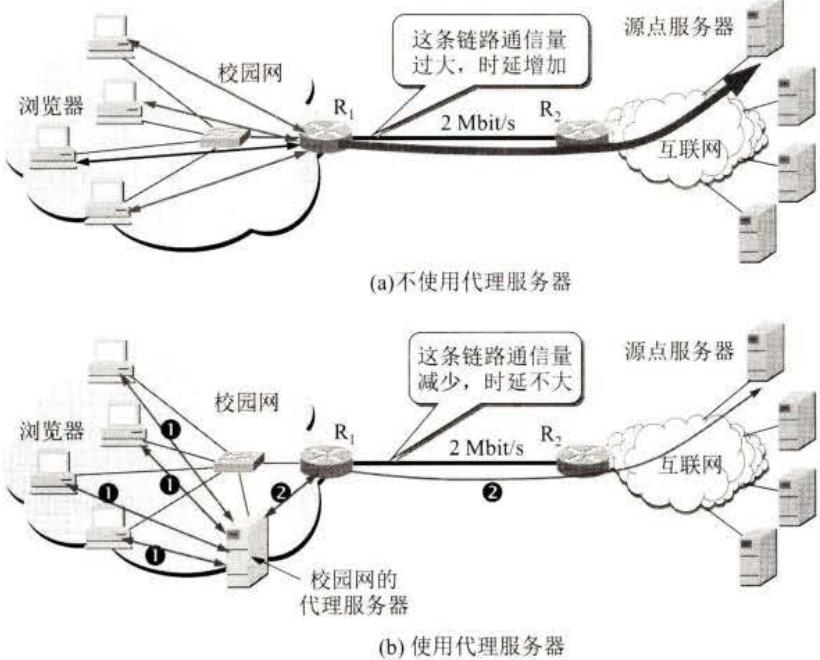
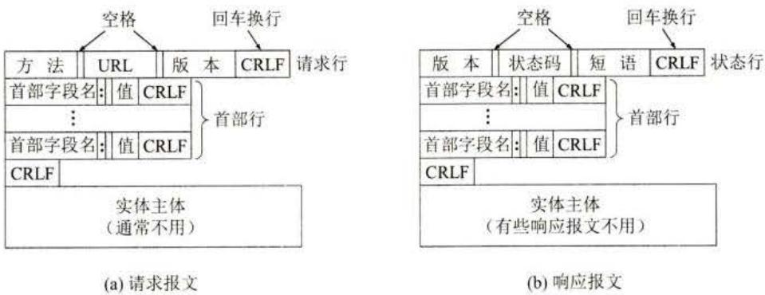

# 6.4.3 超文本传送协议HTTP

## 1. HTTP 的操作过程

协议 HTTP 定义了浏览器（即万维网客户进程）怎样向万维网服务器

请求万维网文档，以及服务器怎样把文档传送给浏览器。从层次的角度看，HTTP 是面向事务的(transaction-oriented) $^{①}$ 应用层协议，它是万维网上能够可靠地交换文件（包括文本、声音、图像等各种多媒体文件）的重要基础。请注意，协议 HTTP 不仅传送完成超文本跳转所必需的信息，而且也传送任何可从互联网上得到的信息，如文本、超文本、声音和图像等。

万维网的大致工作过程如图 6-8 所示。

> 图 6-8 万维网的工作过程（教材第 276 页）

每个万维网网点都有一个服务器进程，它不断地监听 TCP 的端口 80，以便发现是否有浏览器（即万维网客户。请注意，浏览器和万维网客户是同义词）向它发出连接建立请求。一旦监听到连接建立请求并建立了 TCP 连接之后，浏览器就向万维网服务器发出浏览某个页面的请求，服务器接着就返回所请求的页面作为响应。服务器在完成任务后，TCP 连接就被释放了。在浏览器和服务器之间的请求和响应的交互，必须按照规定的格式和遵循一定的规则。这些格式和规则就是超文本传送协议 HTTP。

> ① 注：所谓事务(transaction)就是指一系列的信息交换，而这一系列的信息交换是一个不可分割的整体，也就是说，要么所有的信息交换都完成，要么一次交换都不进行。

HTTP 规定在 HTTP 客户与 HTTP 服务器之间的每次交互，都由一个 ASCII 码串构成的请求和一个类似的通用互联网扩充，即 “类 MIME (MIME-like)” 的响应组成。HTTP 报文通常都使用 TCP 连接传送。

用户浏览页面的方法有两种。一种方法是在浏览器的地址窗口中键入所要找的页面的URL。另一种方法是在某一个页面中用鼠标点击一个可选部分，这时浏览器会自动在互联网上找到所要链接的页面。

HTTP 使用了面向连接的 TCP 作为运输层协议，保证了数据的可靠传输。HTTP 不必考虑数据在传输过程中被丢弃后又怎样被重传。但是，协议 HTTP 本身是无连接的。这就是说，虽然 HTTP 使用了 TCP 连接，但通信的双方在交换 HTTP 报文之前不需要先建立 HTTP 连接。在 1997 年以前使用的是协议 HTTP/1.0 [RFC 1945]。现在普遍使用的升级版本是建议标准 HTTP/1.1 [RFC 7231]。2015 年以后，又有了新的建议标准 HTTP/2 [RFC 7540]，以及压缩 HTTP 报文首部的建议标准[RFC 7541]。

协议 HTTP 是无状态的(stateless)。也就是说，同一个客户第二次访问同一个服务器上的页面时，服务器的响应与第一次被访问时的相同（假定现在服务器还没有把该页面更新），因为服务器并不记得曾经访问过的这个客户，也不记得为该客户曾经服务过多少次。HTTP 的无状态特性简化了服务器的设计，使服务器更容易支持大量并发的 HTTP 请求。

下面我们粗略估算一下，从浏览器请求一个万维网文档到收到整个文档所需的时间（如图 6-9 所示）。用户在点击鼠标链接某个万维网文档时，协议 HTTP 首先要和服务器建立 TCP 连接。这需要使用三报文握手。当建立 TCP 连接的三报文握手的前两个报文完成后（即经过了一个 RTT 时间后），万维网客户就把 HTTP 请求报文，作为建立 TCP 连接的三报文握手中的第三个报文的数据，发送给万维网服务器。服务器收到 HTTP 请求报文后，就把所请求的文档作为响应报文返回给客户。

> 图 6-9 请求一个万维网文档所需的时间（教材第 277 页）

从图 6-9 可看出，请求一个万维网文档所需的时间是该文档的传输时间（与文档大小成正比）加上两倍往返时间 RTT（一个 RTT 用于连接 TCP 连接，另一个 RTT 用于请求和接收万维网文档。TCP 建立连接的三报文握手的第三个报文段中的数据，就是客户对万维网文档的请求报文）。

协议 HTTP/1.0 的主要缺点，就是每请求一个文档就要有两倍 RTT 的开销。若一个主页上有很多链接的对象（如图片等）需要依次进行链接，那么每一次链接下载都导致 $2 \times RTT$ 的开销。另一种开销就是万维网客户和服务器每一次建立新的 TCP 连接都要分配缓存和变量。特别是万维网服务器往往要同时服务于大量客户的请求，所以这种非持续连接会使万维网服务器的负担很重。好在浏览器都能够打开 5～10 个并行的 TCP 连接，而每一个 TCP 连接处理客户的一个请求。因此，使用并行 TCP 连接可以缩短响应时间。

协议 HTTP/1.1 较好地解决了这个问题，它使用了持续连接(persistent connection)。所谓持续连接就是万维网服务器在发送响应后仍然在一段时间内保持这条连接，使同一个客户（浏览器）和该服务器可以继续在这条连接上传送后续的 HTTP 请求报文和响应报文。这并不局限于传送同一个页面上链接的文档，而是只要这些文档都在同一个服务器上就行。协议 HTTP/1.1 的持续连接有两种工作方式，即非流水线方式(without pipelining)和流水线方式(with pipelining)。

非流水线方式的特点，是客户在收到前一个响应后才能发出下一个请求。因此，在 TCP 连接已建立后，客户每访问一次对象都要用去一个往返时间 RTT。这比非持续连接要用去两倍 RTT 的开销，节省了建立 TCP 连接所需的一个 RTT 时间。但非流水线方式还是有缺点的，因为服务器在发送完一个对象后，其 TCP 连接就处于空闲状态，浪费了服务器资源。

流水线方式的特点，是客户在收到 HTTP 的响应报文之前就能够接着发送新的请求报文。于是一个接一个的请求报文到达服务器后，服务器就可连续发回响应报文。因此，使用流水线方式时，客户访问所有的对象只需花费一个 RTT 时间。流水线工作方式使 TCP 连接中的空闲时间减少，提高了下载文档效率。

最初网页是以文本为主，但很快发展到使用大量的图片、音频和视频，并且对页面的实时性要求也越来越高（如视频聊天或直播），这样就使得协议 HTTP/1.1 已无法跟上互联网的发展了。于是谷歌公司在 2009 年开发了软件 SPDY，用来提高协议 HTTP/1.1 的工作效率。IETF 在此基础上与谷歌合作完成了协议 HTTP/2，而谷歌也停止了对 SPDY 的继续完善工作。

协议 HTTP/2 是协议 HTTP/1.1 的升级版本，其 HTTP 方法/状态码/语义等都没有改变，其主要特点如下：

(1) 我们知道，HTTP/1.1 具有流水线的工作方式。这就是在 TCP 连接建立后，客户可以连续向服务器发出许多个请求，而不必等到收到一个响应后再发送下一个请求。但服务器发回响应时必须按先后顺序排队，逐个地发送给客户。有时遇到某个响应迟迟不能发回，那么排在后面的一些响应就必须等待很长的时间。HTTP/2 把服务器发回的响应变成可以并行地发回（使用同一个 TCP 连接），这就大大缩短了服务器的响应时间。

(2) 使用 HTTP/1.1 时，当客户收到服务器发回的响应后，原来建立的 TCP 连接就释放了。如果客户还要继续向该服务器发送新的请求，就必须重新建立 TCP 连接。HTTP/2 允许客户复用 TCP 连接进行多个请求，这样就节省了 TCP 连续多次建立和释放连接所花费的时间。

(3) HTTP/1.1 的请求和响应报文是面向文本的(text-oriented)。当客户连续发送请求并受到响应时，在 TCP 连接上传送的 HTTP 报文首部成为不小的开销。在这些首部中有很多字段是重复的。为此，HTTP/2 把所有的报文都划分为许多较小的二进制编码的帧，并采用了新的压缩算法，不发送重复的首部字段，大大减小了首部的开销，提高了传输效率。

因此，现在主流的浏览器都支持 HTTP/2。但是，有的服务器还未来得及更新，仍然只支持 HTTP/1.1。但 HTTP/2 是向后兼容的。当使用 HTTP/2 的客户向服务器发出请求时，如果服务器仍然使用 HTTP/1.1，那么服务器仍然可以收到请求报文。在发回响应后，客户就改用 HTTP/1.1 与服务器进行交互。

## 2. 代理服务器

代理服务器(proxy server)是一种网络实体，它又称为万维网高速缓存(Web cache)。代理服务器把最近的一些请求和响应暂存在本地磁盘中。当新请求到达时，若代理服务器发现这个请求与暂时存放的请求相同，就返回暂存的响应，而不需要按URL的地址再次去互联网访问该资源。代理服务器可在客户端或服务器端工作，也可在中间系统上工作。下面我们用例子说明它的作用。

设图 6-10(a) 是校园网不使用代理服务器的情况。这时，校园网中所有的计算机都通过 2 Mbit/s 专线链路（ $R_{1}-R_{2}$ ）与互联网上的源点服务器建立 TCP 连接。因而校园网各计算机访问互联网的通信量往往会使这条 2 Mbit/s 的链路过载，使得时延大大增加。

图 6-10(b) 是校园网使用代理服务器的情况。这时，访问互联网的过程是这样的：

(1) 校园网的计算机中的浏览器向互联网的服务器请求服务时，就先和校园网的代理服务器建立 TCP 连接，并向代理服务器发出 HTTP 请求报文（见图 6-10(b) 中的①）。

(2) 若代理服务器已经存放了所请求的对象，代理服务器就把这个对象放入 HTTP 响应报文中返回给计算机的浏览器。

(3) 否则，代理服务器就代表发出请求的用户浏览器，与互联网上的源点服务器(origin server)建立 TCP 连接（如图 6-10(b) 中的②所示），并发送 HTTP 请求报文。

> 图 6-10 代理服务器的作用（教材第 279 页）

(4) 源点服务器把所请求的对象放在 HTTP 响应报文中返回给校园网的代理服务器。

(5) 代理服务器收到这个对象后, 先复制在自己的本地存储器中 (留待以后用), 然后再把这个对象放在 HTTP 响应报文中, 通过已建立的 TCP 连接 (见图 6-10(b) 中的①), 返回

给请求该对象的浏览器。

我们注意到，代理服务器有时是作为服务器（当接受浏览器的 HTTP 请求时），但有时却作为客户（当向互联网上的源点服务器发送 HTTP 请求时）。

在使用代理服务器的情况下，由于有相当大一部分通信量局限在校园网的内部，因此，2 Mbit/s 专线链路（ $R_{1}-R_{2}$ ）上的通信量大大减少，因而减小了访问互联网的时延。

以代理服务器方式构成的内容分发网络 CDN (Content Distribution Network) 在互联网应用中起到了很大的作用。最先使用 CDN 技术的是美国的 Akamai (阿卡迈) 公司。Akamai 公司现在是全球最大的 CDN 平台，是全球能够提供最大规模分发在线视频的服务商。目前 Akamai 公司拥有 24 万台服务器，3900 个位置节点，使全球的用户可以就近下载视频、音频节目，或进行其他业务联系，而用户甚至根本不知道已经使用了 Akamai 提供的服务。现在 Akamai 与全球多家电信运营商建立了深度合作关系，所提供的通信流量高达每秒 40 TB，业务遍及 137 个国家和地区。

## 3. HTTP 的报文结构

HTTP 有两类报文:

(1) 请求报文——从客户向服务器发送请求报文，如图 6-11(a) 所示。

(2) 响应报文——从服务器到客户的回答，如图 6-11(b) 所示。

> 图 6-11 HTTP 的报文结构（教材第 280 页）

由于 HTTP 是面向文本的，因此在报文中的每一个字段都是一些 ASCII 码串，因而各个字段的长度都是不确定的。

HTTP 请求报文和响应报文都是由三个部分组成的。可以看出，这两种报文格式的区别就是开始行不同。

(1) 开始行，用于区分是请求报文还是响应报文。在请求报文中的开始行叫作请求行 (Request-Line)，而在响应报文中的开始行叫作状态行(Status-Line)。在开始行的三个字段之间都以空格分隔开，最后的“CR”和“LF”分别代表“回车”和“换行”。

(2) 首部行，用来说明浏览器、服务器或报文主体的一些信息。首部可以有好几行，但也可以不使用。在每一个首部行中都有首部字段名和它的值，每一行在结束的地方都要有“回车”和“换行”。整个首部行结束时，还有一空行将首部行和后面的实体主体分开。

(3) 实体主体(entity body)，在请求报文中一般都不用这个字段，而在响应报文中也可能没有这个字段。

下面先介绍 HTTP 请求报文的一些主要特点。

请求报文的第一行“请求行”只有三个内容，即方法、请求资源的 URL，以及 HTTP 的版本。

请注意：这里的名词 “方法” (method) 是面向对象技术中使用的专门名词。所谓 “方法” 就是对所请求的对象进行的操作，这些方法实际上也就是一些命令。因此，请求报文的类型是由它所采用的方法决定的。表 6-1 给出了请求报文中常用的几种方法。

> 表 6-1 HTTP 请求报文的一些方法（教材第 281 页）

| 方法(操作) | 意义 |
| --- | --- |
| OPTION | 请求一些选项的信息 |
| GET | 请求读取由URL所标志的信息 |
| HEAD | 请求读取由URL所标志的信息的首部 |
| POST | 给服务器添加信息(例如,注释) |
| PUT | 在指明的URL下存储一个文档 |
| DELETE | 删除指明的URL所标志的资源 |
| TRACE | 用来进行环回测试的请求报文 |
| CONNECT | 用于代理服务器 |

下面是 HTTP 的请求报文的开始行（即请求行）的格式。请注意，在 GET 后面有一个空格，接着是某个完整的 URL，其后面又有一个空格，最后是 HTTP/1.1。

下面是一个完整的 HTTP 请求报文的例子:

在请求行使用了相对 URL（即省略了主机的域名）是因为下面的首部行（第 2 行）给出了主机的域名。第 3 行是告诉服务器不使用持续连接，表示浏览器希望服务器在传送完所请求的对象后即关闭 TCP 连接。这个请求报文没有实体主体。

再看一下 HTTP 响应报文的主要特点。

每一个请求报文发出后，都能收到一个响应报文。响应报文的第一行就是状态行。

状态行包括三项内容，即 HTTP 的版本、状态码，以及解释状态码的简单短语。

状态码(Status-Code)都是三位数字的，分为5大类，原先有33种[RFC 2616]，后来又增加了几种[RFC 6585，建议标准]。这5大类的状态码都是以不同的数字开头的。

1xx 表示通知信息，如请求收到了或正在进行处理。

2xx 表示成功，如接受或知道了。

3xx 表示重定向，如要完成请求还必须采取进一步的行动。

4xx 表示客户的差错，如请求中有错误的语法或不能完成。

5xx 表示服务器的差错，如服务器失效无法完成请求。

下面三种状态行在响应报文中是经常见到的。

HTTP/1.1 202 Accepted {接受}

HTTP/1.1 400 Bad Request {错误的请求}

Http/1.1 404 Not Found {找不到}

若请求的网页从 http://www.ee.xyz.edu/index.html 转移到了一个新的地址，则响应报文的状态行和一个首部行就是下面的形式：

HTTP/1.1 301 Moved Permanently

{永久性地转移了}

Location: http://www.xyz.edu/ee/index.html {新的URL}

## 4. 在服务器上存放用户的信息

在本节（6.4.3节）第1小节“HTTP的操作过程”中已经讲过，HTTP是无状态的。这样做虽然简化了服务器的设计，但在实际工作中，一些万维网站点却常常希望能够识别用户。例如，在网上购物时，一个顾客要购买多种物品。当他把选好的一件物品放入“购物车”后，他还要继续浏览和选购其他物品。因此，服务器需要记住用户的身份，使他接着选购的一些物品能够放入同一个“购物车”中，这样就便于集中结账。有时某些万维网站点也可能想限制某些用户的访问。要做到这点，可以在HTTP中使用Cookie。在RFC 6265中对Cookie进行了定义，规定万维网站点可以使用Cookie来跟踪用户。Cookie原意是“小甜饼”（广东人用方言音译为“曲奇”），目前尚无标准译名，在这里Cookie表示在HTTP服务器和客户之间传递的状态信息。现在很多网站都已广泛使用Cookie。

Cookie 是这样工作的：当用户 A 浏览某个使用 Cookie 的网站时，该网站的服务器就为 A 产生一个唯一的识别码，并以此作为索引在服务器的后端数据库中产生一个项目。接着在给 A 的 HTTP 响应报文中添加一个叫作 Set-cookie 的首部行。这里的“首部字段名”就是“Set-cookie”，而后面的“值”就是赋予该用户的“识别码”。例如这个首部行是这样的：

Set-cookie: 31d4d96e407aad42

当 A 收到这个响应时，其浏览器就在它管理的特定 Cookie 文件中添加一行，其中包括这个服务器的主机名和 Set-cookie 后面给出的识别码。当 A 继续浏览这个网站时，每发送一个 HTTP 请求报文，其浏览器就会从其 Cookie 文件中取出这个网站的识别码，并放到 HTTP 请求报文的 Cookie 首部行中：

Cookie: 31d4d96e407aad42

于是，这个网站就能够跟踪用户 31d4d96e407aad42（用户 A）在该网站的活动。需要注意的是，服务器并不需要知道这个用户的真实姓名以及其他的信息。但服务器能够知道用户 31d4d96e407aad42 在什么时间访问了哪些页面，以及访问这些页面的顺序。如果 A 是在网上购物，那么这个服务器可以为 A 维护一个所购物品的列表，使 A 在结束这次购物时可以一起付费。

如果 A 在几天后再次访问这个网站，那么他的浏览器会在其 HTTP 请求报文中继续使用首部行 Cookie: 31d4d96e407aad42，而这个网站服务器根据 A 过去的访问记录可以向他推荐商品。如果 A 已经在该网站登记过和使用过信用卡付费，那么这个网站就已经保存了 A 的姓名、电子邮件地址、信用卡号码等信息。这样，当 A 继续在该网站购物时，只要还使用同一个计算机上网，由于浏览器产生的 HTTP 请求报文中都携带了同样的 Cookie 首部行，服务器就可利用 Cookie 来验证出这是用户 A，因此以后 A 在这个网站购物时就不必重新在键盘上输入姓名、信用卡号码等信息。这对顾客显然是很方便的。

尽管 Cookie 能够简化用户网上购物的过程，但 Cookie 的使用一直引起很多争议。有人认为 Cookie 会把计算机病毒带到用户的计算机中。其实这是对 Cookie 的误解。Cookie 只是一个小小的文本文件，不是计算机的可执行程序，因此不可能传播计算机病毒，也不可能用来获取用户计算机硬盘中的信息。对于 Cookie 的另一个争议，是关于用户隐私的保护问题。例如，网站服务器知道了 A 的一些信息，就有可能把这些信息出卖给第三方。Cookie 还可用来收集用户在万维网网站上的行为。这些都属于用户个人的隐私。有些网站为了使顾客放心，就公开声明他们会保护顾客的隐私，绝对不会把顾客的识别码或个人信息出售或转移给其他厂商。

为了让用户有拒绝接受 Cookie 的自由，在浏览器中用户可自行设置接受 Cookie 的条件。例如在浏览器 IE 11.0 中，选择工具栏中的“工具”→“Internet 选项”→“隐私”命令，就可以看见菜单中的左边有一个可上下滑动的标尺，它有六个位置。最高的位置是阻止所有 Cookie，而最低的位置是接受所有 Cookie。中间的位置则是在不同条件下可以接受 Cookie。用户可根据自己的情况对 IE 浏览器进行必要的设置。
