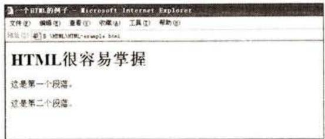
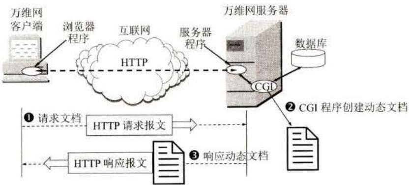
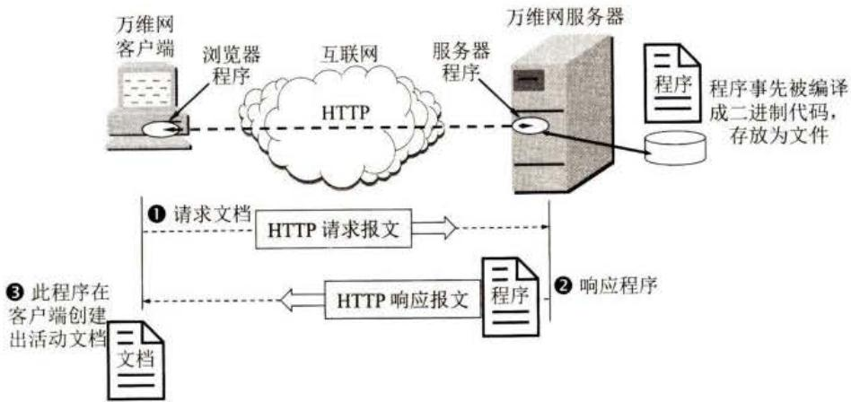

# 6.4.4 万维网的文档

## 1. 超文本标记语言 HTML

要使任何一台计算机都能显示出任何一个万维网服务器上的页面，就必须解决页面制作的标准化问题。超文本标记语言 HTML (HyperText Markup Language) 就是一种制作万维网页面的标准语言，它消除了不同计算机之间信息交流的障碍。但请注意，HTML 并不是应用层的协议，它只是万维网浏览器使用的一种语言。由于 HTML 非常易于掌握且实施简单，因此它很快就成为万维网的重要基础[RFC 2854]。官方的 HTML 标准由万维网联盟 W3C（即 WWW Consortium）负责制定。有关 HTML 的一些参考资料见[W-HTML]。从 HTML 在 1993 年问世后，就不断地对其版本进行更新。现在最新的版本是 HTML 5.0，新的版本增加了<audio>和<video>两个标签来实现对多媒体中的音频、视频使用的支持，增加了能够在移动设备上支持多媒体功能。

HTML 定义了许多用于排版的命令，即 “标签” (tag) $^{①}$ 。例如，<I>表示后面开始用斜体字排版，而</I>则表示斜体字排版到此结束。HTML 把各种标签嵌入到万维网的页面中，这样就构成了所谓的 HTML 文档。HTML 文档是一种可以用任何文本编辑器（例如，Windows 的记事本 Notepad）创建的 ASCII 码文件。但应注意，仅当 HTML 文档是以.html 或.htm 为后缀时，浏览器才对这样的 HTML 文档的各种标签进行解释。如果 HTML 文档改为以.txt 为其后缀，则 HTML 解释程序就不对标签进行解释，而浏览器只能看见原来的文本文件。

> ① 注：在[MINGCI93]中，将 tag 和 flag 两个名词都译为“标志”。由于目前已有较多的作者将 tag 译为“标签”，并考虑到最好与 flag 的译名有所区别，故将 tag 译为标签。实际上，“标签”的意思也还比较准确，因为一个 HTML 文档与浏览器所显示的内容相比，主要就是增加了许多的标签。

并非所有的浏览器都支持所有的 HTML 标签。若某一个浏览器不支持某一个 HTML 标签，则浏览器将忽略此标签，但在一对不能识别的标签之间的文本仍然会被显示出来。

下面是一个简单例子，用来说明 HTML 文档中标签的用法。在每一个语句后面的花括号中的字是给读者看的注释，在实际的 HTML 文档中并没有这种注释。

|  | {HTML 文档开始} |
| --- | --- |
|  | {首部开始} |
| 一个 HTML 的例子 | {“一个 HTML 的例子”是文档的标题} |
|  | {首部结束} |
|  | {主体开始} |
| HTML 很容易掌握 | {“HTML 很容易掌握”是主体的 1 级题头} |
| 这是第一个段落。 | {和之间的文字是一个段落} |
| 这是第二个段落。 | {和之间的文字是一个段落} |
|  | {主体结束} |
|  | {HTML 文档结束} |

把上面的 HTML 文档存入 D 盘的文件夹 HTML 中，文件名是 HTML-example.html（注意：实际的文档中没有注释部分）。当浏览器读取了该文档后，就按照 HTML 文档中的各种标签，根据浏览器所使用的显示器的尺寸和分辨率大小，重新进行排版并显示出来。图 6-12 表示 IE 浏览器在计算机屏幕上显示出的与该文档有关部分的画面。文档的标题(title)“一个 HTML 的例子”显示在浏览器最上面的标题栏中。文件的路径显示在地址栏中。再下面就是文档的主体部分。主体部分的题头(heading)，即文档主体部分的标题“HTML 很容易掌握”，用较大的字号显示出来，因为在标签中指明了使用的是 1 级题头<H1>。

目前已开发出了很好的制作万维网页面的软件工具，使我们能够像使用 Word 文字处理器那样很方便地制作各种页面。即使我们用 Word 文字处理器编辑了一个文件，但只要在“另存为(Save As)”时选取文件后缀为.htm 或.html，就可以很方便地把 Word 的.doc 格式文件转换为浏览器可以显示的 HTML 格式的文档。

> 图 6-12 在屏幕上显示的 HTML 文档主体部分的例子（教材第 284 页）

HTML 允许在万维网页面中插入图像。一个页面本身带有的图像称为内含图像 (inline image)。HTML 标准并没有规定该图像的格式。实际上，大多数浏览器都支持 GIF 和 JPEG 文件。很多格式的图像占据的存储空间太大，因而这种图像在互联网传送时就很浪费时间。例如，一幅位图文件 (.bmp) 可能要占用 500 \~ 700 KB 的存储空间。但若将此图像改存为经压缩的 .gif 格式，则可能只有十几个千字节，大大减少了存储空间。

HTML 还规定了链接的设置方法。我们知道每个链接都有一个起点和终点。链接的起点说明在万维网页面中的什么地方可引出一个链接。在一个页面中，链接的起点可以是一个字或几个字，或是一幅图，或是一段文字。在浏览器所显示的页面上，链接的起点是很容易识别的。在以文字作为链接的起点时，这些文字往往用不同的颜色显示（例如，一般的文字用黑色字时，链接起点往往使用蓝色字），甚至还会加上下划线（一般由浏览器来设置）。当我们将鼠标移动到一个链接的起点时，表示鼠标位置的箭头就变成了一只手。这时只要点击鼠标，这个链接就被激活。

链接的终点可以是其他网站上的页面。这种链接方式叫作远程链接。这时必须在HTML文档中指明链接到的网站的URL。有时链接可以指向本计算机中的某一个文件或本文件中的某处，这叫作本地链接。这时必须在HTML文档中指明链接的路径。

实际上，现在这种链接方式已经不局限于用在万维网文档中。在最常用的 Word 文字处理器的工具栏中，也设有“插入超链接”的按钮。只要点击这个按钮，就可以看到设置超链接的窗口。用户可以很方便地在自己写的 Word 文档中设置各种链接的起点和终点。

在这一小节的最后，我们还要简单介绍一下和浏览器有关的几种其他语言。

XML (Extensible Markup Language) 是可扩展标记语言，它和 HTML 很相似。但 XML 的设计宗旨是传输数据，而不是显示数据（HTML 是为了在浏览器上显示数据）。更具体些，XML 用于标记电子文件，使其具有结构性的标记语言，可用来标记数据、定义数据类型，是一种允许用户对自己的标记语言进行定义的源语言。XML 是一种简单、与平台无关并被广泛采用的标准。XML 相对于 HTML 的优点是它将用户界面与结构化数据分隔开来。这种数据与显示的分离使得集成来自不同源的数据成为可能。客户信息、订单、研究结果、账单付款、病历、目录数据及其他信息都可以转换为 XML。XML 不是要替换 HTML，而是对 HTML 的补充。XML 标记由文档的作者定义，并且是无限制的。HTML 标记则是预定义的；HTML 作者只能使用当前 HTML 标准所支持的标记。

另一种语言 XHTML (Extensible HTML) 是可扩展超文本标记语言，它与 HTML 4.01 几乎是相同的。但 XHTML 是更严格的 HTML 版本，也是一个 W3C 标准（2000 年 1 月制定），是作为一种 XML 应用被重新定义的 HTML，并将逐渐取代 HTML。所有新的浏览器都支持 XHTML。

还有一种语言 CSS (Cascading Style Sheets) 是层叠样式表，它是一种样式表语言，用于为 HTML 文档定义布局。CSS 与 HTML 的区别就是：HTML 用于结构化内容，而 CSS 则用于格式化结构化的内容。例如，在浏览器上显示的字体、颜色、边距、高度、宽度、背景图像等方面，都能够给出精确的规定。现在所有的浏览器都支持 CSS。

## 2. 动态万维网文档

上面所讨论的万维网文档只是万维网文档中最基本的一种，即所谓的静态文档(static document)。静态文档在文档创作完毕后就存放在万维网服务器中，在被用户浏览的过程中，内容不会改变。由于这种文档的内容不会改变，因此用户对静态文档的每次读取所得到的返回结果都是相同的。

静态文档的最大优点是简单。由于 HTML 是一种排版语言，因此静态文档可以由不懂程序设计的人员来创建。但静态文档的缺点是不够灵活。当信息变化时就要由文档的作者手工对文档进行修改。可见，变化频繁的文档不适于做成静态文档。

动态文档(dynamic document)是指文档的内容是在浏览器访问万维网服务器时才由应用程序动态创建的。当浏览器请求到达时，万维网服务器要运行另一个应用程序，并把控制转移到此应用程序。接着，该应用程序对浏览器发来的数据进行处理，并输出 HTML 格式的文档，万维网服务器把应用程序的输出作为对浏览器的响应。由于对浏览器每次请求的响应都是临时生成的，因此用户通过动态文档所看到的内容是不断变化的。动态文档的主要优点是具有报告当前最新信息的能力。例如，动态文档可用来报告股市行情、天气预报或民航售票情况等内容。但动态文档的创建难度比静态文档的高，因为动态文档的开发不是直接编写文档本身，而是编写用于生成文档的应用程序，这就要求动态文档的开发人员必须会编程，而所编写的程序还要通过大范围的测试，以保证输入的有效性。

动态文档和静态文档之间的主要差别体现在服务器一端。这主要是文档内容的生成方法不同。而从浏览器的角度看，这两种文档并没有区别。动态文档和静态文档的内容都遵循HTML所规定的格式，浏览器仅根据在屏幕上看到的内容无法判定服务器送来的是哪一种文档，只有文档的开发者才知道。

从以上所述可以看出，要实现动态文档就必须在以下两个方面对万维网服务器的功能进行扩充：

(1) 应增加另一个应用程序，用来处理浏览器发来的数据，并创建动态文档。

(2) 应增加一个机制，用来使万维网服务器将浏览器发来的数据传送给这个应用程序，然后万维网服务器能够解释这个应用程序的输出，并向浏览器返回 HTML 文档。

图 6-13 是扩充了功能的万维网服务器的示意图。这里增加了一个机制，叫作通用网关接口 CGI (Common Gateway Interface)。CGI 是一种标准，它定义了动态文档应如何创建，输入数据应如何提供给应用程序，以及输出结果应如何使用。

在万维网服务器中新增加的应用程序叫作 CGI 程序。取这个名字的原因是：万维网服务器与 CGI 的通信遵循 CGI 标准。“通用”是因为这个标准所定义的规则对其他任何语言都是通用的。“网关”二字的出现是因为 CGI 程序还可能访问其他的服务器资源，如数据库或图形软件包，因而 CGI 程序的作用有点像一个网关。也有人将 CGI 程序简称为网关程序。“接口”是因为有一些已定义好的变量和调用等可供其他 CGI 程序使用。请读者注意：在看到 CGI 这个名词时，应弄清是指 CGI 标准，还是指 CGI 程序。

> 图 6-13 扩充了功能的万维网服务器（教材第 286 页）

CGI 程序的正式名字是 CGI 脚本(script)。按照计算机科学的一般概念，“脚本” $^{①}$ 指的是一个程序，它被另一个程序（解释程序）而不是计算机的处理机来解释或执行。有一些语言专门作为脚本语言(script language)，如 Perl, REXX（在 IBM 主机上使用），JavaScript 以及 Tcl/Tk 等。脚本也可用一些常用的编程语言写出，如 C, C++等。使用脚本语言可更容易和更快地进行编码，这对一些有限功能的小程序是很合适的。但一个脚本运行起来比一般的编译程序要慢，因为它的每一条指令先要被另一个程序来处理（这就要一些附加的指令），而不是直接被指令处理器来处理。脚本不一定是一个独立的程序，它可以是一个动态装入的库，甚至是服务器的一个子程序。

> ① 注：脚本(script)一词还有其他的意思。例如，在多媒体开发程序中用“脚本”来表示编程人员输入的一系列指令，这些指令指明多媒体文件应按什么顺序执行。

CGI 程序又称为 cgi-bin 脚本，这是因为在许多万维网服务器上，为便于找到 CGI 程序，就将 CGI 程序放在 /cgi-bin 的目录下。

## 3. 活动万维网文档

随着 HTTP 和万维网浏览器的发展，上一节所述的动态文档已明显地不能满足发展的需要。这是因为，动态文档一旦建立，它所包含的信息内容也就固定下来而无法及时刷新屏幕。另外，像动画之类的显示效果，动态文档也无法提供。

有两种技术可用于浏览器屏幕显示的连续更新。一种技术称为服务器推送(server push)，这种技术是将所有的工作都交给服务器。服务器不断地运行与动态文档相关联的应用程序，定期更新信息，并发送更新过的文档。

尽管从用户的角度看，这样做可达到连续更新的目的，但这也有很大的缺点。首先，为了满足很多客户的请求，服务器就要运行很多服务器推送程序。这将造成过多的服务器开销。其次，服务器推送技术要求服务器为每一个浏览器客户维持一个不释放的 TCP 连接。随着 TCP 连接的数目增加，每一个连接所能分配到的网络带宽就下降，这就导致网络传输时延的增大。

另一种提供屏幕连续更新的技术是活动文档(active document)。这种技术是把所有的工作都转移给浏览器端。每当浏览器请求一个活动文档时，服务器就返回一段活动文档程序副本，使该程序副本在浏览器端运行。这时，活动文档程序可与用户直接交互，并可连续地改变屏幕的显示。只要用户运行活动文档程序，活动文档的内容就可以连续地改变。由于活动文档技术不需要服务器的连续更新传送，对网络带宽的要求也不会太高。

从传送的角度看，浏览器和服务器都把活动文档看成是静态文档。在服务器上的活动文档的内容是不变的，这点和动态文档是不同的。浏览器可在本地缓存一份活动文档的副本。活动文档还可处理成压缩形式，以便于存储和传送。另一点要注意的是，活动文档本身并不包括其运行所需的全部软件，大部分的支持软件是事先存放在浏览器中的。图 6-14 说明了活动文档的创建过程。

由美国 SUN 公司开发的 Java 语言是一项用于创建和运行活动文档的技术。在 Java 技术中使用了一个新的名词 “小应用程序” (applet) $^{①}$ 来描述活动文档程序。当用户从万维网服务器下载一个嵌入了 Java 小应用程序的 HTML 文档后，用户可在浏览器的显示屏幕上点击某个图像，然后就可看到动画的效果；或是在某个下拉式菜单中点击某个项目，即可看到根据用户键入的数据所得到的计算结果。实际上，Java 技术是活动文档技术的一部分。限于篇幅，有关 Java 技术的进一步讨论这里从略。

> 注：在 Java 语言出现之前就已经有了 applet 这一名词。小应用程序 applet 通常被嵌入在操作系统或一个较大的应用程序之中。在万维网技术中，此名词常常指的是 Java 小应用程序。

> 图 6-14 活动文档由服务器发送过来的程序在客户端创建（教材第 288 页）
