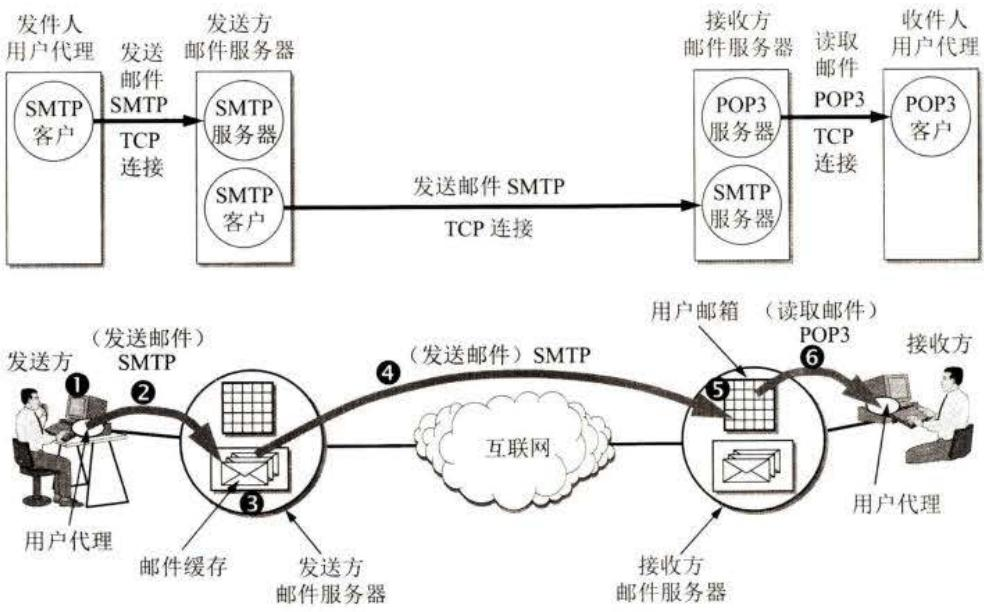

# 6.5.1 电子邮件概述

## 6.5 电子邮件

大家知道，实时通信的电话固然使用方便，但有两个严重缺点。第一，电话通信的主叫和被叫双方必须同时在场。第二，有些电话常常不必要地打断被叫者的工作或休息。

电子邮件(E-mail)是互联网上使用最多的和最受用户欢迎的一种应用。电子邮件把邮件发送到收件人使用的邮件服务器，并放在其中的收件人邮箱(mail box)中，收件人可在自己方便时上网到自己使用的邮件服务器进行读取。这相当于互联网为用户设立了存放邮件的信箱，因此 e-mail 有时也称为“电子信箱”。电子邮件不仅使用方便，而且还具有传递迅速和费用低廉的优点。据有的公司报道，使用电子邮件后可提高劳动生产率 30%以上。现在电子邮件不仅可传送文字信息，而且还可附上声音和图像。由于电子邮件和手机的广泛使用，现已迫使传统的电报业务退出市场，因为这种传统电报既贵又慢，且很不方便。

1982 年 ARPANET 的电子邮件问世后，很快就成为最受广大网民欢迎的互联网应用。电子邮件的两个最重要的草案标准，是 2008 年更新的简单邮件传送协议 SMTP (Simple Mail Transfer Protocol) [RFC 5321] 和互联网文本报文格式 [RFC 5322]。

由于互联网的 SMTP 只能传送可打印的 7 位 ASCII 码邮件，因此在 1996 年又发布了通用互联网邮件扩充 MIME (Multipurpose Internet Mail Extensions)[RFC 2045，草案标准]。MIME 在其邮件首部中说明了邮件的数据类型（如文本、声音、图像、视像等）。在 MIME 邮件中可同时传送多种类型的数据。这在多媒体通信的环境下是非常有用的。

一个电子邮件系统应具有图 6-16 所示的三个主要组成构件，这就是用户代理、邮件服务器，以及邮件发送协议（如 SMTP）和邮件读取协议（如 POP3）。POP3 是邮局协议(Post Office Protocol)的版本 3。凡是有 TCP 连接的，都经过了互联网，有的甚至可以跨越数千公里的距离。这里为简洁起见，没有画出网络。在互联网中，邮件服务器的数量是很大的。正是这些邮件服务器构成了电子邮件基础结构的核心。在图 6-16 中为了说明问题，仅仅画出了两个邮件服务器。

> 图 6-16 电子邮件的最主要的组成构件（教材第 294 页）

用户代理 UA (User Agent) 就是用户与电子邮件系统的接口，在大多数情况下它就是运行在用户计算机中的一个程序。因此用户代理又称为电子邮件客户端软件。用户代理向用户提供一个很友好的接口（目前主要是窗口界面）来发送和接收邮件。现在可供大家选择的用户代理有很多种。例如，微软公司的 Outlook Express 和我国张小龙制作的 Foxmail，都是很受欢迎的电子邮件用户代理。

用户代理至少应当具有以下 4 个功能。

(1) 撰写。给用户提供编辑信件的环境。例如，应让用户能创建便于使用的通信录（有常用的人名和地址）。回信时不仅能很方便地从来信中提取出对方地址，并自动地将此地址写入到邮件中合适的位置，而且还能方便地对来信提出的问题进行答复（系统自动将来信复制一份在用户撰写回信的窗口中，因而用户不需要再输入来信中的问题）。

(2) 显示。能方便地在计算机屏幕上显示出来信（包括来信附上的声音和图像）。

(3) 处理。处理包括发送邮件和接收邮件。收件人应能根据情况按不同方式对来信进行处理。例如，阅读后删除、存盘、打印、转发等，以及自建目录对来信进行分类保存。有时还可在读取信件之前先查看一下邮件的发件人和长度等，对于不愿收的信件可直接在邮箱中删除。

(4) 通信。发信人在撰写完邮件后，要利用邮件发送协议将邮件发送到用户所使用的邮件服务器。收件人在接收邮件时，要使用邮件读取协议从本地邮件服务器接收邮件。

互联网上有许多邮件服务器可供用户选用（有些要收取少量的邮箱使用费用）。邮件服务器24小时不间断地工作，并且具有很大容量的邮件信箱。邮件服务器的功能是发送和接收邮件，同时还要向发件人报告邮件传送的结果（已交付、被拒绝、丢失等）。邮件服务器按照客户服务器方式工作。邮件服务器需要使用两种不同的协议。一种协议用于用户代理向邮件服务器发送邮件或在邮件服务器之间发送邮件，如SMTP协议，而另一种协议用于用户代理从邮件服务器读取邮件，如邮局协议POP3。

这里应当注意，邮件服务器必须能够同时充当客户和服务器。例如，当邮件服务器 A向另一个邮件服务器 B 发送邮件时，A 就作为 SMTP 客户，而 B 是 SMTP 服务器。反之，当 B 向 A 发送邮件时，B 就是 SMTP 客户，而 A 就是 SMTP 服务器。

图 6-16 给出了计算机之间发送和接收电子邮件的几个重要步骤。请注意，SMTP 和 POP3（或 IMAP）都是使用 TCP 连接来传送邮件的，使用 TCP 的目的是为了可靠地传送邮件。

① 发件人调用计算机中的用户代理撰写和编辑要发送的邮件。

② 发件人点击屏幕上的“发送邮件”按钮，把发送邮件的工作全都交给用户代理来完成。用户代理把邮件用 SMTP 协议发给发送方邮件服务器，用户代理充当 SMTP 客户，而发送方邮件服务器充当 SMTP 服务器。用户代理所进行的这些工作，用户是看不到的。有的用户代理可以让用户在屏幕上看见邮件发送的进度显示。用户所使用的邮件服务器究竟在什么地方，用户并不知道，也没必要知道。实际上，用户在把写好的信件交付给用户代理后，就什么都不用管了。

③ SMTP 服务器收到用户代理发来的邮件后，就把邮件临时存放在邮件缓存队列中，等待发送到接收方的邮件服务器（等待时间的长短取决于邮件服务器的处理能力和队列中待发送的信件的数量。但这种等待时间一般都远远大于分组在路由器中等待转发的排队时间）。

④ 发送方邮件服务器的 SMTP 客户与接收方邮件服务器的 SMTP 服务器建立 TCP 连接，然后就把邮件缓存队列中的邮件依次发送出去。请注意，邮件不会在互联网中的某个中间邮件服务器落地。如果 SMTP 客户还有一些邮件要发送到同一个邮件服务器，那么可以在原来已建立的 TCP 连接上重复发送。如果 SMTP 客户无法和 SMTP 服务器建立 TCP 连接（例如，接收方服务器过负荷或出了故障），那么要发送的邮件就会继续保存在发送方的邮件服务器中，并在稍后一段时间再进行新的尝试。如果 SMTP 客户超过了规定的时间还不能把邮件发送出去，那么发送邮件服务器就把这种情况通知用户代理。

⑤ 运行在接收方邮件服务器中的 SMTP 服务器进程收到邮件后，把邮件放入收件人的用户邮箱中，等待收件人进行读取。

⑥ 收件人在打算收信时，就运行计算机中的用户代理，使用 POP3（或 IMAP）协议读取发送给自己的邮件。请注意，在图 6-16 中，POP3 服务器和 POP3 客户之间的箭头表示的是邮件传送的方向。但它们之间的通信是由 POP3 客户发起的。

请注意这里有两种不同的通信方式。一种是“推”(push): SMTP 客户把邮件“推”给 SMTP 服务器。另一种是“拉”(pull): POP3 客户把邮件从 POP3 服务器“拉”过来。细心的读者可能会想到这样的问题: 如果让图 6-16 中的邮件服务器程序就在发送方和接收方的计算机中运行, 那么岂不是可以直接把邮件发送到收件人的计算机中?

答案是“不行”。这是因为并非所有的计算机都能运行邮件服务器程序。有些计算机可能没有足够的存储空间来运行允许程序在后台运行的操作系统，或是可能没有足够的 CPU 能力来运行邮件服务器程序。更重要的是，邮件服务器程序必须不间断地运行，每天 24 小时都必须不间断地连接在互联网上，否则就可能使很多外面发来的邮件无法接收。这样看来，让用户的计算机运行邮件服务器程序显然是很不现实的（一般用户在不使用计算机时就将机器关闭）。让来信暂时存储在用户的邮件服务器中，而当用户方便时就从邮件服务器的用户信箱中读取来信，则是一种比较合理的做法。在 Foxmail 中使用一种“特快专递”服务。这种服务就是从发件人的用户代理直接利用 SMTP 把邮件发送到接收方邮件服务器。这就加快了邮件的交付（省去在发送方邮件服务器中的排队等待时间）。但这种“特快专递”和邮政的 EMS 直接把邮件送到用户家中不同，它并没有把邮件直接发送到收件人的计算机中。但有些邮件服务器为了防止垃圾邮件和计算机病毒，拒绝接收从一般用户直接发来的邮件。

电子邮件由信封(envelope)和内容(content)两部分组成。电子邮件的传输程序根据邮件信封上的信息来传送邮件。这与邮局按照信封上的信息投递信件是相似的。

在邮件的信封上，最重要的就是收件人的地址。TCP/IP 体系的电子邮件系统规定电子邮件地址(E-mail address)的格式如下：

$$ \text { 用户名 } @ \text { 邮件服务器的域名 }\tag{6-1} $$

在式(6-1)中，符号“@”应读作“at”，表示“在”的意思。例如，在电子邮件地址“xyz@abc.com”中，“abc.com”就是邮件服务器的域名，而“xyz”就是在这个邮件服务器中收件人的用户名，也就是收件人邮箱名，是收件人为自己定义的字符串标识符。但应注意，这个用户名在邮件服务器中必须是唯一的（当用户定义自己的用户名时，邮件服务器要负责检查该用户名在本服务器中的唯一性）。这样就保证了每一个电子邮件地址在世界范围内是唯一的。这对保证电子邮件能够在整个互联网范围内的准确交付是十分重要的。电子邮件的用户一般采用容易记忆的字符串。
