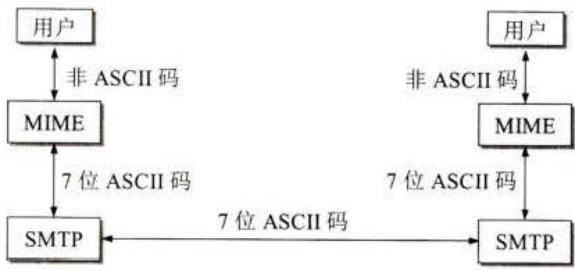

# 6.5.6 通用互联网邮件扩充MIME

## 1. MIME 概述

前面所述的电子邮件协议 SMTP 有以下缺点：

(1) SMTP 不能传送可执行文件或其他的二进制对象。人们曾试图将二进制文件转换为 SMTP 使用的 ASCII 文本，例如流行的 UNIX UUencode/UUdecode 方案，但这些均未形成正式标准或事实上的标准。

(2) SMTP 限于传送 7 位的 ASCII 码。许多其他非英语国家的文字（如中文、俄文，甚至带重音符号的法文或德文）就无法传送。即使在 SMTP 网关将 EBCDIC 码（即扩充的二/十进制交换码）转换为 ASCII 码，也会遇到一些麻烦。

(3) SMTP 服务器会拒绝超过一定长度的邮件。

(4) 某些 SMTP 的实现并没有完全按照 SMTP 的互联网标准。常见的问题如下:

\- 回车、换行的删除和增加；

\- 超过76个字符时的处理：截断或自动换行；

\- 后面多余空格的删除；

\- 将制表符 tab 转换为若干个空格。

于是在这种情况下就提出了通用互联网邮件扩充 MIME [RFC 2045\~2049，前三个文档是草案标准]。MIME 并没有改动或取代 SMTP。MIME 的意图是继续使用原来的邮件格式，但增加了邮件主体的结构，并定义了传送非 ASCII 码的编码规则。也就是说，MIME 邮件可在现有的电子邮件程序和协议下传送。图 6-17 表示 MIME 和 SMTP 的关系。

> 图 6-17 MIME 和 SMTP 的关系（教材第 301 页）

MIME 主要包括以下三部分内容:

(1) 5 个新的邮件首部字段，它们可包含在原来的邮件首部中。这些字段提供了有关邮件主体的信息。

(2) 定义了许多邮件内容的格式，对多媒体电子邮件的表示方法进行了标准化。

(3) 定义了传送编码，可对任何内容格式进行转换，而不会被邮件系统改变。

为适应于任意数据类型和表示，每个 MIME 报文包含告知收件人数据类型和使用编码的信息。MIME 把增加的信息加入到原来的邮件首部中。

下面是 MIME 增加的 5 个新的邮件首部的名称及其意义（有的可以是选项）。

(1) MIME-Version: 标志 MIME 的版本。现在的版本号是 1.0。若无此行，则为英文文本。

(2) Content-Description: 这是可读字符串，说明此邮件主体是否是图像、音频或视频。

(3) Content-Id: 邮件的唯一标识符。

(4) Content-Transfer-Encoding: 在传送时邮件的主体是如何编码的。

(5) Content-Type: 说明邮件主体的数据类型和子类型。

上述的前三项的意思很清楚，因此下面只对后两项进行介绍。

## 2. 内容传送编码

下面介绍三种常用的内容传送编码 (Content-Transfer-Encoding)。

最简单的编码就是7位ASCII码，而每行不能超过1000个字符。MIME对这种由ASCII码构成的邮件主体不进行任何转换。

另一种编码称为 quoted-printable，这种编码方法适用于所传送的数据中只有少量的非ASCII码，例如汉字。这种编码方法的要点就是对于所有可打印的ASCII码，除特殊字符等号“=”外，都不改变。等号“=”和不可打印的ASCII码以及非ASCII码的数据的编码方法是：先将每个字节的二进制代码用两个十六进制数字表示，然后在前面再加上一个等号“=”。例如，汉字的“系统”的二进制编码是：11001111 10110101 11001101 10110011（共有32位，但这四个字节都不是ASCII码），其十六进制数字表示为：CFB5CDB3。用quoted-printable编码表示为：=CF=B5=CD=B3，这12个字符都是可打印的ASCII字符，它们的二进制编码 $^{①}$ 需要96位，和原来的32位相比，开销达200%。而等号“=”的二进制代码为00111101，即十六进制的3D，因此等号“=”的quoted-printable编码为“=3D”。

对于任意的二进制文件，可用 base64 编码。这种编码方法是先把二进制代码划分为一个个 24 位长的单元，然后把每一个 24 位单元划分为 4 个 6 位组。每一个 6 位组按以下方法转换成 ASCII 码。6 位的二进制代码共有 64 种不同的值，从 0 到 63。用 A 表示 0，用 B 表示 1，等等。26 个大写字母排列完毕后，接下去再排 26 个小写字母，再后面是 10 个数字，最后用 “+” 表示 62，而用 “/” 表示 63。再用两个连在一起的等号 “==” 和一个等号 “=” 分别表示最后一组的代码只有 8 位或 16 位。回车和换行都忽略，它们可在任何地方插入。

下面是一个base64编码的例子：

$$ \begin{array}{l l l l l} 2 4 \text {位二进制代码} & 0 1 0 0 1 0 0 1 0 0 1 1 0 0 0 1 0 1 1 1 1 0 0 1 \\ \text {划分为4个6位组} & 0 1 0 0 1 0 & 0 1 0 0 1 1 & 0 0 0 1 0 1 & 1 1 1 0 0 1 \\ \text {对应的base64编码} & S & T & F & 5 \\ \text {用ASCII编码发送} & 0 1 0 1 0 0 1 1 & 0 1 0 1 0 1 0 0 & 0 1 0 0 0 1 1 0 & 0 0 1 1 0 1 0 1 \end{array} $$

不难看出，24 位的二进制代码采用 base64 编码后变成了 32 位，开销为 8 位，占 32 位的 25%。

## 3. 内容类型

MIME 标准规定 Content-Type 说明必须含有两个标识符，即内容类型(type)和子类型(subtype)，中间用“/”分开。

MIME 一直到现在还是草案标准。除了内容类型和子类型，MIME 允许发件人和收件人自己定义专用的内容类型。但为避免可能出现名字冲突，标准要求为专用的内容类型选择的名字要以字符串 X-开始。后来陆续出现了几百个子类型，而且子类型的数目还在不断地增加。现在可以在网站上查出现有的 MIME 类型和子类型的名称，以及申请新的子类型的具体步骤[W-MEDIA-TYPE]。表 6-3 列出了 MIME 常用的内容类型、子类型举例及其说明 $^{②}$ 。

> 表 6-3 可出现在 MIME Content-Type 说明中的类型及子类型举例（教材第 302 页）

| 内容类型 | 子类型举例 | 说明 |
| --- | --- | --- |
| text(文本) | plain, html, xml, css | 不同格式的文本 |
| image(图像) | gif, jpeg, tiff | 不同格式的静止图像 |
| audio(音频) | basic, mpeg, mp4 | 可听见的声音 |
| video(视频)model(模型) | mpeg, mp4, quicktimevrml | 不同格式的影片3D 模型 |
| application(应用) | octet-stream, pdf, javascript, zip | 不同应用程序产生的数据 |
| message(报文) | http, rfc822 | 封装的报文 |
| multipart(多部分) | mixed, alternative, parallel, digest | 多种类型的组合 |

> ① 注：ASCII 码原来定义为 7 位码。但最初为了增加检错能力就增加了一个奇偶检验位，因而使用一个字节（8 位）表示一个 ASCII 码。于是 ASCII 码就变成了 8 位码，但其最高位一定是 0，而后面的 7 位就是最初定义的 ASCII 编码。

> ② 注：GIF (Graphics Interchange Format), JPEG (Joint Photographic Expert Group) 和 TIFF (Tagged Image File Format) 都是静止图像（如照片）格式的标准，前两者是压缩的，后者可以是压缩的，也可以是不压缩的。而 MPEG (Motion Picture Experts Group) 是活动图像（如电影）的压缩标准，包括 MPEG 视频、MPEG 音频和 MPEG 系统（视频音频同步）三个部分。QuickTime 是苹果公司的媒体播放机。VRML (Virtual Reality Modeling Language) 是虚拟现实建模语言。PDF (Portable Document Format) 是 Adobe 公司开发的一种电子文件格式。ZIP 是一种文件压缩算法。

MIME 的内容类型中的 multipart 是很有用的，因为它使邮件增加了相当大的灵活性。MIME 标准为 multipart 定义了四种可能的子类型，每个子类型都提供重要功能。

(1) mixed 子类型允许单个报文含有多个相互独立的子报文，每个子报文可有自己的类型和编码。mixed 子类型报文使用户能够在单个报文中附上文本、图形和声音，或者用额外数据段发送一个备忘录，类似商业信笺含有的附件。在 mixed 后面还要用到一个关键字，即 Boundary=，此关键字定义了分隔报文各部分所用的字符串（由邮件系统定义），只要在邮件的内容中不会出现这样的字符串即可。当某一行以两个连字符“--”开始，后面紧跟上述的字符串，就表示下面开始了另一个子报文。

(2) alternative 子类型允许单个报文含有同一数据的多种表示。当给多个使用不同硬件和软件系统的收件人发送备忘录时，这种类型的 multipart 报文就很有用。例如，用户可同时用普通的 ASCII 文本和格式化的形式发送文本，从而允许拥有图形功能的计算机用户在查看图形时选择格式化的形式。

(3) parallel 子类型允许单个报文含有可同时显示的各个子部分（例如，图像和声音子部分必须一起播放）。

(4) digest 子类型允许单个报文含有一组其他报文（如从讨论中收集电子邮件报文）。

下面显示了一个 MIME 邮件，它包含有一个简单解释的文本和含有非文本信息的照片。邮件中第一部分的注解说明第二部分含有一张照片。

你要的图片在此邮件中，收到后请回信。

谢希仁

上面最后一行表示 boundary 的字符串后面还有两个连字符 “--”，表示整个 multipart 的结束。
