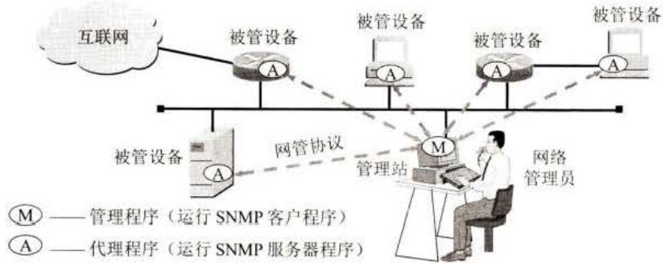

# 6.7.1 网络管理的基本概念

## 6.7 简单网络管理协议 SNMP

虽然网络管理还没有精确定义，但它的内容可归纳为：

网络管理包括对硬件、软件和人力的使用、综合与协调，以便对网络资源进行监视、测试、配置、分析、评价和控制，这样就能以合理的价格满足网络的一些需求，如实时运行性能、服务质量等。网络管理常简称为网管。

我们可以看到，网络管理并不是指对网络进行行政上的管理。

网络是一个非常复杂的分布式系统。这是因为网络上有很多不同厂家生产的、运行着多种协议的节点（主要是路由器），而这些节点还在相互通信和交换信息。网络的状态总是不断地变化着。可见，我们必须使用一种机制来读取这些节点上的状态信息，有时还要把一些新的状态信息写入到这些节点上。

下面简单介绍网络管理模型中的主要构件（如图 6-20 所示）。

管理站又称为管理器，是整个网络管理系统的核心，它通常是个有着良好图形界面的高性能的工作站，并由网络管理员直接操作和控制。所有向被管设备发送的命令都是从管理站发出的。管理站的所在部门也常称为网络运行中心 NOC (Network Operations Center)。管理站中的关键构件是管理程序（如图 6-20 中有字母 M 的椭圆形图标所示）。管理程序在运行时就成为管理进程。管理站（硬件）或管理程序（软件）都可称为管理者(manager)或管理器，所以这里的 manager 不是指人而是指机器或软件。网络管理员(administrator)才是指人。大型网络往往实行多级管理，因而有多个管理者，而一个管理者一般只管理本地网络的设备。

> 图 6-20 网络管理的一般模型（教材第 307 页）

在被管网络中有很多的被管设备（包括设备中的软件）。被管设备可以是主机、路由器、打印机、集线器、网桥或调制解调器等。在每一个被管设备中可能有许多被管对象(Managed Object)。被管对象可以是被管设备中的某个硬件（例如，一块网络接口卡），也可以是某些硬件或软件（例如，路由选择协议）的配置参数的集合。被管设备有时可称为网络元素或简称为网元。在被管设备中也会有一些不能被管的对象（在下面的6.7.2节将会讲到对象命名树，所谓不能被管的对象就是不在对象命名树上的对象）。

在每一个被管设备中都要运行一个程序以便和管理站中的管理程序进行通信。这些运行着的程序叫作网络管理代理程序，或简称为代理(agent)（如图 6-20 中有字母 A 的几个椭圆形图标所示）。代理程序在管理程序的命令和控制下，在被管设备上采取本地的行动。

在图 6-20 中还有一个重要构件就是网络管理协议，简称为网管协议。后面还要讨论它的作用。

简单网络管理协议 SNMP (Simple Network Management Protocol) 中的管理程序和代理程序按客户服务器方式工作。管理程序运行 SNMP 客户程序，而代理程序运行 SNMP 服务器程序。在被管对象上运行的 SNMP 服务器程序不停地监听来自管理站的 SNMP 客户程序的请求（或命令）。一旦发现了，就立即返回管理站所需的信息，或执行某个动作（例如，把某个参数的设置进行更新）。在网管系统中往往是一个（或少数几个）客户程序与很多的服务器程序进行交互。

关于网络管理有一个基本原理，这就是：

若要管理某个对象，就必然会给该对象添加一些软件或硬件，但这种“添加”对原有对象的影响必须尽量小些。

SNMP 正是按照这样的基本原理来设计的。

SNMP 发布于 1988 年。OSI 虽然在这之前就已制定出许多的网络管理标准，但当时（到现在也很少）却没有符合 OSI 网管标准的产品。SNMP 最重要的指导思想就是要尽可能简单。SNMP 的基本功能包括监视网络性能、检测分析网络差错和配置网络设备等。在网络正常工作时，SNMP 可实现统计、配置和测试等功能。当网络出故障时，可实现各种差错检测和恢复功能。经过近二十年的使用，SNMP 不断修订完善，较新的版本是 SNMPv3，而前两个版本分别是 SNMPv2 和 SNMPv1。但一般可简称为 SNMP。SNMPv3 最大的改进就是安全特性。也就是说，只有被授权的人员才有资格执行网络管理的功能（如关闭某一条链路）和读取有关网络管理的信息（如读取一个配置文件的内容）。然而 SNMP 协议已相当庞大，一点也不“简单”，整个标准共有八个 RFC 文档[RFC 3411—3418，STD62]。因此这里只能给出一些最基本的概念。

若网络元素使用的不是 SNMP 协议而是另一种网络管理协议，那么 SNMP 协议就无法控制该网络元素。这时可使用委托代理(proxy agent)。委托代理能提供如协议转换和过滤操作等功能对被管对象进行管理。

SNMP 的网络管理由三个部分组成，即 SNMP 本身、管理信息结构 SMI (Structure of Management Information) 和管理信息库 MIB (Management Information Base)。下面简述这三部分的作用。

SNMP 定义了管理站和代理之间所交换的分组格式。所交换的分组包含各代理中的对象（变量）名及其状态（值）。SNMP 负责读取和改变这些数值。

SMI 定义了命名对象和定义对象类型（包括范围和长度）的通用规则，以及把对象和对象的值进行编码的规则。这样做是为了确保网络管理数据的语法和语义无二义性。但从 SMI 的名称并不能看出它的功能。请注意，SMI 并不定义一个实体应管理的对象数目，也不定义被管对象名以及对象名及其值之间的关联。

MIB 在被管理的实体中创建了命名对象，并规定了其类型。

为了更好地理解上述的几个组成部分，可以把它们和程序设计进行一下对比。

我们在编程时要使用某种语言，而这种语言就是用来定义编程的规则。例如，一个变量名必须从字母开始而后面接着是字母数字。在网络管理中，这些规则由 SMI 来定义。

在程序设计中必须对变量进行说明。例如，int counter，表示变量 counter 是整数类型。MIB 在网络管理中就做这样的事情。MIB 给每个对象命名，并定义对象的类型。

在编程中的说明语句之后，程序需要写出一些语句用来存储变量的值，并在需要时改变这些变量的值。协议 SNMP 在网络管理中完成这件任务。SNMP 按照 SMI 定义的规则，存储、改变和解释这些已由 MIB 说明的对象的值。

总之，SMI 建立规则，MIB 对变量进行说明，而 SNMP 完成网管的动作。

下面就一一介绍上述的三个构件。
