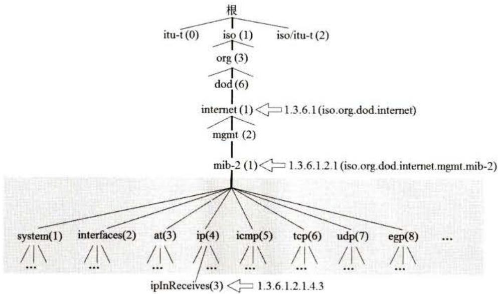
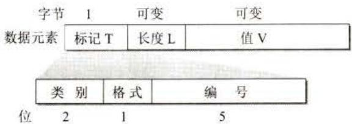
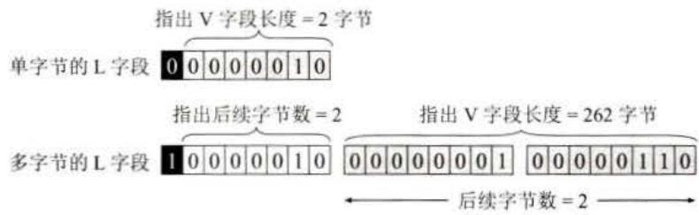

# 6.7.2 管理信息结构SMI

管理信息结构 SMI 是 SNMP 的重要组成部分。根据 6.7.1 节所讲，SMI 的功能应当有三个，即规定：

(1) 被管对象应怎样命名；

(2) 用来存储被管对象的数据类型有哪些;

(3) 在网络上传送的管理数据应如何编码。

## 1. 被管对象的命名

SMI 规定，所有的被管对象都必须处在对象命名树(object naming tree)上。图 6-21 给出了对象命名树的一部分。对象命名树的根没有名字，它的下面有三个顶级对象，都是世界上著名的标准制定单位，即 ITU-T（过去叫作 CCITT）和 ISO，以及这两个组织的联合体，它们的标号分别是 0 到 2。图中的对象名习惯上用英文小写表示。在 ISO 的下面的一个标号为 3 的节点是 ISO 认同的组织成员 org。在其下面有一个美国国防部 dod (Department of Defense) 的子树（标号为 6），再下面就是 internet（标号为 1）。在只讨论 internet 中的对象时，可只画出 internet 以下的子树，并在 internet 节点旁边写上对象标识符 1.3.6.1 即可。

> 图 6-21 SMI 规定所有被管对象必须在命名树上（教材第 309 页）

在 internet 节点下面的标号为 2 的节点是 mgmt（管理）。再下面只有一个节点，即管理信息库 mib-2，其对象标识符为 1.3.6.1.2.1。在 mib-2 下面包含了所有被 SNMP 管理的对象（见下面 6.7.3 节的讨论）。

## 2. 被管对象的数据类型

SMI 使用基本的抽象语法记法 1（即 ISO 制定的 ASN.1 $^{①}$ ）来定义数据类型，但又增加了一些新的定义。因此 SMI 既是 ASN.1 的子集，又是 ASN.1 的超集。ASN.1 的记法很严格，它使得数据的含义不存在任何可能的二义性。例如，使用 ASN.1 时不能简单地说 “一个具有整数值的变量”，而必须说明该变量的准确格式和整数取值的范围。当网络中的计算机对数据项并不都使用相同的表示时，采用这种精确的记法就尤其重要。

我们知道，任何数据都具有两种重要的属性，即值(value)与类型(type)。这里“值”是某个值集合中的一个元素，而“类型”则是值集合的名字。如果给定一种类型，则这种类型的一个值就是该类型的一个具体实例。

SMI 把数据类型分为两大类：简单类型和结构化类型。简单类型是最基本的、直接使用 ASN.1 定义的类型。表 6-4 给出了最主要的几种简单类型。

> ① 注：ISO 原以为还会制定出更多的抽象语法记法，但实际上到目前为止并没有第二个抽象语法记法出现。因此 ASN.1 似应写为 ASN。抽象语法只描述数据的结构形式且与具体的编码格式无关，同时也不涉及这些数据结构在计算机内如何存放。

> 表 6-4 几种最主要的简单类型（教材第 310 页）

| 类型 | 大小 | 说明 |
| --- | --- | --- |
| INTEGER | 4字节 | 在 $-2^{31}$ 到 $2^{31}-1$ 之间的整数 |
| Interger32 | 4字节 | 和INTEGER相同 |
| Unsigned32 | 4字节 | 在0到 $2^{32}-1$ 之间的无符号数 |
| OCTET STRING | 可变 | 不超过65535字节长的字节串 |
| OBJECT IDENTIFIER | 可变 | 对象标识符 |
| IPAddress | 4字节 | 由4个整数组成的IP地址 |
| Counter32 | 4字节 | 可从0增加到 $2^{32}$ 的整数;当它到达最大值时就返回到0 |
| TimeTicks | 4字节 | 记录时间的计数值,以1/100秒为单位 |
| BITS | — | 比特串 |
| Opaque | 可变 | 不解释的串 |

数据类型 sequence 类似于 C 语言中的 struct 或 record，它是一些简单数据类型的组合（不一定要相同的类型）。而数据类型 sequence of 类似于 C 语言中的 array，它是同样类型的简单数据类型的组合，或同样类型的 sequence 数据类型的组合。

## 3. 编码方法

SMI 使用 ASN.1 制定的基本编码规则 BER (Basic Encoding Rule) 进行数据的编码。BER 指明了每种数据的类型和值。在发送端用 BER 编码，可把用 ASN.1 所表述的报文转换成唯一的比特序列。在接收端用 BER 进行解码，就可得到该比特序列所表示的 ASN.1 报文。

初看起来，或许用两个字段就能表示类型和值。但由于表示值可能需要多个字节，因此还需要一个指出“要用多少字节表示值”的长度字段。因此 ASN.1 把所有的数据元素都表示为 T-L-V 三个字段组成的序列（见图 6-22）。T 字段(Tag)定义数据的类型，L 字段 (Length)定义 V 字段的长度，而 V 字段(Value)定义数据的值。

> 图 6-22 用 TLV 方法进行编码（教材第 310 页）

(1) T 字段又叫作标记字段，占 1 字节。T 字段比较复杂，因为它要定义的数据类型较多。T 字段又再分为以下三个子字段：

\- 类别（2位）共四种：通用类(00)，即ASN.1定义的类型；应用类(01)，即SMI定义的类型；上下文类(10)，即上下文所定义的类型；专用类(11)，保留为特定厂商定义的类型。

\- 格式（1位）共两种，指出数据类型的种类：简单数据类型(0)，结构化数据类型(1)。

\- 编号（5位）用来标志不同的数据类型。编号的范围一般为0～30。当编号大于30时，T字段就要扩展为多个字节（这种情况很少用到，可参考ITU-T X.209，这里从略）。

表 6-5 是一些数据类型的 T 字段的编码。

> 表 6-5 几种数据类型的 T 字段编码（教材第 311 页）

| 数据类型 | 类别 | 格式 | 编号 | T字段(二进制) | T字段(十六进制) |
| --- | --- | --- | --- | --- | --- |
| INTEGER | 00 | 0 | 00010 | 00000010 | 02 |
| OCTET STRING | 00 | 0 | 00100 | 00000100 | 04 |
| OBJECT IDENTIFIER | 00 | 0 | 00110 | 00000110 | 06 |
| NULL | 00 | 0 | 00101 | 00000101 | 05 |
| Sequence, sequence of | 00 | 1 | 10000 | 00110000 | 30 |
| IPAddress | 01 | 0 | 00000 | 01000000 | 40 |
| Counter | 01 | 0 | 00001 | 01000001 | 41 |
| Gauge | 01 | 0 | 00010 | 01000010 | 42 |
| TimeTicks | 01 | 0 | 00011 | 01000011 | 43 |
| Opaque | 01 | 0 | 00100 | 01000100 | 44 |

(2) L 字段又叫作长度字段（单字节或多字节）。当 L 字段为单字节时，其最高位为 0，后面的 7 位定义 V 字段的长度。当 L 字段为多个字节时，其最高位为 1，而后面的 7 位定义后续字节的字节数（用二进制整数表示）。这时，所有的后续字节并置起来的二进制整数定义 V 字段的长度。图 6-23 给出了 L 字段的格式举例。

> 图 6-23 L 字段的格式举例（教材第 311 页）

(3) V 字段又叫作值字段，用于定义数据元素的值。

根据以上所述，我们给出两个用十六进制表示的编码例子。例如，INTEGER 15，根据表6-5，其T字段是02，再根据表6-4，INTEGER类型要用4字节编码。最后得出TLV编码为02 04 00 00 00 0F。又如IPAddress 192.1.2.3，IPAddress的T字段是40，V字段需要4字节表示，因此IPAddress 192.1.2.3的TLV编码是40 04 C0 01 02 03。

TLV 方法中的 V 字段还可嵌套其他数据元素的 TLV 字段，并可多重嵌套。
