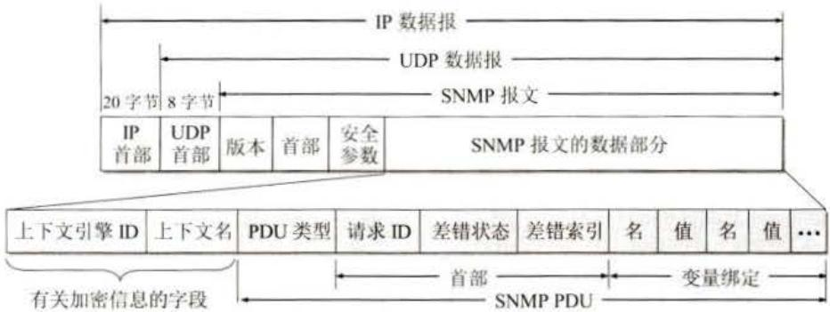
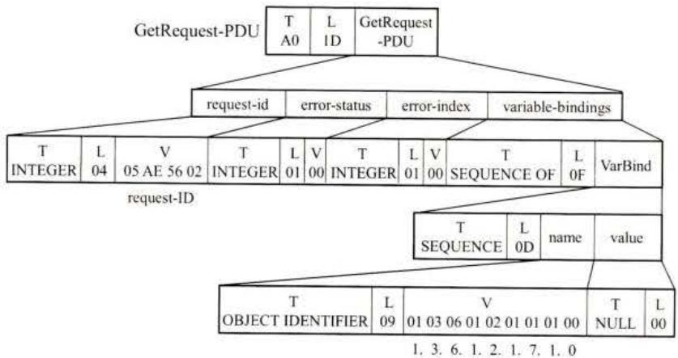

# 6.7.4 SNMP的协议数据单元和报文

实际上，SNMP 的操作只有两种基本的管理功能，即：

(1) “读” 操作，用 Get 报文来检测各被管对象的状况；

(2) “写”操作，用 Set 报文来改变各被管对象的状况。

SNMP 的这些功能通过探询操作来实现，即 SNMP 管理进程定时向被管理设备周期性地发送探询信息。上述时间间隔可通过 SNMP 的管理信息库 MIB 来建立。探询的好处是：第一，可使系统相对简单；第二，能限制通过网络所产生的管理信息的通信量。但探询管理协议不够灵活，而且所能管理的设备数目不能太多。探询系统的开销也较大。如探询频繁而并未得到有用的报告，则通信线路和计算机的 CPU 周期就被浪费了。

但 SNMP 不是完全的探询协议，它允许不经过询问就能发送某些信息。这种信息称为陷阱(trap)，表示它能够捕捉“事件”。但这种陷阱信息的参数是受限制的。

当被管对象的代理检测到有事件发生时，就检查其门限值。代理只向管理进程报告达到某些门限值的事件（这就叫作过滤）。这种方法的好处是：第一，仅在严重事件发生时才发送陷阱；第二，陷阱信息很简单且所需字节数很少。

总之，使用探询（至少是周期性地）以维持对网络资源的实时监视，同时也采用陷阱机制报告特殊事件，使得 SNMP 成为一种有效的网络管理协议。

SNMP 使用无连接的 UDP，因此在网络上传送 SNMP 报文的开销较小。但 UDP 是不保证可靠交付的。这里还要指出，SNMP 使用 UDP 的方法有些特殊。在运行代理程序的服务器端用熟知端口 161 来接收 Get 或 Set 报文和发送响应报文（与熟知端口通信的客户端使用临时端口），但运行管理程序的客户端则使用熟知端口 162 来接收来自各代理的 trap 报文。

SNMP 现在共定义了如表 6-8 所示的 8 种类型的协议数据单元[RFC 3416, STD62]，其中 PDU 编号为 4 的已经废弃了。在 PDU 编号后面是对应的 T 字段值（十六进制形式表示）。

> 表 6-8 SNMP 定义的协议数据单元类型（教材第 313 页）

| PDU 编号(T字段) | PDU 名称 | 用途 |
| --- | --- | --- |
| 0(A0) | GetRequest | 管理者从代理读取一个或一组变量的值 |
| 1(A1) | GetNextRequest | 管理者从代理读取MIB树上的下一个变量的值(即使不知道此变量名也行)。此操作可反复进行,特别是按顺序一一读取列表中的值很方便 |
| 2(A2) | Response | 代理向管理者或管理者向管理者发送对五种Request报文的响应,并提供差错码、差错状态等信息 |
| 3(A3) | SetRequest | 管理者对代理的一个或多个MIB变量的值进行设置 |
| 5(A5) | GetBulkRequest | 管理者从代理读取大数据块的值(如大的列表中的值) |
| 6(A6) | InformRequest | 管理者从另一远程管理者读取该管理者控制的代理中的变量值 |
| 7(A7) | SNMPv2Trap | 代理向管理者报告代理中发生的异常事件 |
| 8(A8) | Report | 在管理者之间报告某些类型的差错,目前尚未定义 |

和大多数 TCP/IP 协议不一样，SNMP 报文没有固定的字段。相反，它们使用标准 ASN.1 编码。因此，SNMP 报文用人工进行编码和理解时都比较困难。为此，在图 6-24 中给出了 SNMPv1 的报文格式。可以看出，一个 SNMP 报文共由四个部分组成，即版本、首部、安全参数和 SNMP 报文的数据部分。目前最新版本是版本 3。首部包括报文标识 (message identification)、最大报文长度、报文标志 (message flag)。报文标志占 1 字节，其中的每一位定义安全类型或其他信息。安全参数用来产生报文摘要（见下一章的 7.3.1 节）。

> 图 6-24 SNMP 的报文格式（教材第 314 页）

从图 6-24 可看出，在 SNMP PDU 前面还有两个有关加密信息的字段。这是当数据部分需要加密时才使用的两个字段。与网络管理直接相关的是后面的 SNMP PDU 部分。对于表 6-8 给出的前四种 PDU 的格式都是相同的，即由 PDU 类型、请求 ID、差错状态、差错索引以及变量绑定这几个字段组成。PDU 的各种类型以及类型的编号和 T 字段的编码已在表 6-8 中给出。下面简单介绍一下其他字段的作用。

(1) 请求 ID (request ID) 由管理进程设置的 4 字节整数值。代理进程在发送响应报文时也要返回此请求 ID。由于管理进程可同时向许多代理发出请求读取变量值的报文，因此设置了请求 ID 可使管理进程能够识别返回的响应是对应于哪一个请求报文。

(2) 差错状态(error status) 在请求报文中，这个字段是零。当代理进程响应时，就填入 0\~18 中的一个数字。例如 0 表示 noError（一切正常），1 表示 tooBig（代理无法把回答装入到一个 SNMP 报文之中），2 表示 noSuchName（操作指明了一个不存在的变量），3 表示 badValue（无效值或无效语法），等等[RFC 3416]。

(3) 差错索引(error index) 在请求报文中，这个字段是零。当代理进程响应时，若出现 noSuchName, badValue 或 readOnly 的差错，代理进程就设置一个整数，指明有差错的变量在变量列表中的偏移。

(4) 变量绑定(variable-bindings) 指明一个或多个变量的名和对应的值。在请求报文中，变量的值应忽略（类型是 NULL）。

为了大致了解 ASN.1 给出的定义的形式，下面举出定义 GetRequest-PDU 的例子。两个连字符 “--” 后面的是注解。

但变量 VarBindList 是什么类型呢？还需要继续定义（这里从略）。上面 ASN.1 定义中的第二行中的 IMPLICIT 叫作隐式标记，是为了在进行编码时可省去对 IMPLICIT 后面的类型 (SEQUENCE) 的编码，使最后得出的编码更加简洁。

下面我们假定管理者发送 GetRequest-PDU，为的是从某路由器的代理进程获得“收到 UDP 数据报的数目”的信息。从图 6-21 可以查出，mib-2 下面第 7 个节点是 udp，而 udp 节点下面的第一个节点就是 udpInDatagrams。由于这个节点已经是叶节点（即没有连接在它下面的子节点了），读取这个节点的数值时应在节点标识符后面加上 0，即 1.3.1.1.2.1.7.1.0。这样，可得出 GetRequest-PDU 的 ASN.1 编码，如图 6-25 所示。

> 图 6-25 GetRequest-PDU 的 ASN.1 编码（教材第 315 页）

可以把图中各字段的十六进制编码表示如下。

A0 1D -- GetRequest-PDU，上下文类型，长度 $1\mathrm{D}_{16} = 29$

02 04 05 AE 56 02 -- INTEGER 类型，长度 $04_{16}$ ，request-id = 05 AE 56 02

30 OF --SEQUENCE OF 类型，长度 $0F_{16}=15$

30 0D -- SEQUENCE 类型，长度 $0D_{16}=13$
