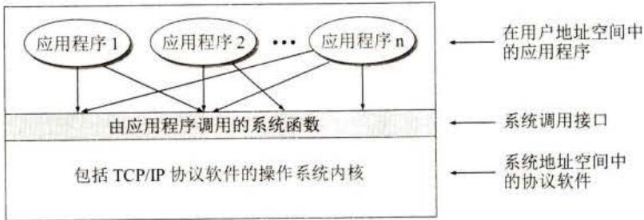
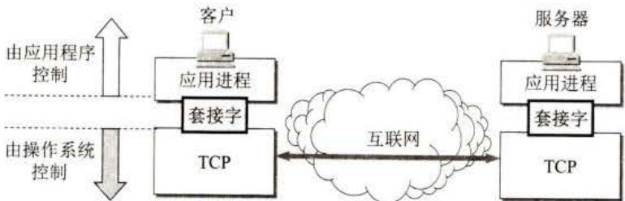
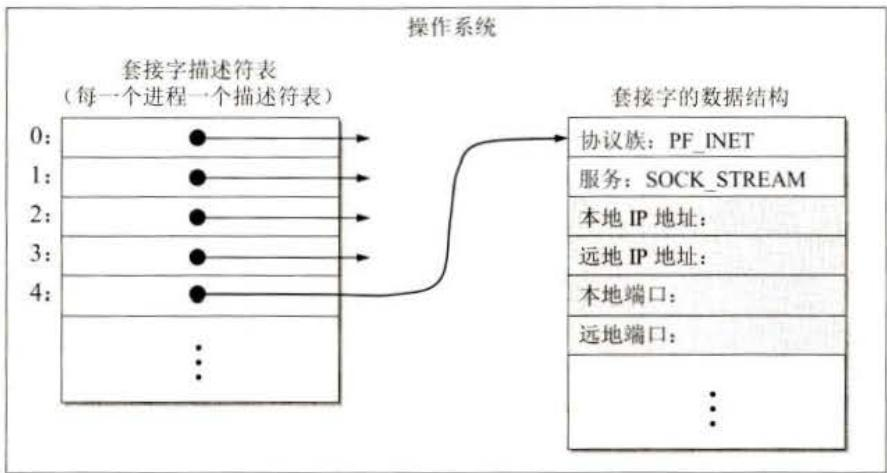
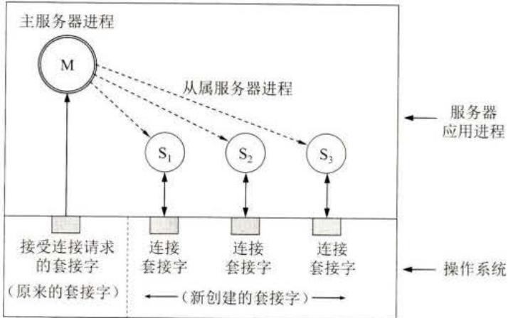
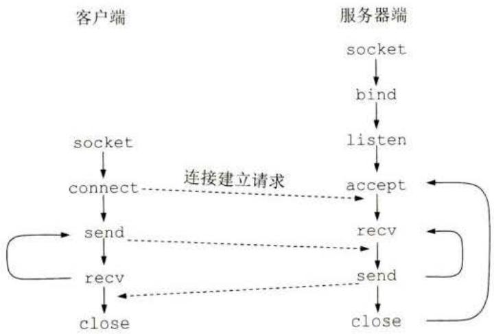

# 6.8 应用进程跨越网络的通信

在这以前我们已经讨论了互联网使用的几种常用的应用层协议，这些应用协议使广大用户可以更加方便地利用互联网的资源。

现在的问题是：如果我们还有一些特定的应用需要互联网的支持，但这些应用又不能直接使用已经标准化的互联网应用协议，那么我们应当做哪些工作？要回答这个问题，实际上就是要了解下面要介绍的系统调用和应用编程接口。这些问题需要一门专门的课程来学习，我们在这里只能给出一些初步的概念。

## 6.8.1 系统调用和应用编程接口

大多数操作系统使用系统调用(system call)的机制在应用程序和操作系统之间传递控制权。对程序员来说，系统调用和一般程序设计中的函数调用非常相似，只是系统调用是将控制权传递给了操作系统。图 6-26 说明了多个应用进程使用系统调用的机制。

> 图 6-26 多个应用进程使用系统调用的机制（教材第 316 页）

当某个应用进程启动系统调用时，控制权就从应用进程传递给了系统调用接口。此接口再把控制权传递给计算机的操作系统。操作系统把这个调用转给某个内部过程，并执行所请求的操作。内部过程一旦执行完毕，控制权就又通过系统调用接口返回给应用进程。总之，只要应用进程需要从操作系统获得服务，就要把控制权传递给操作系统，操作系统在执行必要的操作后把控制权返还给应用进程。因此，系统调用接口实际上就是应用进程的控制权和操作系统的控制权进行转换的一个接口。由于应用程序在使用系统调用之前要编写一些程序，特别是需要设置系统调用中的许多参数，因此这种系统调用接口又称为应用编程接口 API (Application Programming Interface)。API 从程序设计的角度定义了许多标准的系统调用函数。应用进程只要使用标准的系统调用函数就可得到操作系统的服务。因此从程序设计的角度看，也可以把 API 看成是应用程序和操作系统之间的接口。

现在 TCP/IP 协议软件已驻留在操作系统中。由于 TCP/IP 协议族被设计成能运行在多种操作系统的环境中，因此 TCP/IP 标准没有规定应用程序与 TCP/IP 协议软件如何接口的细节，而是允许系统设计者能够选择有关 API 的具体实现细节。目前，只有几种可供应用程序使用 TCP/IP 的应用编程接口 API。这里最著名的就是美国加利福尼亚大学伯克利分校为 Berkeley UNIX 操作系统定义的一种 API，它又称为套接字接口 (socket interface)（或插口接口）。微软公司在其操作系统中采用了套接字接口 API，形成了一个稍有不同的 API，并称之为 Windows Socket，简称为 WinSock。AT&T 为其 UNIX 系统 V 定义了一种 API，简写为 TLI (Transport Layer Interface)。

我们知道，若要让计算机做某件事情，就要编写使计算机能理解的程序。在网络环境下的计算机应用都有一个共同特点，这就是：位于不同地点的计算机要通过网络进行通信。从另一种角度看，计算机之间的通信就是本计算机要读取另一个地点的计算机中的数据，或者要把数据从本计算机写入到另一个地点的计算机中。这种“读取”和“写入”的过程都要用到上面所说的系统调用。

在讨论网络编程时常常把套接字作为应用进程和运输层协议之间的接口，图 6-27 表示这一概念。图中假定了运输层使用 TCP 协议（若使用 UDP 协议，情况也是类似的，只是 UDP 是无连接的。通信的两端仍然可用两个套接字来标志）。现在套接字已成为计算机操作系统内核的一部分。

> 图 6-27 套接字成为应用进程与运输层协议的接口（教材第 317 页）

请注意：在套接字以上的进程是受应用程序控制的，而在套接字以下的运输层协议软件则是受计算机操作系统的控制。因此，只要应用程序使用 TCP/IP 协议进行通信，它就必须通过套接字与操作系统交互（这就要使用系统调用函数）并请求其服务。我们应当注意到，应用程序的开发者对套接字以上的应用进程具有完全的控制，但对套接字以下的运输层却只有很少的控制，例如，可以选择运输层协议（TCP 或 UDP）以及一些运输层的参数（如最大缓存空间和最大报文长度等）。

当应用进程（客户或服务器）需要使用网络进行通信时，必须首先发出 socket 系统调用，请求操作系统为其创建一个“套接字”。这个调用的实际效果是请求操作系统把网络通信所需要的一些系统资源（存储器空间、CPU 时间、网络带宽等）分配给该应用进程。操作系统为这些资源的总和用一个叫作套接字描述符(socket descriptor)的号码（小的整数）来表示，然后把这个套接字描述符返回给应用进程。此后，应用进程所进行的网络操作（建立连接、收发数据、调整网络通信参数等）都必须使用这个套接字描述符。所以，几乎所有的网络系统调用都把这个套接字描述符作为套接字的许多参数中的第一个参数。在处理系统调用的时候，通过套接字描述符，操作系统就可以识别出应该使用哪些资源来完成应用进程所请求的服务。通信完毕后，应用进程通过一个关闭套接字的 close 系统调用通知操作系统回收与该套接字描述符相关的所有资源。由此可见，套接字是应用进程为了获得网络通信服务而与操作系统进行交互时使用的一种机制。

图 6-28 给出了当应用进程发出 socket 系统调用时，操作系统所创建的套接字描述符与套接字数据结构的关系。由于在一个进程中可能同时出现多个套接字，因此需要有一个存放套接字描述符的表，而每一个套接字描述符有一个指针指向存放套接字的地址。在套接字的数据结构中有许多参数要填写。图 6-28 中已填写好的参数是协议族（PF\_INET，表示使用 Internet 的 TCP/IP 协议族）和服务（SOCK\_STREAM，表示使用流式服务，也就是使用 TCP 服务）。在刚刚创建一个新的套接字时，有灰色背景的四个项目（本地和远地 IP 地址，本地和远地端口）都是未填写的，因此它和任何机器中的应用进程暂时都还没有联系。

> 图 6-28 调用 socket 创建套接字（教材第 318 页）

这里要特别强调一下，在第5章5.3.2节的最后，我们曾指出，同一个名词socket可表示多种不同的意思。在本节讨论socket系统调用时，套接字socket已不仅仅是RFC793所定义的如公式(5-1)所示的那样，而是如图6-28右边所示的套接字的数据结构。

## 6.8.2 几种常用的系统调用

下面我们以使用 TCP 的服务为例介绍几种常用的系统调用。

## 1. 连接建立阶段

当套接字被创建后，它的端口号和 IP 地址都是空的，因此应用进程要调用 bind（绑定）来指明套接字的本地地址（本地端口号和本地 IP 地址）。在服务器端调用 bind 时就是把熟知端口号和本地 IP 地址填写到已创建的套接字中。这就叫作把本地地址绑定到套接字。在客户端也可以不调用 bind，这时由操作系统内核自动分配一个动态端口号（通信结束后由系统收回）。

服务器在调用 bind 后，还必须调用 listen（收听）把套接字设置为被动方式，以便随时接受客户的服务请求。UDP 服务器由于只提供无连接服务，不使用 listen 系统调用。

服务器紧接着就调用 accept（接受），以便把远地客户进程发来的连接请求提取出来。系统调用 accept 的一个变量就是要指明是从哪一个套接字发起的连接。

调用 accept 要完成的动作较多。这是因为一个服务器必须能够同时处理多个连接。这样的服务器常称为并发方式(concurrent)工作的服务器。可以有多种方法实现这种并发方式。图 6-29 所示的是一种实现方法。

主服务器进程 M（就是通常所说的服务器进程）一调用 accept，就为每一个新的连接请求创建一个新的套接字，并把这个新创建的套接字的标识符返回给发起连接的客户方。与此同时，主服务器进程还要创建一个从属服务器进程（如图 6-29 中的 $S_{1}$ ）来处理新建立的连接。这样，从属服务器进程用这个新创建的套接字和客户进程建立连接，而主服务器进程用原来的套接字重新调用 accept，继续接受下一个连接请求。在已建立的连接上，从属服务器进程就使用这个新创建的套接字传送和接收数据。数据通信结束后，从属服务器进程就关闭这个新创建的套接字，同时这个从属服务器也被撤销。

> 图 6-29 并发方式工作的服务器（教材第 319 页）

总之，在任一时刻，服务器中总是有一个主服务器进程和零个或多个从属服务器进程。主服务器进程用原来的套接字接受连接请求，而从属服务器进程用新创建的套接字（在图6-29中注明是“连接套接字”）和相应的客户建立连接并可进行双向传送数据。

以上介绍的是服务器为了接受客户端发起的连接请求而进行的一些系统调用。现在看一下客户端的情况。当使用 TCP 协议的客户已经调用 socket 创建了套接字后，客户进程就调用 connect，以便和远地服务器建立连接（这就是主动打开，相当于客户发出的连接请求）。在 connect 系统调用中，客户必须指明远地端点（即远地服务器的 IP 地址和端口号）。

## 2. 数据传送阶段

客户和服务器都在 TCP 连接上使用 send 系统调用传送数据，使用 recv 系统调用接收数据。通常客户使用 send 发送请求，而服务器使用 send 发送回答。服务器使用 recv 接收客户用 send 调用发送的请求。客户在发完请求后用 recv 接收回答。

调用 send 需要三个变量：数据要发往的套接字的描述符、要发送的数据的地址以及数据的长度。通常 send 调用把数据复制到操作系统内核的缓存中。若系统的缓存已满，send 就暂时阻塞，直到缓存有空间存放新的数据。

调用 recv 也需要三个变量：要使用的套接字的描述符、缓存的地址以及缓存空间的长度。

## 3. 连接释放阶段

一旦客户或服务器结束使用套接字，就把套接字撤销。这时就调用 close 释放连接和撤销套接字。

图 6-30 画出了上述的一些系统调用的使用顺序。有些系统调用在一个 TCP 连接中可能会循环使用。

> 图 6-30 系统调用使用顺序的例子（教材第 320 页）

UDP 服务器由于只提供无连接服务，因此不使用 listen 和 accept 系统调用。
