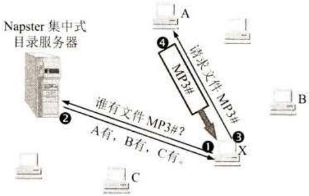

# 6.9.1 具有集中目录服务器的P2P工作方式

## 6.9 P2P 应用

我们在第 1 章的 1.3.1 节中已经简单地介绍了 P2P 应用的概念。现在我们将进一步讨论 P2P 应用的若干工作原理。

P2P 应用就是指具有 P2P 体系结构的网络应用。所谓 P2P 体系结构就是在这样的网络应用中，没有（或只有极少数的）固定的服务器，而绝大多数的交互都是使用对等方式（P2P 方式）进行的。

P2P 应用的范围很广，例如，文件分发、实时音频或视频会议、数据库系统、网络服务支持（如 P2P 打车软件、P2P 理财等）。限于篇幅，下面只介绍最常用的 P2P 文件分发的工作原理。

P2P 文件分发不需要使用集中式的媒体服务器，而所有的音频/视频文件都是在普通的互联网用户之间传输的。这其实是相当于有很多（有时达到上百万个）分散在各地的媒体服务器（由普通用户的计算机充当这种媒体服务器）向其他用户提供所要下载的音频/视频文件。这种 P2P 文件分发方式解决了集中式媒体服务器可能出现的瓶颈问题。

目前在互联网流量中，P2P 工作方式下的文件分发已占据了最大的份额，比万维网应用所占的比例大得多。因此单纯从流量的角度看，P2P 文件分发应当是互联网上最重要的应用。现在 P2P 文件分发不仅传送音频文件 MP3，而且还传送视频文件（10～1000 MB，或更大）、各种软件和图像文件。

最早使用 P2P 工作方式的是 Napster。这个名称来自 1999 年美国东北大学的新生 Shawn Fanning 所写的一个叫作 Napster 的软件。利用这个软件就可通过互联网免费下载各种 MP3音乐。Napster 的出现使 MP3 成为网络音乐事实上的标准 $^{①}$ 。

Napster 能够搜索音乐文件，能够提供检索功能。所有音乐文件的索引信息都集中存放在 Napster 目录服务器中。这个目录服务器起着索引的作用。使用者只要查找目录服务器，就可知道应从何处下载所要的 MP3 文件。在 2000 年，Napster 成为互联网上最流行的 P2P 应用，并占据互联网上的通信量中相当大的比例。

这里的关键就是运行 Napster 的所有用户，都必须及时向 Napster 的目录服务器报告自己已经存有哪些音乐文件。Napster 目录服务器就用这些用户信息建立起一个动态数据库，集中存储了所有用户的音乐文件信息（即对象名和相应的 IP 地址）。当某个用户想下载某个 MP3 文件时，就向目录服务器发出查询（这个过程仍是传统的客户-服务器方式），目录服务器检索出结果后向用户返回存放这一文件的计算机 IP 地址，于是这个用户就可以从中选取一个地址下载想要得到的 MP3 文件（这个下载过程就是 P2P 方式）。可以看出，Napster 的文件传输是分散的（P2P 方式），但文件的定位则是集中的（客户-服务器方式）。

图 6-31 是 Napster 的工作过程的示意图。假定 Napster 目录服务器已经建立了其用户的动态数据库。图中给出了某个用户要下载音乐文件的主要交互过程。

> 图 6-31 Napster 的工作过程（教材第 321 页）

① 用户 X 向 Napster 目录服务器查询（客户-服务器方式）谁有文件 MP3#。

② Napster 目录服务器回答 X：有三个地点有文件 MP3#，即 A, B 和 C（给出了这三个地点的 IP 地址）。于是用户 X 得知所需的文件 MP3# 的三个下载地点。

③ 用户 X 可以随机地选择三个地点中的任一个，也可以使用 PING 报文寻找最方便下载的一个。在图 6-31 中，我们假定 X 向 A 发送下载文件 MP3# 的请求报文。现在 X 和 A 都使用 P2P 方式通信，互相成为对等方，X 是临时的客户，而对等方 A 是临时的服务器。

④ 对等方 A（现在作为服务器）把文件 MP3# 发送给 X。

这种集中式目录服务器的最大缺点就是可靠性差，而且会成为其性能的瓶颈（尤其是在用户数非常多的情况下）。更为严重的是这种做法侵犯了唱片公司的版权。虽然 Napster 网站并没有直接非法复制任何 MP3 文件（Napster 网站不存储任何 MP3 文件，因而并没有直接侵犯版权），但法院还是判决 Napster 属于 “间接侵害版权”，因此在 2000 年 7 月底 Napster 网站就被迫关闭了。

> ① 注：通常 CD 光盘中的音乐都采用 wav 格式，即采用标准的 PCM 编码。MP3 则进行了压缩，把一些人耳朵不太能够听出来的部分频率分量压缩掉了。压缩比一般在 1:4 到 1:12 之间。例如，压缩比为 1:10 就表明 10MB 的 wav 格式音乐，可压缩成 1 MB 的 MP3 格式，而音质的下降并不太明显。
