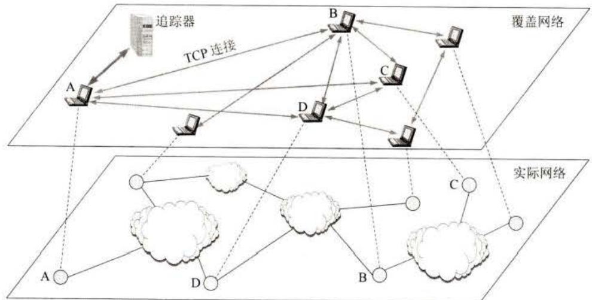
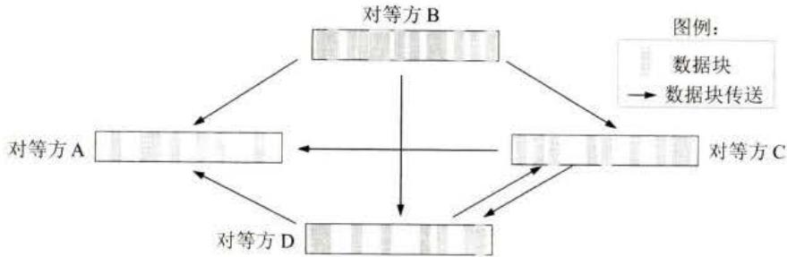

# 6.9.2 具有全分布式结构的P2P文件共享程序

在第一代 P2P 文件共享网站 Napster 关闭后，开始出现了以 Gnutella 为代表的第二代 P2P 文件共享程序。Gnutella 是一种采用全分布方法定位内容的 P2P 文件共享应用程序。Gnutella 与 Napster 最大的区别就是不使用集中式的目录服务器进行查询，而是使用洪泛法在大量 Gnutella 用户之间进行查询。为了不使查询的通信量过大，Gnutella 设计了一种有限范围的洪泛查询。这样可以减少倾注到互联网的查询流量，但由于查询的范围受限，因而这也影响到查询定位的准确性。

为了更加有效地在大量用户之间使用 P2P 技术下载共享文件，最近几年已经开发出很多种第三代 P2P 共享文件程序[KURO17]，它们使用分散定位和分散传输技术。如 KaZaA，电骤 eMule，比特洪流 BT (Bit Torrent)等。

下面对比特洪流 BT 的主要特点进行简单的介绍。

在 P2P 的文件分发应用中，2001 年由 Brahm Cohen 开发的 BitTorrent（中文意思是“比特洪流”）是很具代表性的一个。取这个名称的原因就是 BitTorrent 把参与某个文件分发的所有对等方的集合称为一个洪流 (torrent)。为了方便，下面我们使用 BitTorrent 的简称 BT。BT 把对等方下载文件的数据单元称为文件块 (chunk)，一个文件块的长度是固定不变的，例如，典型的数值是 256 KB。当一个新的对等方加入某个洪流时，一开始它并没有文件块。但新的对等方逐渐地能够下载到一些文件块。而与此同时，它也为别的对等方上传一些文件块。某个对等方获得了整个的文件后，可以立即退出这个洪流（相当于自私的用户），也可继续留在这个洪流中，为其他的对等方上传文件块（相当于无私的用户）。加入或退出某个洪流可在任何时间完成（即使在某个文件还没有下载完毕时），也是完全自由的。

BT 的协议相当复杂[W-BT]。下面讨论其基本机制。

每一个洪流都有一个基础设施节点，叫作追踪器(tracker)。当一个对等方加入洪流时，必须向追踪器登记（或称为注册），并周期性地通知追踪器它仍在洪流中。追踪器因而就跟踪了洪流中的对等方。一个洪流中可以拥有少到几个多到几百或几千个对等方。

我们用图 6-32 来进一步说明 BT 的工作原理。当一个新的对等方 A 加入洪流时，追踪器就随机地从参与的对等方集合中选择若干个（例如，30 个），并把这些对等方的 IP 地址告诉 A。于是 A 就和这些对等方建立了 TCP 连接。我们称所有与 A 建立了 TCP 连接的对等方为“相邻对等方”(neighboring peers)。在图 6-32 中我们在上面的覆盖网络中画出了 A 有三个相邻对等方（B, C 和 D）。这些相邻对等方的数目是动态变化的，有的对等方可能不久就离开了，但不久后又有新加入进来的对等方。请注意，实际的网络拓扑可能是非常复杂的（参见图 6-32 覆盖网络下面的实际网络图）。我们知道，TCP 连接只是个逻辑连接，而每一个 TCP 连接可能会穿越很多的网络。因此我们在讨论问题时，可以利用实际网络上面的一个更加简洁的覆盖网络，这个覆盖网络忽略了实际网络的许多细节，使问题的讨论更加方便。在覆盖网络中，A 的三个相邻对等方就看得很清楚。

在任何时刻，每一个对等方可能只拥有某文件的一个文件块子集，而不同的对等方所拥有的文件块子集也不会完全相同。对等方 A 将通过 TCP 连接周期性地向其相邻对等方索取它们拥有的文件块列表。根据收到的文件块列表，A 就知道了应当请求哪一个相邻对等方

把哪些自己缺少的文件块发送过来。

> 图 6-32 在覆盖网络中对等方的相邻关系的示意图（教材第 323 页）

图 6-33 是对等方之间互相传送数据块的示意图。例如，A 向 B、C 和 D 索取数据块，但 B 同时也向 C 和 D 传送数据块，D 和 C 还互相传送数据块。由于 P2P 对等用户的数量非常多，因此，从不同的对等方获得不同的数据块，然后组装成整个的文件，一般要比仅从一个地方下载整个的文件要快很多。

> 图 6-33 对等方之间互相传送文件数据块（教材第 323 页）

然而 A 必须做出两个重要决定。第一，哪些文件块是首先需要向其相邻对等方请求的？第二，在很多向 A 请求文件块的相邻对等方中，A 应当向哪些相邻对等方发送所请求的文件块？

对于第一个问题，A 要使用叫作最稀有的优先(rarest first)的技术。我们知道，凡是 A 所缺少的而正好相邻对等方已拥有的文件块，都应当去索取。可能其中的某些文件块，很多相邻对等方都有（即文件块的副本很多），这就是“不稀有的”文件块，以后可慢慢请求。如果 A 所缺少的文件块在相邻对等方中的副本很少，那就是“很稀有的”。因此，A 首先应当请求副本最少的文件块（即最稀有的）。否则，一旦拥有最稀有文件块的对等方退出了洪流，就会影响 A 对所缺文件块的收集。

对于第二个问题，BT 采用了一种更加机灵的算法，其基本思想就是：凡当前有以最高数据率向 A 传送文件块的某相邻对等方，A 就优先把所请求的文件块传送给该相邻对等方。具体来说，A 持续地测量从其相邻对等方接收数据的速率，并确定速率最高的 4 个相邻对等方。接着，A 就把文件块发送给这 4 个相邻对等方。每隔 10 秒钟，A 还要重新计算数据率，然后可能修改这 4 个对等方。在 BT 的术语中，这 4 个对等方叫作已疏通的或无障碍的 (unchoked) 对等方。更重要的是，每隔 30 秒，A 要随机地找一个另外的相邻对等方 B，并向其发送文件块。这样，A 有可能成为 B 的前 4 位上传文件块的提供者。在此情况下，B 也有可能向 A 发送文件块。如果 B 发送文件块的速率足够快，那么 B 也有可能进入 A 的前 4 位上传文件块的提供者。这样做的结果是，这些对等方相互之间都能够以令人满意的速率交换文件块。
