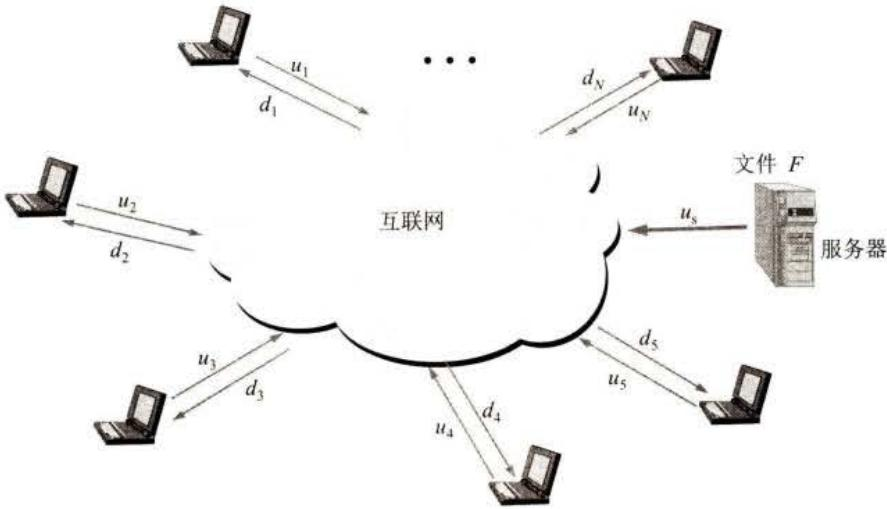

# 6.9.3 P2P文件分发的分析

我们从一个例子开始，来讨论 P2P 文件分发中的几个重要概念[KURO17]。

在图 6-34 中，有 N 台主机要从互联网上的服务器下载一个大文件，其长度为 F bit。在图中我们把这个文件也记为 F。按照习惯，从互联网传送数据到主机，叫作下载(download)，而反过来传送数据，即从主机向互联网传送，则称为上传(upload)或上载。服务器的文件是供互联网上的用户享用的，因此服务器的文件只是单方向上传到互联网。我们把服务器的上传速率记为 $u_{s}$ ，单位是 bit/s。再假定主机与互联网连接的链路的上传速率和下载速率分别为 $u_{i}$ 和 $d_{i}$ ，单位都是 bit/s。我们还假定互联网的核心部分不会产生拥塞。瓶颈只会发生在服务器的接入链路，或者是某些主机的接入链路。

> 图 6-34 文件分发的例子（教材第 324 页）

我们先在传统的客户-服务器方式下，计算给所有主机分发完毕的最短时间 $T_{cs}$ 。

从服务器端考虑，N 台主机共需要从服务器得到的数据总量（比特数）是 NF。如果服务器能够不停地以其上传速率 $u_{s}$ 向各主机传送数据，一直到各主机都收到文件 F，就需要时间 $NF/u_{s}$ ，单位是秒。由此可见， $T_{cs}$ 不可能小于 $NF/u_{s}$ 。

如果 N 台主机都以各自的下载速率不停地下载文件 F，那么下载速率最慢的主机（设其下载速率为 $d_{min}$ ）的下载文件时间 $(F/d_{\min})$ ，将是 N 个下载时间中最大的一个。由此可见， $T_{cs}$ 也不可能小于 $F/d_{min}$ 。

如果 $NF/u_{s} \geqslant F/d_{min}$ ，则瓶颈在服务器端的接入链路。这时 $T_{cs} = NF/u_{s}$ 。

如果 $F/d_{\min} \geqslant NF/u_{s}$ ，则瓶颈在下载最慢的主机的接入链路。这时 $T_{cs} = F/d_{\min}$ 。

由此可得出所有主机都下载完文件 F 的最少时间是

$$ T _ {\mathrm{cs}} = \max \left\{\frac {N F}{u _ {\mathrm{s}}}, \frac {F}{d _ {\min}} \right\}\tag{6-2} $$

从以上分析可以看出，若公式(6-2)括号中的第一项大于第二项，则 $T_{\mathrm{cs}}$ 就与主机数 $N$ 成正比。如果主机数增大1000倍，那么文件的分发时间也要增大1000倍。

下面讨论在 P2P 方式下，文件全部分发完毕的最少时间 $T_{P2P}$ 。然而在 P2P 方式下，文件分发所需的时间较难计算，这是因为每一台主机在接收文件的同时，还利用自己的上传能力向其他主机传送文件。文件传送所需的时间取决于主机向对等方传送文件的具体方式。但是，我们还是可以导出文件分发所需的最少时间的表达式。

在文件分发开始时，只有服务器有文件 F。服务器必须把文件 F 的每一个比特通过接入链路传送到互联网（至少要传送一次）。因此文件分发的最少时间不可能小于 $F/u_{s}$ 。和客户-服务器方式相比，在 P2P 方式下，服务器不需要一遍一遍地发送文件 F，因为互联网上的其他主机（即对等方）可以代替服务器向其他对等方分发文件 F。

在 P2P 方式下，下载速率最慢的主机（设其下载速率为 $d_{min}$ ）下载文件 F 的时间是 $F/d_{min}$ ，这是 N 个对等方下载时间中最大的一个。可见文件分发的最少时间不可能小于 $F/d_{min}$ 。这个结论和客户-服务器方式是一样的。

整个系统中所有主机（包括服务器）的上传速率之和是 $u_{T}=u_{s}+u_{1}+u_{2}+\ldots+u_{N}$ 。因此，文件分发的最少时间也不可能小于 $NF/u_{T}$ 。

这样，我们得出在P2P方式下所有主机都下载完文件 $F$ 的最少时间的下限是

$$ T _ {\mathrm{P2P}} \geqslant \max \left\{\frac {F}{u _ {\mathrm{s}}}, \frac {F}{d _ {\mathrm{min}}}, \frac {N F}{u _ {\mathrm{T}}} \right\}\tag{6-3} $$

在公式(6-3)的推导过程中，我们假定每一个对等方只要收到一个比特就立即上传到互联网的其他对等方。但实际上是把收到的若干个比特组成一个数据块后再上传出去。但是当文件 F 很大时，我们也可以在公式(6-3)中取等号，作为文件 F 的最少分发时间 $T_{P2P}$ 的近似值。

有一种情况最值得我们注意。这就是对等方的数目 N 非常大，因此在公式(6-3)的括号中的最后一项的值将大于前两项的值。这样， $T_{P2P}$ 值的下限就近似为 $NF/u_{T}$ 。

我们再假定一些数据。设所有的对等方的上传速率都是 u，并且 F/u = 1 小时，所有对等方的下载速率都不小于服务器的上传速率，因而不会对我们的计算产生影响。我们再设服务器的上传速率 $u_{s} = 10u$ 。当 N = 30 时，用公式(6-3)算出所有主机都下载完文件 F 的最少时间的下限是 $T_{P2P} = 0.75 F/u = 0.75$ 小时（这个数值一定小于 1 小时）。如果采用客户-服务器方式，则当 N = 30 时，所有主机都下载完文件 F 的最少时间是 $T_{cs} = NF/u_{s} = 3$ 小时。
