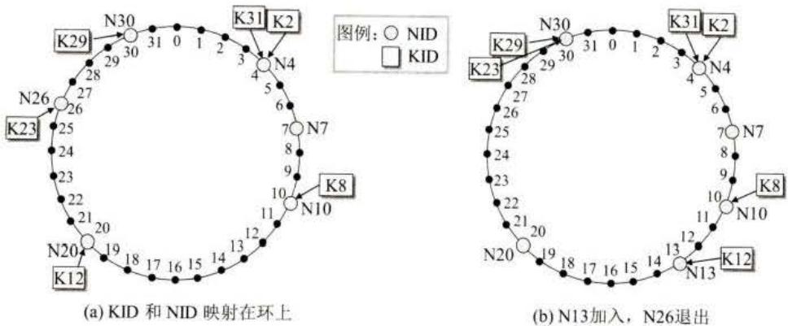
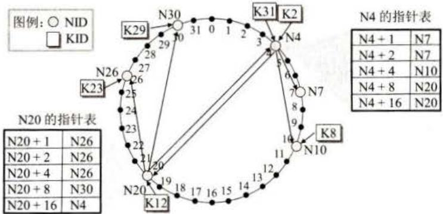

# 6.9.4 在P2P对等方中搜索对象

在 P2P 文件系统中，对等方用户的数量非常多，并且处于一种无序的状态。任何一个对等方可以随时加入进来或随时退出。在这种情况下，怎样有效地找到所需的文件，也就是怎样有效地定位对等方及其资源，乃是 P2P 系统中的一个十分重要的问题。

限于篇幅，我们在这里只简单介绍一下怎样利用散列函数来定位对等方。

我们知道，Gnutella 是一种采用全分布方法定位内容的 P2P 文件共享应用程序，它解决了集中式目录服务器所造成的瓶颈问题。然而 Gnutella 是在非结构化的覆盖网络中采用查询洪泛的方法来进行查找的，因此查找的效率较低。现在比较好的查找方法是设法构建一种分布式数据库，以进行对等方及其资源的定位。这种分布式数据库在概念上并不复杂，只要能够支持大量对等方（可能有几百万个）进行索引查找即可。存储在数据库中的信息只有两个部分：

(1) 要查找的资源名 K（例如，电影或歌曲的名字）。资源名也可称为关键字。

(2) 存放该对象的节点的 IP 地址 N。有的 IP 地址还附带有端口号。

存放在数据库中的信息就是大量成对出现的（资源名 K，节点的 IP 地址 N）。在查找某资源名 K 时，只要在数据库中查找到匹配的资源名 K，数据库就能够返回对应的节点的 IP 地址 N。所以问题的关键就是要设法把每个资源名 K 存放在一个非常便于查找的地方。

细心的读者可能会联想到曾在前面 6.1 节讨论的 DNS 域名系统。DNS 是根据主机的域名来查找其 IP 地址，这和 P2P 的情况有相似之处。但我们知道，主机的域名是结构化的命名系统，因此域名服务器可以划分为几种不同的级别（如根服务器等）便于查找。但 P2P 系统则不同，其资源名是非结构化的。因此不能套用 DNS 的那种查找方法。

前面已经讲过，Napster 在一个集中式目录服务器中构建的查找数据库虽然很简单，但性能上却有瓶颈。在 P2P 系统中，应怎样构建分布式的 P2P 数据库？让每个对等方都拥有所有对等方 IP 地址的列表是不可行的。让所有成对出现的（资源名 K, IP 地址 N）随机地分散到各对等方也是不可行的。因为这将使查找对象的次数过大，无法使用。现在广泛使用的索引和查找技术叫作分布式散列表 DHT (Distributed Hash Table)。DHT 也可译为分布式哈希表，它是由大量对等方共同维护的散列表。基于 DHT 的具体算法已有不少，如 Chord, Pastry, CAN (Content Addressable Network)，以及 Kademilia 等。下面简单介绍广泛使用的 Chord 算法，这是美国麻省理工大学于 2001 年提出的[STOI01]。

分布式散列表 DHT 利用散列函数，把资源名 K 及其存放的节点 IP 地址 N 都分别映射为资源名标识符 KID 和节点标识符 NID。如果所有的对等方都使用散列函数 SHA-1（我们在下一章 7.3.1 节还要介绍 SHA-1 在网络安全方面的应用），那么通过散列得出的标识符 KID 和 NID 都是 160 位二进制数字，且其数值范围在 $[0, 2^{160}-1]$ 之间。虽然从理论上讲，散列函数 SHA-1 是多对一的函数，但实际上不同输入得到相同的输出的概率是极小的。此外，通过 SHA-1 映射得到的标识符能够比较均匀而稀疏地分布在 Chord 环上。为便于讨论，我们假定现在标识符只有 5 位二进制数字，也就是说，所有经散列函数得出的标识符的数值范围都在 $[0, 31]$ 之间。Chord 把节点按标识符数值从小到大沿顺时针排列成一个环形覆盖网络（见图 6-35(a)），并按照下面的规则进行映射：

(1) 节点标识符 NID 按照其标识符值映射到 Chord 环上对应的点，见图 6-35(a) 中标有 NID 的小圆点，如 N4, N7, N10, N20, N26 和 N30。

(2) 资源名标识符 KID 则按照其标识符值映射到与其值最接近的下一个 NID，见图 6-36(a) 中标有 KID 的小方块。所谓 “最接近的下一个” NID 就是指：从 KID 值开始，按顺时针方向沿 Chord 环遇到的下一个 NID。例如，K31 和 K2 应放在 N4，因为在环上从 31 和 2 按顺时针方向遇到的下一个 NID 是 N4。同理，K8, K12, K23 和 K29 应分别放在 N10, N20, N26 和 N30。如果碰巧同时出现 K29 和 N29（这种概率极小），那么 K29 就应当放在 N29。

请注意：在图 6-35 中，K31 和 K2 都放在 N4，这表示要查找存放资源 K31 或 K2 的节

点的 IP 地址，就应当到节点 N4 去查找。请注意，资源 K31 和 K2 并非存放在节点 N4。

这就是说，每个资源由 Chord 环上与其标识符值最接近的下一个节点提供服务。我们再强调一下，Chord 环并非实际的网络。在 Chord 环上相邻的节点，在地理上很可能相距非常远。

> 图 6-35 基于 DHT 的 Chord 环（教材第 327 页）

Chord 环上的每一个节点都要维护两个指针变量，一个指向其后继节点，而另一个指向其前任节点。例如，在图 6-35(a) 中，N10 的后继节点是 N20（N10 沿顺时针方向的下一个节点），其前任节点是 N7（N10 沿逆时针方向的前一个节点）。如果一个新的节点 N13 加入进来，那么 N20 的前任节点就变为 N13，因而 K12 就要从 N20 的位置移到 N13，同时 N10 的后继节点就变为 N13（见图 6-35(b)）。此外，如果节点 N26 退出，那么 K23 就要移到 N30，而 N30 的前任节点就变为 N20，同时 N20 的后继节点变为 N30。

在这样的 Chord 环上查找资源，从理论上讲，任何一个节点，只要从其后继节点一个个地遍历查找下去，一定可以找到所查询的资源。可见要定位一个资源，平均需要沿环发送查找报文 N/2 个，或遍历 $O(N)$ 个节点（N 为环上的总节点数）。显然，这种顺序查找的方法效率很低。

为了加速查找，在 Chord 环上可以增加一些指针表(finger table)，它又称为路由表或查找器表。若 Chord 环上的标识符有 m 位（现在 m = 5），则在节点 n 上的指针表可设置不超过 m 个指针，指向其后继的节点。我们先看图 6-36 中节点 N4 的指针表。指针表中的第 2 列是从 N4 可以指向的多个后继节点。本来每一个节点仅仅指向沿顺时针方向的下一个后继节点，但现在则指向多个后继节点（在本例中就是 N7, N10 和 N20）。第 1 列的第 i 行是计算 $(N4 + 2^{i-1})$ ，用来得出后继节点。例如，第 4 行 i = 4，算出 $(N4 + 2^{i-1}) = N4 + 8 = 12$ ，而 Chord 环上的节点 12 的后继节点是 N20。图中还画出了从 N4 到这几个后继节点的连线（这些连线就是 Chord 环上的弦，Chord 名字由此得出）。还有一点要注意的是，在 N20 的指针表中的第 5 行， $N20 + 16 = 36$ ，但按照模 $2^{5}$ 运算， $36 \mod 2^{5} = 4$ ，恰好节点 4 的后继节点是 N4。

假定在图 6-36 中的节点 N4 要查找 K29。如果用遍历各节点的方法，则要查找 5 次，即 N7→N10→N20→N26→N30。但若利用指针表，则 N4 首先在自己的指针表中寻找在不到 29 且最接近 29 的节点，即 N20，然后把定位资源 K29 的请求发送给 N20。在 N20 的指针表中继续类似的寻找。结果是：最接近 29 的节点是 N30。这就是存放资源 K29 的节点。这种查找方法类似于二分查找，只用了两次查找，定位一个资源仅需 $O(\log_{2}N)$ 步。

> 图 6-36 节点 N4 和 N20 的指针表（教材第 328 页）

在 P2P 网络中，对等方可能相当频繁地加入或退出系统，这就需要很好地维护这个分布式数据库（维护各节点的指针和指针表），而这种维护的工作量可能会很大。当对等方数量非常大时，究竟采用何种查询机制更加合理，则需要根据具体情况来确定。

P2P 技术还在不断地改进，但随着 P2P 文件共享程序日益广泛地使用，也产生了一系列的问题有待于解决。这些问题已迫使人们要重新思考下一代互联网应如何演进。例如，音频/视频文件的知识产权就是其中的一个问题。又如，当非法盗版的、或不健康的音频/视频文件在互联网上利用 P2P 文件共享程序广泛传播时，要对 P2P 的流量进行有效的管理，在技术上还是有相当的难度。由于现在 P2P 文件共享程序的大量使用，已经消耗了互联网主干网上大部分的带宽。因此，怎样制定出合理的收费标准，既能够让广大网民接受，又能使网络运营商赢利并继续加大投入，也是目前迫切需要解决的问题。
