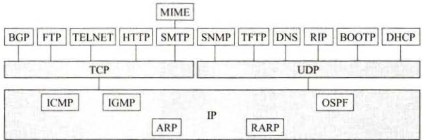

# 第6章 习题

6-01 互联网的域名结构是怎样的？它与目前的电话网的号码结构有何异同之处？

6-02 域名系统的主要功能是什么？域名系统中的本地域名服务器、根域名服务器、顶级域名服务器以及权限域名服务器有何区别？

6-03 举例说明域名转换的过程。域名服务器中的高速缓存的作用是什么？

6-04 设想有一天整个互联网的 DNS 系统都瘫痪了（这种情况不大会出现），试问还有可能给朋友发送电子邮件吗？

6-05 文件传送协议 FTP 的主要工作过程是怎样的？为什么说 FTP 是带外传送控制信息？主进程和从属进程各起什么作用？

6-06 简单文件传送协议 TFTP 与 FTP 的主要区别是什么？各用在什么场合？

6-07 远程登录 TELNET 的主要特点是什么？什么叫作虚拟终端 NVT?

6-08 解释以下名词。各英文缩写词的原文是什么？

WWW, URL, HTTP, HTML, CGI, 浏览器, 超文本, 超媒体, 超链, 页面, 活动文档, 搜索引擎。

6-09 假定一个超链从一个万维网文档链接到另一个万维网文档时，由于万维网文档上出现了差错而使得超链指向一个无效的计算机名字。这时浏览器将向用户报告什么？

6-10 假定要从已知的 URL 获得一个万维网文档。若该万维网服务器的 IP 地址开始时并不知道。试问：除 HTTP 外，还需要什么应用层协议和运输层协议？

6-11 你所使用的浏览器的高速缓存有多大？请进行一个实验：访问几个万维网文档，然后将你的计算机与网络断开，然后再回到你刚才访问过的文档。你的浏览器的高速缓存能够存放多少个页面？

6-12 什么是动态文档？试举出万维网使用动态文档的一些例子。

6-13 浏览器同时打开多个 TCP 连接进行浏览的优缺点如何？请说明理由。

6-14 请判断以下论述的正误，并简述理由。

(1) 用户点击某网页，该网页有 1 个文本文件和 3 个图片。此用户可以发送一个请求就可以收到 4 个响应报文。

(2) 有以下两个不同的网页：www.abc.com/m1.html 和 www.abc.com/m2.html。用户可以使用同一个 HTTP/1.1 持续连接传送对这两个网页的请求和响应。

(3) 在客户与服务器之间的非持续连接，只需要用一个 TCP 报文段就能够装入两个不同的 HTTP 请求报文。

(4) 在 HTTP 响应报文中的主体实体部分永远不会是空的。

6-15 假定你在浏览器上点击一个 URL，但这个 URL 的 IP 地址以前并没有缓存在本地主机上。因此需要用 DNS 自动查找和解析。假定要解析到所要找的 URL 的 IP 地址共经过 n 个 DNS 服务器，所经过的时间分别为 $RTT_{1}, RTT_{2}, \cdots, RTT_{n}$ 。假定从要找的网页上只需要读取一个很小的图片（即忽略这个小图片的传输时间）。从本地主机到这个网页的往返时间是 $RTT_{w}$ 。试问从点击这个 URL 开始，一直到本地主机的屏幕上出现所读取的小图片，一共要经过多长时间？

6-16 在上题中，假定同一台服务器的 HTML 文件中又链接了三个非常小的对象。若忽略这些对象的发送时间，试计算客户点击读取这些对象所需的时间。

(1) 没有并行 TCP 连接的非持续 HTTP;

(2) 使用并行 TCP 连接的非持续 HTTP;

(3) 流水线方式的持续 HTTP。

6-17 在浏览器中应当有几个可选解释程序。试给出一些可选解释程序的名称。

6-18 一个万维网网点有 1000 万个页面，平均每个页面有 10 个超链。读取一个页面平均要 100 ms。请问：要检索整个网点所需的最少时间是多少？

6-19 搜索引擎可分为哪两种类型？各有什么特点？

6-20 试述电子邮件的最主要的组成部件。用户代理 UA 的作用是什么？没有 UA 行不行？

6-21 电子邮件的信封和内容在邮件的传送过程中起什么作用？和用户的关系如何？

6-22 电子邮件的地址格式是怎样的？请说明各部分的意思。

6-23 试简述SMTP通信的三个阶段的过程。

6-24 试述邮局协议 POP 的工作过程。在电子邮件中，为什么需要使用 POP 和 SMTP 这两个协议？IMAP 与 POP 有何区别？

6-25 MIME 与 SMTP 的关系是怎样的？什么是 quoted-printable 编码和 base64 编码？

6-26 一个二进制文件共3072字节长。若使用base64编码，并且每发送完80字节就插入一个回车符CR和一个换行符LF，问一共发送了多少个字节？

6-27 试将数据 11001100 10000001 00111000 进行 base64 编码，并得出最后传送的 ASCII 数据。

6-28 试将数据 01001100 10011101 00111001 进行 quoted-printable 编码，并得出最后传送的 ASCII 数据。这样的数据用 quoted-printable 编码后，其编码开销有多大？

6-29 电子邮件系统需要将人们的电子邮件地址编成目录以便于查找。要建立这种目录应将人名划分为几个标准部分（例如，姓、名）。若要形成一个国际标准，那么必须解决哪些问题？

6-30 电子邮件系统使用 TCP 传送邮件。为什么有时我们会遇到邮件发送失败的情况？为什么有时对方会收不到我们发送的邮件？

6-31 基于万维网的电子邮件系统有什么特点？在传送邮件时使用什么协议？

6-32 DHCP 协议用在什么情况下？当一台计算机第一次运行引导程序时，其 ROM 中有没有该主机的 IP 地址、子网掩码或某个域名服务器的 IP 地址？

6-33 什么是网络管理？为什么说网络管理是当今网络领域中的热门课题？

6-34 解释下列术语：网络元素、被管对象、管理进程、代理进程和管理信息库。

6-35 SNMP 使用 UDP 传送报文。为什么不使用 TCP?

6-36 为什么 SNMP 的管理进程使用探询掌握全网状态属于正常情况，而代理进程用陷阱向管理进程报告属于较少发生的异常情况？

6-37 SNMP 使用哪几种操作？SNMP 在 Get 报文中设置了请求标识符字段，为什么？

6-38 什么是管理信息库 MIB？为什么要使用 MIB？

6-39 什么是管理信息结构 SMI？它的作用是什么？

6-40 用 ASN.1 基本编码规则对以下 4 个数组 (SEQUENCE-OF) 进行编码。假定每一个数字占用 4 个字节。2345, 1236, 122, 1236

6-41 SNMP 要发送一个 GetRequest 报文，以便向一个路由器获取 ICMP 的 icmpInParmProbs 的值。在 icmp 中变量 icmpInParmProbs 的标号是 5，它是一个计数器，用来统计收到的类型为参数问题的 ICMP 差错报告报文的数目。试给出这个 GetRequest 报文的编码。

6-42 对象 tcp 的 OBJECT IDENTIFIER 是什么？

6-43 在 ASN.1 中，IP 地址(IPAddress)的类别是应用类。若 IPAddress = 131.21.14.2，试求其 ASN.1 编码。

6-44 什么是应用编程接口 API？它是应用程序和谁的接口？

6-45 试举出常用的几种系统调用的名称，说明它们的用途。

6-46 图 6-37 表示了各应用协议在层次中的位置。

(1) 简单讨论一下为什么有的应用层协议要使用 TCP 而有的却要使用 UDP?

(2) 为什么 MIME 画在 SMTP 之上?

(3) 为什么路由选择协议 RIP 放在应用层?

> 图6-37 习题6-46的图（教材第 332 页）

6-47 现在流行的 P2P 文件共享应用程序都有哪些特点？存在哪些值得注意的问题？

6-48 使用客户-服务器方式进行文件分发。一台服务器把一个长度为 $F$ 的大文件分发给 $N$ 个对等方。假设文件传输的瓶颈是各计算机（包括服务器）的上传速率 $u$ 。试计算文件分发到所有对等方的最短时间。

6-49 重新考虑上题的文件分发任务，但采用 P2P 文件分发方式，并且每个对等方只能在接收完整个文件后才能向其他对等方转发。试计算文件分发到所有 N 个对等方的最短时间。

6-50 再重新考虑上题的文件分发任务，但可以把这个非常大的文件划分为一个个非常小的数据块进行分发，即一个对等方在下载完一个数据块后就能向其他对等方转发，并同时可下载其他数据块。不考虑分块增加的控制信息，试计算整个大文件分发到所有对等方的最短时间。

6-51 假定某服务器有一文件 $F = 15$ Gbit 要分发给分布在互联网各处的 $N$ 个对等方。服务器上传速率 $u_{s} = 30$ Mbit/s，每个对等方的下载速率 $d = 2$ Mbit/s，上传速率为 $u = 300$ kbit/s。设(1) $N = 10$ ，(2) $N = 1000$ 。试分别计算在客户-服务器方式下和在 P2P 方式下，该文件分发时间的最小值。
