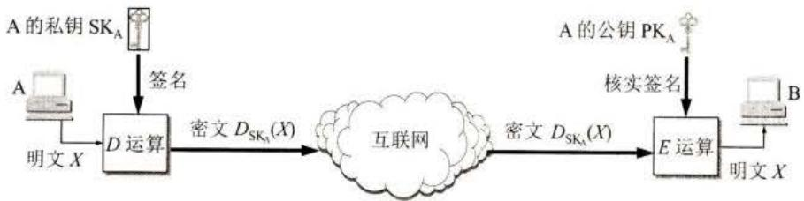
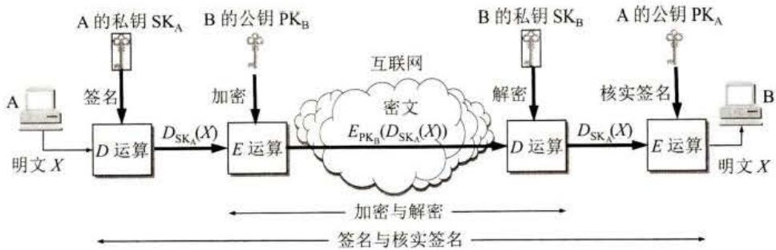
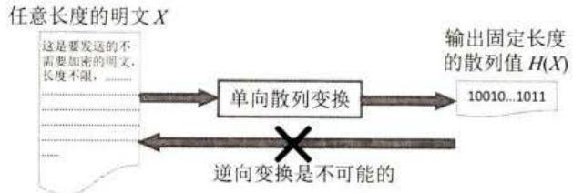
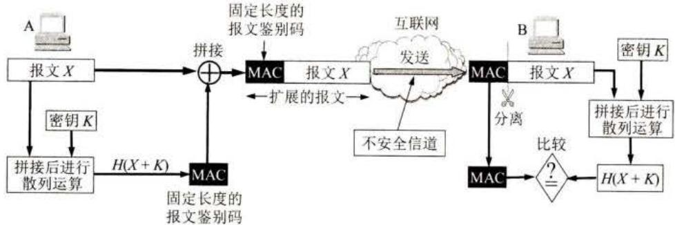
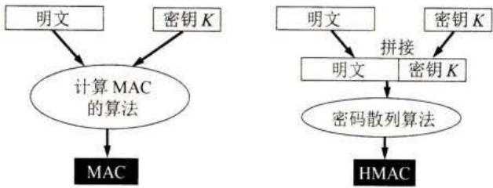
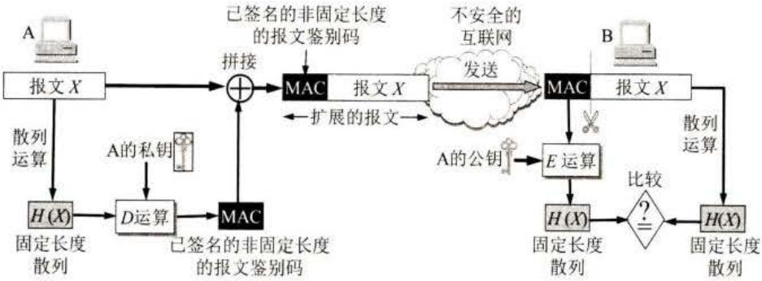

# 7.3.1 报文鉴别

## 7.3 鉴别

在网络的应用中，鉴别(authentication)是网络安全中一个很重要的问题。鉴别和加密是不相同的概念。鉴别的内容有二。一是要鉴别发信者，即验证通信的对方的确是自己所要通信的对象，而不是其他的冒充者。这就是实体鉴别。实体可以是发信的人，也可以是一个进程（客户或服务器）。因此这也常称为端点鉴别。二是要鉴别报文的完整性，即对方所传送的报文没有被他人篡改过。至于报文是否需要加密，则是与“鉴别”性质不同的问题。有的报文需要加密（这要另找措施），但许多报文并不需要加密。

请注意，鉴别与授权(authorization)也是不同的概念。授权涉及的问题是：所进行的过程是否被允许（如是否可以对某文件进行读或写）。

不过有时常用报文鉴别一词包含上述鉴别的两个内容，既鉴别报文的发送者，也鉴别报文的完整性。

下面分别讨论报文鉴别与实体鉴别的特点。

## 1. 用数字签名进行鉴别（原理）

我们知道，书信或文件可根据亲笔签名或印章来鉴别其真实性。但在计算机网络中传送的报文，则可使用数字签名进行鉴别。下面就介绍数字签名的原理。

为了进行数字签名，A 用其私钥 $SK_{A}$ 对报文 X 进行 D 运算（如图 7-4 所示）。D 运算本来叫作解密运算。可是，还没有加密怎么就进行解密呢？其实 D 运算只是把报文变换为某种不可读的密文（因此有时也说成 A 用其私钥对报文加密，但这样说不准确）。在图 7-4 中我们使用 “D 运算” 而不是 “解密运算”，就是为了避免产生这种误解。A 把经过 D 运算得到的密文传送给 B。B 为了核实签名，用 A 的公钥进行 E 运算，还原出明文 X。请注意，任何人用 A 的公钥 $PK_{A}$ 进行 E 运算后都可以得出 A 发送的明文。可见图 7-4 所示的通信方式并非为了保密，而是为了进行签名和核实签名，即确认此明文的确是 A 发送的。

> 图 7-4 用数字签名进行鉴别（教材第 341 页）

下面讨论一下为什么数字签名具有鉴别报文的功能。

因为除 A 外没有别人持有 A 的私钥 $SK_{A}$ ，所以除 A 外没有别人能产生密文 $D_{\mathrm{SK}_{\mathrm{A}}}(X)$ 。这样，B 确信报文 X 是 A 签名发送的。这就鉴别了报文的发送者。同理，其他人如果篡改过报文，但由于无法得到 A 的私钥 $SK_{A}$ 对篡改后的报文进行 D 运算，那么 B 对收到的报文进行核实签名的 E 运算后，将会得出不可读的明文，因而不会被欺骗。这样就保证了报文的完整性。

数字签名还有另一功能，就是发送者事后不能抵赖对报文的签名。这叫作不可否认。

若 A 要抵赖曾发送报文给 B，B 可把 X 及 $D_{\mathrm{SK}_{A}}(X)$ 出示给进行公证的第三者。第三者很容易用 $PK_{A}$ 去证实 A 确实发送 X 给 B。

以上这三项功能的关键都在于没有其他人能够持有 A 的私钥 $SK_{A}$ 。

但数字签名仅对报文进行了签名，对报文 X 本身却未保密。因为截获到密文 $D_{\mathrm{SK}_{\mathrm{A}}}(X)$ 并知道发送者身份的任何人，若通过某种手段获得了发送者的公钥 $PK_{A}$ ，就能解出报文的内容。如果用图 7-5 所示的方法，就可同时实现保密通信和数字签名。图中 $SK_{A}$ 和 $SK_{B}$ 分别为 A 和 B 的私钥，而 $PK_{A}$ 和 $PK_{B}$ 分别为 A 和 B 的公钥。请注意，在许多情况下，我们往往强调的是使用何种密钥进行运算，这时的表达方式可简单些。例如，“用 A 的私钥对明文 X 进行签名”可记为 $\mathrm{SK}_{\mathrm{A}}(X)$ 。若“再用 B 的公钥对此签名进行加密”，则可记为 $\mathrm{PK}_{\mathrm{B}}(\mathrm{SK}_{\mathrm{A}}(X))$ ，而不必深究使用的是 D 运算还是 E 运算。

> 图 7-5 可保证机密性的数字签名（教材第 342 页）

如图 7-5 所示的可保证机密性的数字签名方法，虽然在理论上是正确的，但很难用于现实生活中。因此这一节的小标题后边有“原理”二字。这是因为要对报文（可能很长的报文）先后要进行两次 D 运算和两次 E 运算，这种运算量太大，要花费非常多的计算机 CPU 时间，在很多情况下是无法令人接受的。因此目前对网络上传送的大量报文，普遍都使用开销小得多的对称密钥加密。要实现数字签名当然必须使用公钥密码，但一定要设法减小公钥密码算法的开销。这就要使用后面几个小节所讨论的密码散列函数和报文鉴别码。

## 2. 密码散列函数

散列函数（又称为杂凑函数，或哈希函数）在计算机领域中使用得很广泛。密码学对散列函数有非常高的要求，因此符合密码学要求的散列函数又常称为密码散列函数(cryptographic hash function)。以后在不致产生错误概念时，我们也常把密码散列函数简称为散列函数。具体说来，密码散列函数 $H(X)$ 应具有以下四个特点：

(1) 虽然散列函数的输入报文 $X$ 的长度不受限制，但计算出的结果 $H(X)$ 的长度则应是较短的和固定的。散列函数的输出 $H(X)$ 又称为散列值，或散列。散列函数采用确定算法，因此相同的输入必定得出相同的输出。虽然密码散列函数相当复杂，但利用计算机，散列函数的运算还是相当快的。

(2) 散列函数的输入和输出的关系是多对一的。若散列值 $H(X)$ 的长度为 128 位，那么输出散列值只有 $2^{128}$ 个有限多的可能值（ $2^{128}$ 与 IPv6 的地址数一样大，是个很大的数值）。然而我们的输入报文 $X$ 却有无限多的取值。可见必然会出现不同输入却产生相同输出的碰撞现象。精心挑选的密码散列函数应当非常不易发生碰撞，即应具有很好的抗碰撞性。

(3) 若给出散列值 $H(X)$ , 则无人能找出输入报文 $X$ 。也就是说, 散列函数是一种单向函数(one-way function), 即逆向变换是不可能的 (如图 7-6 所示)。

> 图7-6 密码散列函数是单向的（教材第 343 页）

上述特点的另一种表述方法是：

若已知 X 和 $H(X)$ ，则没有人能够找到 $Y (Y \neq X)$ ，使得 $H(Y) = H(X)$ 。

但下面我们要讲到，关于这方面的研究，后来已有了一些新的进展。

(4) 好的密码散列函数还具有这样一些特性：散列函数输出的每一个比特，都与输入的每一个比特有关；哪怕仅改动输入的一个比特，输出也会相差极大；散列函数的运算包括许多非线性运算。

通过许多学者的不断努力，已经设计出一些实用的密码散列函数（或称为散列算法），其中最出名的就是 MD5 和 SHA-1。MD 就是 Message Digest 的缩写，意思是报文摘要。MD5 是报文摘要的第 5 个版本。

报文摘要算法 MD5 公布于 RFC 1321（1991 年），并获得了非常广泛的应用。MD5 的设计者 Rivest 曾提出一个猜想，即根据给定的 MD5 报文摘要代码，要找出一个与原来报文有相同报文摘要的另一报文，其难度在计算上几乎是不可能的。但在 2004 年，中国学者王小云 $^{①}$ 发表了轰动世界的密码学论文，证明可以用系统的方法找出一对报文，这对报文具有相同的 MD5 报文摘要[W-WANG]，而这仅需 15 分钟，或不到 1 小时。于是，MD5 的安全性就产生了动摇。随后，又有许多学者开发了对 MD5 实际的攻击。于是 MD5 最终被另一种叫作安全散列算法 SHA (Secure Hash Algorithm)的标准所取代。

下面仍以 MD5 为例来介绍报文摘要。这主要是考虑到目前新的散列函数（如 SHA-2）是从 MD5 发展而来的。对于有兴趣研究散列函数的读者，MD5 是个很好的出发点。

MD5 算法的大致过程如下:

(1) 先把任意长的报文按模 $2^{64}$ 计算其余数（64 位），追加在报文的后面。

(2) 在报文和余数之间填充 1\~512 位，使得填充后的总长度是 512 的整数倍。填充的首位是 1，后面都是 0。

(3) 把追加和填充后的报文分割为许多 512 位的数据块，每个 512 位的报文数据再分成 4 个 128 位的数据块依次送到不同的散列函数进行 4 轮计算。每一轮又都按 32 位的小数据块进行复杂的运算。一直到最后计算出 MD5 报文摘要代码（128 位）。

这样得出的 MD5 报文摘要代码中的每一位都与原来报文中的每一位有关。由此可见，像 MD5 这样的密码散列函数实际上已是个相当复杂的算法，而不是简单的函数了。

SHA-1 是由美国标准与技术协会 NIST 提出的一个散列算法系列。SHA-1 和 MD5 相似，但其散列值的长度为 160 位（比 MD5 的 128 位多了 25%）。SHA-1 也是先把输入报文划分为许多 512 位长的数据块，然后经过复杂运算后得出散列值。SHA-1 比 MD5 更安全，但计算起来却比 MD5 要慢些。1995 年发布的新版本 SHA-1 [RFC 3174] 在安全性方面有了很大的改进。

> ① 注：王小云，女，1966年出生，山东大学和清华大学教授，中国科学院院士，主要研究领域为密码学和信息安全学。

但 SHA-1 后来也被证明其实际安全性并未达到设计要求，并且也曾被王小云教授的研究团队攻破。谷歌也宣布了攻破 SHA-1 的消息。现在 SHA-1 已被另外的两个版本 SHA-2 [RFC 6234] 和 SHA-3 [W-SHA3] 所替代。SHA-2 和 SHA-3 都各有好几种变型。前者有 SHA-224, SHA-256, SHA-384 和 SHA-512，后者有 SHA3-224, SHA3-256, SHA3-384 和 SHA3-512。在上面名称最后的 3 位数字表示散列的位数。这里需要指出，SHA-3 采用了与 SHA-2 完全不同的散列函数。现在许多组织都已纷纷宣布停用 SHA-1。例如，微软于 2017 年 1 月 1 日起停止支持 SHA-1 证书，而以前签发的 SHA-1 证书也必须更换为 SHA-2 证书。

请注意，MD5 或 SHA-1 “被攻破”，是指有人能设法找出具有相同散列值的一对报文。这样就动摇了 MD5 或 SHA-1 的安全性。但是，密码学家目前尚无法把一个任意已知的报文 X，篡改为具有同样 MD5 或 SHA-1 散列值的另一报文 Y。

## 3. 用报文鉴别码实现报文鉴别

下面进一步讨论怎样使用散列函数来实现报文鉴别。

下面给出的三个简单步骤，给出鉴别报文的初步概念。

(1) 用户 A 首先根据自己的明文 X 计算出散列 $H(X)$ （例如，使用 MD5）。为简单起见，我们把得出的散列 $H(X)$ 记为 H。

(2) 用户 A 把散列 H 拼接在明文 X 的后面，生成了扩展的报文 $(X, H)$ ，然后发送给 B。

(3) 用户 B 收到了这个扩展的报文 $(X, H)$ 。因为散列的长度 H 是早已知道的固定值，因此很容易把收到的散列 H 和明文 X 分离开。B 通过散列函数的运算，计算出所收到的明文 X 的散列 $H(X)$ 。若 $H(X) = H$ ，则 B 就认为所收到的明文是 A 发送过来的。

但上述做法实际上是不可行的。设想某个入侵者创建了一个伪造的报文 $M$ ，然后也用同样的方法计算出其散列 $H(M)$ ，并且冒充 A 把拼接有散列的扩展报文发送给 B。B 收到扩展的报文 $(M, H(M))$ 后，按照上面步骤(3)的方法进行验证，发现一切都是正常的，就会误认为所收到的伪造报文就是 A 发送的。

因此，必须设法对上述的攻击进行防范。解决的办法可以是：A 把双方共享的密钥 K（K 就是一串不太长的字符串）拼接到报文 X 后，进行散列运算（如图 7-7 所示）。散列运算得出的结果为固定长度的 $H(X + K)$ ，称为报文鉴别码 MAC (Message Authentication Code)。请注意：局域网中使用的媒体接入控制 MAC 正好也使用这三个字母，因此在看到缩写词 MAC 时应注意上下文。A 把报文鉴别码 MAC 拼接在报文 X 后面，得到扩展的报文，发送给 B。我们注意到，共享密钥 K 并没有出现在网上传送的扩展的报文中。

B 收到扩展的报文后，把报文鉴别码 MAC 与报文 X 进行分离。B 再用同样的密钥 K 与报文 X 拼接，进行散列运算，把得出的结果 $H(X + K)$ 与分离出的报文鉴别码 MAC 进行比较。如相等，就可确认收到的报文 X 的确是 A 发送的。只要入侵者不掌握密钥 K，就无法伪造 A 的报文鉴别码 MAC，因而无法伪造 A 发送的报文。像这样的报文鉴别码称为数字签名，或数字指纹。图 7-7 所示的过程就是 A 对报文进行了签名，而 B 对报文进行了鉴别。

> 图 7-7 用报文鉴别码 MAC 鉴别报文（教材第 345 页）

图 7-7 所示的鉴别过程并没有执行加密算法，只是在计算散列值时在报文后面拼接了密钥，因此这种鉴别报文的方法消耗的计算资源很少，但却能有效地保护报文的完整性。

在许多有关鉴别的文献中，常常看到在 MAC 前面加上一个 H 的写法，即 HMAC (Hashed MAC)。MAC 与 HMAC 的区别如图 7-8 所示 [PETE12，第 646 页]。前面图 7-7 所示的 MAC 实际上就是 HMAC。计算 HMAC 是规定把密钥 K 拼接在明文后面，然后使用密码散列算法对其进行运算，得出的散列值就是 HMAC。但在计算 MAC 时则不一定这样做。首先，密钥 K 不一定非要拼接在明文的后面，只要把密钥 K 作为一个计算 MAC 的参数即可。其次，可以有多种计算 MAC 的算法，不一定非要使用严格的密码散列算法。在 RFC 2104 中，对各种不同情况下 HMAC 的计算方法都有着详细的规定。但在本书中，为了方便，对 MAC 和 HMAC 可视为同义词。

> 图7-8 MAC与HMAC的区别（教材第 345 页）

上述这种鉴别报文的方法还有一些问题有待解决。例如，采用怎样安全有效的方法来分发通信双方共享的密钥 K？另一种可行的方法是采用公钥系统。我们用图 7-9 来说明。

> 图 7-9 使用已签名的报文鉴别码对报文鉴别（教材第 345 页）

用户 A 对报文 X 进行散列运算，得出固定长度的散列 $H(X)$ 。用自己的私钥对 $H(X)$ 进行 D 运算（也可以说成是用私钥进行加密），得出已签名的但非固定长度的报文鉴别码 MAC。

请注意，这里没有对报文 X 进行加密，而是对很短的散列 $H(X)$ 进行 D 运算，因此这种运算仍然是很快的。A 把已签名的非固定长度的报文鉴别码 MAC，拼接在报文 X 后面，构成扩展的报文发送给 B。

B 收到扩展的报文后，先进行报文分离。虽然 B 不知道已签名的报文鉴别码的长度，但由于报文 X 是明文，其结束处可以设有标记，因此分离出 MAC 不困难。分离后，B 对报文 X 进行散列函数运算，同时用 A 的公钥对分离出的已签名的报文鉴别码 MAC 进行 E 运算（也可以说成是用公钥进行解密）。最后对这两个运算结果 $H(X)$ 进行比较。如相等，就说明一切正确。由于入侵者没有 A 的私钥，因此不可能伪造出 A 发出的报文。这里我们假定 B 事先知道 A 的公钥。

不难看出，采用这种方法得到的扩展的报文，不仅是不可伪造的，也是不可否认的。图 7-9 所示的过程，可简称为：“A 用自己的私钥进行签名，B 用 A 的公钥进行鉴别”。
