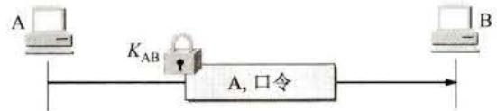
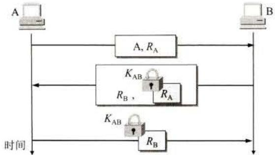
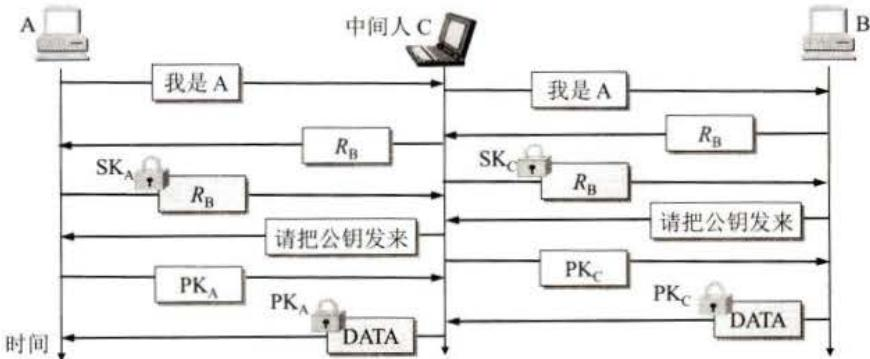

# 7.3.2 实体鉴别

实体鉴别和报文鉴别不同。报文鉴别是对每一个收到的报文都要鉴别报文的发送者，而实体鉴别是在系统接入的全部持续时间内对和自己通信的对方实体只需验证一次。

最简单的实体鉴别过程如图 7-10 所示。A 向远端的 B 发送带有自己身份 A（例如，A 的姓名）和口令的报文，并且使用双方约定好的共享对称密钥 $K_{AB}$ 进行加密。B 收到此报文后，用共享对称密钥 $K_{AB}$ 进行解密，从而鉴别了实体 A 的身份。

> 图 7-10 仅使用对称密钥传送鉴别实体身份的报文（教材第 346 页）

然而这种简单的鉴别方法具有明显的漏洞。例如，入侵者 C 可以从网络上截获 A 发给 B 的报文，C 并不需要破译这个报文（因为破译可能很费时间），而是直接把这个由 A 加密的报文发送给 B，使 B 误认为 C 就是 A；然后 B 就向伪装成 A 的 C 发送许多本来应当发给 A 的报文。这就叫作重放攻击(replay attack)。C 甚至还可以截获 A 的 IP 地址，然后把 A 的 IP 地址冒充为自己的 IP 地址（这叫作 IP 欺骗），使 B 更加容易受骗。

为了对付重放攻击，可以使用不重数(nonce)。不重数就是一个不重复使用的大随机数，即“一次一数”。在鉴别过程中不重数可以使 B 能够把重复的鉴别请求和新的鉴别请求区分开。图 7-11 给出了这个过程。

> 图 7-11 使用不重数进行鉴别（教材第 346 页）

在图 7-11 中，A 首先用明文发送其身份 A 和一个不重数 $R_{A}$ 给 B。接着，B 响应 A 的查问，用共享的密钥 $K_{AB}$ 对 $R_{A}$ 加密后发回给 A，同时也给出了自己的不重数 $R_{B}$ 。最后，A 再响应 B 的查问，用共享的密钥 $K_{AB}$ 对 $R_{B}$ 加密后发回给 B。这里很重要的一点是 A 和 B 对不同的会话必须使用不同的不重数集。由于不重数不能重复使用，所以 C 在进行重放攻击时无法重复使用所截获的不重数。

在使用公钥密码体制时，可以对不重数进行签名鉴别。例如在图7-11中，B用其私钥对不重数 $R_{A}$ 进行签名后发回给A。A用B的公钥核实签名，如能得出自己原来发送的不重数 $R_{A}$ ，就核实了和自己通信的对方的确是B。同样，A也用自己的私钥对不重数 $R_{B}$ 进行签名后发送给B。B用A的公钥核实签名，鉴别了A的身份。

公钥密码体制虽然不必在互相通信的用户之间秘密地分配共享密钥，但仍有受到攻击的可能。让我们看下面的例子。

C 冒充是 A，发送报文给 B，说：“我是 A”。

B 选择一个不重数 $R_{B}$ ，发送给 A，但被 C 截获了。

C 用自己的私钥 $SK_{C}$ 冒充是 A 的私钥，对 $R_{B}$ 加密，并发送给 B。

B 向 A 发送报文，要求对方把解密用的公钥发送过来，但这报文也被 C 截获了。

C 把自己的公钥 $PK_{C}$ 冒充是 A 的公钥发送给 B。

B 用收到的公钥 $PK_{C}$ 对收到的加密的 $R_{B}$ 进行解密，其结果当然正确。于是 B 相信通信的对方是 A，接着就向 A 发送许多敏感数据，但都被 C 截获了。

然而上述这种欺骗手段不够高明，因为 B 只要打电话询问一下 A 就能戳穿骗局，因为 A 根本没有和 B 进行通信。但下面的“中间人攻击”（man-in-the-middle attack）就更加具有欺骗性。图 7-12 是“中间人攻击”的示意图。

> 图 7-12 中间人攻击（教材第 347 页）

从图 7-12 可看出，A 想和 B 通信，向 B 发送 “我是 A” 的报文，并给出了自己的身份。这个报文被 “中间人” C 截获，C 把这个报文原封不动地转发给 B。B 选择一个不重数 $R_{B}$ 发送给 A，但同样被 C 截获后也照样转发给 A。

中间人 C 用自己的私钥 $SK_{C}$ 对 $R_{B}$ 加密后发回给 B，使 B 误以为是 A 发来的。A 收到 $R_{B}$ 后也用自己的私钥 $SK_{A}$ 对 $R_{B}$ 加密后发回给 B，但中途被 C 截获并丢弃。B 向 A 索取其公钥，这个报文被 C 截获后转发给 A。

C 把自己的公钥 $PK_{C}$ 冒充是 A 的公钥发送给 B，而 C 也截获到 A 发送给 B 的公钥 $PK_{A}$ 。

B 用收到的公钥 $PK_{C}$ （以为是 A 的）对数据 DATA 加密，并发送给 A。C 截获后用自己的私钥 $SK_{C}$ 解密，复制一份留下，然后再用 A 的公钥 $PK_{A}$ 对数据 DATA 加密后发送给 A。

A 收到数据后，用自己的私钥 $SK_{A}$ 解密，以为和 B 进行了保密通信。其实，B 发送给 A 的加密数据已被中间人 C 截获并解密了一份，但 A 和 B 却都不知道。

由此可见，公钥的分配以及认证公钥的真实性也是一个非常重要的问题。关于这点我们在后面（7.4.2节）还要讨论。
