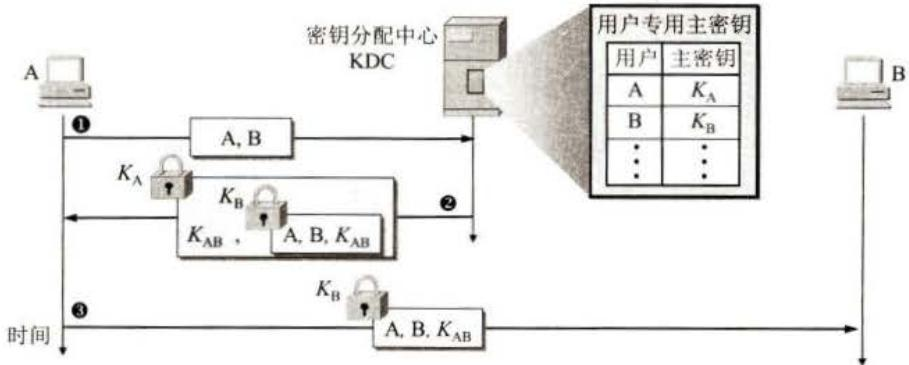
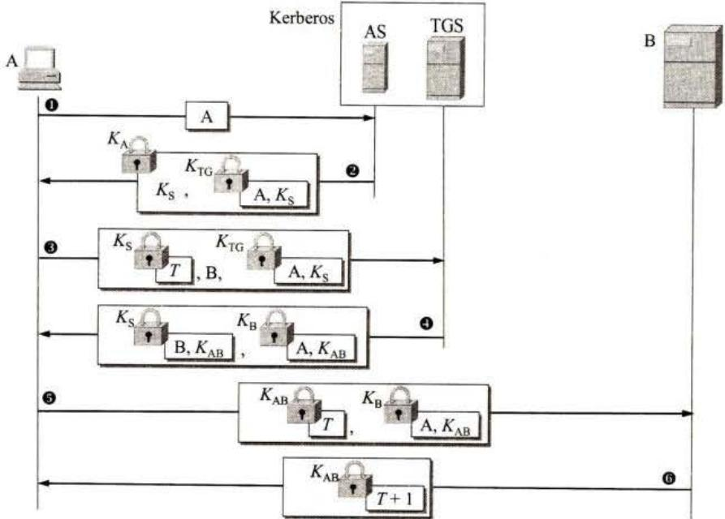
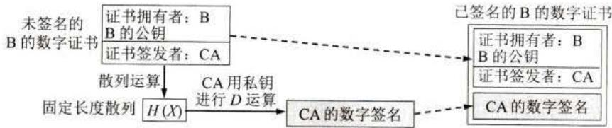
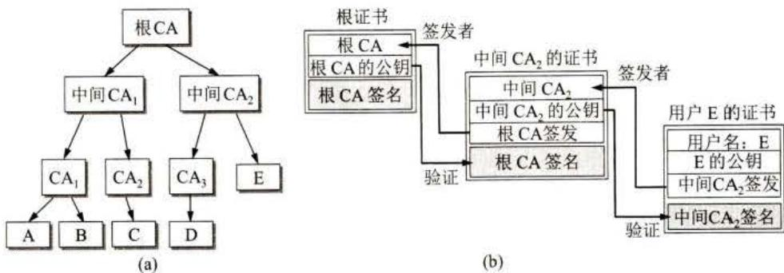

# 7.4 密钥分配

由于密码算法是公开的，网络的安全性就完全基于密钥的安全保护上。因此在密码学中出现了一个重要的分支——密钥管理。密钥管理包括：密钥的产生、分配、注入、验证和使用。本节只讨论密钥的分配。

密钥分配（或密钥分发）是密钥管理中最大的问题。密钥必须通过最安全的通路进行分配。例如，可以派非常可靠的信使携带密钥分配给互相通信的各用户。这种方法称为网外分配方式。但随着用户的增多和网络流量的增大，密钥更换频繁（密钥必须定期更换才能做到可靠），派信使的办法已不再适用，而应采用网内分配方式，即对密钥自动分配。

## 7.4.1 对称密钥的分配

对称密钥分配存在以下两个问题。

第一，如果 $n$ 个人中的每一个需要和其他 $n - 1$ 个人通信，就需要 $n(n - 1)$ 个密钥。但每两人共享一个密钥，因此密钥数是 $n(n - 1)/2$ 。这常称为 $\pmb{n}^2$ 问题。如果 $n$ 是个很大的数，所需要的密钥数量就非常大。

第二，通信的双方怎样才能安全地得到共享的密钥呢？正是因为网络不安全，所以才需要使用加密技术。但密钥又需要怎样传送呢？

目前常用的密钥分配方式是设立密钥分配中心 KDC (Key Distribution Center)。KDC 是大家都信任的机构，其任务就是给需要进行秘密通信的用户临时分配一个会话密钥（仅使用一次）。在图 7-13 中假定用户 A 和 B 都是 KDC 的登记用户。A 和 B 在 KDC 登记时就已经在 KDC 的服务器上安装了各自和 KDC 进行通信的主密钥(master key) $K_{A}$ 和 $K_{B}$ 。为简单起见，下面在叙述时把“主密钥”简称为“密钥”。密钥分配分为三个步骤（如图 7-13 中带箭头直线上的①,②和③所示）。

> 图 7-13 KDC 对会话密钥的分配（教材第 348 页）

① 用户 A 向密钥分配中心 KDC 发送时用明文，说明想和用户 B 通信。在明文中给出

A 和 B 在 KDC 登记的身份。

② KDC 用随机数产生 “一次一密” 的会话密钥 $K_{\mathrm{AB}}$ 供 A 和 B 的这次会话使用, 然后向 A 发送回答报文。这个回答报文用 A 的密钥 $K_{\mathrm{A}}$ 加密。这个报文中包含这次会话使用的密钥 $K_{\mathrm{AB}}$ 和请 A 转给 B 的一个票据 (ticket) $^{①}$ , 该票据包括 A 和 B 在 KDC 登记的身份, 以及这次会话将要使用的密钥 $K_{\mathrm{AB}}$ 。票据用 B 的密钥 $K_{\mathrm{B}}$ 加密, A 无法知道此票据的内容, 因为 A 没有 B 的密钥 $K_{\mathrm{B}}$ , 当然 A 也不需要知道此票据的内容。

③ 当 B 收到 A 转来的票据并使用自己的密钥 $K_{B}$ 解密后，就知道 A 要和他通信，同时也知道 KDC 为这次和 A 通信所分配的会话密钥 $K_{AB}$ 。

此后，A 和 B 就可使用会话密钥 $K_{AB}$ 进行这次通信了。

请注意，在网络上传送密钥时，都是经过加密的。解密用的密钥都不在网上传送。

KDC 还可在报文中加入时间戳，以防止报文的截取者利用以前已记录下的报文进行重放攻击。会话密钥 $K_{AB}$ 是一次性的，因此机密性较高。而 KDC 分配给用户的密钥 $K_{A}$ 和 $K_{B}$ ，都应定期更换，以减少攻击者破译密钥的机会。

目前最出名的对称密钥分配协议是 Kerberos V5 $^{②}$ [RFC 4120, 4121，建议标准]，是美国麻省理工学院(MIT)开发的。Kerberos 既是鉴别协议，同时也是 KDC，它已经变得很普及。Kerberos 使用比 DES 更加安全的高级加密标准 AES 进行加密。下面用图 7-14 介绍 Kerberos V4 的大致工作过程（其原理和 V5 大体一样，但稍简单些）。

> 图 7-14 Kerberos 的工作原理（教材第 349 页）

Kerberos 使用两个服务器：鉴别服务器 AS (Authentication Server)、票据授予服务器 TGS(Ticket-Granting Server)。Kerberos 只用于客户与服务器之间的鉴别，而不用于人对人的鉴别。在图 7-14 中，A 是请求服务的客户，而 B 是被请求的服务器。A 通过 Kerberos 向 B 请求服务。Kerberos 需要通过以下六个步骤鉴别的确是 A（而不是其他人冒充 A）向 B 请求服务后，才向 A 和 B 分配会话使用的密钥。下面简单解释各步骤。

> ① 注：目前在网络安全领域中ticket一词还没有标准译名，也有人译为“票”“执照”“票证”或“签条”。

> ② 注：Kerberos 是希腊神话中具有三个头的狗，它为 Hades（哈得斯，主宰阴间的冥王）看门。

① A 用明文（包括登记的身份）向鉴别服务器 AS 表明自己的身份。AS 就是 KDC，它掌握各实体登记的身份和相应的口令。AS 对 A 的身份进行验证。只有验证结果正确，才允许 A 和票据授予服务器 TGS 进行联系。

② 鉴别服务器 AS 向 A 发送用 A 的对称密钥 $K_{A}$ 加密的报文，这个报文包含 A 和 TGS 通信的会话密钥 $K_{S}$ 以及 AS 要发送给 TGS 的票据（这个票据是用 TGS 的对称密钥 $K_{TG}$ 加密的）。A 并不保存密钥 $K_{A}$ ，但当这个报文到达 A 时，A 就键入其口令。若口令正确，则该口令和适当的算法一起就能生成密钥 $K_{A}$ 。这个口令随即被销毁。密钥 $K_{A}$ 用来对 AS 发送过来的报文进行解密。这样就提取出会话密钥 $K_{S}$ （这是 A 和 TGS 通信要使用的）以及要转发给 TGS 的票据（这是用密钥 $K_{TG}$ 加密的）。

③ A 向 TGS 发送三项内容:

\- 转发鉴别服务器 AS 发来的票据。

\- 服务器 B 的名字。这表明 A 请求 B 的服务。请注意，现在 A 向 TGS 证明自己的身份并非通过键入口令（因为入侵者能够从网上截获明文口令），而是通过转发 AS 发出的票据（只有 A 才能提取出）。票据是加密的，入侵者伪造不了。

\- 用 $K_{\mathrm{S}}$ 加密的时间戳 $T$ 。它用来防止入侵者的重放攻击。

④ TGS 发送两个票据，每一个都包含 A 和 B 通信的会话密钥 $K_{\mathrm{AB}}$ 。给 A 的票据用 $K_{\mathrm{S}}$ 加密；给 B 的票据用 B 的密钥 $K_{\mathrm{B}}$ 加密。请注意，现在入侵者不能提取 $K_{\mathrm{AB}}$ ，因为不知道 $K_{\mathrm{S}}$ 和 $K_{\mathrm{B}}$ 。入侵者也不能重放步骤③，因为入侵者不能把时间戳更换为一个新的（因为不知道 $K_{\mathrm{S}}$ ）。如果入侵者在时间戳到期之前，非常迅速地发送步骤③的报文，那么对 TGS 发送过来的两个票据仍然不能解密。

⑤ A 向 B 转发 TGS 发来的票据，同时发送用 $K_{AB}$ 加密的时间戳 T。

⑥ B 把时间戳 T 加 1 来证实收到了票据。B 向 A 发送的报文用密钥 $K_{AB}$ 加密。

以后，A 和 B 就使用 TGS 给出的会话密钥 $K_{AB}$ 进行通信。

顺便指出，Kerberos 要求所有使用 Kerberos 的主机必须在时钟上进行 “松散的” 同步。所谓 “松散的” 同步是要求所有主机的时钟误差不能太大，例如，不能超过 5 分钟的数量级。这个要求是为了防止重放攻击。TGS 发出的票据都设置较短的有效期。超过有效期的票据就作废了。因此入侵者即使截获了某个票据，也不能长期保留用来进行以后的重放攻击。

## 7.4.2 公钥的分配

在公钥密码体制中，公钥的分配方法并不简单。本节就讨论这个问题。

我们不妨先假定大家都各自保存有自己的私钥，而把各自的公钥发布在网上。假定 A 和 B 都是公司。有个捣乱者给 A 发送邮件，声称自己是 B，要购买 A 生产的设备，货到付款，并给出了 B 的收货地址。邮件中还附上 “B 的公钥”（其实是捣乱者的公钥）。最后用捣乱者的私钥对邮件进行了签名。A 收到邮件后，就用邮件中给出的捣乱者的公钥（A 以为自己使用了 B 的公钥），对邮件中的签名进行了鉴别，就误认为 B 真的是要购买设备。当 A把生产的设备运到 B 的地址后，B 才知道被愚弄了！捣乱者甚至还可伪造一个冒充 B 的网站，上面有 “B 的公钥”（其实是捣乱者的公钥）。

那么，有没有可靠的方法来获得 B 的公钥，并且能确信公钥是真的？

有一种非常可靠的方法，就是公司 A 派人亲自去公司 B，直接向公司 B 索要其公钥。这样拿到的 B 的公钥当然是可信任的。但这种很不方便的办法显然不能普遍推广使用。

现在流行的办法，这就是找一个可信任的第三方机构（第三方机构既不是需要 B 的公钥的公司 A，也不是拥有公钥的公司 B），给拥有公钥的实体发一个具有数字签名的数字证书(digital certificate)，有时也可简称为证书。数字证书就是对公钥与其对应的实体（人或机器）进行绑定(binding)一个证明。因此它常称为公钥证书。这种签发证书的机构就叫作认证中心 CA (Certification Authority)，它由政府或知名公司出资建立（这样就可以得到大家的信任）。每个证书中写有公钥及其拥有者的标识信息（人名、地址、电子邮件地址或 IP 地址等）。更重要的是，证书中有 CA 使用自己私钥的数字签名，这就是认证中心 CA 把 B 的未签名的证书进行散列函数运算，再用 CA 的私钥对散列值进行 D 运算（也就是对散列值进行签名）。这样就得到了 CA 的数字签名。把 CA 的数字签名和未签名的 B 的证书放在一起，就最后构成了已签名的 B 的数字证书（如图 7-15 所示）。图中的数字证书只给出了最重要的几个项目。这样的证书无法伪造。任何用户都可从可信任的地方（如代表政府的报纸）获得认证中心 CA 的公钥，以验证证书的真伪。这种数字证书是公开的，不需要加密。现在我国的认证中心已有不少，例如，在金融领域，中国金融认证中心 CFCA (China Financial Certification Authority) 是由中国人民银行牵头，联合 14 家全国性商业银行共同建立的金融认证机构，其权威性是毋庸置疑的。在国际上，威瑞信公司 VeriSign 是发行数字证书产品的一家具有权威性的公司。

> 图 7-15 已签名的 B 的数字证书的产生过程（教材第 351 页）

公司 A 拿到 B 的数字证书后，可以对 B 的数字证书的真实性进行核实。A 使用数字证书上给出的 CA 的公钥，对数字证书中 CA 的数字签名进行 E 运算，得出一个数值。再对 B 的数字证书（把 CA 的数字签名除外的部分）进行散列运算，又得出一个数值。比较这两个数值。若一致，则数字证书是真的。当 A 收到包含有 B 的数字签名的订货单时，也能用类似的方法，对订单的真实性进行核实（使用 B 的数字证书中给出的 B 的公钥）。

为了使 CA 发布的数字证书在各行各业中能够通用，数字证书的格式就必须标准化。为此，ITU-T 制定了 X.509 协议标准，后来 IETF 采用了现在的版本，即 X.509 V3 [RFC 5280]，作为互联网的建议标准（147 页）。X.509 又称为互联网公钥基础结构 PKI (Public Key Infrastructure)。

X.509 规定了一个数字证书必须包括以下这些重要字段：

X.509 的版本

\- 数字证书名称及序列号

\- 本数字证书所使用的签名算法

\- 数字证书签发者的唯一标识符

\- 数字证书的有效期（有效期开始到结束的日期范围）

\- 主体名（或主题名，公钥和数字证书拥有者的唯一标识符）

\- 公钥（数字证书拥有者的公钥和使用算法的标识符，对应的私钥由证书拥有者保存）

X.509 提出把多级认证中心链接起来的，构成一个树状的认证系统（如图 7-16(a) 所示）。在多级认证系统的末端就是用户（A \~ E）。在 X.509 中并没有规定这种链接需要多少级，也没有给每一级的认证中心规定统一的名称。但最高一级的认证中心都称为根认证中心（Root CA），即公认可信的认证中心（或无条件信任的），且其公钥是公开的。在这种树状的认证系统中，可以有不止一个根 CA。从根 CA 向下的所有链接都称为信任链，表示处在这条链接上的认证机构都是可信的。

> 图 7-16 树状结构的多级认证系统(a)和证书链(b)（教材第 352 页）

图 7-16(a)最右边的一串链接就是一条信任链的例子：根 CA→中间 CA₂→用户 E。与这条信任链对应的是证书链（如图 7-16(b)所示），通过图中所示的链接，就可以查到本证书的签发者，也可以知道用谁的公钥来验证本证书中的签名。在这条证书链中，根 CA 给中间 CA₂ 签发了中间证书，并使用根 CA 的私钥进行数字签名。中间 CA₂ 可以用根 CA 的公钥，对证书中的根 CA 签名进行验证。因此中间证书是可信的和不可篡改的。同理，中间 CA₂ 给下面的一个用户签发了用户证书，并使用中间 CA₂ 的私钥进行数字签名。用户可以用中间 CA₂ 的公钥，对用户证书中的中间 CA₂ 的签名进行验证。因此，这个用户证书也是可信的和不可篡改的。请注意，最顶层的根证书的数字签名是自签名（即自己的私钥给自己签名）。根证书不需要其他的认证机构对其签名，是我们的信任链的起点。

若证书链中的某个认证中心没有严格遵守证书所规定的要求（例如，把证书转让给了其他单位，但并未严格验证其身份），那么这个节点以下的证书是否还可信，就应重新验证。用户若发现私钥被盗或遗失，应及时报告上级 CA，以便撤销证书。每一个 CA 应当有一个公布于众的、用本 CA 的私钥签名证书撤销名单，并定期更新。
