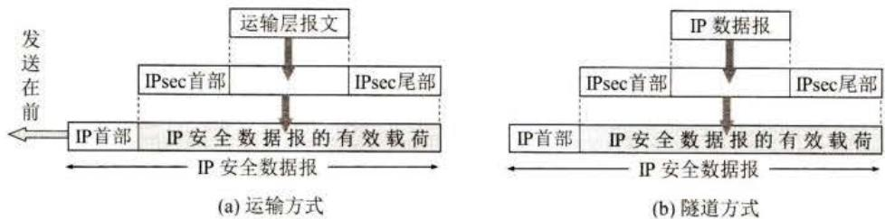
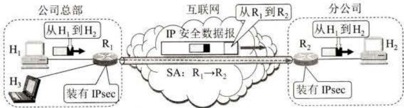
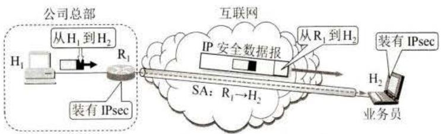
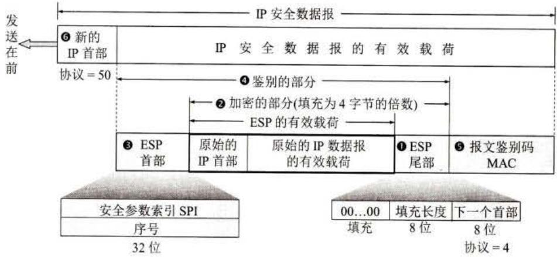

# 7.5.1 网络层安全协议

## 7.5 互联网使用的安全协议

前面几节所讨论的网络安全原理都可用在互联网中，目前在网络层、运输层和应用层都有相应的网络安全协议。下面分别介绍这些协议的要点。

## 1. IPsec 协议族概述

我们在第 4 章的 4.8.1 节中讨论虚拟专用网 VPN 时，提到在 VPN 中传送的信息都是经过加密的。现在我们就要介绍提供这种加密服务的 IPsec。

IPsec 并不是单一的协议，而是能够在 IP 层提供互联网通信安全的协议族（不太严格的名词 “IPsec 协议” 也常见到）。实际上，IPsec 包含了一个通用框架和若干加密算法，具有相当的灵活性和可扩展性。IPsec 允许通信双方从中选择合适的算法和参数（例如，密钥长度），以及是否使用鉴别。为保证互操作性，IPsec 规定其所有的实现都必须包含 IPsec 所推荐的全部加密算法。

IPsec 就是 “IP 安全(security)” 的缩写。在很多 RFC 文档中已给出了详细的描述。在这些文档中，最重要的就是描述 IP 安全体系结构的 RFC 4301（目前是建议标准）和提供 IPsec 协议族概述的 RFC 6071。

IPsec 协议族中的协议可划分为以下三个部分：

(1) IP 安全数据报格式的两个协议：鉴别首部 AH (Authentication Header) 协议和封装安全有效载荷 ESP (Encapsulation Security Payload) 协议。

(2) 有关加密算法的三个协议。

(3) 互联网密钥交换 IKE (Internet Key Exchange) 协议。

下面我们要重点介绍 IP 安全数据报的格式，以便了解 IPsec 怎样提供网络层的安全通信。AH 协议提供源点鉴别和数据完整性，但不能保密。而 ESP 协议比 AH 协议复杂得多，它提供源点鉴别、数据完整性和保密。IPsec 支持 IPv4 和 IPv6。在 IPv6 中，AH 和 ESP 都是扩展首部的一部分。AH 协议的功能都已包含在 ESP 协议中，因此使用 ESP 协议就可以不使用 AH 协议。下面我们将不再讨论 AH 协议，而只介绍 ESP 协议的要点。

使用 ESP 或 AH 协议的 IP 数据报称为 IP 安全数据报（或 IPsec 数据报），它可以在两台主机之间、两个路由器之间或一台主机和一个路由器之间发送。

IP 安全数据报有以下两种不同的工作方式。

第一种工作方式是运输方式(transport mode)。运输方式是在整个运输层报文段的前后分别添加若干控制信息，再加上IP首部，构成IP安全数据报（见图7-17(a))。

> 图 7-17 IP 安全数据报的两种工作方式（教材第 353 页）

第二种工作方式是隧道方式(tunnel mode)。隧道方式是在原始的 IP 数据报的前后分别添加若干控制信息，再加上新的 IP 首部，构成一个 IP 安全数据报（见图 7-17(b)）。

无论使用哪种方式，最后得出的 IP 安全数据报的 IP 首部都是不加密的。只有使用不加密的 IP 首部，互联网中的各个路由器才能识别 IP 首部中的有关信息，把 IP 安全数据报在不安全的互联网中进行转发，从源点安全地转发到终点。所谓“安全数据报”是指数据报的数据部分是经过加密的，并能够被鉴别的。通常把数据报的数据部分称为数据报的有效载荷(payload)。

由于目前使用最多的就是隧道方式，因此下面的讨论只限于隧道方式。

## 2. 安全关联

在发送 IP 安全数据报之前，在源实体和目的实体之间必须创建一条网络层的逻辑连接，即安全关联 SA (Security Association)。这样，传统的互联网中无连接的网络层就变为了具有逻辑连接的一个层。安全关联是从源点到终点的单向连接，它能够提供安全服务。如要进行双向安全通信，则两个方向都需要建立安全关联。假定某公司有一个公司总部和一个在外地的分公司。总部需要和这个分公司以及在各地出差的 n 个员工进行双向安全通信。在这种情况下，一共需要创建 $(2 + 2n)$ 条安全关联 SA。在这些安全关联 SA 上传送的就是 IP 安全数据报。

图 7-18(a) 是安全关联 SA 的示意图。公司总部和分公司都各有一个负责收发 IP 数据报的路由器 $R_{1}$ 和 $R_{2}$ （通常就是公司总部和分公司的防火墙中的路由器），而公司总部与分公司之间的安全关联 SA 就是在路由器 $R_{1}$ 和 $R_{2}$ 之间建立的。当然，路由器 $R_{1}$ 和 $R_{2}$ 都必须预先装有 IPsec。现假定公司总部的主机 $H_{1}$ 要和分公司的主机 $H_{2}$ 通过互联网进行安全通信。

公司总部主机 $H_{1}$ 发送给分公司主机 $H_{2}$ 的 IP 数据报，必须先经过公司总部的路由器 $R_{1}$ 。然后经 IPsec 的加密处理后，成为 IP 安全数据报。这样就把原始的 IP 数据报隐藏在 IP 安全数据报中了。IP 安全数据报经过互联网中很多路由器的转发，最后到达分公司的路由器 $R_{2}$ 。路由器 $R_{2}$ 对 IP 安全数据报解密，还原出原始的数据报，传送到终点主机 $H_{2}$ 。从逻辑上看，IP 安全数据报在安全关联 SA 上传送，就好像通过一个安全的隧道。这就是“隧道方式”这一名词的来源。如果总部的主机 $H_{1}$ 要和总部的另一台主机 $H_{3}$ 通信，由于都在公司内部，不需要加密，因此不需要建立安全关联。 $H_{1}$ 发出的 IP 数据报只需通过总部内部的路由器 $R_{1}$ 转发一次即可送到 $H_{3}$ 。如果 $H_{1}$ 要上网查看天气预报，同样不需要建立安全关联，而是发送 IP 数据报，经过路由器 $R_{1}$ 转发到互联网中的下一个路由器，最后到达互联网中预报气象的服务器。

> (a) 公司总部与分公司的安全通信（教材第 354 页）

> (b) 公司总部与业务员的安全通信 图 7-18 安全关联 SA 的示意图（教材第 354 页）

若公司总部的主机 $H_{1}$ 要和某外地业务员的便携机 $H_{2}$ 进行安全通信，则情况将稍有不同（如图 7-18(b) 所示）。可以看出，这时公司总部的路由器 $R_{1}$ 和外地业务员的便携机 $H_{2}$ 建立安全关联 SA（即路由器和主机之间的安全关联）。公司总部 $H_{1}$ 发送的 IP 数据报，通过路由器 $R_{1}$ 后，就变成了 IP 安全数据报。经过互联网中许多路由器的转发，最后到达 $H_{2}$ 。可以看出，现在是在路由器 $R_{1}$ 和业务员的便携机 $H_{2}$ 之间构成了一个安全隧道。外地业务员利用事先安装在便携机 $H_{2}$ 中的 IPsec 对 IP 安全数据报进行鉴别和解密，还原 $H_{1}$ 发来的 IP 数据报。

建立安全关联 SA 的路由器或主机，必须维护这条 SA 的状态信息。我们以图 7-18 中的安全关联 SA 为例，说明其状态信息应包括的项目：

(1) 一个 32 位的连接标识符，称为安全参数索引 SPI (Security Parameter Index)。

(2) 安全关联 SA 的源点和终点的 IP 地址（即路由器 $R_{1}$ 和 $R_{2}$ 的 IP 地址）。

(3) 所使用的加密类型（例如，DES 或 AES）。

(4) 加密的密钥。

(5) 完整性检查的类型（例如，使用报文摘要 MD5 或 SHA-1 的报文鉴别码 MAC）。

(6) 鉴别使用的密钥。

当路由器 $R_{1}$ 要通过 SA 发送 IP 安全数据报时，就必须读取 SA 的这些状态信息，以便知道如何把 IP 数据报进行加密和鉴别。

## 3. IP 安全数据报的格式

图 7-19 是 IP 安全数据报的格式。下面以隧道方式为例，结合各字段的作用，讨论一下 IP 安全数据报是怎样构成的。图中的数字①至⑥表示 IP 安全数据报构成的先后顺序。

> 图 7-19 IP 安全数据报的格式（教材第 355 页）

① 首先在原始的 IP 数据报（也就是 ESP 的有效载荷）后面添加 ESP 尾部。ESP 尾部有三个字段。第一个字段是填充字段，用全 0 填充。第二个字段是填充长度（8 位），指出填充字段的字节数。为什么要进行填充呢？这是因为在进行数据加密时，通常都要求数据块长度是若干字节（例如，4 字节）的整数倍。当 IP 数据报长度不满足此条件时，就必须用 0 进行填充。每个 0 为一个字节长。虽然填充长度（8 位）的最大值是 255，但实际上，填充很少会用到这个最大值。ESP 尾部最后一个字段是“下一个首部”（8 位）。这个字段的值指明，在接收端，ESP 的有效载荷应交给哪个协议来处理。如图 7-19 所示，IP 安全数据报有三个首部。现在 ESP 尾部中的 “下一个首部” 显然就是指 ESP 的有效载荷中的 “原始的 IP 首部”，IP 的协议值是 4，因此 “下一个首部” 应填入的数值是 4。如果不是隧道方式而是运输方式，则 “ESP 的有效载荷” 就应当是 TCP 或 UDP 报文段，“下一个首部” 的值也要改为另外的数值。

② 按照安全关联 SA 指明的加密算法和密钥，对 “ESP 的有效载荷（即原始的 IP 数据报）+ ESP 尾部”（见图 7-19 中的 “加密的部分”）进行加密。

③ 对 “加密的部分” 完成加密后，就添加 ESP 首部。ESP 首部有两个 32 位字段。第一个字段存放安全参数索引 SPI。通过同一个 SA 的所有 IP 安全数据报都使用同样的 SPI 值。第二个字段是序号，鉴别要用到这个序号，它用来防止重放攻击。请注意，当分组重传时序号并不重复。

④ 按照 SA 指明的算法和密钥，对 “ESP 首部 + 加密的部分”（见图 7-19 中的 “鉴别的部分”）生成报文鉴别码 MAC。

⑤ 把所生成的报文鉴别码 MAC 添加在 ESP 尾部的后面，和 ESP 首部、ESP 的有效载荷、ESP 尾部一起，构成 IP 安全数据报的有效载荷。

⑥ 生成新的 IP 首部，通常为 20 字节长，和普通的 IP 数据报的首部的格式是一样的。需要注意的是，首部中的协议字段的值是 50，表明在接收端，首部后面的有效载荷应交给 ESP 协议来处理。

当分公司的路由器 $R_{2}$ 收到 IP 安全数据报后，先检查首部中的目的地址。发现目的地址就是 $R_{2}$ ，于是路由器 $R_{2}$ 就继续处理这个 IP 安全数据报。

路由器 $R_{2}$ 找到 IP 首部的协议字段值（现在是 50），就把 IP 首部后面的所有字段（即 IP 安全数据报的有效载荷）都用 ESP 协议进行处理。先检查 ESP 首部中的安全参数索引 SPI，以确定收到的数据报属于哪一个安全关联 SA（因为路由器 $R_{2}$ 可能有多个安全关联）。路由器 $R_{2}$ 接着计算报文鉴别码 MAC，看是否和 ESP 尾部后面添加的报文鉴别码 MAC 相符。如是，即知收到的数据报的确是来自路由器 $R_{1}$ 。再检验 ESP 首部中的序号，以证实有无被入侵者重放。接着要用和这个安全关联 SA 对应的加密算法和密钥，对已加密的部分进行解密。再根据 ESP 尾部中的填充长度，去除发送端填充的所有 0，还原出加密前的 ESP 有效载荷，也就是 $H_{1}$ 发送的原始 IP 数据报。

根据解密后得到的 ESP 尾部中 “下一个首部” 的值（现在是 4），把 ESP 的有效载荷交给 IP 来处理。当找到原始的 IP 首部中的目的地址是主机 $H_{2}$ 的 IP 地址时，就把整个的 IP 数据报传送给主机 $H_{2}$ 。整个 IP 数据报的传送过程到此结束。

请注意，在图 7-19 的 “原始的 IP 首部” 中，是用主机 $H_{1}$ 和 $H_{2}$ 的 IP 地址分别作为源地址和目的地址，而在 IP 安全数据报的 “新的 IP 首部” 中，是使用路由器 $R_{1}$ 和 $R_{2}$ 的 IP 地址分别作为源地址和目的地址（这是图 7-18(a) 所示的情况）。但如果是图 7-18(b) 所示的情况，IP 安全数据报不经过另一个路由器 $R_{2}$ ，那么在 IP 安全数据报的 “新的 IP 首部” 中，要用路由器 $R_{1}$ 和主机 $H_{2}$ 的 IP 地址分别作为 IP 安全数据报的源地址和目的地址。

从以上的讨论可以看出，设想有一个 IP 安全数据报在互联网中被某人截获，如果截获者不知道此安全数据报的密码，那么他只能知道这是一个从路由器 $R_{1}$ 发往路由器 $R_{2}$ 的 IP 数据报，但却无法看懂其有效载荷中的数据含义。如果截获者篡改了数据报的源地址，那么安全数据报的鉴别功能可以保证源地址的真实性。假定截获者故意删除了安全数据报中的一些字节，但由于接收端的路由器 $R_{2}$ 能够进行完整性检验，就不会接收这种含有差错的信息。

如果截获者试图进行重放攻击，那么由于安全数据报使用了有效的序号，使得重放攻击也无法得逞。

## 4. IPsec 的其他构件

前面已经提到过，发送 IP 安全数据报的实体可能要用到很多条安全关联 SA。那么这些 SA 存放在什么地方呢？这就要提及 IPsec 的一个重要构件，叫作安全关联数据库 SAD (Security Association Database)。所有需要运行 IPsec 的站点都必须有 SAD。当主机要发送 IP 安全数据报时，就要在 SAD 中查找相应的 SA，以便获得必要的信息，来对该 IP 安全数据报实施安全保护。同样，当主机要接收 IP 安全数据报时，也要在 SAD 中查找相应的 SA，以便获得信息来检查该分组的安全性。

前面已经提到了，主机所发送的数据报并非都必须进行加密，很多信息使用普通的数据报用明文发送即可。因此，除了安全关联数据库 SAD，还需要另一个数据库，这就是安全策略数据库 SPD (Security Policy Database)。SPD 指明什么样的数据报需要进行 IPsec 处理。这取决于源地址、源端口、目的地址、目的端口，以及协议的类型等。因此，当一个 IP 数据报到达时，SPD 指出应当做什么（使用 IP 安全数据报还是不使用），而 SAD 则指出，如果需要使用 IP 安全数据报，应当怎样做（使用哪一个 SA）。

还有一个问题，安全关联数据库 SAD 中存放的许多安全关联 SA 是怎样建立起来的呢？如果一个虚拟专用网 VPN 只有几个路由器和主机，那么用人工键入的方法就可以建立起所需的安全关联数据库 SAD。但如果一个 VPN 有好几百或几千个路由器和主机，人工键入的方法显然是不行的。因此，对于大型的、地理位置分散的系统，为了创建 SAD，我们需要使用自动生成的机制，即使用互联网密钥交换 IKE (Internet Key Exchange) 协议。IKE 的用途就是为 IP 安全数据报创建安全关联 SA。

IKE 是个非常复杂的协议，IKEv2 是其新的版本，在 2014 年 10 月已成为互联网的正式标准[RFC 7296, STD79]。IKEv2 以另外三个协议为基础：

(1) Oakley——是个密钥生成协议[RFC 2412]。

(2) 安全密钥交换机制 SKEME (Secure Key Exchange MEchanism) ——是用于密钥交换的协议。它利用公钥加密来实现密钥交换协议中的实体鉴别。

(3) 互联网安全关联和密钥管理协议 ISAKMP (Internet Secure Association and Key Management Protocol) ——用于实现 IKE 中定义的密钥交换，使 IKE 的交换能够以标准化、格式化的报文创建安全关联 SA。

关于 IKE 的深入介绍可参阅有关文档，如 RFC 4945 和 RFC 7427（都是建议标准）。
