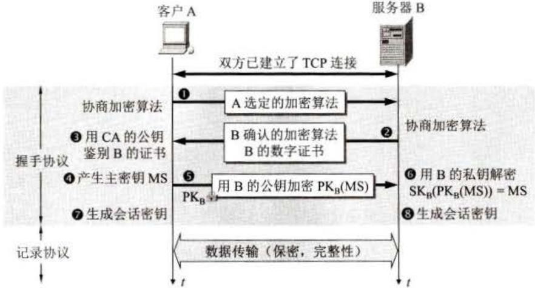
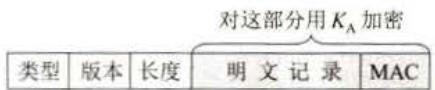

# 7.5.2 运输层安全协议

## 1. 协议 TLS 的要点

当万维网能够提供网上购物时，安全问题就马上被提到桌面上来了。例如，当顾客在不安全的互联网上购物时，他会要求得到下列安全服务：

(1) 顾客需要确保服务器属于真正的销售商，而不是某个冒充者。这就是应对身份进行鉴别。

(2) 顾客与销售商需要确保报文的内容（例如账单）在传输过程中没有被篡改。这就是

应保证通信内容的数据完整性。

(3) 顾客与销售商需要确保诸如信用卡上的敏感信息不被泄露。这就是要有机密性。

不仅在电子商务领域，即使在我们日常上网浏览各种信息时，我们所浏览的信息也是属于个人隐私，不应作为网上的公开信息。因此，在很多情况下，客户端（浏览器）与服务器之间的通信需要使用安全的运输层协议。曾经广泛使用的运输层安全协议有两个，即：(1) 安全套接字层 SSL (Secure Socket Layer)。(2) 运输层安全 TLS (Transport Layer Security)。

协议 SSL 是 Netscape 公司在 1994 年开发的安全协议，广泛应用于基于万维网的各种网络应用（但不限于万维网应用）。SSL 作用在端系统应用层的 HTTP 和运输层之间，在 TCP 之上建立起一个安全通道，为通过 TCP 传输的应用层数据提供安全保障。

1995 年 Netscape 公司把协议 SSL 转交给 IETF，希望能够把 SSL 进行标准化。1999 年 IETF 在 SSL 3.0 的基础上设计了协议 TLS 1.0（改动极少），为所有基于 TCP 的网络应用提供安全数据传输服务。为了应对网络安全的变化，IETF 及时地对 TLS 的版本进行升级，如 2006 年的 TLS 1.1，2008 年的 TLS 1.2。2014 年 10 月，谷歌建议禁用 SSL 3.0，因为其设计上有漏洞，用户的敏感信息有被窃取的可能。接着，Mozilla 和微软也发出了同样的安全通告。2018 年 8 月 IETF 发布了经历了 28 个草案后才通过的最新版本 TLS 1.3 [RFC 8446，建议标准]（不向后兼容）。在 2020 年，旧版本 TLS 1.0/1.1 均被废弃。目前谷歌浏览器 Chrome 和火狐浏览器 Firefox 都已开始使用更加安全的协议 TLS 1.3，但不少老客户端仍未抛弃一些旧版本。应当说，到目前为止协议 TLS 1.2 还是安全可用的，只是被发现了有潜在的安全隐患。因此，现在能够使用的运输层安全协议就只剩下协议 TLS 1.2 和协议 TLS 1.3 了。

协议 TLS 的位置在运输层和应用层之间（如图 7-20 所示）。虽然协议 SSL 2.0/3.0 均已被废弃不用了，但现在还经常能够看到把 “SSL/TLS” 视为 TLS 的同义词。这是因为协议 TLS 本来就源于 SSL（但并不兼容），而现在旧协议 SSL 被更新为新协议 TLS。

> 图 7-20 协议 TLS 位于运输层和应用层之间（教材第 358 页）

| 应用程序 |
| --- |
| TLS(或SSL/TLS) |
| TCP |
| IP |

应用层使用协议 TLS 最多的就是 HTTP，但并非仅限于 HTTP。因为协议 TLS 是对 TCP 加密，因此任何在 TCP 之上运行的应用程序都可以使用协议 TLS。例如，用于 IMAP 邮件存取的鉴别和数据加密也可以使用 TLS。TLS 提供了一个简单的带有套接字的应用程序接口 API，这和 TCP 的 API 是相似的。

当不需要运输层安全协议时，HTTP 就直接使用 TCP 连接，这时协议 TLS 不起作用。由于需要使用运输层安全协议的人越来越多，因此现在相当多的网站已是全站使用运输层安全协议。例如，当我们使用百度网站浏览信息时，在浏览器的地址栏键入其官网地址 www.baidu.com 后（不必在前面键入 http://或 https://），就可以在屏幕上看到这样的响应：

$$ \text { https: / / www.baidu.com } $$

可以看出，尽管用户在浏览器上没有键入 https://，但百度网站总是提供安全的运输层服务。提供安全运输层服务的标志是地址栏 URL 中的协议部分显示出的是 https，并且在其左边还有一个安全锁的标志。在 http 后面加上的 s 代表 security，表明是使用 HTTPS，即提供安全服务的 HTTP 协议（TCP 的 HTTPS 端口号是 443，而不是 HTTP 使用的端口号 80）。这时我们就可以放心和这样的网站进行通信，因为这个网站已经被鉴别了是真正的百度网站，并且之后在浏览器和百度服务器之间的所有交互报文都是加密的，因而通信的机密性得到了保证。

现在我们使用某些主流浏览器访问不安全的网站时，浏览器会向用户发出“不安全”的警告。下面给出当我们键入桔梗网的网址 shu.jiegeng.com 后所看到的响应：

谷歌 Chrome 浏览器指出 “不安全”

$$ \text { 火狐 } \text { Firefox 浏览器提示无安全锁 } $$

$$ ⓘ \text { 不安全 } | \mathrm{shu.jiegeng.com} $$

shu.jiegeng.com

这就提醒我们在上网时要注意信息的安全。

协议 TLS 具有双向鉴别的功能。但大多数情况下使用的是单向鉴别，即客户端（浏览器）需要鉴别服务器。也就是说，浏览器 A 要确信即将访问的网站服务器 B 是安全和可信的。这必须要有两个前提。首先，服务器 B 必须能够证明本身是安全和可信的。因此服务器 B 需要有一个证书来证明自己。现在我们假定服务器 B 已经持有了有效的 CA 证书。这正是运输层安全协议 TLS 的基石。其次，浏览器 A 应具有一些手段来证明服务器 B 是安全和可信的。下面就来讨论这一点。

生产电脑操作系统的厂商为了方便用户，把当前获得公众信任的许多主流认证中心 CA 的根证书，都已内置在其操作系统中。这些根证书上都有认证中心 CA 的公钥 $PK_{CA}$ ，而且根证书都用 CA 的私钥 $SK_{CA}$ 进行了自签名（防止伪造）。用户为了验证要访问的服务器是否安全和可信，只要打开电脑中的浏览器（操作系统自带的或用户自己装上的），就可查到操作系统收藏的某个根认证中心的根 CA 证书，并可以利用证书上的公钥 $PK_{CA}$ 对 B 的证书进行验证。若服务器 B 的证书是证书链上的某个中间 CA 签发的，那么浏览器 A 也可用类似方法验证 B 的证书的真实性。

由于浏览器与服务器的通信方式就是以前讲过的“客户-服务器方式”，因此下面就用客户代表浏览器。

如图 7-21 所示，在客户与服务器双方已经建立了 TCP 连接后，就可开始执行协议 TLS。根据 RFC 8446，这里主要有两个阶段，即握手阶段和会话阶段。在握手阶段，TLS 使用其中的握手协议，而在会话阶段，TLS 使用其中的记录协议。下面讨论协议 TLS 的要点。

> 图 7-21 TLS 建立安全会话的工作原理（教材第 359 页）

我们先介绍协议 TLS 的握手阶段。握手阶段要验证服务器是安全可信的，同时生成在后面的会话阶段所需的共享密钥，以保证双方交换的数据的私密性和完整性。这里要提醒读者，在刚开始执行协议 TLS 时，通信双方的信道是不安全的。因此要弄清：(1) 双方怎样通过不安全的信道得到会话时所需的共享密钥。这里没有采用密钥分发中心 KDC 来分配密钥，而是采用自己生成共享密钥的方法。(2) 用什么方法保证所传送数据的机密性与完整性。

(1) 协商加密算法 ① 客户 A 向服务器 B 发送自己选定的加密算法（包括密钥交换算法）。② 服务器 B 从中确认自己所支持的算法，同时把自己的 CA 数字证书发送给 A。这里要说明一下，从 TLS 1.0 更新到 1.1 和 1.2 版本时，每一次更新都增加了当时认为是更加安全可靠的加密算法。为了协议的向后兼容，对老版本中的不太安全的数十种算法也都保留下来了。这就造成协商过程非常耗时，需要花费 2 倍 RTT 的时间（通常记为 2-RTT）。因此最新的 TLS 1.3 版本把陈旧的很多种算法统统取消（例如 MD5, SHA-1, DES, 3DES 等），只留下几种最安全的算法。客户不是把自己所有的加密算法都告诉服务器，供服务器来挑选，而是猜测服务器可能愿意使用什么加密算法，把自己选定的加密算法直接发送给服务器，让服务器来确认。这就把 “协商” 时间缩短为 1-RTT。

(2) 服务器鉴别 ③ 客户 A 用数字证书中 CA 的公钥对数字证书进行验证鉴别。

(3) 生成主密钥 ④ 客户 A 按照双方确定的密钥交换算法生成主密钥 MS (Master Secret)。⑤ 客户 A 用 B 的公钥 $\mathrm{PK}_{\mathrm{B}}$ 对主密钥 MS 加密，得出加密的主密钥 $\mathrm{PK}_{\mathrm{B}}(\mathrm{MS})$ ，发送给服务器 B。请注意，在有关 TLS 的文档中，密钥一词使用的是 Secret，而不是 Key。

(4) 服务器 B 用自己的私钥把主密钥解密出来: $\mathrm{SK}_{\mathrm{B}}(\mathrm{PK}_{\mathrm{B}}(\mathrm{MS})) = \mathrm{MS}$ 。这样, 客户 A 和服务器 B 都拥有了为后面的数据传输使用的共同的主密钥 MS。

(5) 为了使双方的通信更加安全，客户 A 和服务器 B 最好使用不同的密钥。于是主密钥被分割成 4 个不同的密钥，这就是图 7-21 中的⑦和⑧：生成会话密钥。在这以后，每一方都拥有这样 4 个密钥（请注意，这些都是对称密钥，即加密和解密用的是同一个密钥）：

\- 客户 A 发送数据时使用的会话密钥 $K_{\mathrm{A}}$

\- 客户 A 发送数据时使用的 MAC 密钥 $M_{\mathrm{A}}$

\- 服务器 B 发送数据时使用的会话密钥 $K_{\mathrm{B}}$

\- 服务器 B 发送数据时使用的 MAC 密钥 $M_{\mathrm{B}}$

会话密钥不使用非对称密钥，因为对称密钥的运行速度快得多（相差3个数量级）。

下面讨论协议 TLS 的会话阶段。会话阶段要保证传送数据的机密性和完整性。

客户或服务器在发送数据时，都把长的数据划分为较小的数据块，叫作记录(record)。然后对每一个记录进行鉴别运算和加密运算。为了防止入侵者截取传输中的记录，或颠倒记录的前后顺序，TLS 的记录协议对每一个记录按发送顺序赋予序号，把每一方发送的第一个记录作为 0 号记录。发送下一个记录时序号就加 1，但序号最大值不得超过 $2^{64} - 1$ ，且不允许序号绕回。然而此序号并非写在记录之中，而是在进行散列运算时，把序号包含进去。例如，当客户 A 向服务器 B 发送一个明文记录时，客户 A 先把 MAC 密钥 $M_A$ 和该记录当前的序号一起拼接在此明文记录之后，然后进行散列运算，得出 MAC。再把得出的 MAC 和明文记录拼接起来，用会话密钥 $K_A$ 进行加密，发送给服务器 B。B 使用同样的会话密钥 $K_A$ 进行解密，然后分离出明文记录和 MAC。B 再把同样的 MAC 密钥 $M_A$ 和该记录应有的序号拼接在此明文记录之后，进行散列运算，看得出的结果与前面得出的 MAC 值是否一致，以鉴别收到的明文记录的完整性（内容和顺序均无误）。上述对记录加密的方法称为 AEAD(Authenticated Encryption with Associated Data), 即带关联数据的鉴别加密。

实际上，客户 A 所发送的加密的记录的前面，还必须添加三个不加密的字段，图 7-22 给出了这三个字段的位置。类型字段指明所传送的记录出握手阶段的报文，还是应用程序传送的报文，或最后要关闭 TLS 连接的报文（下一小节将要解释）。长度字段给出的字节数可用来从 TCP 报文中提取 TLS 记录。

> 图 7-22 TLS 传送的记录格式（教材第 361 页）

## 2. 协议 TLS 必须包含的措施

以上介绍的只是协议 TLS 的要点。但若仅仅是这样，还不能提供足够的安全。因此，对前面图 7-21 所示的双方的握手阶段，需要补充一些措施。

(1) 在客户 A 向服务器 B 发送自己选定的加密算法（包括密钥交换算法）时，还要向服务器 B 发送客户的不重数。服务器 B 从中确认自己所支持的算法，同时把自己的 CA 数字证书和服务器的不重数发送给客户 A。

(2) 生成预主密钥 客户 A 验证了服务器 B 的数字证书后, 生成为下一步生成主密钥使用的预主密钥 PMS (Pre-Master Secret), 并用 B 的公钥 $\mathrm{PK}_{\mathrm{B}}$ 对预主密钥 PMS 加密, 把加密的预主密钥 $\mathrm{PK}_{\mathrm{B}}(\mathrm{PMS})$ 发送给服务器 B。B 用其私钥 $\mathrm{SK}_{\mathrm{B}}$ 进行解密, 得出预主密钥 PMS。这样, 客户 A 和服务器 B 都拥有了为后面的数据传输使用的共同的预主密钥 PMS。

(3) 生成主密钥 客户 A 和服务器 B 各自使用同样的（已商定的）算法，使用预主密钥 PMS 以及客户的不重数和服务器的不重数，生成主密钥 MS。然后再将其划分为 4 个密钥。于是 A 和 B 各拥有相同的 4 个密钥（每一方在发送数据时使用的会话密钥和 MAC 密钥）。

(4) 客户 A 向服务器 B 发送的全部握手阶段报文的 MAC。

(5) 服务器 B 向客户 A 发送的全部握手阶段报文的 MAC。

上述最后的(4)和(5)的作用是这样的。在 A 向 B 发送加密的预主密钥之前的握手信息是没有加密的明文，因此可能受到入侵者的篡改。现在 A 和 B 都各自对全部握手阶段的报文计算了散列值 MAC。如果入侵者篡改了处在传输过程中的某个报文，那么上面(4)和(5)所得出的 MAC 值必然不一致。这样 A 或 B 就可以立即中止当前的连接。

在(1)中客户和服务器各产生一个仅使用一次的不重数，其目的是为了防止“重放攻击”。设想在 A 和 B 之间有一个入侵者，他截获了 A 和 B 交互的全部报文。虽然他未能解密 A 和 B 交互的具体内容，但他可以在以后的某日，重新按照原来的顺序依次发送给 B。如果没有使用上述的不重数，那么 B 无法发现这是入侵者重放旧的报文。B 也将和前次的握手过程一样，向 A 发回报文（实际上是发给了中间人入侵者）。这样造成的后果是很严重的。但使用了不重数以后，在下一个 TCP 连接中，客户 A 必须使用另一个不同的不重数。这样就有效地防止了重放攻击。

前面曾提到在关闭 TLS 连接之前，A 或 B 应当先发送关闭 TLS 的记录，目的是防止入侵者的截断攻击(truncation attack)。所谓截断攻击就是在 A 和 B 正在进行会话时，入侵者突然发送 TCP 的 FIN 报文段来关闭 TCP 连接。但如果 A 或 B 没有事先发送一个要关闭 TLS的记录，那么 A 或 B 见到 TCP 的 FIN 报文段时，就知道这是入侵者的截断攻击了。入侵者无法伪造关闭 TLS 的记录，因为虽然记录前面的三个字段都是明文，但每个记录的内容是加密的，并有 MAC 保证其完整性的。

在 TLS 1.3 中使用了更加安全的椭圆曲线密码 ECC (Elliptic Curve Cryptography)与 AES，使运算速度比旧的 1.2 版本有了很大的提高。TLS 1.3 还添加了 0-RTT 的功能。这就是说，如果客户之前连接过某服务器，TLS 1.3 通过储存先前会话的秘密信息，不需要经过 1-RTT 的握手过程，仅需 0-RTT 即可开始会话阶段，这样就更加提高了 TLS 的效率。当然，这样做必须要防止可能发生的重放攻击。
