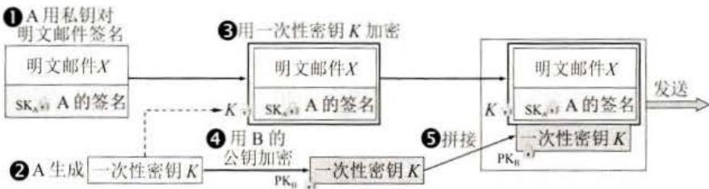

# 7.5.3 应用层安全协议

限于篇幅，我们在这一节仅讨论应用层中有关电子邮件的安全协议。

电子邮件在传送过程中可能要经过许多路由器，其中的任何一个路由器都有可能对转发的邮件进行阅读。从这个意义上讲，电子邮件是没有什么隐私可言的。

电子邮件这种网络应用也有其很特殊的地方，这就是发送电子邮件是个即时的行为。这种行为在本质上与我们前两节所讨论的不同。当我们使用 IPSec 或 SSL 时，我们假设双方在相互之间建立起一个会话并双向地交换数据。而在电子邮件中没有会话存在。当 A 向 B 发送一个电子邮件时，A 和 B 并不会为此而建立任何会话。而在此后的某个时间，如果 B 读取了该邮件，他有可能会、也有可能不会回复这个邮件。可见我们所讨论的是单向报文的安全问题。

如果说电子邮件是即时的行为，那么发送方与接收方如何才能就用于电子邮件安全的加密算法达成一致意见呢？如果双方之间不存在会话，不存在协商加密/解密所使用的算法，那么接收方如何知道发送方选择了哪种算法呢？

要解决这个问题，电子邮件的安全协议就应当为每种加密操作定义相应的算法，以便用户在其系统中使用。A 必须要把使用的算法的名称（或标识）包含在电子邮件中。例如，A 可以选择用 AES 进行加密/解密，并选择用 SHA-1 作为报文摘要算法。当 A 向 B 发送电子邮件时，就在自己的邮件中包含与 AES 和 SHA-1 相对应的标识。B 在接收到该邮件后，首先要提取这些标识，然后就能知道在解密和报文摘要运算时应当分别使用哪种算法了。

加密算法在使用加密密钥时也存在同样的问题。如果没有协商过程，通信的双方如何在彼此之间知道所使用的密钥？目前的电子邮件安全协议要求使用对称密钥算法进行加密和解密，并且这个一次性的密钥要跟随报文一起发送。发信人 A 可以生成一个密钥并把它与报文一起发送给 B。为了保护密钥不被外人截获，这个密钥需要用收信人 B 的公钥进行加密。总之，这个密钥本身也要被加密。

还有一个问题也需要考虑。很显然，要实现电子邮件的安全就必须使用某些公钥算法。例如，我们需要对密钥加密或者对邮件签名。为了对密钥进行加密，发信人 A 就需要收信人 B 的公钥，同样为了验证被签名的报文，收信人 B 也需要发信人 A 的公钥。因此，为了发送一个具有鉴别和保密的报文，就需要用到两个公钥。但是 A 如何才能确认 B 的公钥，B 又如何才能确认 A 的公钥呢？不同的电子邮件安全协议有不同的方法来验证密钥。

下面我们介绍在应用层为电子邮件提供安全服务的协议 PGP。

PGP (Pretty Good Privacy) 是 Zimmermann 于 1995 年开发的。它是一个完整的电子邮件安全软件包，包括加密、鉴别、电子签名和压缩等技术。PGP 并没有使用什么新的概念，它只是把现有的一些加密算法（如 RSA 公钥加密算法或 MD5 报文摘要算法）综合在一起而已。由于包括源程序的整个软件包可以从互联网免费下载[W-PGP]，因此 PGP 在 MS-DOS/Windows 以及 UNIX 等平台上得到了广泛的应用。现在 PGP 的网站以每个月百万页的规模，为一百多个国家的用户提供服务。

后来 PGP 公司与 Zimmermann 同意 IETF 制定 PGP 的公开互联网标准 OpenPGP。2007 年 IETF 发布了 OpenPGP 的建议标准[RFC 4880]。

PGP 的工作原理并不复杂。它提供电子邮件的安全性、发送方鉴别和报文完整性。

假定 A 向 B 发送电子邮件明文 X，现在用 PGP 进行加密。A 有三个密钥：自己的私钥 $SK_{A}$ ，B 的公钥 $PK_{B}$ 和自己生成的一次性密钥 K。B 有两个密钥：自己的私钥 $SK_{B}$ 和 A 的公钥 $PK_{A}$ 。

A 需要做以下几件事（如图 7-23 所示）。

> 图 7-23 在发送方 A 的 PGP 处理过程（教材第 363 页）

① 用 A 的私钥 $SK_{A}$ 对明文邮件 X 进行签名。把签名拼接在明文邮件 X 后面。

② 利用随机数 A 生成一次性密钥 K（共享的对称密钥）。

③ 用 A 生成的一次性密钥 K 对已签名的邮件加密。

④ 用 B 的公钥 $PK_{B}$ 对 A 生成的一次性密钥 K 进行加密。

⑤ 把已加密的一次性密钥和已加密的签名邮件，拼接在一起发送给 B。

请注意，图 7-23 中三个 “加密” 的作用是不同的。第一次加密是用 A 的私钥 $SK_{A}$ 对明文邮件的报文摘要进行加密，即进行数字签名，目的是保证邮件的完整性。第二次加密是用 A 生成的一次性密钥 K 对已签名的邮件加密，目的是保证邮件的机密性。第三次加密是用 B 的公钥 $PK_{B}$ 对 A 的一次性密钥 K 加密，目的是保证对称密钥 K 的机密性。

B 收到 A 发过来的报文后要做以下几件事（建议读者自行画出相应的图，这里从略）：

(1) 在文档 RFC 4880 中，对加密邮件的各种格式（如仅加密但不鉴别，或仅鉴别但不加密，或加密加上鉴别），均有详细的规定。因此 B 可以根据邮件的种类，准确地把已加密的一次性密钥和已加密的签名报文分离开。

(2) 用 B 私钥 $\mathrm{SK}_{\mathrm{B}}$ 解出一次性密钥 $K$ （这是对称密钥，加密和解密都需要各使用一次）。

(3) 用导出的一次性密钥 K 对加密的签名邮件进行解密，分离出明文邮件 X 和 A 的数字签名。

(4) 用 B 手中的 A 的公钥 $PK_{A}$ 对 A 的数字签名进行解密。然后即可接着验证邮件的完整性，具体的做法与前面图 7-9 所述的相似，这里不再重复。

在 PGP 中，发件方和收件方是如何获得对方的公钥呢？当然，最安全的办法是双方面对面直接交换公钥，但在大多数情况下这并不现实。因此可以通过认证中心 CA 签发的证书来验证公钥持有者的合法身份。然而在 PGP 中不要求使用 CA，而是允许用一种第三方签署的方式来解决该问题。例如，如果用户 A 和用户 B 分别和第三方 C 已经确认对方拥有的公钥属实，则 C 可以用其私钥分别对 A 和 B 的公钥进行签名，为这两个公钥进行担保。当 A 得到一个经 C 签名的 B 的公钥时，可以用已确认的 C 的公钥对 B 的公钥进行鉴别。不过，用户发布其公钥的最常见的方式还是把公钥发布在他们的个人网页上，或仅仅通过电子邮件进行分发。

PGP 很难被攻破。因此在目前可以认为 PGP 是足够安全的。
