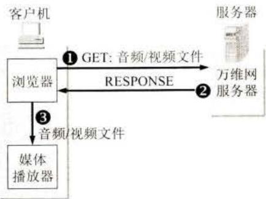

# 8.2 流式存储音频/视频

“流式存储音频/视频”中的“存储”二字，表明这里所讨论的流式音频/视频文件不是实时产生的，而是已经录制好的，通常存储在光盘或硬盘中。不过有时为了简便，往往省略“存储”二字。在讨论从网上下载这种文件之前，我们先回忆一下使用传统的浏览器是怎样从服务器下载已经录制好的音频/视频文件的。图8-4说明了下载的三个步骤。

> 图 8-4 传统的下载文件方法（教材第 374 页）

① 用户从客户机(client machine)的浏览器上用 HTTP 协议向服务器请求下载某个音频/视频文件，GET 表示请求下载的 HTTP 报文。请注意，HTTP 使用 TCP 连接。

② 服务器如有此文件就发送给浏览器，RESPONSE 表示服务器的 HTTP 响应报文。在响应报文中装有用户所要的音频/视频文件。整个下载过程可能会花费很长的时间。

③ 当浏览器完全收下这个文件后（所需的时间取决于音频/视频文件的大小），就可以传送给自己机器上的媒体播放器进行解压缩，然后播放。

为什么不能直接在浏览器中播放音频/视频文件呢？这是因为播放器并没有集成在万维网浏览器中。因此，必须使用一个单独的应用程序来播放这种音频/视频节目。这个应用程序通常称为媒体播放器(media player)。现在流行的媒体播放器有 Real Networks 的 RealPlayer、微软的 Windows Media Player 和苹果公司的 QuickTime。媒体播放器具有的主要功能是：管理用户界面、解压缩、消除时延抖动和处理传输带来的差错。
