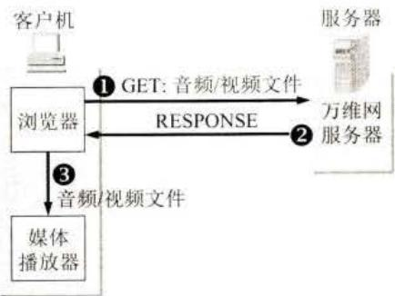
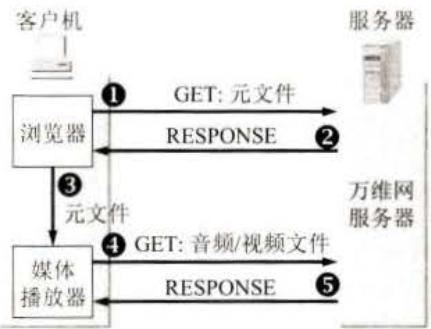

# 8.2.1 具有元文件的万维网服务器

## 8.2 流式存储音频/视频

“流式存储音频/视频”中的“存储”二字，表明这里所讨论的流式音频/视频文件不是实时产生的，而是已经录制好的，通常存储在光盘或硬盘中。不过有时为了简便，往往省略“存储”二字。在讨论从网上下载这种文件之前，我们先回忆一下使用传统的浏览器是怎样从服务器下载已经录制好的音频/视频文件的。图8-4说明了下载的三个步骤。

> 图 8-4 传统的下载文件方法（教材第 374 页）

① 用户从客户机(client machine)的浏览器上用 HTTP 协议向服务器请求下载某个音频/视频文件，GET 表示请求下载的 HTTP 报文。请注意，HTTP 使用 TCP 连接。

② 服务器如有此文件就发送给浏览器，RESPONSE 表示服务器的 HTTP 响应报文。在响应报文中装有用户所要的音频/视频文件。整个下载过程可能会花费很长的时间。

③ 当浏览器完全收下这个文件后（所需的时间取决于音频/视频文件的大小），就可以传送给自己机器上的媒体播放器进行解压缩，然后播放。

为什么不能直接在浏览器中播放音频/视频文件呢？这是因为播放器并没有集成在万维网浏览器中。因此，必须使用一个单独的应用程序来播放这种音频/视频节目。这个应用程序通常称为媒体播放器(media player)。现在流行的媒体播放器有 Real Networks 的 RealPlayer、微软的 Windows Media Player 和苹果公司的 QuickTime。媒体播放器具有的主要功能是：管理用户界面、解压缩、消除时延抖动和处理传输带来的差错。

请注意，图 8-4 所示传统的下载文件的方法并没有涉及 “流式”（即边下载边播放）的概念。传统的下载方法最大缺点就是历时太长，这往往使下载者不愿继续等待。为此，已经找出了几种改进的措施。

第一种改进的措施就是在万维网服务器中，除了真正的音频/视频文件外，还增加了一个元文件(metafile)。所谓元文件（请注意，不是源文件）就是一种非常小的文件，它描述或指明其他文件的一些重要信息。这里的元文件保存了有关这个音频/视频文件的信息。图8-5说明了使用元文件下载音频/视频文件的几个步骤。

> 图 8-5 使用具有元文件的万维网服务器（教材第 375 页）

① 浏览器用户点击所要看的音频/视频文件的超链，使用 HTTP 的 GET 报文接入到万维网服务器。实际上，这个超链并没有直接指向所请求的音频/视频文件，而是指向一个元文件。这个元文件有实际的音频/视频文件的统一资源定位符 URL。

② 万维网服务器把该元文件装入 HTTP 响应报文的主体，发回给浏览器。在响应报文中还有指明该音频/视频文件类型的首部。

③ 客户机浏览器收到万维网服务器的响应，分析其内容类型首部行，调用相关的媒体播放器（客户机中可能装有多个媒体播放器），把提取出的元文件传送给媒体播放器。

④ 媒体播放器使用元文件中的 URL 直接和万维网服务器建立 TCP 连接，并向万维网服务器发送 HTTP 请求报文，要求下载浏览器想要的音频/视频文件。

⑤ 万维网服务器发送 HTTP 响应报文，把该音频/视频文件发送给媒体播放器。媒体播放器在存储了若干秒的音频/视频文件后（这是为了消除抖动），就以音频/视频流的形式边下载、边解压缩、边播放。
