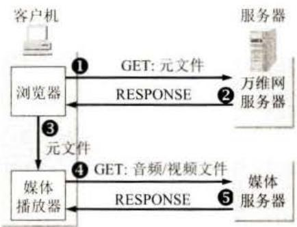
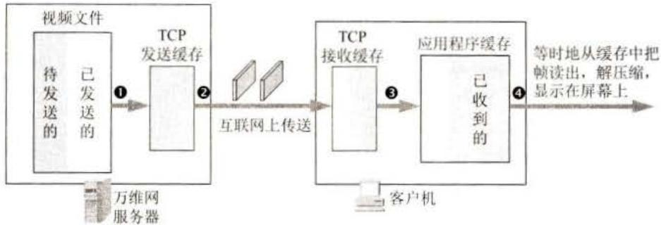

# 8.2.2 媒体服务器

为了更好地提供播放流式音频/视频文件的服务，现在最为流行的做法就是使用两个分开的服务器。如图 8-6 所示，现在使用一个普通的万维网服务器，和另一个媒体服务器(media server)。媒体服务器和万维网服务器可以运行在一个端系统内，也可以运行在两个不同的端系统中。媒体服务器与普通的万维网服务器的最大区别就是，媒体服务器是专门为播放流式音频/视频文件而设计的，因此能够更加有效地为用户提供播放流式多媒体文件的服务。因此媒体服务器也常被称为流式服务器(streaming server)。下面我们介绍其工作原理。

> 图 8-6 使用媒体服务器（教材第 376 页）

在用户端的媒体播放器与媒体服务器的关系是客户与服务器的关系。与图 8-5 不同的是，现在媒体播放器不是向万维网服务器而是向媒体服务器请求音频/视频文件。媒体服务器和媒体播放器之间采用另外的协议进行交互。

采用媒体服务器后，下载音频/视频文件的前三个步骤仍然和上一节所述的一样，区别就是后面两个步骤，即：

①\~③ 前三个步骤与图 8-5 中的相同。

④ 媒体播放器使用元文件中的 URL 接入到媒体服务器，请求下载浏览器所请求的音频/视频文件。下载文件可以使用上一小节讲过的 HTTP/TCP，也可以借助于使用 UDP 的任何协议，例如使用实时运输协议 RTP（见 8.3.3 节）。

⑤ 媒体服务器给出响应，把该音频/视频文件发送给媒体播放器。媒体播放器在迟延了若干秒后（例如，2～5秒），以流的形式边下载、边解压缩、边播放。

上面提到，传送音频/视频文件可以使用 TCP，也可以使用 UDP。起初人们选用 UDP 来传送。不采用 TCP 的主要原因是担心当网络出现分组丢失时，TCP 的重传机制会使重传的分组不能按时到达接收端，使得媒体播放器的播放不流畅。但后来的实践经验发现，采用 UDP 会有以下几个缺点。

(1) 发送端按正常播放的速率发送流媒体数据帧，但由于网络的情况多变，在接收端的播放器很难做到始终按规定的速率播放。例如，一个视频节目需要以 1 Mbit/s 的速率播放。如果从媒体服务器到媒体播放器之间的网络容量突然降低到 1 Mbit/s 以下，那么这时就会出现播放器的暂停，影响正常的观看。

(2) 很多单位的防火墙往往阻拦外部 UDP 分组的进入，因而使用 UDP 传送多媒体文件时会被防火墙阻拦掉。

(3) 使用 UDP 传送流式多媒体文件时，如果在用户端希望能够控制媒体的播放，如进行暂停、快进等操作，那么还需要使用另外的协议 RTP（见 8.3.3 节）和 RTSP（见 8.2.3 节）。这样就增加了成本和复杂性。

于是，现在对流式存储音频/视频的播放，如 YouTube 和 Netflix $^{①}$ ，都采用 TCP 来传送。图 8-7 说明了使用 TCP 传送流式视频的几个主要步骤[KURO17]。

> ① 注：YouTube（油管）是全球最大的视频网站，能支持数百万用户同时观看流畅的视频节目，也支持网民上传自己制作的共享视频节目。Netflix（奈飞，或网飞）是世界上最大的在线影片租赁提供商，可提供超过85000部DVD电影的租赁服务，以及4000多部影片或者电视剧的在线观看服务。

> 图 8-7 使用 TCP 传送流式视频的主要步骤（教材第 377 页）

步骤①：用户使用 HTTP 获取存储在万维网服务器中的视频文件，然后把视频数据传送到 TCP 发送缓存中。若发送缓存已填满，就暂时停止传送。

步骤②：从 TCP 发送缓存通过互联网向客户机中的 TCP 接收缓存传送视频数据，直到接收缓存被填满。

步骤③：从 TCP 接收缓存把视频数据再传送到应用程序缓存（即媒体播放器的缓存）。这叫作预先存储。当预先存储在缓存中的视频数据存储到一定数量时，就开始播放。这个过程一般不超过 1 分钟。

步骤④：在播放时，媒体播放器等时地（即周期性地）把视频数据按帧读出，经解压缩后，把视频节目显示在用户的屏幕上。

请注意。这里只有步骤④的读出速率是严格按照源视频文件的规定速率来播放的。而前面的三个步骤中的数据传送速率则可以是任意的。如果用户暂停播放，那么图中的三个缓存将很快被填满，这时TCP发送缓存就暂停读取所要传送的视频文件，否则就会引起视频数据的丢失。以后，当用户继续播放时，媒体播放器每读出n bit，TCP发送缓存就可以从存储的视频文件再读取n bit。如果客户机中的两个缓存经常处于填满状态，就能够较好地应付网络中偶然出现的拥塞。

如果步骤②的传送速率小于步骤④的读出速率，那么客户机中的两个缓存中的存量就会逐渐减少。当媒体播放器缓存的数据被取空后，播放就不得不暂停，直到后续的视频数据重新注入进来后才能再继续播放。实践证明，只要在步骤②的TCP平均传送速率达到视频节目规定的播放速率的两倍，媒体播放器一般就能流畅地播放网上的视频节目。

这里要指出，如果是观看实况转播，那么最好应当首先考虑使用 UDP 来传送。如果使用 TCP 传送，则当出现网络严重拥塞而产生播放的暂停时，就会使人难于接受。使用 UDP 传送时，即使因网络拥塞丢失了一些分组，对观看的感觉也会比突然出现暂停要好些。

顺便指出，我们在家中的宽带上网并不能保证媒体播放器一定能够流畅地回放任何视频节目。这是因为网络营运商只能保证，从用户家中到网络运营商的某个路由器之间的这段网络的数据速率。但从网络运营商到互联网上下载视频的某个媒体服务器的这段网络状况则是未知的，很可能在某些时段会出现一些网络拥塞。此外，还要考虑所选的视频节目的清晰度所要求的传输带宽。我们都知道，DVD质量的视频和高清电视或4K超高清视频节目所要求的网速就相差很远。

流式媒体播放器问世后就很受欢迎。网民们不需要再随身携带刻录有视频节目的光盘，只要有能够上网的智能手机或轻巧的平板电脑，就能够随时上网观看各种视频音频节目。曾经在城市中很热闹的光盘销售商店，由于受到流式媒体的冲击，现已变得相当萧条。
