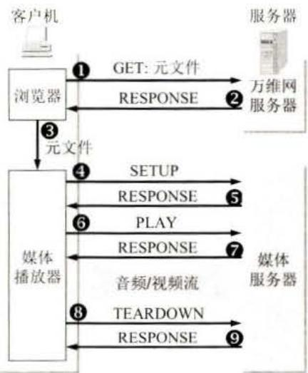

# 8.2.3 实时流式协议RTSP

实时流式协议 RTSP (Real-Time Streaming Protocol) 是 IETF 的 MMUSIC 工作组 (Multiparty Multimedia SessIon Control WG，多方多媒体会话控制工作组) 开发的协议，现在是 RTSP 2.0 [RFC 7826，建议标准]。RTSP 是为了给流式过程增加更多的功能而设计的协议。RTSP 本身并不传送数据，而仅仅是使媒体播放器能够控制多媒体流的传送（有点像文件传送协议 FTP 有一个控制信道），因此 RTSP 又称为带外协议 (out-of-band protocol)。

RTSP 协议以客户-服务器方式工作，它是一个应用层的多媒体播放控制协议，用来使用户在播放从互联网下载的实时数据时能够进行控制（像在影碟机上那样的控制），如：暂停/继续、快退、快进等。因此，RTSP 又称为“互联网录像机遥控协议”。

RTSP 的语法和操作与 HTTP 协议的相似（所有的请求和响应报文都是 ASCII 文本）。但与 HTTP 不同的地方是 RTSP 是有状态的协议（HTTP 是无状态的）。RTSP 记录客户机所处于的状态（初始化状态、播放状态或暂停状态）。RFC 7826 还规定，RTSP 控制分组既可在 TCP 上传送，也可在 UDP 上传送。RTSP 没有定义音频/视频的压缩方案，也没有规定音频/视频在网络中传送时应如何封装在分组中。RTSP 不规定音频/视频流在媒体播放器中应如何缓存。

在使用 RTSP 的播放器中比较著名的是苹果公司的 QuickTime 和 Real Networks 公司的 RealPlayer。

图 8-8 表示使用 RTSP 的媒体服务器的工作过程。

> 图 8-8 使用 RTSP 的媒体服务器的工作过程（教材第 378 页）

① 浏览器使用 HTTP 的 GET 报文向万维网服务器请求音频/视频文件。

② 万维网服务器从浏览器发送携带有元文件的响应。

③ 浏览器把收到的元文件传送给媒体播放器。

④ 媒体播放器的 RTSP 客户发送 SETUP 报文与媒体服务器的 RTSP 服务器建立连接。

⑤ 媒体服务器的 RTSP 服务器发送响应 RESPONSE 报文。

⑥ 媒体播放器的 RTSP 客户发送 PLAY 报文开始下载音频/视频文件（即开始播放）。

⑦ 媒体服务器的 RTSP 服务器发送响应 RESPONSE 报文。

此后，音频/视频文件被下载，所用的协议是运行在 UDP 上的。可以是后面要介绍的 RTP，也可以是其他专用的协议。在音频/视频流播放的过程中，媒体播放器可以随时暂停（利用 PAUSE 报文）和继续播放（利用 PLAY 报文），也可以快进或快退。

⑧ 用户在不想继续观看时，可以由 RTSP 客户发送 TEARDOWN 报文断开连接。

⑨ 媒体服务器的 RTSP 服务器发送响应 RESPONSE 报文。

请注意，以上编号的步骤④至⑨都使用实时流协议RTSP。在图8-8中步骤⑦后面没有编号的“音频/视频流”则使用另外的传送音频/视频数据的协议，如RTP。
