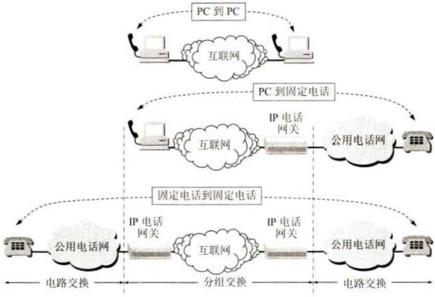

# 8.3.1 IP电话概述

## 8.3 交互式音频/视频

限于篇幅，在本节中我们只介绍交互式音频，即 IP 电话。IP 电话是在互联网上传送多媒体信息的一个例子。通过 IP 电话的讨论，可以有助于了解在互联网上传送多媒体信息应当解决好哪些问题。

## 1. 狭义的和广义的 IP 电话

IP 电话有多个英文同义词。常见的有 VoIP (Voice over IP), Internet Telephony 和 VON (Voice On the Net)。但 IP 电话的含义却有不同的解释。

狭义的 IP 电话就是指在 IP 网络上打电话。所谓 “IP 网络” 就是 “使用 IP 协议的分组交换网” 的简称。这里的网络可以是互联网，也可以是包含有传统的电路交换网的互联网，不过在互联网中至少要有一个 IP 网络。

广义的 IP 电话则不仅仅是电话通信，而且还可以是在 IP 网络上进行交互式多媒体实时通信（包括话音、视像等），甚至还包括即时传信 IM (Instant Messaging)。即时传信是在上网时就能从屏幕上得知有哪些朋友也正在上网。若有，则彼此可在网上即时交换信息（文字的或声音的），也包括使用一点对多点的多播技术。目前流行的即时传信应用程序有微信、Skype、QQ 和 MSN Messenger [CHEN07]，很受网民的欢迎。IP 电话可看成是一个正在演进的多媒体服务平台，是话音、视像、数据综合的基础结构。在某些条件下（例如使用宽带的局域网），IP 电话的话音质量甚至还优于普通电话。

下面讨论狭义的 IP 电话[COLL01]，而广义的 IP 电话在原理上是一样的。

其实 IP 电话并非新概念。早在 20 世纪 70 年代初期 ARPANET 刚开始运行不久，美国即着手研究如何在计算机网络上传送电话信息，即所谓的分组话音通信。但在很长一段时间里，分组话音通信发展得并不快。主要的原因是：

(1) 缺少廉价的高质量、低速率的话音信号编解码软件和相应的芯片。

(2) 计算机网络的传输速率和路由器处理速率均不够快，因而导致传输时延过大。

(3) 没有保证实时通信服务质量 QoS (Quality of Service) 的网络协议。

(4) 计算机网络的规模较小，而通信网只有在具有一定规模后才能产生经济效益。

## 2. IP 电话网关

然而到了20世纪90年代中期，上述的几个问题才相继得到了较好的解决。于是美国的

VocalTec 公司在 1995 年初率先推出了实用化的 IP 电话。但是这种 IP 电话必须使用 PC。1996 年 3 月，IP 电话进入了一个转折点：VocalTec 公司成功地推出了 IP 电话网关（IP Telephony Gateway），它是公用电话网 $^{①}$ 与 IP 网络的接口设备。IP 电话网关的作用就是：

(1) 在电话呼叫阶段和呼叫释放阶段进行电话信令的转换。

(2) 在通话期间进行话音编码的转换。

有了这种 IP 电话网关，就可实现 PC 用户到固定电话用户打 IP 电话（仅需经过 IP 电话网关一次），以及固定电话用户之间打 IP 电话（需要经过 IP 电话网关两次）。

图 8-9 画出了 IP 电话几种不同的连接方式。图中最上面的情况最简单，是两个 PC 用户之间的通话。这当然不需要经过 IP 电话网关，但必须是双方都同时上网才能进行通话。图 8-9 中间的一种情况是 PC 到固定电话之间的通话。最后一种情况是两个固定电话之间打 IP 电话，这当然是最方便的。读者应当特别注意在哪一部分是使用电路交换还是分组交换。

> 图 8-9 IP 电话的几种连接方法（教材第 380 页）

## 3. IP 电话的通话质量

IP 电话的通话质量与电路交换电话网的通话质量有很大差别。在电路交换电话网中，任何两端之间的通话质量都是有保证的。但 IP 电话则不然。IP 电话的通话质量主要由两个因素决定，一个是通话双方端到端的时延和时延抖动，另一个是话音分组的丢失率。但这两个因素都是不确定的，而是取决于当时网络上的通信量。若网络上的通信量非常大以致发生了网络拥塞，那么端到端时延和时延抖动以及分组丢失率都会很高，这就导致 IP 电话的通话质量下降。因此，一个用户使用 IP 电话的通话质量取决于当时其他许多用户的行为。请注意，电路交换电话网的情况则完全不是这样。当电路交换电话网的通信量太大时，往往使我们无法拨通电话（听到的是忙音），即电话网拒绝对正在拨号的用户提供接通服务。但是只要我们拨通了电话，那么电信公司就能保证让用户享受满意的通话质量。

> ① 注：公用电话网即公用电路交换电话网，又称为传统电话网或电信网。

经验证明，在电话交谈中，端到端的时延不应超过 250 ms，否则交谈者就会感到不自然。陆地公用电话网的时延一般只有 50\~70 ms。但经过同步卫星的电话端到端时延就超过 250 ms，一般人都不太适应经过卫星传送的过长的时延。IP 电话的时延有时会超过 250 ms，因此 IP 电话必须努力减小端到端的时延。当通信线路产生回声时，则容许的端到端时延就更小些（有时甚至只容许几十毫秒的时延）。

IP 电话端到端时延是由以下几个因素造成的：

(1) 话音信号进行模数转换要产生时延。

(2) 已经数字化的话音比特流要积累到一定的数量才能够装配成一个话音分组，这也会产生时延。

(3) 话音分组的发送需要时间，此时间等于话音分组长度与通信线路的数据率之比。

(4) 话音分组在互联网中经过许多路由器的存储转发时延。

(5) 话音分组到达接收端在缓存中暂存所引起的时延。

(6) 将话音分组还原成模拟话音信号的数模转换也要产生一定的时延。

(7) 话音信号在通信线路上的传播时延。

(8) 由终端设备的硬件和操作系统产生的接入时延。由 IP 电话网关引起的接入时延约为 20\~40 ms，而用户 PC 声卡引起的接入时延为 20\~180 ms。有的调制解调器（如 V.34）还会再增加 20\~40 ms 的时延（由于进行数字信号处理、均衡等）。

话音信号在通信线路上的传播时延一般都很小（卫星通信除外），通常可不予考虑。当采用高速光纤主干网时，上述的第三项时延也不大。

第一、第二和第六项时延取决于话音编码的方法。很明显，在保证话音质量的前提下，话音信号的数码率应尽可能低些。为了能够在世界范围提供 IP 电话服务，话音编码就必须采用统一的国际标准。ITU-T 已制定出不少话音质量不错的低速率话音编码的标准。目前适合 IP 电话使用的 ITU-T 标准主要有以下两种：

(1) G.729 话音速率为 8 kbit/s 的共轭结构代数码激励线性预测 CS-ACELP (Conjugate-Structure Algebraic-Code-Excited Linear Prediction) 声码器。

(2) G.723.1 话音速率为 5.3/6.3 kbit/s 的线性预测编码 LPC (Linear Prediction Coding) 声码器。

这两种标准的比较见表8-1。

> 表 8-1 G.729 和 G.723.1 的主要性能比较（教材第 381 页）

| 标准 | 比特率(kbit/s) | 帧大小(ms) | 处理时延(ms) | 帧长(字节) | 数字信号处理MIPS |
| --- | --- | --- | --- | --- | --- |
| G.729 | 8 | 10 | 10 | 10 | 20 |
| G.723.1 | 5.3/6.3 | 30 | 30 | 20/24 | 16 |

表中的比特率是输入为 64 kbit/s 标准 PCM 信号时在编码器输出的数据率。帧大小是压缩到每一个分组中的话音信号时间长度。处理时间是对一个帧运行编码算法所需的时间。帧长是一个已编码的帧的字节数（不包括首部）。数字信号处理 MIPS（每秒百万指令）是用数字信号处理芯片实现编码所需的最小处理机速率（以每秒百万指令为单位）。如使用 PC 的通用处理机，则所需的处理机 MIPS 还要高些。不难看出，G.723.1 标准虽然可得到更低的数据率，但其时延也更大些。

要减少上述第四和第五项时延较为困难。当网络发生拥塞而产生话音分组丢失时，还必须采用一定的策略（称为“丢失掩蔽算法”）对丢失的话音分组进行处理。例如，可使用前一个话音分组来填补丢失的话音分组的间隙。

接收端缓存空间和播放时延的大小对话音分组丢失率和端到端时延也有很大的影响。图 8-10 说明了这一问题。话音质量可分为四个级别，即“长途电话质量”（这是最好的质量）、“良好”“基本可用”和“不好”，各对应于图 8-10 中的一个区域。越接近坐标原点，话音质量就越好。我们假定某 IP 电话的通话质量处在图中 B 点的位置。若增大接收端缓存空间并增大播放时延，则话音分组丢失率将减小，但端到端的时延将增大（如图中的 C 点）。继续增大播放时延，则话音分组丢失率将继续减小，趋向于网络所引起的丢失率（如图中的 D 点），但 D 点的端到端时延很大，话音质量很不好。反之，若将接收端缓存做得很小并减小播放时延，则端到端时延将减小，趋向于网络所引起的端到端时延（如图中的 A 点），但话音分组丢失率将会大大增加，话音质量也不好。

可见接收端的播放时延有一个最佳值。图中有一个点 N，相当于端到端时延和话音分组丢失率都是最小的，但实际上并不可能工作在这个点上。

据统计，当通话双方相距 3200 km 时，互联网上的时延约为 30\~100 ms（传播和排队），而所有各环节的时延总和约为 100\~262 ms（在两个 IP 电话网关之间）或 170\~562 ms（在两个 PC 之间）[KAST98]。可见为了减小时延，应尽可能不要直接用 PC 打 IP 电话。

提高路由器的转发分组的速率对提高 IP 电话的质量也是很重要的。据统计，一个跨大西洋的 IP 电话一般要经过 20\~30 个路由器。现在一个普通路由器每秒可转发 50\~100 万个分组。若能改用吉比特路由器（又称为线速路由器），则每秒可转发 500 万至 6000 万个分组（即交换速率达 60 Gbit/s 左右）。这样还可进一步减少由网络造成的时延。

近几年来，IP 电话的质量得到了很大的提高。现在许多 IP 电话的话音质量已经优于固定电话的话音质量。一些电信运营商还建造了自己专用的 IP 电话线路，以便保证更好的通话质量。在 IP 电话领域里，最值得一提的就是 Skype IP 电话，它给全世界的广大用户带来了高品质并且廉价的通话服务。Skype 使用了 Global IP Sound 公司开发的互联网低比特率编解码器 iLBC (internet Low Bit rate Codec)[RFC 3951, 3952]，进行话音的编解码和压缩，使其话音质量优于传统的公用电话网（采用电路交换）的话音质量。Skype 支持两种帧长：20 ms（速率为 15.2 kbit/s，一个话音分组块为 304 bit）和 30 ms（速率为 13.33 kbit/s，一个话音分组块为 400 bit）。Skype 的另一个特点是对话音分组的丢失进行了特殊的处理，因而能够容忍高达 30% 的话音分组丢失率，通话的用户一般感觉不到话音的断续或迟延，杂音也很小。

Skype 采用了 P2P（见第 6 章 6.9 节的介绍）和全球索引（Global Index）技术提供快速路由选择机制（而不是单纯依靠服务器来完成这些工作），因而其管理成本大大降低，在用户呼叫时，由于用户路由信息分布式存储于互联网的节点中，因此呼叫连接完成得很快。Skype 还采用了端对端的加密方式，保证信息的安全性。Skype 在信息发送之前进行加密，在接收时进行解密，在数据传输过程中完全没有可能在中途被窃听。

由于 Skype 使用的是 P2P 的技术，用户数据主要存储在 P2P 网络中，因此必须保证存储在公共网络中的数据是可靠的和没有被篡改的。Skype 对公共目录中存储的和用户相关的数据都采用了数字签名，保证了数据无法被篡改。

自 2003 年 8 月 Skype 推出以来，在短短 15 个月内，Skype 已拥有超过 5000 万次的下载量，注册量超过 2000 万用户，并且还在以每天超过 15 万用户的速度增长。在 2011 年，在同一时间使用 Skype 的用户数已经突破了 3000 万大关。据统计，在 2014 年的国际长途电话的市场份额中，Skype 已经占据了 40%。Skype 的问世给全球信息技术和通信产业带来深远的影响，也给每一位网络使用者带来生活方式的改变。
