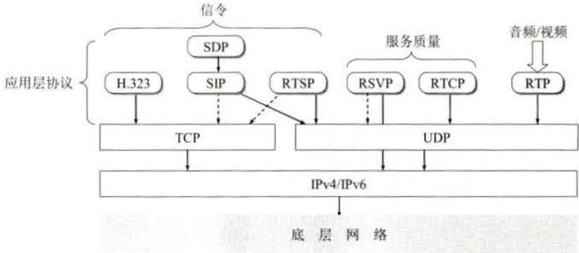

# 8.3.2 IP电话所需要的几种应用协议

在 IP 电话的通信中，我们至少需要两种应用协议。一种是信令协议，它使我们能够在互联网上找到被叫用户 $^{①}$ 。另一种是话音分组的传送协议，它使我们用来进行电话通信的话音数据能够以时延敏感属性在互联网中传送。这样，为了在互联网中提供实时交互式的音频/视频服务，我们需要新的多媒体体系结构。

图 8-11 给出了在这样的体系结构中的三种应用层协议。第一种协议是与信令有关的，如 H.323 和 SIP（画在最左边）；第二种协议是直接传送音频/视频数据的，如 RTP（画在最右边）；第三种协议是为了提高服务质量，如 RSVP 和 RTCP（画在中间）。

> 图 8-11 提供实时交互式音频/视频服务所需的应用层协议（教材第 383 页）

下面先介绍实时运输协议 RTP 及其配套的协议——实时运输控制协议 RTCP，然后再介

> ① 注：在公用电话网中，电话交换机根据用户所拨打的号码就能够通过合适的路由找到被叫用户，并在主叫和被叫之间建立起一条电路连接。这些都依靠电话信令(signaling)完成。我们听到的振铃声、忙音或一些录音提示，以及打完电话挂机释放连接，也都是由电话信令来处理的。现在电话网使用的信令就是7号信令SS7。利用IP网络打电话同样也需要IP网络能够识别的某种信令，但由于IP电话往往要经过已有的公用电话网，因此IP电话的信令必须在所有的功能上与原有的7号信令相兼容，这样才能使IP网络和公用电话网上的两种信令能够互相转换，因而能够做到互操作。

绍 IP 电话的信令协议 H.323 和会话发起协议 SIP。
