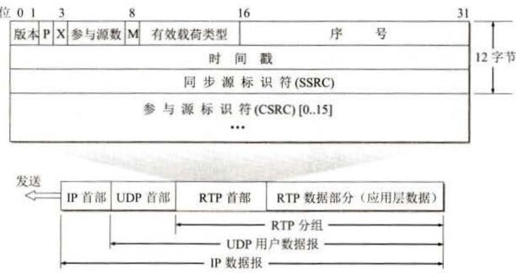

# 8.3.3 实时运输协议RTP

实时运输协议 RTP (Real-time Transport Protocol) 是 IETF 的 AVT 工作组(Audio/Video Transport WG) 开发的协议，现已成为互联网标准[RFC 3550, STD64] [RFC 3551, STD65]。

RTP 为实时应用提供端到端的运输，但不提供任何服务质量的保证。需要发送的多媒体数据块（音频/视频）经过压缩编码处理后，先送给 RTP 封装成为 RTP 分组（也可称为 RTP 报文 $^{①}$ ）。RTP 分组装入运输层的 UDP 用户数据报后，再向下递交给 IP 层。RTP 现已成为互联网正式标准，并且已被广泛使用。RTP 同时也是 ITU-T 的标准（H.225.0）。实际上，RTP 是一个协议框架，因为它只包含了实时应用的一些共同功能。RTP 自己并不对多媒体数据块做任何处理，而只是向应用层提供一些附加的信息，让应用层知道应当如何进行处理。

图 8-11 把 RTP 协议画在应用层。这是因为从应用开发者的角度看，RTP 应当是应用层的一部分。在应用程序的发送端，开发者必须编写用 RTP 封装分组的程序代码，然后把 RTP 分组交给 UDP 套接字接口。在接收端，RTP 分组通过 UDP 套接字接口进入应用层后，还要利用开发者编写的程序代码从 RTP 分组中把应用数据块提取出来。

然而 RTP 的名称又隐含地表示它是一个运输层协议。这样划分也是可以的，因为 RTP 封装了多媒体应用的数据块，并且由于 RTP 向多媒体应用程序提供了服务（如时间戳和序号），因此也可以把 RTP 看成是在 UDP 之上的一个运输层子层的协议。

RTP 还有两点值得注意。首先，RTP 分组只包含 RTP 数据，而控制是由另一个配套使用的 RTCP 协议提供的（这在下一节介绍）。其次，RTP 在端口号 1025 到 65535 之间选择一个未使用的偶数 UDP 端口号，而在同一次会话中的 RTCP 则使用下一个奇数 UDP 端口号。但端口号 5004 和 5005 则分别用作 RTP 和 RTCP 的默认端口号。

图 8-12 给出了 RTP 分组的首部格式，下面进行简单的介绍。

> 图 8-12 RTP 分组的首部格式（教材第 384 页）

> ① 注：按惯例，在运输层或应用层的协议数据单元应当叫作报文。但相关 RFC 文档中都是使用 RTP packet 这一名词的。为了和 RFC 文档一致，这里也使用 “RTP 分组”。下一节的 RTCP 也按同样方法处理。

在 RTP 分组的首部中，前 12 个字节是必需的，而 12 字节以后的部分则是可选的。下面按照各字段重要性的顺序来进行介绍。

(1) 有效载荷类型(payload type) 占 7 位。这个字段指出后面的 RTP 数据属于何种格式的应用。收到 RTP 分组的应用层就根据此字段指出的类型进行处理。例如，对于音频有效载荷（每一种格式后面括弧中的数字就表示其有效载荷类型的编码）： $\mu$ 律 PCM (0), GSM (3), LPC (7), A 律 PCM (8), G.722 (9), G.728 (15) 等。对于视频有效载荷：活动 JPEG (26), H.261 (31), MPEG1 (32), MPEG2 (33) 等。

(2) 序号 占 16 位。对每一个发送出的 RTP 分组，其序号加 1。在一次 RTP 会话开始时的初始序号是随机选择的。序号使接收端能够发现丢失的分组，同时也能将失序的 RTP 分组重新按序排列好。例如，在收到序号为 60 的 RTP 分组后又收到了序号为 65 的 RTP 分组。那么就可推断出，中间还缺少序号为 61 至 64 的 4 个 RTP 分组。

(3) 时间戳 占 32 位。时间戳反映了 RTP 分组中数据的第一个字节的采样时刻。在一次会话开始时时间戳的初始值也是随机选择的。即使在没有信号发送时，时间戳的数值也要随时间而不断地增加。接收端使用时间戳可准确知道应当在什么时间还原哪一个数据块，从而消除时延的抖动。时间戳还可以用来使视频应用中声音和图像同步。在 RTP 协议中并没有规定时间戳的粒度，这取决于有效载荷的类型。因此 RTP 的时间戳又称为媒体时间戳，以强调这种时间戳的粒度取决于信号的类型。例如，对于 8 kHz 采样的话音信号，若每隔 20 ms 构成一个数据块，则一个数据块中包含有 160 个样本（0.02 × 8000 = 160）。因此发送端每发送一个 RTP 分组，其时间戳的值就增加 160。

(4) 同步源标识符 占 32 位。同步源标识符 SSRC (Synchronous SouRCe identifier) 是一个数，用来标志 RTP 流(stream)的来源。SSRC 与 IP 地址无关，在新的 RTP 流开始时随机地产生。由于 RTP 使用 UDP 传送，因此可以有多个 RTP 流（例如，使用几个摄像机从不同角度拍摄同一个节目所产生的多个 RTP 流）复用到一个 UDP 用户数据报中。SSRC 可使接收端的 UDP 能够将收到的 RTP 流送到各自的终点。两个 RTP 流恰好都选择同一个 SSRC 的概率是极小的。若发生这种情况，这两个源就都重新选择另一个 SSRC。

(5) 参与源标识符 这是选项，最多可有 15 个。参与源标识符 CSRC (Contributing SouRCe identifier) 也是一个 32 位数，用来标志来源于不同地点的 RTP 流。在多播环境中，可以用中间的一个站（叫作混合站 mixer）把发往同一个地点的多个 RTP 流混合成一个流（可节省通信资源），在目的站再根据 CSRC 的数值把不同的 RTP 流分开。

(6) 参与源数 占 4 位。这个字段给出后面的参与源标识符的数目。

(7) 版本 占 2 位。当前使用的是版本 2。

(8) 填充 P 占 1 位。在某些特殊情况下需要对应用数据块加密，这往往要求每一个数据块有确定的长度。如不满足这种长度要求，就需要进行填充。这时就把 P 位置 1，表示这个 RTP 分组的数据有若干填充字节。在数据部分的最后一个字节用来表示所填充的字节数。

(9) 扩展 X 占 1 位。X 置 1 表示在此 RTP 首部后面还有扩展首部。扩展首部很少使用，这里不再讨论。

(10) 标记 M 占 1 位。M 置 1 表示这个 RTP 分组具有特殊意义。例如，在传送视频流时用来表示每一帧的开始。
