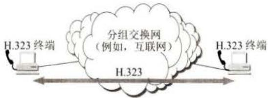
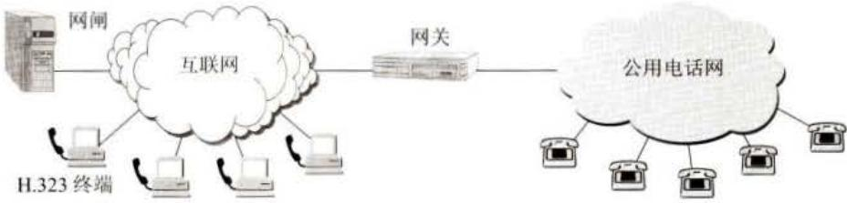

# 8.3.5 H.323

现在 IP 电话有两套信令标准：一套是 ITU-T 定义的 H.323 协议，另一套是 IETF 提出的会话发起协议 SIP (Session Initiation Protocol)。我们先介绍 H.323 协议。

H.323 是 ITU-T 于 1996 年制定的为在局域网上传送话音信息的建议书。1998 年 H.323 的第二个版本改用的名称是 “基于分组的多媒体通信系统”。在 2009 年已更新到 H.323v7。基于分组的网络包括互联网、局域网、企业网、城域网和广域网。H.323 是互联网的端系统之间进行实时声音和视频会议的标准。请注意，H.323 不是一个单独的协议而是一组协议。H.323 包括系统和构件的描述、呼叫模型的描述、呼叫信令过程、控制报文、复用、话音编解码器、视像编解码器，以及数据协议等。图 8-13 示意了连接在分组交换网上的 H.323 终端使用 H.323 协议进行多媒体通信。

> 图 8-13 H.323 终端使用 H.323 协议进行多媒体通信（教材第 387 页）

H.323 标准指明了四种构件，使用这些构件连网就可以进行点对点或一点对多点的多媒体通信。

(1) H.323 终端 这可以是一个 PC，也可以是运行 H.323 程序的单个设备。

(2) 网关 网关连接到两种不同的网络，使得 H.323 网络可以和非 H.323 网络（如公用电话网）进行通信。仅在一个 H.323 网络上通信的两个终端当然就不需要使用网关。

(3) 网闸(gatekeeper) 网闸相当于整个 H.323 网络的大脑。所有的呼叫都要通过网闸，因为网闸提供地址转换、授权、带宽管理和计费功能。网闸还可以帮助 H.323 终端找到距离公用电话网上的被叫用户最近的一个网关。

(4) 多点控制单元 MCU (Multipoint Control Unit) MCU 支持三个或更多的 H.323 终端的音频或视频会议。MCU 管理会议资源、确定使用的音频或视频编解码器。

网关、网闸和 MCU 在逻辑上是分开的构件，但它们可实现在一个物理设备中。在 H.323 标准中，将 H.323 终端、网关和 MCU 都称为 H.323 端点(end point)。

图 8-14 表示了利用 H.323 网关使互联网能够和公用电话网进行连接。

> 图 8-14 H.323 网关用来和非 H.323 网络进行连接（教材第 387 页）

图 8-15 给出了 H.323 的体系结构。可以看出，H.323 是一个协议族，它可以使用不同的运输协议。H.323 包括以下一些组成部分：

> 图 8-15 H.323 的协议体系结构（教材第 388 页）

| 音频/视频应用 | 信令和控制 | 数据应用 |  |  |  |  |
| --- | --- | --- | --- | --- | --- | --- |
| 音频编解码 | 视频编解码 | RTCP | H.225.0登记信令 | H.225.0呼叫信令 | H.245控制信令 | T.120数据 |
| RTP |  |  |  |  |  |  |
| UDP | TCP |  |  |  |  |  |
| IP |  |  |  |  |  |  |

(1) 音频编解码器 H.323 要求至少要支持 G.711（64 kbit/s 的 PCM）。建议支持如 G.722（16 kbit/s 的 ADPCM），G.723.1（5.3/6.3 的 LPC），G.728（16 kbit/s 的低时延 CELP）和 G.729（8 kbit/s 的 CS-ACELP）等。

(2) 视频编解码器 H.323 要求必须支持 H.261 标准（176×144 像素）。

(3) H.255.0 登记信令，即登记/接纳/状态 RAS (Registration/Admission/Status)。H.323 终端和网闸使用 RAS 来完成登记、接纳控制和带宽转换等功能。

(4) H.225.0 呼叫信令用来在两个 H.323 端点之间建立连接。

(5) H.245 控制信令 用来交换端到端的控制报文，以便管理 H.323 端点的运行。

(6) T.120 数据传送协议 这是与呼叫相关联的数据交换协议。用户在参加音频/视频会议时，可以和其他与会用户共享屏幕上的白板。由于使用 TCP 协议，因此能够保证数据传送的正确（在传送音频/视频文件时使用的是 UDP，因此不能保证服务质量）。

(7) 实时运输协议 RTP 和实时运输控制协议 RTCP 这两个协议前面已讨论。

H.323 的出发点是以已有的电路交换电话网为基础，增加了 IP 电话的功能（即远距离传输采用 IP 网络）。H.323 的信令也沿用原有电话网的信令模式，因此与原有电话网的连接比较容易。
