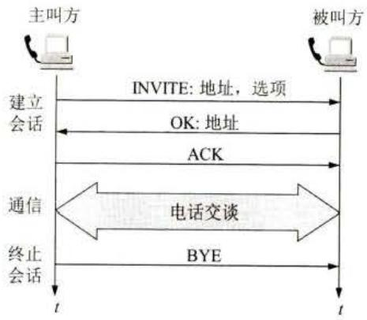
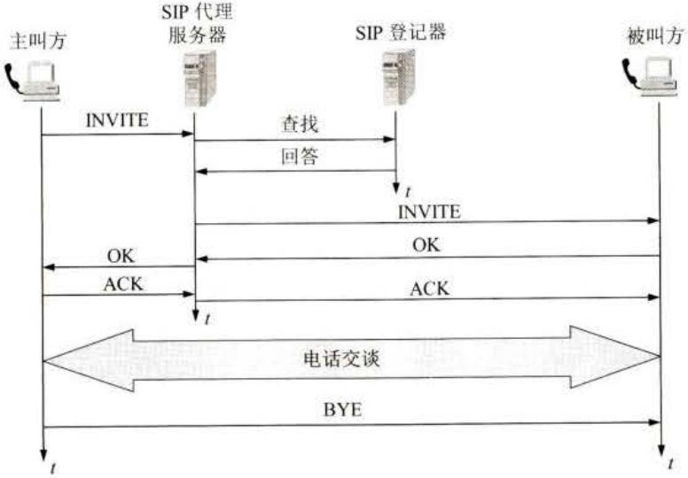

# 8.3.6 会话发起协议SIP

虽然 H.323 系列现在已被大部分生产 IP 电话的厂商采用，但由于 H.323 过于复杂（整个文档多达 736 页），不便于发展基于 IP 的新业务，因此 IETF 的 MMUSIC 工作组制定了另一套较为简单且实用的标准，即会话发起协议 SIP (Session Initiation Protocol) [RFC 3261—3264]，目前已成为互联网的建议标准。SIP 使用了 KISS 原则：即“保持简单、傻瓜”(Keep It Simple and Stupid)。

SIP 协议的出发点是以互联网为基础，而把 IP 电话视为互联网上的新应用。因此 SIP 协议只涉及 IP 电话所需的信令和有关服务质量的问题，而没有提供像 H.323 那样多的功能。SIP 没有强制使用特定的编解码器，也不强制使用 RTP 协议。然而，实际上大家还是选用 RTP 和 RTCP 作为配合使用的协议。

SIP 使用文本方式的客户-服务器协议。SIP 系统只有两种构件，即用户代理(user agent)和网络服务器(network server)。用户代理包括两个程序，即用户代理客户 UAC (User Agent Client)和用户代理服务器 UAS (User Agent Server)，前者用来发起呼叫，后者用来接受呼叫。网络服务器分为代理服务器(proxy server)和重定向服务器(redirect server)。代理服务器接受来自主叫用户的呼叫请求（实际上是来自用户代理客户的呼叫请求），并将其转发给被叫用户或下一跳代理服务器，然后下一跳代理服务器再把呼叫请求转发给被叫用户（实际上是转发给用户代理服务器）。重定向服务器不接受呼叫，它通过响应告诉客户下一跳代理服务器的地址，由客户按此地址向下一跳代理服务器重新发送呼叫请求。

SIP 的地址十分灵活。它可以是电话号码，也可以是电子邮件地址、IP 地址或其他类型的地址。但一定要使用 SIP 的地址格式，例如：

电话号码 sip:zhangsan@8625-87654321

IPv4 地址 sip:zhangsan@201.12.34.56

\- 电子邮件地址 sip:zhangsan@163.com

和 HTTP 相似，SIP 是基于报文的协议。SIP 使用了 HTTP 的许多首部、编码规则、差错码以及一些鉴别机制。它比 H.323 具有更好的可扩缩性。

SIP 的会话共有三个阶段：建立会话、通信和终止会话。图 8-16 给出了一个简单的 SIP 会话的例子。图中的建立会话阶段和终止会话阶段，都是使用 SIP 协议，而中间的通信阶段，则使用如 RTP 这样的传送实时话音分组的协议。

> 图8-16 一个简单的SIP会话的例子（教材第 389 页）

在图 8-16 中，主叫方先向被叫方发出 INVITE 报文，这个报文中含有双方的地址信息以及其他一些信息（如通话时话音编码方式等）。被叫方如接受呼叫，则发回 OK 响应，而主叫方再发送 ACK 报文作为确认（这和建立 TCP 连接的三报文握手相似）。然后双方就可以通话了。当通话完毕时，双方中的任何一方都可以发送 BYE 报文以终止这次的会话。

SIP 有一种跟踪用户的机制，可以找出被叫方使用的 PC 的 IP 地址（例如，被叫方使用 DHCP，因而没有固定的 IP 地址）。为了实现跟踪，SIP 使用登记的概念。SIP 定义一些服务器作为 SIP 登记器(registrar)。每一个 SIP 用户都有一个相关联的 SIP 登记器。用户在任何时候发起 SIP 应用时，都应当给 SIP 登记器发送一个 SIP REGISTER 报文，向登记器报告现在使用的 IP 地址。SIP 登记器和 SIP 代理服务器通常运行在同一台主机上。

图 8-17 说明了 SIP 登记器的用途。主叫方把 INVITE 报文发送给 SIP 代理服务器。这个 INVITE 报文中只有被叫方的电子邮件地址而没有其 IP 地址。SIP 代理服务器就向 SIP 登记器发送域名系统 DNS 查询（这个查找报文不是 SIP 的报文），然后从回答报文得到了被叫方的 IP 地址。代理服务器把得到的被叫方的 IP 地址插入到主叫方发送的 INVITE 报文中，转发给被叫方。被叫方发送 OK 响应，然后主叫方发送 ACK 报文，完成了会话的建立。

> 图 8-17 跟踪被叫方的机制（教材第 390 页）

如果被叫没有在这个 SIP 登记器进行过登记，那么这个 SIP 登记器就发回重定向报文，指示 SIP 代理服务器向另一个 SIP 登记器重新进行 DNS 查询，直到找到被叫为止。图 8-17 给出了这种情况下主叫方发出确认之前的呼叫过程。

SIP 还有一个配套协议是会话描述协议 SDP (Session Description Protocol)。SDP 在电话会议的情况下特别重要，因为电话会议的参加者应当能够动态地加入和退出。SDP 详细地指明了媒体编码、协议的端口号以及多播地址。SDP 现在也是互联网建议标准[RFC 8866]。

由于 SIP 问世较晚，因此它现在比 H.323 占有的市场份额要小。对今后作为 IETF 标准的 SIP 协议的进展情况应当引起我们的注意。
