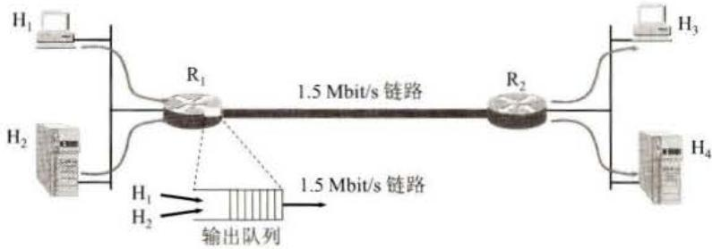

# 8.4.1 使互联网提供服务质量

## 8.4 改进“尽最大努力交付”的服务

使互联网更好地传送多媒体信息的另一种方法，是改变互联网平等对待所有分组的思想，使得对时延有较严格要求的实时音频/视频分组，能够从网络得到更好的服务质量 QoS。

下面我们先介绍提供服务质量的一般方法。

根据 ITU-T 在建议书 E.800 中给出的定义，服务质量 QoS 是服务性能的总效果，此效果决定了一个用户对服务的满意程度。因此在最简单的意义上，有服务质量的服务就是能够满足用户的应用需求的服务，或者说，可提供一致的、可预计的数据交付服务。

在涉及一些具体问题时，服务质量可用若干基本的性能指标来描述，包括可用性、差错率、响应时间、吞吐量、分组丢失率、连接建立时间、故障检测和改正时间等。服务提供者可向其用户保证某一种等级的服务质量。

我们已多次强调过，互联网的网络本身只能提供“尽最大努力交付”的服务。而要传送多媒体信息，网络又必须具有一定的服务质量。下面通过图8-18的例子说明应从哪些方面入手使互联网具有一定的服务质量[KURO17]。图中表示局域网上的两台主机 $\mathrm{H}_{1}$ 和 $\mathrm{H}_{2}$ 通过非常简单的网络（路由器 $R_{1}$ 和 $R_{2}$ 以及连接它们的链路）分别向远地另外两台主机 $H_{3}$ 和 $H_{4}$ 发送数据。连接 $R_{1}$ 和 $R_{2}$ 的链路带宽是 1.5 Mbit/s。现在考虑以下四种情况。

> 图 8-18 主机 $H_{1}$ 和 $H_{2}$ 分别向主机 $H_{3}$ 和 $H_{4}$ 发送数据（教材第 391 页）

## (1) 一个 1 Mbit/s 的实时音频数据和一个 FTP 文件数据

假定 $H_{1}$ 向 $H_{3}$ 传送 1 Mbit/s 的实时音频数据，而 $H_{2}$ 向 $H_{4}$ 传送低优先级的 FTP 文件数据。两台主机发送的数据都在路由器 $R_{1}$ 的输出队列中排队。若突然有一个很大的 FTP 数据块来到 $R_{1}$ ，就会把输出队列全部占满。后面到达路由器 $R_{1}$ 的实时音频分组就会被丢弃。显然这是不合理的。因此需要增加一个机制，就是给不同性质的分组打上不同的标记。这样当 $H_{1}$ 和 $H_{2}$ 的分组进入路由器 $R_{1}$ 时， $R_{1}$ 就能够识别 $H_{1}$ 的实时数据分组，并使这些分组以高优先级进入输出队列，而仅在队列有多余空间时才准许低优先级的 FTP 的数据分组进入。

## (2) 一个 1 Mbit/s 的实时音频数据和一个高优先级的 FTP 文件数据

假定 FTP 的用户用高价从 ISP 处购买了高优先级服务，而实时音频的用户只购买了低优先级服务。因此，仅根据分组自己的标记来确定其服务等级还不够合理。可见应当使路由器增加一种机制——分类(classification)，即路由器根据某些准则（例如，根据发送数据的地址）对输入分组进行分类，然后对不同类别的通信量给予不同的优先级。

## (3) 一个数据率异常的实时音频数据和一个 FTP 文件数据

假定上述的主机 $H_{1}$ 的数据率突然不正常地增大到 1.5 Mbit/s 或更高（这可能是出了故障或恶意破坏网络的正常运行），那么就会使主机 $H_{2}$ 的 FTP 的低优先级数据无法通过路由器 $R_{1}$ 。因此，应当使路由器能够对某个数据流进行通信量的管制(policing)，使得这个数据流不要影响其他正常的数据流在网络中通过。例如，可以将 $H_{1}$ 的数据率限定为 1 Mbit/s。路由器 $R_{1}$ 不停地监视 $H_{1}$ 的数据率。只要 $H_{1}$ 的数据率超过规定的 1 Mbit/s，路由器 $R_{1}$ 就把其中的某些分组丢弃，使其数据率不超过原来设定的门限。

为了更加合理地利用网络资源，应在路由器中再增加一种机制——调度(scheduling)。我们可以利用调度功能给实时音频和文件传送这两个应用分别分配 1 Mbit/s 和 0.5 Mbit/s 的带宽。这就好像在带宽为 1.5 Mbit/s 的链路中划分出两个逻辑链路，其带宽分别为 1 Mbit/s 和 0.5 Mbit/s，因而对这两种应用都有相应的服务质量保证。

## (4) $\mathrm{H}_{1}$ 和 $\mathrm{H}_{2}$ 都发送数据率为 $1\mathrm{Mbit / s}$ 的实时数据

在这种情况下，到达路由器 $R_{1}$ 的总数据率是 2 Mbit/s，已超过了 1.5 Mbit/s 链路的带宽。若使这两台主机发出的数据流平等地共享 1.5 Mbit/s 链路的带宽，则每个数据流平均将丢失 25% 的分组，因而都变得没有用了。比较合理的做法是让一个数据流通过 1.5 Mbit/s 的链路，而阻止另一个数据流的通过。这就需要另一种机制——呼叫接纳(call admission)。这里借用了电话网的术语，进一步的讨论见后面的 8.4.3 节。在使用呼叫接纳机制时，一个数据流要预先声明它所需的服务质量，然后或者被准许进入网络（能得到所需的服务质量），或者被拒绝进入网络（当所需的服务质量不能得到满足时）。

上面简单地说明了为使互联网能够提供一定的服务质量，应当设法增加一些机制，即：分组的类别、管制、调度以及呼叫接纳。在后面的几节我们将陆续讨论这些问题。
