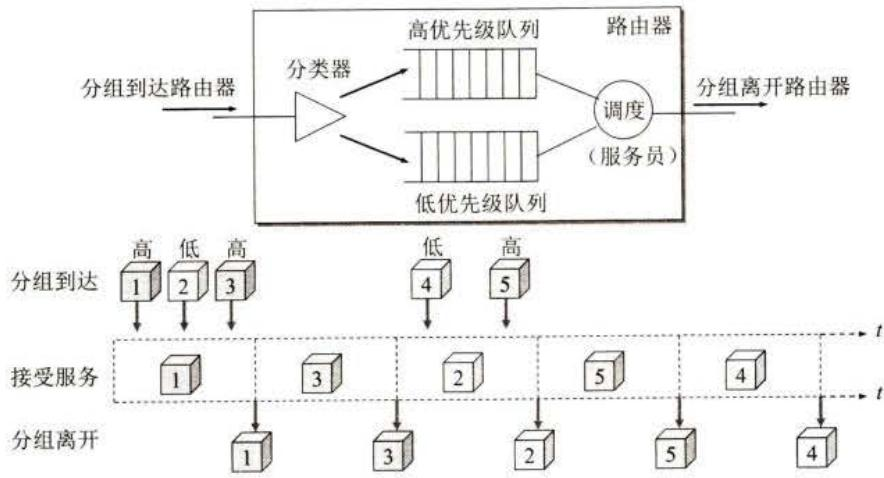
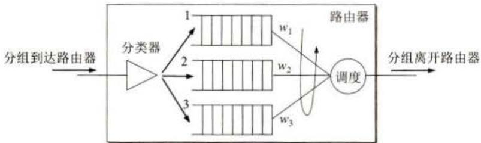
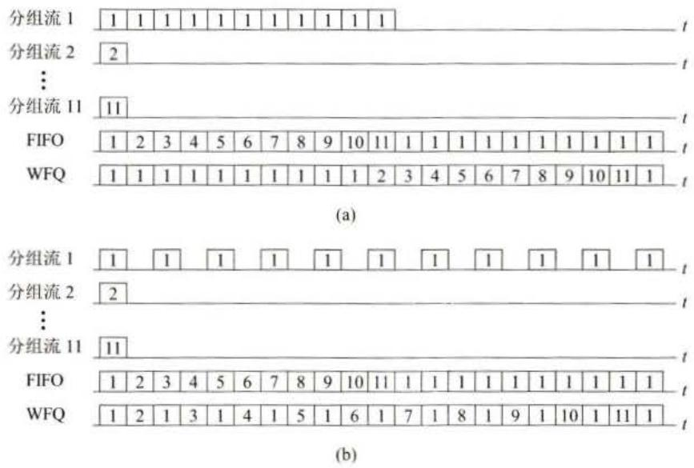
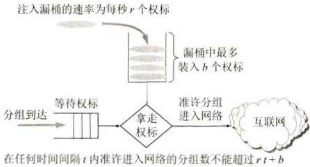
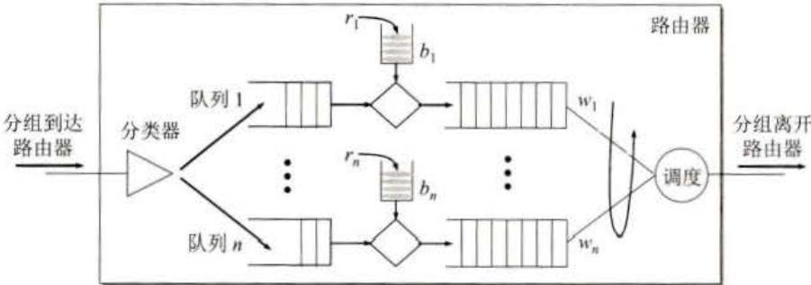

# 8.4.2 调度和管制机制

调度和管制机制是使互联网能够提供服务质量的重要措施[STAL10]。下面先讨论调度机制。

## 1. 调度机制

这里所说的“调度”就是指排队的规则。如果不采用专门的调度机制，那么在路由器的队列采用的默认排队规则就是先进先出 FIFO (First In First Out)。当队列已满时，后到达的分组就被丢弃。先进先出的最大缺点就是不能区分时间敏感分组和一般数据分组，并且也不公平，因为这使得排在长分组后面的短分组要等待很长的时间。就像在机场办理登机卡时，正巧排在你前面的一个人代表 20 个人的团队来办理登机卡，这时你只能耐心等待。

在先进先出的基础上增加按优先级排队，就能使优先级高的分组优先得到服务。图 8-19 是按优先级排队的例子。图中假定优先级分为两种，因此有两个队列：高优先级队列和低优先级队列。

> 图 8-19 按优先级排队的例子（教材第 392 页）

假定分组的到达是按照编号从小到大的顺序。在到达路由器后就由分类器（又称为分类程序）对其进行优先级分类，然后按照类别进入相应的队列。图中的圆圈表示调度，其作用是从队列中取走排在队首的分组。“调度”相当于排队论中的服务员。只要高优先级队列中有分组在内，就从高优先级队列中按照链路速率取出排在队首的分组。只有当高优先级队列已空时，才能轮到低优先级队列中的分组输出到链路上。在图8-19的下方给出三个高优先级的分组（灰色方块）与两个低优先级的分组（白色方块）交替地到达路由器。但在分组离开路由器时，高优先级的分组3和5都提前得到服务。请注意，低优先级的分组2仍然比高优先级的分组5先得到服务。这是因为在分组2得到服务时，分组5还没有到达路由器。当高优先级的分组5到达时，路由器正在发送分组2，因此分组5必须等待分组2离开路由器后才能得到服务。

简单地按优先级排队会带来一个缺点，这就是在高优先级队列中总是有分组时，低优先级队列中的分组就长期得不到服务。这就不太公平。公平排队 FQ (Fair Queuing) 可解决这一问题。公平排队是对每种类别的分组流设置一个队列，然后轮流使每一个队列一次只能发送一个分组。对于空的队列就跳过去。但公平排队也有不公平的地方，这就是长分组得到的服务时间长，而短分组就比较吃亏，并且公平排队并没有区分分组的优先级。

为了使高优先级队列中的分组有更多的机会得到服务，可增加队列“权重”的概念，这就是加权公平排队 WFQ (Weighted Fair Queuing)，其工作原理如图 8-20 所示。

> 图 8-20 加权公平排队 WFQ（教材第 393 页）

加权公平排队 WFQ 是这样工作的：分组到达后就进行分类，然后送交与其类别对应的队列（图中假定分为三类）。三个队列按顺序依次把队首的分组发送到链路。遇到队列空就跳过去。但根据各类别的优先级不同，每种队列分配到的服务时间也不同。可以给队列 i 指派一个权重 $w_{i}$ 。于是队列 i 得到的平均服务时间为 $w_{i}/(\Sigma w_{j})$ ，这里 $\Sigma w_{j}$ 是对所有的非空队列的权重求和。这样，若路由器输出链路的数据率（即带宽）为 R，那么队列 i 将得到的有保证的数据率 $R_{i}$ 应为

$$ R _ {i} = \frac {R \times w _ {i}}{\Sigma w _ {j}}\tag{8-1} $$

加权公平排队 WFQ 在服务质量体系结构中占有重要的地位。当前的许多路由器产品都加入了 WFQ 调度的功能。为了更好地理解 WFQ 的概念，图 8-21 给出了一个简单的例子，并把先进先出 FIFO 的情况也同时画出。我们假定在 WFQ 的情况下，分配给分组流 1 的权重是 0.5（即得到服务的时间占总的服务时间的一半），而分配给其他 10 个分组流的权重都各为 0.05。这样，分组流 2\~11 共 10 个分组流合起来的权重也是 0.5。

在使用先进先出规则时，只有一个队列，因此每个分组流的第一个分组共11个分组排在队首。在图8-21(a)和(b)两种情况下，FIFO的结果都是一样的，即队列中前11分组发送完毕后才能发送分组流中剩下的分组。在使用WFQ时，在图(a)中分组流1先可以发送10个分组（但第11个分组还不能发送），而在图(b)中分组流1和其他的分组流交替地发送。不管是哪一种情况，分组流1都能够得到更多时间的服务。

## 2. 管制机制

前面提到了使用管制机制可以提供服务质量。对一个数据流，我们可根据以下三个方面进行管制：

(1) 平均速率 网络需要控制一个数据流的平均速率。这里的平均速率是指在一定的时间间隔内通过的分组数。但这个时间间隔的选择也说明了这个指标的严格程度。例如，限定数据流的平均速率为每秒 50 个分组和平均速率为每分钟 3000 个分组，虽然这两个指标的平均值都一样，但其严格程度却不同。假定有一个数据流，有一秒钟通过了 1000 个分组，但一分钟平均下来仍不超过 3000 个，那么这个数据流的平均速率符合后面一个指标，但却远远不满足前面的指标。

> 图8-21 WFQ与FIFO的比较（教材第 394 页）

(2) 峰值速率 峰值速率限制了数据流在非常短的时间间隔内的流量。数学上的“瞬时值”在实际网络中无法测定。因此这里所说的“非常短的时间间隔”需要指明时间间隔是多少。例如，限定数据流的平均速率为每分钟 3000 个分组，但同时限定其峰值速率不超过每秒 1000 个分组。峰值速率也同时受到链路带宽的限制。

(3) 突发长度 网络也限制在非常短的时间间隔内连续注入到网络中的分组数。

要在网络中对进入网络的分组流按以上三个指标进行管制，可使用非常著名的漏桶管制器(leaky bucket policer)（可简称为漏桶），其工作原理如图8-22所示。

> 图 8-22 漏桶管制器的工作原理（教材第 394 页）

漏桶是一种抽象的机制。在漏桶中可装入许多权标(token)，但最多装入 $b$ 个权标。只要漏桶中的权标数小于 $b$ 个，新的权标就以每秒 $r$ 个权标的恒定速率加入到漏桶中。但若漏桶已装满了 $b$ 个权标，则新的权标就不再装入，而漏桶的权标数达到最大值 $b$ 。

漏桶管制分组流进入网络的过程如下：分组进入网络前，先要进入一个队列中等候漏桶中的权标。只要漏桶中有权标，就可从漏桶取走一个权标，然后就准许一个分组从队列进入到网络。若漏桶已无权标，就要等新的权标注入到漏桶，再把这个权标拿走后才能准许下一个分组进入网络。请注意：“准许进入网络”并不等于说“已经进入了网络”，因为分组进入网络还需要时间，这取决于输出链路的带宽和分组在输出端的排队情况。

假定在时间间隔 t 中把漏桶中的全部 b 个权标都取走，但在这个时间间隔内漏桶又装入了 rt 个新的权标，因此在任何时间间隔 t 内准许进入网络的分组数的最大值为 $rt + b$ 。控制权标进入漏桶的速率 r 就可对分组进入网络的速率进行管制。

## 3. 漏桶机制与加权公平排队相结合

把漏桶机制与加权公平排队结合起来，可以控制队列中的最大时延。

现假定有 n 个分组流输入到一个路由器，复用后从一条链路输出。每一个分组流使用漏桶机制进行管制，漏桶参数为 $b_{i}$ 和 $r_{i}, i=1,2,\cdots,n$ （如图 8-23 所示）。

> 图 8-23 用漏桶机制进行管制（教材第 395 页）

前面已经讲过，WFQ 可以使每一个分组流得到如公式(8-1)所示的有保证的数据率。那么当分组流通过漏桶后等待 WFQ 服务时，一个分组所经受的最大时延是多少？

现在考虑分组流 i。假定漏桶 i 已经装满了 $b_{i}$ 个权标。这就表示分组流 i 不需要等待就可从漏桶中拿走 $b_{i}$ 个权标，因此 $b_{i}$ 个分组可以马上从路由器输出。但分组流 i 得到的数据率由公式(8-1)给出。这 $b_{i}$ 个分组中的最后一个分组所经受的时延最大，它等于传输这 $b_{i}$ 个分组所需的时间 $d_{max}$ ，即 $b_{i}$ 除以公式(8-1)给出的传输速率：

$$ d _ {\max} = \frac {b _ {i} \Sigma w _ {j}}{R \times w _ {i}}\tag{8-2} $$
