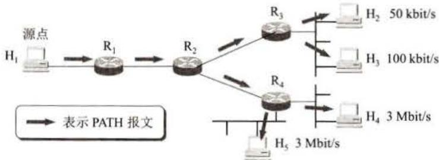
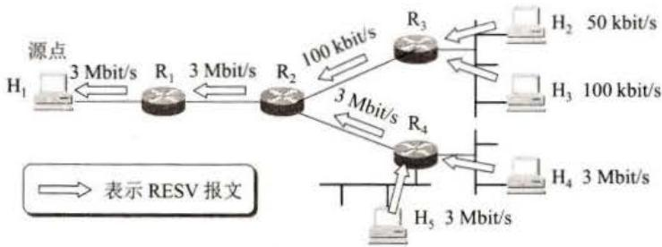
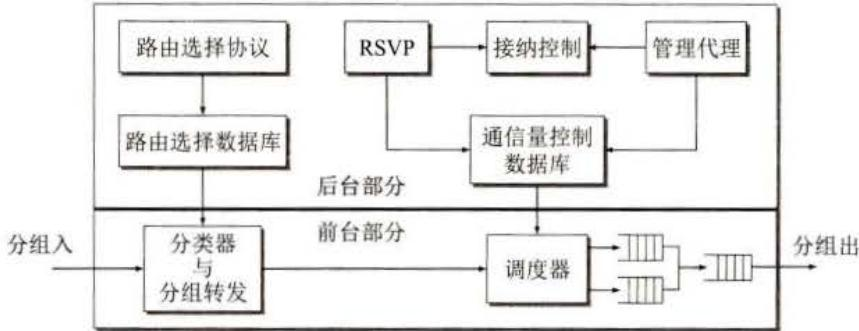

# 8.4.3 综合服务IntServ与资源预留协议RSVP

最初试图在互联网中将互联网提供的服务划分为不同类别的是 IETF 提出的综合服务 IntServ (Integrated Services) [RFC 2210—2215] 和资源预留协议 RSVP (ReSource reservation Protocol) [RFC 2205—2209] [ZHAN93]，其中的某些 RFC 文档已成为互联网的建议标准。

IntServ 可对单个的应用会话提供服务质量的保证，其主要特点有二：

(1) 资源预留。一个路由器需要知道给不断出现的会话已经预留了多少资源（即链路带宽和缓存空间）。

(2) 呼叫建立。一个需要服务质量保证的会话，必须首先在源点到终点路径上的每一个路由器预留足够的资源，以保证其端到端的服务质量的要求。因此，在一个会话开始之前必须先有一个呼叫建立（又称为呼叫接纳）过程，它需要在其分组传输路径上的每一个路由器都参加。每一个路由器都要确定该会话所需的本地资源是否够用，同时还不要影响到已经建立的会话的服务质量。

IntServ 定义了两类服务：

(1) 有保证的服务(guaranteed service)，可保证一个分组在通过路由器时的排队时延有一个严格的上限。

(2) 受控负载的服务(controlled-load service)，可以使应用程序得到比通常的“尽最大努力”更加可靠的服务。

IntServ 共有以下四个组成部分：

(1) 资源预留协议 RSVP，它是 IntServ 的信令协议。

(2) 接纳控制(admission control)，用来决定是否同意对某一资源的请求。

(3) 分类器(classifier)，用来把进入路由器的分组进行分类，并根据分类的结果把不同类别的分组放入特定的队列。

(4) 调度器(scheduler)，根据服务质量要求决定分组发送的前后顺序。

会话必须首先声明它所需的服务质量，以便使路由器能够确定是否有足够的资源来满足该会话的需求。资源预留协议RSVP在进行资源预留时采用了多播树的方式。发送端发送PATH报文（即存储路径状态报文），给所有的接收端指明通信量的特性。每个中间的路由器都要转发PATH报文，而接收端用RESV报文（即资源预留请求报文）进行响应。路径上的每个路由器对RESV报文的请求都可以拒绝或接受。当请求被某个路由器拒绝时，路由器就发送一个差错报文给接收端，从而终止了这一信令过程。当请求被接受时，链路带宽和缓存空间就被分配给这个分组流，而相关的流(flow)状态信息就保留在路由器中。“流”是在多媒体通信中的一个常用的名词，一般定义为“具有同样的源IP地址、源端口号、目的IP地址、目的端口号、协议标识符及服务质量需求的一连串分组”。

图 8-24 用一个简单例子说明 RSVP 协议的要点。设主机 $H_{1}$ 要向互联网上的四台主机 $H_{2}\sim H_{5}$ 发送多播视频节目，在图中这四台主机右边标注的数据率就是这些主机打算以这样的数据率来接收 $H_{1}$ 发送的视频节目。这个视频节目可使用不同的数据率来接收。用较低数据率接收时，图像和声音的质量也就较差了。

主机 $H_{1}$ 先以多播方式从源点 $H_{1}$ 向下游方向发送 PATH 报文，如图 8-24(a) 所示。当 PATH 报文传送到多播路径终点的四台主机（即叶节点）时，每一台主机就向多播路径的上游发送 RESV 报文，指明在接收该多播节目时所需的服务质量等级。路由器若无法预留 RESV 报文所请求的资源，就返回差错报文。若能预留，则把下游传来的 RESV 报文合并构成新的 RESV 报文，传送给自己的上游路由器，最后传送到源点主机 $H_{1}$ 。这些情况如图 8-24(b) 所示。因此，RSVP 协议是面向终点的。

需要注意的是，路由器合并下游的 RESV 报文并不是把下游提出的预留数据率简单地相加而是取其中较大的数值。例如，路由器 $R_{4}$ 收到两个预留 3 Mbit/s 的 RESV 报文，但 $R_{4}$ 向 $R_{2}$ 发送的 RESV 报文只要求预留 3 Mbit/s 而不是 6 Mbit/s（因为向下游方向发送数据是采用可以节省带宽的多播技术）。同理， $R_{3}$ 向 $R_{2}$ 发送的 RESV 报文要求预留 100 kbit/s 而不是 150 kbit/s。最后， $R_{1}$ 向源点 $H_{1}$ 发送的 RESV 报文要求预留 3 Mbit/s。当 $H_{1}$ 收到返回的 RESV 报文后，就开始发送视频数据报文了。

> (a) 源点用多播发送 PATH 报文（教材第 397 页）

> (b) 各终点向源点返回 RESV 报文 图 8-24 RSVP 协议的工作原理（教材第 397 页）

IntServ/RSVP 使得互联网的体系结构发生了根本的变化，因为 IntServ/RSVP 使得互联网不再是提供“尽最大努力交付”的服务。在有关服务质量的协议中，RSVP 是最复杂的。

IntServ/RSVP所基于的概念是端系统中与分组流有关的状态信息。各路由器中的预留信息只存储有限的时间（这称为软状态soft-state），因而各终点对这些预留信息必须定期进行更新。我们还应注意到，RSVP协议不是运输层协议而是网络层的控制协议。RSVP不携带应用数据。图8-25给出了在路由器中实现的IntServ体系结构。

> 图 8-25 IntServ 体系结构在路由器中的实现（教材第 397 页）

IntServ 体系结构分为前台和后台两个部分。前台部分画在下面，包括两个功能块，即分类器与分组转发，分组的调度器。每一个进入路由器的分组都要通过这两个功能块。后台部分画在上面（有灰色阴影的部分），包括四个功能块和两个数据库。这四个功能块是：

\- 路由选择协议，负责维持路由选择数据库。由此可查找出对应于每一个目的地址和每一个流的下一跳地址。

\- RSVP 协议，为每一个流预留必要的资源，并不断地更新通信量控制数据库。

\- 接纳控制，当一个新的流产生时，RSVP 就调用接纳控制功能块，以便确定是否有足够的资源可供这个流使用。

\- 管理代理，用来修改通信量控制数据库和管理接纳控制功能块，包括设置接纳控制策略。

综合服务 IntServ 体系结构存在的主要问题是：

(1) 状态信息的数量与流的数目成正比。例如，对于 OC-48 链路（2.5 Gbit/s）上的主干网路由器，通过 64 kbit/s 的音频流的数目就超过 39000 个。如果对数据率再进行压缩，则流的数目就更多。因此在大型网络中，按每个流进行资源预留会产生很大的开销。

(2) IntServ 体系结构复杂。若要得到有保证的服务，所有的路由器都必须装有 RSVP、接纳控制、分类器和调度器。这种路由器称为 RSVP 路由器。在应用数据传送的路径中只要有一个路由器不是 RSVP 路由器，整个的服务就又变为“尽最大努力交付”了。

(3) 综合服务 IntServ 所定义的服务质量等级数量太少，不够灵活。
