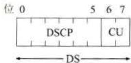
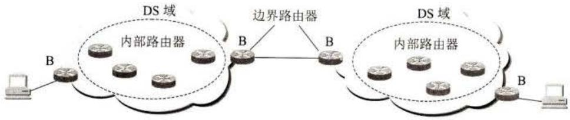
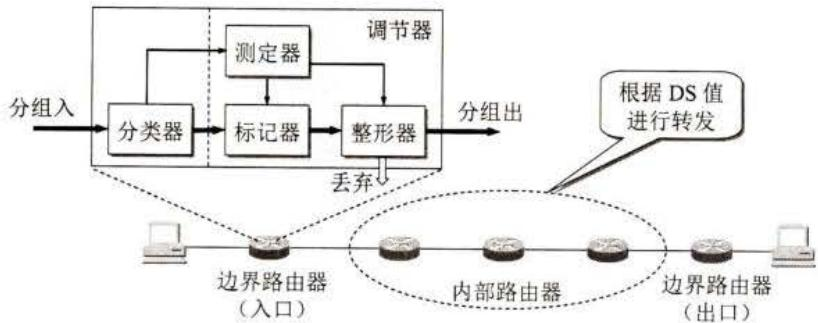

# 8.4.4 区分服务DiffServ

## 1. 区分服务的基本概念

由于综合服务 IntServ 和资源预留协议 RSVP 都较复杂，很难在大规模的网络中实现，因此 IETF 提出了一种新的策略，即区分服务 DiffServ (Differentiated Services) [RFC 2475]。区分服务有时也简写为 DS。因此，具有区分服务功能的节点就称为 DS 节点。

区分服务 DiffServ 的要点如下：

(1) DiffServ 力图不改变网络的基础结构，但在路由器中增加区分服务的功能。因此，DiffServ 将 IP 协议中原有 8 位的 IPv4 的服务类型字段和 IPv6 的通信量类字段重新定义为区分服务 DS（如图 8-26 所示）。路由器根据 DS 字段的值来处理分组的转发。因此，利用 DS 字段的不同数值就可提供不同等级的服务质量。根据互联网的建议标准[RFC 2474]，DS 字段现在只使用其中的前 6 位，即区分服务码点 DSCP (Differentiated Services CodePoint)，再后面的两位目前不使用，记为 CU (Currently Unused)。因此由 DS 字段的值所确定的服务质量实际上就是由 DS 字段中 DSCP 的值来确定的。

> 图 8-26 区分服务码点 DSCP 占 DS 字段的前 6 位（教材第 398 页）

在使用 DS 字段之前，互联网的 ISP 要和用户商定一个服务等级协定 SLA (Service Level Agreement)。在 SLA 中指明了被支持的服务类别（可包括吞吐量、分组丢失率、时延和时延抖动、网络的可用性等）和每一类别所容许的通信量。

(2) 网络被划分为许多个 DS 域 (DS Domain)。一个 DS 域在一个管理实体的控制下实现同样的区分服务策略。DiffServ 将所有的复杂性放在 DS 域的边界节点 (boundary node) 中，而使 DS 域内部路由器工作得尽可能简单。边界节点可以是主机、路由器或防火墙等。为了简单起见，下面只讨论边界节点是边界路由器的情况（原理都是一样的）。图 8-27 给出了 DS 域、边界路由器 (boundary router) 和内部路由器 (interior router) 的示意图。图中标有 B 的路由器都是边界路由器。

> 图 8-27 DS 域、边界路由器和内部路由器的示意图（教材第 399 页）

(3) 边界路由器中的功能较多，可分为分类器(classifier)和通信量调节器(conditioner)两大部分。调节器又由标记器(marker)、整形器(shaper)和测定器(meter)三个部分组成。分类器根据分组首部中的一些字段（如源地址、目的地址、源端口、目的端口或分组的标识等）对分组进行分类，然后将分组交给标记器。标记器根据分组的类别设置DS字段的值。以后在分组的转发过程中，就根据DS字段的值使分组得到相应的服务。测定器根据事先商定的SLA不断地测定分组流的速率（与事前商定的数值相比较），然后确定应采取的行动，例如，可重新打标记或交给整形器进行处理。整形器中设有缓存队列，可以将突发的分组峰值速率平滑为较均匀的速率，或丢弃一些分组。在分组进入内部路由器后，路由器就根据分组的DS值进行转发。图8-28给出了边界路由器中各功能块的关系。

> 图 8-28 边界路由器中的各功能块的关系（教材第 399 页）

(4) DiffServ 提供了一种聚合(aggregation)功能。DiffServ 不是为网络中的每一个流维持供转发时使用的状态信息，而是把若干个流根据其 DS 值聚合成少量的流。路由器对相同 DS 值的流都按相同的优先级进行转发。这就大大简化了网络内部的路由器的转发机制。区分服务 DiffServ 不需要使用 RSVP 信令。

## 2. 每跳行为 PHB

DiffServ 定义了在转发分组时体现服务水平的每跳行为 PHB (Per-Hop Behavior)。所谓“行为”就是指在转发分组时路由器对分组是怎样处理的。“行为”的例子可以是：“首先转发这个分组”或“最后丢弃这个分组”。“每跳”是强调这里所说的行为只涉及本路由器转发的这一跳的行为，而下一个路由器再怎样处理则与本路由器的处理无关。这和 IntServ/RSVP 考虑的服务质量是“端到端”的很不一样。

IETF 的 DiffServ 工作组已经定义了两种 PHB，即迅速转发 PHB 和确保转发 PHB。

迅速转发 PHB (Expedited Forwarding PHB) 可记为 EF PHB，或 EF [RFC 3246，建议标准]。EF 指明离开一个路由器的通信量的数据率必须等于或大于某一数值。因此 EF PHB 用来构造通过 DS 域的一个低丢失率、低时延、低时延抖动、确保带宽的端到端服务（即不排队或很少排队）。这种服务对端点来说像点对点连接或“虚拟租用线”，又称为 Premium（优质）服务。对应于 EF 的区分服务码点 DSCP 的值是 101110。

确保转发 PHB (Assured Forwarding PHB) 可记为 AF PHB 或 AF[RFC 2597，建议标准]。AF 用 DSCP 的第 0\~2 位把通信量划分为四个等级（分别为 001, 010, 011 和 100），并给每一种等级提供最低数量的带宽和缓存空间。对于其中的每一个等级再用 DSCP 的第 3\~5 位划分出三个“丢弃优先级”（分别为 010, 100 和 110，从最低丢弃优先级到最高丢弃优先级）。当发生网络拥塞时，对于每一个等级的 AF，路由器就首先把“丢弃优先级”较高的分组丢弃。

从以上所述可看出，区分服务 DiffServ 比较灵活，因为它并没有定义特定的服务或服务类别。当新的服务类别出现而旧的服务类别不再使用时，DiffServ 仍然可以工作。
