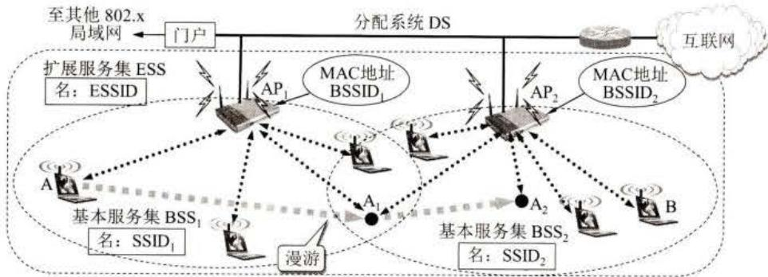
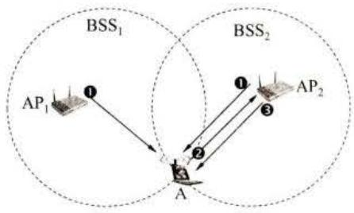
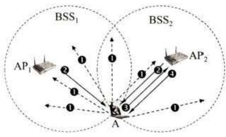
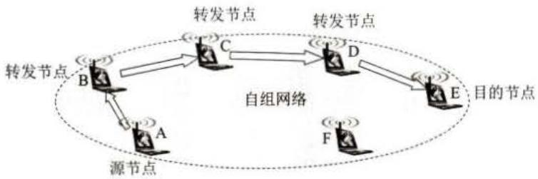
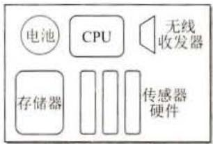

# 9.1.1 无线局域网的组成

## 9.1 无线局域网 WLAN

在局域网刚刚问世后的一段时间，无线局域网的发展比较缓慢，原因是价格贵、数据传输速率低、安全性较差，以及使用登记手续复杂（使用无线电频率必须得到有关部门的批准）。但自20世纪80年代末以来，由于人们工作和生活节奏的加快以及移动通信技术的飞速发展，无线局域网也就逐步进入市场。无线局域网提供了移动接入的功能，这就给许多需要发送数据但又不能坐在办公室的工作人员提供了方便。当一个工厂跨越的面积很大时，若要将各个部门都用电缆连接成网，其费用可能很高；但若使用无线局域网，不仅节省了投资，而且建网的速度也会较快。另外，当大量持有便携式计算机的用户在一个地方同时要求上网时（如在图书馆或股票交易大厅里），若用电缆连网，恐怕连铺设电缆的位置都很难找到。而用无线局域网则比较容易。由于手机普及率日益增高，通过无线局域网接入到互联网已成为当今上网最常用的方式。无线局域网常简写为WLAN(Wireless Local Area Network)。

请读者注意，便携站(portable station)和移动站(mobile station)表示的意思并不一样。便携站当然是便于移动的，但便携站在工作时其位置是固定不变的。而移动站不仅能够移动，而且还可以在移动的过程中进行通信（正在进行的应用程序感觉不到计算机位置的变化，也不因计算机位置的移动而中断运行）。移动站一般使用电池供电。

无线局域网可分为两大类。第一类是有基础设施的，第二类是无基础设施的。本章主要介绍第一类无线局域网。

## 1. IEEE 802.11

对于第一类有基础设施的无线局域网，1997年IEEE制定出无线局域网协议802.11系列标准。2003年5月，我国颁布了WLAN的国家标准，该标准采用ISO/IEC 8802-11系列国际标准，并针对WLAN的安全问题，把国家对密码算法和无线电频率的要求纳入了进来。它是基于国际标准的符合我国安全规范的WLAN标准，是属于国家强制执行的标准。该国标在2004年6月已经正式执行，不符合此标准的WLAN产品将不允许出现在国内市场上。

802.11 是个相当复杂的标准。但简单地说，802.11 就是无线以太网的标准，它使用星形拓扑。无线局域网的中心叫作接入点 AP (Access Point)，它是无线局域网的基础设施，也是一个链路层的设备。接入点 AP 也叫作无线接入点 WAP (Wireless Access Point)。所有在无线局域网中的站点，对网内或网外的通信，都必须通过接入点 AP。现在的无线局域网的接入点 AP 往往具有 100 Mbit/s 或 1 Gbit/s 的端口，用来连接到有线以太网。家庭使用的无线局域网接入点 AP，为了方便居民上网，就把 IP 层的路由器的功能也嵌入进来。因此家用的接入点 AP 往往又称为无线路由器（直接用网线连接到家中墙上的 RJ-45 插孔即可）。但企业或机构使用的接入点 AP 还是和路由器分开的。

802.11 无线局域网的 MAC 层使用 CSMA/CA 协议（在后面的 9.1.3 节讨论）。现在 802.11 系列标准的无线局域网常称为 Wi-Fi。曾经广为流传的“Wi-Fi 是 Wireless-Fidelity 的缩写”其实是错误的（本书的前几个版本也曾这样写过）。这点在 Wi-Fi 的官网可以查到 [W-WiFi]。Wi-Fi 是非营利性国际组织 Wi-Fi 联盟 (Wi-Fi Alliance) 的一个标记。Wi-Fi 联盟对通过其互操作性测试的产品就发给这样的注册商标 WiFi，表明是经过 Wi-Fi 联盟认证的。从 2000 年起到 2020 年，全球有 Wi-Fi 注册商标认证的产品已超过 150 亿个。Wi-Fi 的写法并无统一规定，如 WiFi, Wifi, Wi-fi 等都能在文献中见到。

802.11 标准规定无线局域网的最小构件是基本服务集 BSS (Basic Service Set)。一个基本服务集 BSS 包括一个接入点和若干个移动站（这里所说的移动站，也可包括不经常搬动的台式电脑。这种电脑的主板上都装有 Wi-Fi 适配器）。各站在本 BSS 以内之间的通信，或者与外部站点的通信，都必须通过本 BSS 的接入点。当网络管理员安装 AP 时，必须为该 AP 分配一个不超过 32 字节的服务集标识符 SSID (Service Set IDentifier) $^{①}$ 和一个通信信道。SSID 就是指使用该 AP 的无线局域网的名字。SSID 使用字符串而不使用二进制数字的理由就是字符串便于记忆。一个基本服务集 BSS 所覆盖的地理范围叫作一个基本服务区 BSA (Basic Service Area)。基本服务区 BSA 和无线移动通信的蜂窝小区相似。无线局域网的基本服务区 BSA 的范围直径一般不超过 100 米。我们知道，在网络通信中，链路层设备的唯一标志是其 MAC 地址。接入点 AP 在出厂时就已有了一个唯一的 48 位二进制数字的 MAC 地址，其正式名称是基本服务集标识符 BSSID。在无线局域网中传送的各种帧的首部中，都必须有节点的 MAC 地址（即 BSSID，但不是 SSID）。请不要把 BSSID 和 SSID 弄混。用户通常都知道所连接的无线局域网的名 SSID，但可以不知道其 MAC 地址 BSSID。

> ① 注：例如，对于使用 Windows 10 的计算机，点击 “开始” → “Windows 系统” → “控制面板” → “网络和 Internet” → “网络和共享中心”，下面有三个选项，点击 “连接到网络”，就可以看见在每个无线局域网的覆盖范围内的网络名 SSID。这些网络名可以由设备 AP 的生产厂家预先给出，也可以由局域网的管理员更改为另外的名字。

现在简单介绍一下无线局域网所用的信道(channel)的概念。无线局域网通常使用的频段是 2.4 GHz 和 5 GHz 频段。每一个频段又再划分为若干个信道，供各无线局域网使用。例如，在 2.4 GHz 频段中有大约 85 MHz 的带宽可用。802.11b 标准定义了 11 个部分重叠的信道集。相邻信道的中心频率相差 5 MHz，而每个信道的带宽约为 22 MHz。因此，仅当两个信道由四个或更多信道隔开时它们彼此才无重叠。其中，信道 1, 6 和 11 的集合是唯一的三个非重叠信道的集合。现在已经广泛使用的无线路由器就是典型的接入点设备，并且在出厂时就预先设置了 SSID 和使用的信道（用户也可以自行更改）。例如，当发现附近的接入点使用的频道对自己有干扰时，就可以重新设置本服务集接入点的工作信道。

一个基本服务集可以是孤立的单个服务集，也可通过接入点 AP 连接到一个分配系统 DS (Distribution System)，然后再连接到另一个基本服务集，这样就构成了一个扩展服务集 ESS (Extended Service Set)。ESS 也有个标识符，是不超过 32 字符的字符串名字而不是地址，叫作扩展服务集标识符 ESSID（如图 9-1 所示）。分配系统的作用就是使扩展的服务集 ESS 对上层的表现就像一个基本服务集 BSS 一样。分配系统可以使用以太网（这是最常用的）、点对点链路或其他无线网络。扩展服务集 ESS 还可为无线用户提供到 802.x 局域网（也就是非 802.11 无线局域网）的接入。这种接入是通过叫作门户(portal)的设备来实现的。门户是 802.11 定义的新名词，其实它的作用就相当于一个网桥。在一个扩展服务集内几个不同的基本服务集也可能有相交的部分。图 9-1 中的移动站 A 如果要和另一个基本服务集中的移动站 B 通信，就必须经过两个接入点 AP₁ 和 AP₂，即 A→AP₁→AP₂→B。我们应当注意到，在图 9-1 的例子中，从 AP₁ 到 AP₂ 的通信是使用有线传输的。

> 图 9-1 IEEE 802.11 的基本服务集 BSS 和扩展服务集 ESS（教材第 407 页）

我们还应注意到，图 9-1 所示的两个基本服务集的覆盖范围有重合的地方。为了避免在这种重合的地方出现不同信道的相互干扰，这两个接入点所选择的工作信道，必须相隔 5 个或更多的信道。

图 9-1 画出了移动站 A 漫游的情况。但移动站 A 漫游到图中的位置 $A_{1}$ 时，就能够同时收到两个接入点的信号。这时，移动站 A 可以选择和信号较强的一个接入点联系。当移动站漫游到位置 $A_{2}$ 时，就只能和接入点 $AP_{2}$ 联系了。移动站只要能够和其中一个接入点联系上，就一直可保持与另一个移动站 B 的通信。基本服务集的服务范围是由移动站所发射的电磁波的辐射范围确定的。在图 9-1 中用一个虚线椭圆来表示基本服务区的范围。由于实际地形条件可能是多种多样的，一个服务区的覆盖范围可能是很不规则的几何形状。

802.11 标准并没有定义如何实现漫游，但定义了一些基本的工具。例如，一个移动站若要加入一个基本服务集 BSS，就必须先与某个接入点 AP 建立关联(association)。建立关联就表示这个移动站加入了选定的 AP 所属的子网，并和这个接入点 AP 创建了一个虚拟线路。只有已关联的 AP 才向这个移动站发送数据帧，而这个移动站也只有通过关联的 AP 才能向其他站点发送数据帧。这和手机开机后必须和附近的某个基站建立关联的概念是相似的。

移动站与接入点 AP 建立关联的方法有两种。一种是被动扫描（如图 9-2(a) 所示），其过程如下：

① 接入点 AP 周期性发出（例如每秒 10 次）信标帧(beacon frame)，其中包含有若干系统参数（如服务集标识符 SSID 以及支持的速率等）。图 9-2(a) 表示移动站 A 收到了两个接入点发出的信标帧。

② 移动站 A 扫描 11 个信道，选择愿意加入接入点 AP₂ 所在的基本服务集 BSS₂，于是向 AP₂ 发出关联请求帧(Association Request frame)。

③ 接入点 $AP_{2}$ 同意移动站 A 发来的关联请求，向移动站 A 发送关联响应帧(Association Response frame)。

这样，移动站 A 和接入点 $AP_{2}$ 的关联就建立了。

> (a)（教材第 408 页）

> (b) 图 9-2 被动扫描(a)与主动扫描(b)（教材第 408 页）

另一种建立关联的方法是主动扫描（如图 9-2(b) 所示），其步骤如下：

① 移动站 A 主动发出广播的探测请求帧(Probe Request frame)，让所有能够收到此帧的接入点都能够知道有移动站要求建立关联（见图 9-2(b) 中的多个虚线箭头）。

② 现在两个接入点都回答探测响应帧(Probe Response frame)。

③ 移动站 A 向 $AP_{2}$ 发出关联请求帧。

④ 接入点 $AP_{2}$ 向移动站 A 发送关联响应帧，与移动站 A 建立了关联。

为了使一个基本服务集 BSS 能够为更多的移动站提供服务，往往在一个 BSS 内安装有多个接入点 AP。有时一个移动站也可以收到本服务集以外的 AP 信号。移动站只能在多个 AP 中选择一个建立关联。通常可以选择信号最强的一个 AP。但有时也可能该 AP 提供的信道都已被其他移动站占用了。在这种情况下，也只能与信号强度稍差些的 AP 建立关联。

此后，这个移动站就和选定的 AP 互相使用 802.11 关联协议进行对话。移动站点还要向该 AP 鉴别自身。现在的接入点 AP 在出厂时就已经嵌入了 DHCP 模块。因此在关联建立后，移动站点通过关联的 AP 向该子网发送 DHCP 发现报文就可以获取 IP 地址。这时，互联网中的其他部分就把这个移动站当作该 AP 子网中的一台主机。

若移动站使用重建关联(reassociation)服务，就可把这种关联转移到另一个接入点。当使用分离(dissociation)服务时，就可终止这种关联。

一个移动站可以同时进行主动扫描和被动扫描，这样可以更加迅速地和 AP 建立关联。802.11 标准没有规定移动站应选择哪一种扫描方式。但很多移动站愿意使用被动扫描，这样可以节省移动站的电源功率消耗。

现在许多地方，如办公室、机场、快餐店、旅馆、购物中心等都能够向公众提供有偿或无偿接入 Wi-Fi 的服务。这样的地点就叫作热点(hot spot)。由许多热点和接入点 AP 连接起来的区域叫作热区(hot zone)。热点也就是公众无线入网点。

由于无线局域网已非常普及，因此现在无论是智能手机、智能电视机或计算机，其主板上都已经有了内置的无线局域网适配器，能够实现802.11的物理层和MAC层的功能。只要在无线局域网信号覆盖的地方，用户就能够通过接入点AP连接到互联网。

无线局域网用户在和附近的接入点 AP 建立关联时，一般还要键入用户口令。键入正确后，才能和在该网络中的 AP 建立关联。在无线局域网发展初期，这种接入加密方案称为 WEP (Wired Equivalent Privacy，意思是“有线等效的保密”)，它曾经是 1999 年通过的 IEEE 802.11b 标准中的一部分。然而 WEP 的加密方案有安全漏洞，因此现在的无线局域网普遍采用了保密性更好的加密方案 WPA（WiFi Protected Access，意思是“无线局域网受保护的接入”）或其第二个版本 WPA2。现在 WPA2 是 802.11n 中强制执行的加密方案，微软的 Windows 10 支持 WPA2。这表明只有在电脑屏幕上弹出的口令窗口键入正确的口令后，才能与其 AP 建立关联。

## 2. 移动自组网络

另一类无线局域网是无固定基础设施的无线局域网，它又叫作自组网络(ad hoc network) $^{①}$ 。这种自组网络没有上述基本服务集中的接入点AP，而是由一些处于平等状态的移动站相互通信组成的临时网络（如图9-3所示）。图中还画出了当移动站A和E通信时，经过A→B, B→C, C→D和最后D→E这样一连串的存储转发过程。因此，在从源节点A到目的节点E的路径中，移动站B, C和D都是转发节点，这些节点都具有路由器的功能。由于自组网络没有预先建好的网络固定基础设施（基站），因此自组网络的服务范围通常是受限的，而且自组网络一般也不和外界的其他网络相连接（当然也不能接入到互联网）。移动自组网络也就是移动分组无线网络。

自组网络通常是这样构成的：一些可移动的设备发现在它们附近还有其他的可移动设备，并且要求和其他移动设备进行通信。随着便携式电脑和智能手机的普及，自组网络的组网方式已受到人们的广泛关注。由于在自组网络中的每一个移动站，都要参与到网络中其他移动站的路由的发现和维护，同时由移动站构成的网络拓扑有可能随时间变化得很快，因此在固定网络中行之有效的一些路由选择协议对移动自组网络已不适用。这样，在自组网络中路由选择协议就引起了特别的关注。另一个重要问题是多播。在移动自组网络中往往需要将某个重要信息同时向多个移动站传送。这种多播比固定节点网络的多播要复杂得多，需要有实时性好而效率又高的多播协议。在移动自组网络中，安全问题也是一个更为突出的问题。

> ① 注：拉丁语 ad hoc 本来的意思是“仅为此目的(for this purpose only)”，并且通常还有“临时的”含义。译成中文就是“特定的”。直译 ad hoc network 就是“特定网络”。但由于这种网络的组成并不需要使用固定的基础设施，因此可意译为“自组网络”，表明不需要固定基站而仅依靠移动站自身就能组成网络。

> 图 9-3 由处于平等状态的一些便携机构成的自组网络（教材第 410 页）

移动自组网络在军用和民用领域都有很好的应用前景。在军事领域中，由于战场上往往没有预先建好的固定接入点，其移动站就可以利用临时建立的移动自组网络进行通信。这种组网方式也能够应用到作战的地面车辆群和坦克群，以及海上的舰艇群、空中的机群。由于每一个移动设备都具有路由器转发分组的功能，因此分布式的移动自组网络的生存性非常好。在民用领域，持有笔记本电脑的人可以利用这种移动自组网络方便地交换信息，而不受便携式电脑附近没有电话线插头的限制。当出现自然灾害时，在抢险救灾时利用移动自组网络进行及时通信往往也是很有效的，因为这时事先已建好的网络基础设施（基站）可能都已经被破坏了。

近年来，移动自组网络中的一个子集——无线传感器网络 WSN (Wireless Sensor Network) 引起了人们广泛的关注。无线传感器网络是由大量传感器节点通过无线通信技术构成的自组网络。无线传感器网络的应用就是进行各种数据的采集、处理和传输，一般并不需要很高的带宽，但是在大部分时间必须保持低功耗，以节省电池的消耗。由于无线传感节点的存储容量受限，因此对协议栈的大小有严格的限制。此外，无线传感器网络还对网络安全性、节点自动配置、网络动态重组等方面有一定的要求。

据统计，全球 98% 的处理器并不在传统的计算机中，而是处在各种家电设备、运输工具以及工厂的机器中。如果在这些设备上能够嵌入合适的传感器和无线通信功能，就可能把数量极大的节点连接成分布式的传感器无线网络，因而能够实现连网计算和处理。

图 9-4 是典型的传感器节点的组成，它的主要构件包括 CPU、存储器、传感器硬件、无线收发器和电池。

无线传感器网络中的节点基本上是固定不变的，这点和移动自组网络有很大的区别。无线传感器网络主要的应用领域就是组成各种物联网 IoT (Internet of Things)。下面是物联网的一些举例：

(1) 环境监测与保护（如洪水预报、动物栖息的监控）；

(2) 战争中对敌情的侦查和对兵力、装备、物资等的监控；

> 图 9-4 传感器节点的主要构件（教材第 411 页）

(3) 医疗中对病房的监测和对患者的护理；

(4) 在危险的工业环境（如矿井、核电站等）中的安全监测；

(5) 城市交通管理、建筑内的温度/照明/安全控制等。

关于无线传感器网络更详细的内容可参阅[COMM02]。

顺便指出，移动自组网络和移动 IP 并不相同。移动 IP 技术使漫游的主机可以用多种方式连接到互联网。漫游的主机可以直接连接到或通过无线链路连接到固定网络上的另一个子网。支持这种形式的主机移动性需要地址管理和增加协议的互操作性，但移动 IP 的核心网络功能仍然是基于在固定互联网中一直在使用的各种路由选择协议。但移动自组网络是把移动性扩展到无线领域中的自治系统，它具有自己特定的路由选择协议，并且可以不和互联网相连。即使在和互联网相连时，移动自组网络也是以末梢网络(stub network)方式工作的。所谓“末梢网络”就是通信量可以进入末梢网络，也可以从末梢网络发出，但不允许外部的通信量穿越末梢网络。

最后需要弄清在文献中经常要遇到的、与接入有关的几个名词。

固定接入(fixed access)——在作为网络用户期间，用户设置的地理位置保持不变。

移动接入(mobility access)——用户设备能够以车辆速度（一般取为 120 km/h）移动时进行网络通信。当发生切换（即用户移动到不同蜂窝小区）时，通信仍然是连续的。

便携接入(portable access)——在受限的网络覆盖面积中，用户设备能够在以步行速度移动时进行网络通信，提供有限的切换能力。

游牧接入(nomadic access)——用户设备的地理位置至少在进行网络通信时保持不变。如果用户设备移动了位置（改变了蜂窝小区），那么再次进行通信时可能还要寻找最佳的基站。

也有的文献把便携接入和游牧接入当作一样的，定义为可以在通信时以步行速度移动。这点在阅读文献时应加以注意。
